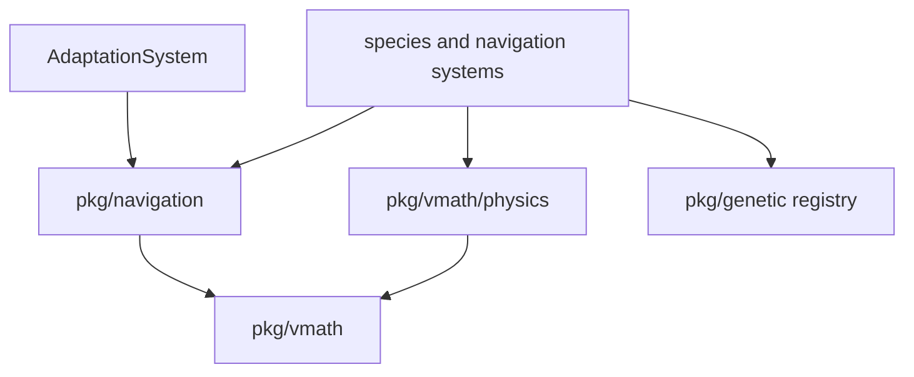
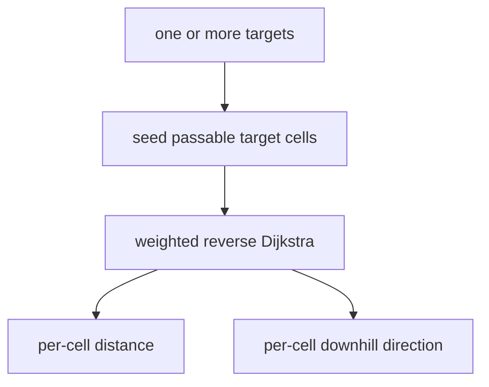
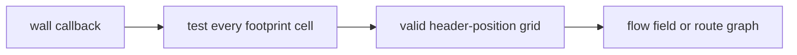
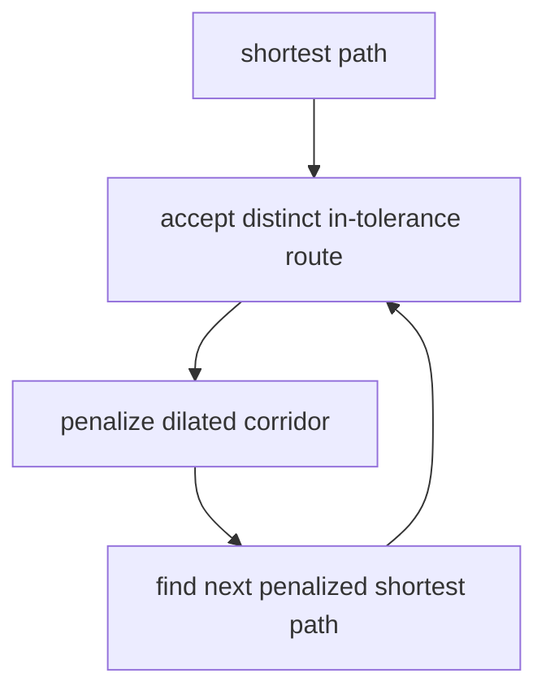
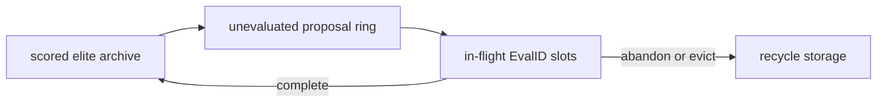

# Navigation, Physics, Adaptation, and Evolution

vif's moving actors share reusable math and algorithm packages, while
systems retain game-specific policy. This document covers four related layers:
grid navigation, continuous movement/collision, route adaptation, and genetic
parameter evolution.

## 1. Package relationships



`pkg/navigation` and `pkg/vmath/physics` accept data/callbacks instead of reaching
directly into the ECS where practical. `NavigationSystem` adapts wall/target
resources to those APIs. `GeneticSystem` adapts entity lifetime events to the
generic evolutionary registry. `AdaptationSystem` is separate from genetics:
it learns route selection, not actor parameters.

## 2. Flow fields

A `FlowField` runs weighted Dijkstra outward from one or more target cells and
stores, for every reachable cell, the direction that descends toward a target.

| Step | Weighted cost |
|---|---|
| Horizontal | 10 |
| Vertical | 20 |
| Diagonal | 22 |

The asymmetric costs compensate for a terminal cell's approximate 2:1 visual
aspect ratio. Eight-way movement is allowed, but a diagonal cannot cut the
corner when either adjacent cardinal cell is blocked.



If a requested target cell is blocked, the field searches outward up to eight
cells and seeds the first passable ring as virtual targets with axis-weighted
gap costs. This lets a large actor navigate toward an occupied anchor without
pretending its footprint can stand in the blocked cell.

Generation stamps avoid clearing full distance/direction arrays on each
recompute. Every grid Dijkstra in the package, the route search included, runs
on one scratch type, `gridSearch`: the wall test asked once per cell into a reused
grid with a blocked border, so a neighbour is one load; one mask of open
directions that states the corner rule; and, since step costs are small
integers, a ring of distance buckets rather than a heap, which settles a cell in
constant time. Cells of equal distance settle in bucket order, so a tie may
point either of two shortest ways. `DirNone` identifies blocked/unreachable
cells and `DirTarget` a seed/arrival cell. Navigation and loot pass
`Position.WallTest`, a grid read from the wall store on the derivation's first
probe, exact to `HasBlockingWallAt` under any wall change between derivations.
The field is fuzzed against a reference heap search: equal distances
everywhere, and every direction a shortest step. At 199x97 a field computes in
about 1.1 ms native and 3.0 ms under WASM.

## 3. Flow-field cache and target groups

Computing a field over a large map every 50 ms tick is too expensive, so
`FlowFieldCache` latches dirty state and throttles recomputation. A field falls
due:

- at once when it has no field or the target count changes. `ObserveGrid` drops
  the field when the passability it was computed on changes; navigation names
  that grid by a generation that moves with any wall or passability change, so a
  grid seen at the same generation is not compared again;
- after a cooldown (`NavFlowMinTicksBetweenCompute`, 5 ticks), when marked dirty
  (a target group update, and for composite fields a wall or regraph event) or
  a target drifted the Manhattan dirty distance (`NavFlowDirtyDistance`, 5 cells);
- after `NavFlowSettleTicks` (20) for a smaller drift: a field a few cells off
  points the same way everywhere but beside the target, where sight takes over.

A cursor's motion reaches the field only through that drift. Navigation's group
caches are lazy: a field that falls due is computed when something first reads
it that Update — a pursuer without sight of its target, a snake choosing whom to
lock, the debug view — so a group nobody chases costs a cheap reachability check.
The throttle decides exactly as it would eagerly, which is what keeps the D-17
phase identical between an instance whose drains read a field and one with none.

Target groups allow multiple actors/structures to define one navigation goal.
Group 0 contains the live cursor roster up to the eight-target navigation cap
(`MaxTargetsPerGroup`); script groups 1–15 (`MaxTargetGroups` is 16) hold up to
eight `TargetAnchor` entities, follow one entity, hold a fixed cell, or mirror
the cursor roster. A field seeded from a group naturally selects the nearest
reachable target at each cell. While any snake head lives, each cursor also gets
a private group (`MaxTargetGroups` + roster slot): a head compares the composite
fields of those groups to lock the cursor it reaches soonest (`LockedTarget`),
keeps a reachable lock until another route is over a third shorter, and steers
by its cursor's group.

That nearest-target property is the group model's boundary. "Nearest reachable
cursor" is the right answer for a hostile species and the wrong one for anything
that belongs to a *particular* participant. Loot is the case: a drop is owned by
the cursor whose kill produced it, it is player-domain, and only that cursor may
collect it. Steered by group 0 it would walk to whichever cursor is nearer and
stall there, and a line-of-sight flag computed against that nearest cursor while
the movement homes at the owner would read "direct path" beside somebody else's
cursor and drive the drop into the wall between it and its own.

`LootSystem` therefore keeps one single-goal field per owner cursor, built from
the same `FlowFieldCache` and the same shared walls, and does its own
line-of-sight check against the same cursor it steers toward. No field covers a
wall cell, so a drop a wall lands on without displacing it — a correction installs
shared walls under player-domain loot — is pushed out as a spawn displaces it. A
field is built the first time a cursor drops something and released when that
cursor goes; a tick with none of its drops in flight recomputes nothing. Anything
else that becomes owned rather than contested belongs on the same seam: give it a
private single-goal field, do not add a target group per participant.

`NavigationComponent` records whether an actor follows a group flow field or a
route graph, the graph/route IDs, a snake head's locked cursor, and each tick's
output: `HasDirectPath` when the target is in sight (area line of sight for a
composite), otherwise the flow vector. Species systems turn that output into a
homing target through `ResolveMovementTarget` (`targeting.go`) — the target
itself in sight, else a point `FlowLookahead` cells along the flow — and integrate
their own motion. Loot carries no `NavigationComponent`: its route is its
owner's, not its group's.

## 4. Composite passability

Point passability is insufficient for a 5-by-3 eye or other composite.
`CompositePassability` precomputes whether the entire footprint fits at every
candidate header coordinate, using header-to-top-left offsets.



It supports full rebuilds and region-of-interest rebuilds after local changes.
Its `IsBlocked` callback can be handed directly to flow-field and route-graph
algorithms. As a result, a path guarantees footprint clearance at sampled
header cells, rather than requiring the species to correct point paths after
the fact. Navigation keeps one grid, for the eye's 5×3 footprint that the quasar
and snake head share; every composite navigator, the 4×2 swarm included, steers
by it.

## 5. Route graphs

A route graph generates several meaningfully distinct, near-optimal corridors
between a source and target:

1. run a normal weighted Dijkstra to establish the optimal distance;
2. accept the path if within the configured tolerance;
3. dilate its corridor and penalize those cells;
4. rerun penalized Dijkstra to push the next candidate elsewhere;
5. reject paths whose corridor overlap is above the configured percentage;
6. stop at the route limit, attempt limit, no path, or excessive true cost.

A graph's searches share one `gridSearch`: passability read once per graph into
the bordered grid, which the corridor dilation reads as well, one corner rule,
and the bucket ring, sized past the largest penalty a cell carries. The search
is fuzzed against relaxation to a fixpoint. A graph at 200x100 costs about 10 ms
native.



Each accepted route stores decimated waypoints, true weighted distance, a
normalized inverse-distance initial weight, and a flow field constrained to its
dilated corridor. The graph also records the footprint/header offsets used to
compute it and the passability generation it was computed on.

A gateway spawned to route by graph requests one at once
(`EventRouteGraphRequest`). Graphs live in `RouteGraphResource`, keyed by the
gateway's `RouteDistID`, and each computed graph (`EventRouteGraphComputed`)
starts its adaptation entry. Gateways attach the graph ID and a route ID popped
from the adaptation pool to spawned eyes. A route steers only while its graph
is fresh — computed on the current generation, toward a cell a live group target
still occupies — and only while the actor is inside its corridor; otherwise the
actor steers by its group field. Navigation rebuilds at most one stale gateway
graph per `NavRouteRebuildInterval` (20 ticks), and `EventNavigationRegraph`
drops every graph and route assignment for that budget to rebuild. `:graph` and
`:flow` expose the structures through the debug renderer.

## 6. Online route adaptation

`AdaptationSystem` maintains an independent route population for each
`(routeGraphID, species subtype)`; the subtype is the eye type, which the gateway
resolves from the genotype before it pops a route. A newly computed graph seeds
subtype 0 from inverse-distance route weights; another subtype's population
clones subtype 0's weights the first time a spawn pops a route for it. A
recomputed graph starts its entry over, since its route indices change.

For each graph-routed species it caches route metadata before destruction. On
death, fitness is:

```text
progress = clamp(1 - remainingCorridorDistance / routeDistance, 0, 1)
efficiency = shortestRouteDistance / chosenRouteDistance
fitness = progress * efficiency
```

If collision knocked an actor just outside its corridor, a radius-five ring
search recovers the nearest valid corridor distance with an aspect-weighted gap
penalty. An actor disappearing without a normal death contributes zero.

The code names its update `applyEXP3`, but it is multiplicative-weights/Hedge
over the mean observed fitness per arm: rewards are not importance-weighted as
canonical EXP3 requires. It:

- multiplies an observed route weight by `exp(RouteLearningRate * meanFitness)`;
- normalizes all weights;
- applies a 0.5% floor to avoid numeric extinction;
- samples 90% proportionally by CDF and 10% as uniform scouts;
- shuffles the result into a pool of `RoutePoolDefaultSize` (100) assignments
  that spawns pop, refilled after each update and once fewer than a quarter
  remain; an exhausted pool rotates through the routes deterministically.

This distinction matters when reasoning about statistical guarantees. The
policy is a pragmatic online route selector, not a textbook adversarial
bandit implementation.

Gateway despawn marks its adaptation entry as draining. After
`RouteDrainTimeout` (60 s), the system removes the entry, route graph, and
buffered outcomes, once in-flight actors have had time to finish. The weights,
pools and consumer heads travel in the D-19 capture
(`engine.AdaptationState`), so a join or correction pops the same next route.

## 7. Genetic library

`pkg/genetic` offers two engines over generic solution and numeric fitness
types:

| Engine | Model | Suitable use |
|---|---|---|
| `StreamingEngine` | Caller-driven steady-state archive with asynchronous evaluation IDs. | Long-lived simulation actors whose score arrives on death. |
| `Engine` | Conventional synchronous generational evolution with optional parallel evaluators. | Offline/on-demand objective functions. |

The streaming engine separates:



Only scored candidates enter the fixed-capacity, descending archive, so elitism
is structural, and an optional equality hook rejects a genotype already archived
at the same score, so the archive does not fill with clones of its best member.
Outcome count advances generations. The proposal ring is bounded; the pending
table is direct-mapped by id, so an evaluation is abandoned explicitly or
evicted once `PendingCapacity` later evaluations have started. The registry
manages up to 256 independent species through atomic slots, so sampling and
stats find a species without a lock.

The root `genetic` package uses `math/rand/v2` PCG streams and depends only on the
standard library. `Seed` is explicit (`0` is valid), and deterministic queue
refill is the default, so a seed plus one operation sequence yields one proposal
stream without consulting wall time. `StreamingEngine.Checkpoint`/`Restore`
carry the complete continuation point: PCG position, archive, queued proposals,
pending evaluations, partial generation, IDs and counters. Archive-only
`Snapshot`/`Inject` remain available when learned candidates should persist but
in-flight work need not.

Operators include tournament/roulette selection, uniform/N-point crossover,
bounded or Gaussian perturbation, capacity-reusing slice cloning, and a
normalized gene-spread diversity metric. The optional fitness/tracking packages
scalarize multi-metric lifetimes, and the optional persistence package provides
atomic store/codecs without coupling the core engine to disk.

## 8. Game genetic adapter

The live game constructs `registry.NewRegistry(nil)`, so population state is
in memory only. Species register gene count, bounds, perturbation, probe bins,
and composite policy through `EventGeneticRegisterSpecies`. The FSM's
tower-defense regions declare the eye: one gene in [0, 1] that
`parameter.GeneBounds.Bin` decodes into one of seven eye types, with seven probe
bins so scouts keep every type under evaluation. A gateway samples an evolved
genotype, or a stratified scout for `GAScoutRate` (8%) of its spawns, and
passes `EvalID`/genes in the spawn request; an eye that cannot spawn abandons
its evaluation.

`GeneticSystem` tracks each evaluated eye's:

- closest squared distance to any target in its target group;
- whether its self-destruct caught a target, credited at
  `CombatDamageEyeSelfDestruct`;
- subtype, species, target group, and evaluation ID;
- termination through normal death or loss of navigation state.

At completion it converts closest approach (relative to the map diagonal) plus
weighted, saturating damage into fitness and reports it to the eye population.
Runs with no positional signal are abandoned rather than scored as zero.

Re-entering a region repeats its declaration, which the registry refuses as a
duplicate, so a population persists through a run. A game reset (`:new`)
replaces the run: every declared species is deregistered, and the FSM's next
declaration starts a fresh population seeded from the new run's shared root.
Nothing survives process exit; the generic persistence package is available but
not wired into the application.

An authoritative multiplayer capture is different from file persistence. The
genetic D-19 carrier exports each registry engine's complete checkpoint, the
scout PCG/counter, the game adapter's live fitness accumulators, and the species
declarations; an install registers or drops species to match them first, since
`Registry.Import` refuses a differing set. A join or correction therefore
continues with the same next genotype and the same pending evaluation IDs; it
does not restart evolution from the scored archive.

## 9. Physics primitives

`pkg/vmath/physics` owns a `float64` `Kinetic` value that
`component.KineticComponent` embeds:

| Area | Facilities |
|---|---|
| Integration | acceleration/velocity/position integration and grid conversion |
| Bounds/walls | reflection, clamping, restitution, axis-separated substeps (up to 20) |
| Steering | speed caps, homing, arrival slowdown, linear/quadratic drag, turn severity, dead-zone snap, spring to rest |
| Collision | profile-based impulses, additive/override modes, mass ratio, angle/magnitude variance, offset influence for multi-cell hits |
| Shapes | ellipse containment with a radial push direction (`CheckSoftCollision`) over `vmath` ellipse/circle tests |
| Orbital | circular-orbit insertion and attraction, radial damping, equilibrium radius |
| 3D | gravity with soft repulsion, elastic collision, overlap separation and axis reflection on `vmath.Vec3` |

`IntegrateWithBounce` limits a substep to roughly 0.45 cells to reduce wall
tunneling, applies acceleration once before selecting the step count, moves one
axis at a time, restores the prior axis position on a wall, and scales reflected
velocity by restitution. Projectiles with stricter swept collision needs use grid
traversal in their owning system rather than relying only on final-cell overlap.

Homing separates desired cruise speed, acceleration, overspeed drag, arrival
radius, near-target drag/acceleration, and a snap dead zone. The profiles in
`internal/profile/homing.go`, built from `internal/parameter` tunables, choose
these values for loot, missiles, and each homing species. Eyes, quasars and
snake heads apply the overspeed drag only on a direct path (`ApplyHomingScaled`).

Two of those values are read together, because a constant pull toward a target
with nothing damping the sideways component of velocity is an orbit, not an
approach: the radius such a pull sustains is `cruise² / accel`. Overspeed drag
does not break it — a body circling at exactly the cruise speed is never
overspeed — so an actor whose sustained radius falls outside its arrival radius
circles until something else stops it. Loot's 34 cells per second against 60
cells per second squared sustains about nineteen cells, four times its arrival
radius. What forecloses the orbit is the cornering brake (`TurnSeverity` ×
`NavCorneringBrake`), a drag that grows as the heading turns from the target and
acts at any distance; drains, swarms, quasars, eyes and loot apply it. A
missile's zero cruise speed makes its overspeed drag continuous instead; a snake
head has neither.

`SoftCollisionSystem` owns contact between species. A source-by-target matrix
indexed by species holds each rule: swarms, quasars, storm circles and pylons
push swarms and quasars by ellipse overlap, and the Kraken pushes every movable
species through its member footprint and is never pushed back. A hit applies the
rule's collision profile (`internal/profile/collision.go`) as an impulse along
the radial and opens a kinetic-immunity window (`SoftCollisionImmunityDuration`)
that steering and flocking read as displacement; an immune or enraged target is
skipped. A second matrix adds continuous flocking separation: swarms and quasars
repel each other and drains, and drains repel only drains, so shared motion
never reads drain positions. A shared target's impulse draws from a stream
reseeded from the tick and the pair (D-8); a player-domain target's from this
instance's player stream.

## 10. Numeric model and determinism

`pkg/vmath` is a `float64` numeric and geometry package and holds the named math
constants (`TwoPi`, `Golden64`). It provides scalar and vector operations,
lookup-table trig/decay, ellipses/arcs, float grid traversal and cell strips
(`Ray`), and a fast seeded RNG: labelled stream seeds (`DeriveSeed`) and seeds
folded from several values (`MixChain`). `pkg/vmath/physics.Kinetic` stores
precise position in cells, velocity in cells per second, and acceleration in
cells per second squared, all as `float64`.

Integer `Point` and `Area` values describe discrete grid cells; they are not a
fixed-point representation. `Point.Center` is the sanctioned grid-to-precise
conversion and adds the half-cell offset, while `PointAt` uses floor so
negative precise coordinates map to the correct cell. Terminal aspect
correction remains explicit in Y radii, weighted distances, and projection
rather than being encoded in the numeric type.

There is one numeric path for motion and physics: `float64` math, plus integer
values where the domain is inherently cell-indexed. Interactive play races
scheduler/event/input paths for the world lock, so live event timing is not a
bit-exact source contract.

Driven runs define a narrower guarantee: `ModeHeadless`, `ModeReplay` and
`ModeScript` use a `ManualClock` advanced only by `App.Tick`, and all
simulation/content RNG streams derive from the root seed and session. For one
implementation build, a driven run is a pure function of seed, resolved config,
and injected event groups; bit-exact journal replay is claimed for headless
source runs. Floating point still prevents treating that as a cross-platform
lockstep guarantee, and a live journal reconstructs input rather than promising
an identical world.

## 11. Maze generation

`pkg/maze` generates odd-sized stochastic mazes using a recursive backtracker,
and:

- first reserves explicitly positioned or randomly placed rooms (`RoomCount`);
- optionally removes outer borders (`RemoveBorders`);
- adds smart braiding/cycles (`Braiding`) while respecting topology constraints;
- connects rooms to passages and reports their entry points;
- forces start/end cells open;
- solves a BFS path from start to end.

The caller supplies the generator (`Config.Rng`); a nil one selects a fixed
stream, so generation never reads the clock. The wall system draws from its own
PCG stream, derived from the shared root and carried in the capture. On
`EventMazeSpawnRequest` it scales the boolean grid by the request's cell size into
one wall batch and clears the requested rooms; the start, end, solution path and
room entries serve `sandbox/maze`.

## 12. Extension guidance

- Use a shared flow field for many actors with the same footprint/targets; do
  not compute one per entity. Do give an actor whose goal is *one participant's*
  entity its own single-goal field: a group field selects the nearest target,
  which is a different question.
- Pair every homing profile with a damping term that acts at cruise speed — the
  cornering brake, in this codebase. Arrival damping alone leaves an orbit at
  `cruise² / accel` that nothing removes.
- Build composite passability before routing a large footprint.
- Choose route adaptation for path policy and genetics for continuous actor
  parameters; do not mix their fitness meanings.
- Cache entity metadata needed after death because component stores are wiped
  before deferred learning updates may run.
- Treat non-finite values, zero denominators, precision near cell boundaries,
  negative-coordinate flooring, and half-cell conversion as explicit boundary
  cases.
- Add debug/status observability for a new learner before trying to tune it.
- If persistence is enabled, version the gene schema and do not rely on
  process-local IDs.

## 13. Source map

| Concern | Primary source |
|---|---|
| Flow fields/cache | `pkg/navigation/flowfield.go`, `cache.go` |
| Flow steering (interpolation, escape) | `pkg/navigation/steering.go` |
| Owner-scoped loot routing | `internal/system/loot.go` |
| Composite navigation | `pkg/navigation/composite.go` |
| Route generation | `pkg/navigation/routegraph.go` |
| ECS navigation adapter | `internal/system/navigation.go` |
| Movement target from navigation output | `internal/system/targeting.go` |
| Route learning | `internal/system/adaptation.go`, `internal/engine/resource.go`, `adaptation_state.go` |
| Genetic engines | `pkg/genetic/*.go`, `pkg/genetic/README.md` |
| Registry/tracking/persistence | `pkg/genetic/{registry,tracking,fitness,persistence}` |
| Game genetic adapter | `internal/system/genetic.go`, `gateway.go`, `eye.go`, `internal/parameter/genetic.go` |
| Physics | `pkg/vmath/physics/*.go` |
| Homing and collision profiles | `internal/profile/homing.go`, `collision.go` |
| Inter-species contact and flocking | `internal/system/soft_collision.go` |
| Kinetic inventory and refactor plan | `doc/generic-kinetic.md` |
| Numeric/geometry | `pkg/vmath/*.go` |
| Mazes | `pkg/maze/generator.go`, `internal/system/wall.go` |
