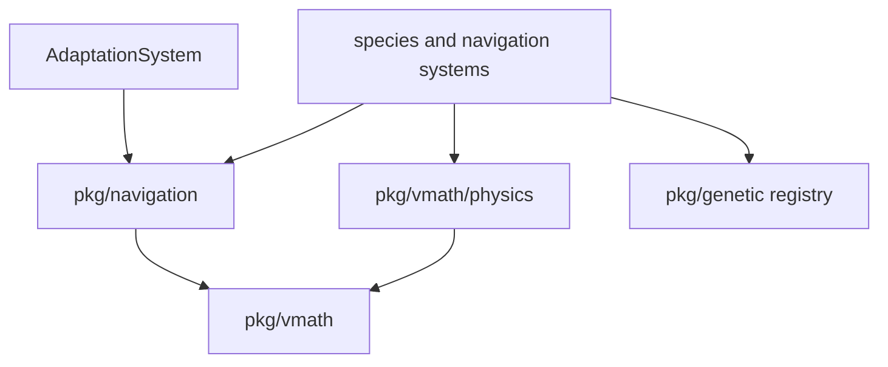
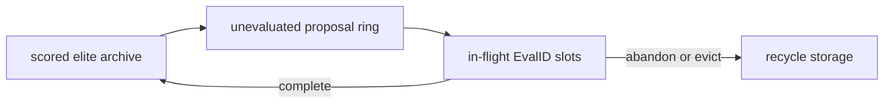

# AI, Physics, and Evolution

vif's moving actors share reusable math and algorithm packages, while
systems retain game-specific policy. This document covers continuous
movement/collision, route adaptation, and genetic parameter evolution; grid
navigation — fields, passability, target groups, the snake lock, route graphs —
is [Navigation](navigation-design.md).

## 1. Package relationships



`pkg/navigation` and `pkg/vmath/physics` accept data/callbacks instead of reaching
directly into the ECS where practical. `NavigationSystem` adapts wall/target
resources to those APIs ([Navigation §1](navigation-design.md#1-structures)).
`GeneticSystem` adapts entity lifetime events to the generic evolutionary
registry. `AdaptationSystem` is separate from genetics: it learns route
selection, not actor parameters.

## 2. Online route adaptation

`AdaptationSystem` maintains an independent route population for each
`(routeGraphID, species subtype)`; the subtype is the eye type, which the gateway
resolves from the genotype before it pops a route. A newly computed graph seeds
subtype 0 from inverse-distance route weights; another subtype's population
clones subtype 0's weights the first time a spawn pops a route for it. A
recomputed graph starts its entry over, since its route indices change.

For each graph-routed species it caches route metadata before destruction. On
death, fitness is:

```text
progress = clamp(1 - remainingCorridorDistance / routeDistance, 0, 1)
efficiency = shortestRouteDistance / chosenRouteDistance
fitness = progress * efficiency
```

If collision knocked an actor just outside its corridor, a radius-five ring
search recovers the nearest valid corridor distance with an aspect-weighted gap
penalty. An actor disappearing without a normal death contributes zero.

The code names its update `applyEXP3`, but it is multiplicative-weights/Hedge
over the mean observed fitness per arm: rewards are not importance-weighted as
canonical EXP3 requires. It:

- multiplies an observed route weight by `exp(RouteLearningRate * meanFitness)`;
- normalizes all weights;
- applies a `RouteMinWeight` (0.5%) floor to avoid numeric extinction;
- samples proportionally by CDF, with `RouteScoutRate` (10%) as uniform scouts;
- shuffles the result into a pool of `RoutePoolDefaultSize` (100) assignments
  that spawns pop, refilled after each update and once fewer than a quarter
  remain; an exhausted pool rotates through the routes deterministically.

This distinction matters when reasoning about statistical guarantees. The
policy is a pragmatic online route selector, not a textbook adversarial
bandit implementation.

Gateway despawn marks its adaptation entry as draining. After
`RouteDrainTimeout` (60 s), the system removes the entry, route graph, and
buffered outcomes, once in-flight actors have had time to finish. The weights,
pools and consumer heads travel in the D-19 capture (`engine.AdaptationState`),
with the route each live eye took and the deaths not yet scored, so a join or
correction pops the same next route and scores the same deaths.

## 3. Genetic library

`pkg/genetic` offers two engines over generic solution and numeric fitness
types:

| Engine | Model | Suitable use |
|---|---|---|
| `StreamingEngine` | Caller-driven steady-state archive with asynchronous evaluation IDs. | Long-lived simulation actors whose score arrives on death. |
| `Engine` | Conventional synchronous generational evolution with optional parallel evaluators. | Offline/on-demand objective functions. |

The streaming engine separates:



Only scored candidates enter the fixed-capacity, descending archive, so elitism
is structural, and an optional equality hook rejects a genotype already archived
at the same score, so the archive does not fill with clones of its best member.
Outcome count advances generations. The proposal ring is bounded; the pending
table is direct-mapped by id, so an evaluation is abandoned explicitly or
evicted once `PendingCapacity` later evaluations have started. The registry
manages up to 256 independent species through atomic slots, so sampling and
stats find a species without a lock.

The root `genetic` package uses `math/rand/v2` PCG streams and depends only on the
standard library. `Seed` is explicit (`0` is valid), and deterministic queue
refill is the default, so a seed plus one operation sequence yields one proposal
stream without consulting wall time. `StreamingEngine.Checkpoint`/`Restore`
carry the complete continuation point: PCG position, archive, queued proposals,
pending evaluations, partial generation, IDs and counters. Archive-only
`Snapshot`/`Inject` remain available when learned candidates should persist but
in-flight work need not.

Operators include tournament/roulette selection, uniform/N-point crossover,
bounded or Gaussian perturbation, capacity-reusing slice cloning, and a
normalized gene-spread diversity metric. The optional fitness/tracking packages
scalarize multi-metric lifetimes, and the optional persistence package provides
atomic store/codecs without coupling the core engine to disk.

## 4. Game genetic adapter

The live game constructs `registry.NewRegistry(nil)`, so population state is
in memory only. Species register gene count, bounds, perturbation, probe bins,
and composite policy through `EventGeneticRegisterSpecies`. The FSM's
tower-defense regions declare the eye: one gene in [0, 1] that
`parameter.GeneBounds.Bin` decodes into one of seven eye types, with seven probe
bins so scouts keep every type under evaluation. A gateway samples an evolved
genotype, or a stratified scout for `GAScoutRate` (8%) of its spawns, and
passes `EvalID`/genes in the spawn request; an eye that cannot spawn abandons
its evaluation.

`GeneticSystem` tracks each evaluated eye's:

- closest squared distance to any target in its target group;
- whether its self-destruct caught a target, credited at
  `CombatDamageEyeSelfDestruct`;
- subtype, species, target group, and evaluation ID;
- termination through normal death or loss of navigation state.

At completion it converts closest approach (relative to the map diagonal) plus
weighted, saturating damage into fitness and reports it to the eye population.
Runs with no positional signal are abandoned rather than scored as zero.

Re-entering a region repeats its declaration, which the registry refuses as a
duplicate, so a population persists through a run. A game reset (`:new`)
replaces the run: every declared species is deregistered, and the FSM's next
declaration starts a fresh population seeded from the new run's shared root.
Nothing survives process exit; the generic persistence package is available but
not wired into the application.

An authoritative multiplayer capture is different from file persistence. The
genetic D-19 carrier exports each registry engine's complete checkpoint, the
scout PCG/counter, the game adapter's live fitness accumulators, and the species
declarations; an install registers or drops species to match them first, since
`Registry.Import` refuses a differing set. A join or correction therefore
continues with the same next genotype and the same pending evaluation IDs; it
does not restart evolution from the scored archive.

## 5. Physics primitives

`pkg/vmath/physics` owns a `float64` `Kinetic` value that
`component.KineticComponent` embeds:

| Area | Facilities |
|---|---|
| Integration | acceleration/velocity/position integration and grid conversion |
| Bounds/walls | reflection, clamping, restitution, axis-separated substeps (up to 20) |
| Steering | speed caps, homing, arrival slowdown, linear/quadratic drag, turn severity, dead-zone snap, spring to rest |
| Collision | profile-based impulses, additive/override modes, mass ratio, angle/magnitude variance, offset influence for multi-cell hits |
| Shapes | ellipse containment with a radial push direction (`CheckSoftCollision`) over `vmath` ellipse/circle tests |
| Orbital | circular-orbit insertion and attraction, radial damping, equilibrium radius |
| 3D | gravity with soft repulsion, elastic collision, overlap separation and axis reflection on `vmath.Vec3` |

`IntegrateWithBounce` limits a substep to roughly 0.45 cells to reduce wall
tunneling, applies acceleration once before selecting the step count, moves one
axis at a time, restores the prior axis position on a wall, and scales reflected
velocity by restitution. Projectiles with stricter swept collision needs use grid
traversal in their owning system rather than relying only on final-cell overlap.

Homing separates desired cruise speed, acceleration, overspeed drag, arrival
radius, near-target drag/acceleration, and a snap dead zone. The profiles in
`internal/profile/homing.go`, built from `internal/parameter` tunables, choose
these values for loot, missiles, and each homing species. Eyes, quasars and
snake heads apply the overspeed drag only on a direct path (`ApplyHomingScaled`).

Two of those values are read together, because a constant pull toward a target
with nothing damping the sideways component of velocity is an orbit, not an
approach: the radius such a pull sustains is `cruise² / accel`. Overspeed drag
does not break it — a body circling at exactly the cruise speed is never
overspeed — so an actor whose sustained radius falls outside its arrival radius
circles until something else stops it. Loot's 34 cells per second against 60
cells per second squared sustains about nineteen cells, four times its arrival
radius. What forecloses the orbit is the cornering brake (`TurnSeverity` ×
`NavCorneringBrake`), a drag that grows as the heading turns from the target and
acts at any distance; drains, swarms, quasars, eyes, snake heads and loot apply
it. It never rests: `TurnSeverity` is `NavCorneringBase` (3) minus the cosine of
the turn, so an actor heading straight at its target still drags at twice the
brake, one heading away at four times, and a drain at twice either. Off a direct
path, where overspeed drag is skipped, that resting drag alone holds the cruise
near accel / (2 × `NavCorneringBrake`), and the turn term spends the overshoot
where a route turns. A missile's zero cruise speed makes its overspeed drag
continuous instead.

`SoftCollisionSystem` owns contact between species. A source-by-target matrix
indexed by species holds each rule: swarms, quasars, storm circles and pylons
push swarms and quasars by ellipse overlap, and the Kraken pushes every movable
species through its member footprint and is never pushed back. A hit applies the
rule's collision profile (`internal/profile/collision.go`) as an impulse along
the radial and opens a kinetic-immunity window (`SoftCollisionImmunityDuration`)
that steering and flocking read as displacement; an immune or enraged target is
skipped. A second matrix adds continuous flocking separation: swarms and quasars
repel each other and drains, and drains repel only drains, so shared motion
never reads drain positions. A data species with mass takes the swarm's and
quasar's part in both, across an ellipse half its footprint; one without takes
neither. A shared target's impulse draws from a stream
reseeded from the tick and the pair (D-8); a player-domain target's from this
instance's player stream.

## 6. Numeric model and determinism

`pkg/vmath` is a `float64` numeric and geometry package and holds the named math
constants (`TwoPi`, `Golden64`). It provides scalar and vector operations,
lookup-table trig/decay, ellipses/arcs, float grid traversal and cell strips
(`Ray`), and a fast seeded RNG: labelled stream seeds (`DeriveSeed`) and seeds
folded from several values (`MixChain`). `pkg/vmath/physics.Kinetic` stores
precise position in cells, velocity in cells per second, and acceleration in
cells per second squared, all as `float64`.

Integer `Point` and `Area` values describe discrete grid cells; they are not a
fixed-point representation. `Point.Center` is the sanctioned grid-to-precise
conversion and adds the half-cell offset, while `PointAt` uses floor so
negative precise coordinates map to the correct cell. Cell aspect correction
remains explicit (`vmath.Aspect`) in Y radii, weighted distances and projection
rather than being encoded in the numeric type.

There is one numeric path for motion and physics: `float64` math, plus integer
values where the domain is inherently cell-indexed. Interactive play races
scheduler/event/input paths for the world lock, so live event timing is not a
bit-exact source contract.

Driven runs define a narrower guarantee: `ModeHeadless`, `ModeReplay` and
`ModeScript` use a `ManualClock` advanced only by `App.Tick`, and all
simulation/content RNG streams derive from the root seed and session. For one
implementation build, a driven run is a pure function of seed, resolved config,
and injected event groups; bit-exact journal replay is claimed for headless
source runs. Floating point still prevents treating that as a cross-platform
lockstep guarantee, and a live journal reconstructs input rather than promising
an identical world.

## 7. Maze generation

`pkg/maze` generates odd-sized stochastic mazes using a recursive backtracker,
and:

- first reserves explicitly positioned or randomly placed rooms (`RoomCount`);
- optionally removes outer borders (`RemoveBorders`);
- adds smart braiding/cycles (`Braiding`) while respecting topology constraints;
- connects rooms to passages and reports their entry points;
- forces start/end cells open;
- solves a BFS path from start to end.

The caller supplies the generator (`Config.Rng`); a nil one selects a fixed
stream, so generation never reads the clock. The wall system draws from its own
PCG stream, derived from the shared root and carried in the capture. On
`EventMazeSpawnRequest` it scales the boolean grid by the request's cell size into
one wall batch and clears the requested rooms; the start, end, solution path and
room entries serve `sandbox/maze`.

The grid is one array; the carve backs out of a dead end along a byte per cell
naming the jump that carved it, with no stack, and the solve runs level by level
over a byte per cell naming the step that reached it, filling the path back to
front at its known length. A region start lays td's maze (99×83, braiding 0.5) in
0.16 ms and 37 kB where it took 1.06 ms and 845 kB, and a 401×121 braided maze
with four rooms takes 1.2 ms and 175 kB where it took 8.9 ms and 7.1 MB
(`BenchmarkGenerate`). The mazes are the same: a digest of every result and of the
caller's stream after it holds across eleven shapes and eight seeds.

## 8. Extension guidance

- Pair every homing profile with a damping term that acts at cruise speed — the
  cornering brake, in this codebase. Arrival damping alone leaves an orbit at
  `cruise² / accel` that nothing removes.
- Choose route adaptation for path policy and genetics for continuous actor
  parameters; do not mix their fitness meanings.
- Cache entity metadata needed after death because component stores are wiped
  before deferred learning updates may run.
- Treat non-finite values, zero denominators, precision near cell boundaries,
  negative-coordinate flooring, and half-cell conversion as explicit boundary
  cases.
- Add debug/status observability for a new learner before trying to tune it.
- If persistence is enabled, version the gene schema and do not rely on
  process-local IDs.

## 9. Source map

| Concern | Primary source |
|---|---|
| Route learning | `internal/system/adaptation.go`, `internal/engine/resource.go`, `adaptation_state.go` |
| Genetic engines | `pkg/genetic/*.go`, `pkg/genetic/README.md` |
| Registry/tracking/persistence | `pkg/genetic/{registry,tracking,fitness,persistence}` |
| Game genetic adapter | `internal/system/genetic.go`, `gateway.go`, `eye.go`, `internal/parameter/genetic.go` |
| Physics | `pkg/vmath/physics/*.go` |
| Homing and collision profiles | `internal/profile/homing.go`, `collision.go` |
| Inter-species contact and flocking | `internal/system/soft_collision.go` |
| Kinetic inventory and refactor plan | `doc/generic-kinetic.md` |
| Numeric/geometry | `pkg/vmath/*.go` |
| Mazes | `pkg/maze/generator.go`, `internal/system/wall.go` |
