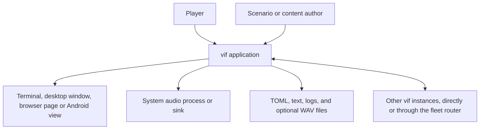
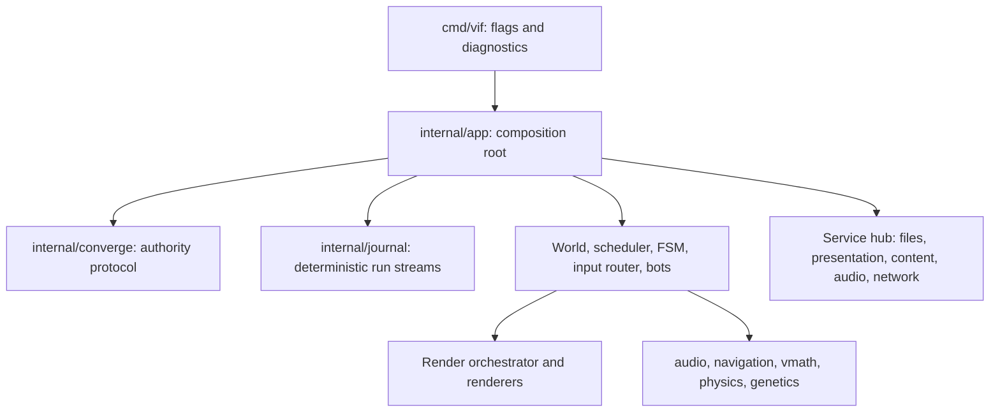
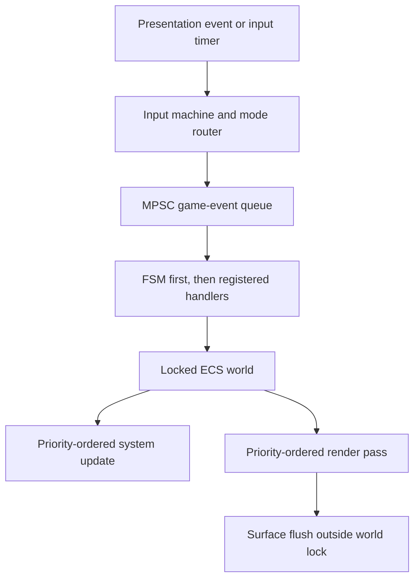

# vif Architecture Overview

vif is a Go terminal game built around a custom entity-component-system
(ECS), an event-settled fixed-step scheduler, a TOML-configured hierarchical
state machine, a layered terminal compositor, and a procedural audio engine.
The game combines vi-style cursor and text operations with real-time combat,
adaptive navigation, and evolving species parameters.

This document is the high-level entry point. The repository imports the
separately maintained `terminal`, `toml`, `color`, and `log` modules. Simulation
math is `float64`, with integer values reserved for discrete grid-cell topology;
the driven runtime's reproducibility is deliberately narrower than a
cross-platform lockstep guarantee.

## 1. System context

The application owns gameplay and orchestration. It delegates terminal
protocol details to `github.com/lixenwraith/terminal`, TOML parsing to
`github.com/lixenwraith/toml`, RGB operations to
`github.com/lixenwraith/color`, and asynchronous log transport to
`github.com/lixenwraith/log`.

## 2. Application containers

The main architectural planes are:

| Plane | Owners | Responsibility |
|---|---|---|
| Composition | `cmd/vif`, `internal/app`, `internal/manifest`, `internal/resource`, `internal/paths` | Resolve options and config roots, construct services/resources/systems/renderers, load the FSM, start and stop the process. |
| Simulation data | `internal/engine`, `internal/component`, `internal/core`, `internal/parameter`, `internal/profile` | Entity identities, typed sparse-set component stores, singleton resources, spatial indexing, shared time/state, tunables, and per-kind profile tables. |
| Simulation behavior | `internal/system`, `internal/fsm`, `internal/event` | Per-tick mechanics, event reactions, encounter control, reset, and system enablement. |
| Interaction | `internal/input`, `internal/mode`, `internal/bot` | Parse terminal events, or step a bot graph, into semantic intents and apply them under the world lock. |
| Authority and convergence | `internal/converge`, `internal/snapshot` | Hold the session's authority term and run its succession, publish the correction cadence, answer the selective manifest exchange, install what arrives, and keep the links a handoff needs. `converge` reads and writes the live world only through the seam the composition root supplies; `snapshot` is the capture wire model and comparison surface. |
| Deterministic run streams | `internal/journal` | Attach recording sinks, capture/load journals, order replay records, generate seeded fuzz input, and execute authored tick scripts through App-independent target contracts. |
| Presentation | `internal/render`, `internal/render/renderer`, `internal/parameter/visual` | Snapshot frame context, layer cells, apply masks/effects, and flush to the presentation's surface. |
| I/O boundaries | `internal/service`, `internal/content`, `internal/network` over `pkg/network`, external modules | Categorized file access, terminal polling, corpus loading, audio device/process management, and framed TCP or WebSocket sessions. |
| Supervision and diagnostics | `internal/lifecycle`, `internal/probe`, `internal/vlog`, `internal/status`, `internal/prof` | An allocated session's lifetime and `/health`/`/metrics` endpoint; the log sink, metric registry, flight recorder and profiler. |
| Reusable algorithms | `pkg/*` | Audio, float64 math/physics, navigation, maze generation, evolution, link pacing, TOML macros, WebSocket framing, and terminal-image conversion. |

See [Package map](package-map.md) for the medium-level dependency view.

## 3. Architectural control flow

`app.Mode` selects one of five application shapes before composition:

| Shape | I/O and presentation | Clock/owner |
|---|---|---|
| `ModePlay` | files, presentation, content, audio, and optional host/join networking, at startup or mid-run; live input and geometry | pause/rate-aware clock; scheduler and event goroutines |
| `ModeHeadless` | files and content; caller supplies geometry and events; authored scripts and bots may add host/join networking | manual clock advanced by a harness, `journal.ScriptDriver` or `bot.Driver` |
| `ModeReplay` | files, presentation, content, audio; recorded input and geometry | manual clock advanced by `journal.ReplayDriver` |
| `ModeScript` | files, presentation, content, audio, and the same optional host/join networking as a headless script; scripted input and geometry | manual clock advanced by `journal.ScriptDriver` or a watched `bot.Driver`, wall-paced |
| `ModeServer` | files, content, and network only; `-size` or first-guest geometry, no input, no local cursor | pause/rate-aware clock; scheduler and event goroutines, as `ModePlay` |

The `Presents`, `Driven`, `Serves`, `OwnsGeometry`, `OwnsInput`, and `Audio`
predicates are the composition policy. A driven App spawns no scheduler/event
goroutines, so for one build its run is a pure function of seed, config, and
injected event groups.

Build capabilities refine that policy before runtime. `vif_headless` stubs the
presentation adapter, refuses every presenting mode and leaves the generated
renderer registry out of the build; it and `vif_noaudio` also remove the audio
service and resource while the generated builder selects lightweight event
sinks. Runtime modes remain the simulation/lifecycle choice, while build profiles
decide which host adapters can be selected at all. The simulation fingerprint
excludes renderers and the local-only audio capability, so a dedicated host and a
full terminal guest retain one session identity. See
[Build profiles and platform boundaries](multi-platform.md).

Interactive play has four cooperating execution paths:

1. The main goroutine selects presentation events, an input ticker, and a render
   ticker. It routes input and flushes frames to the presentation.
2. The scheduler goroutine advances simulation at a nominal 50 ms fixed step,
   gated by frame readiness.
3. The event goroutine settles queued events between simulation ticks and
   remains active while the game is paused.
4. Service-owned goroutines poll the presentation, mix audio, or, in a session,
   perform network I/O.

Queued events are not simply processed once per frame. The scheduler performs
bounded settling passes before the FSM update, after it, and after the systems.
Input can request immediate settling, and a separate event loop handles
inter-tick work. This lets pre-tick, FSM, system, input, and reset cascades
converge before their next dependent phase. The pass after the systems closes
the tick, so nothing its systems produced is still queued when its crossings are
sent, its world is captured or its digest is taken. An iteration cap prevents an
accidental event cycle from monopolizing a thread.

An optional replay journal copies every event of a journaled origin (anything but
a system or this machine's own device) synchronously at queue push. It uses a
dedicated JSONL sink outside diagnostic level/scope and stamps events in a
`(run, tick, settle-boundary)` lattice. A headless
recording can therefore be reinjected at the same boundaries into a fresh
manual-clock App; a live recording reconstructs player input but is not the
source class for which bit-exact world comparison is claimed.

`internal/event` owns the queue-level record/anchor schema; `internal/journal`
owns everything that turns those values into a deterministic external run:
recording lifecycle, in-memory capture, rotated-file loading, replay ordering,
the seeded soak fuzzer, and the authored `-script` format. It imports no App.
`internal/app` supplies narrow adapters and retains configuration identity,
session startup, terminal playback, and process lifetime.

The exact lifecycle and synchronization rules are in
[Runtime and concurrency](runtime.md).

## 4. State ownership and concurrency model

The central invariant is deliberately simple: mutable ECS state has one lock.
The world's `updateMutex` serializes entity/component/position access from the
tick, event, input, reset, and render paths. Component stores and the spatial
grid therefore carry no inner locks.

Exceptions are explicit:

- status metrics and selected context flags use atomics;
- `GameState` owns a small lock for its APM history;
- target groups use their own read/write lock;
- the shared-death prediction ledger has its own mutex, because a derivation is
  recorded from the lock-free push path;
- the RNG stream registry holds a small mutex of its own;
- the audio mixer owns its mutable sequencer/voice state on one goroutine and
  accepts commands over a bounded channel;
- service transports publish into bounded channels and never mutate the world
  from an I/O goroutine.

Diagnostics observe this model rather than participating in it. Status metrics
are per-value atomics; the periodic snapshot and the flight-recorder sample
both run after the world lock is released, so asynchronous logging can never
extend a critical section. See [Logging and diagnostics](logging-and-diagnostics.md).

Presentation output and other potentially blocking I/O happen outside the world
lock. Code reachable from `mode.Router.Handle` must not acquire that lock again,
because it is already held by the application and is non-reentrant.

Reset also has an explicit ownership split. Simulation entities/resources/FSM
state are rebuilt. Operator-owned free-mouse/auto-fire preferences, time scale,
telemetry HUD/pins and standing breakpoints survive plain `:new`; `:new!` clears
the HUD, pins and breakpoints and returns the preferences and time scale to their
startup values. Replay comparison drops that session record plus the exact observer-only
keys in `internal/snapshot/surface.go` rather than treating whole metric groups as
noise.

## 5. Data-oriented ECS

Entities are 64-bit integer identifiers. Most components live in generated,
type-specific sparse sets with dense component and entity slices. This gives
constant-time lookup and swap-removal while preserving compact iteration.
Generated component-mask bookkeeping lets destruction skip stores that an
entity never occupied. Components are pure data: logic over them lives in the
owning system, and the only functions beside them are reads a renderer or mode
shares with a system and the snapshot detach of slice-holding components
([ECS and events](ecs-and-events.md#4-component-catalog)).

The generated stores, capture and delta are emitted into `internal/engine`, so
the engine imports `internal/component`: a build-time dependency, not a design
that names game concepts. `internal/gen-manifest` hardcodes no component; it
parses `internal/manifest/definition.go` and emits templates over whatever that
file lists, the only name it knows being `Position`, and the world, scheduler,
queue, convergence and snapshot code is written over the generated rows, never
over a named component. In the headless binary the generated capture, install and
delta code is 877 KB of text and data against 317 KB of hand-written engine, and
the terminal module the engine's vocabulary comes from links at 14 KB.

Position is specialized rather than being an ordinary generated store. It also
maintains a fixed-capacity spatial grid used for cell queries, wall masks,
line-of-sight, patterns, and nearby free-space searches. Large actors use a
header/member composite model: an invisible or controlling header owns motion
and lifecycle, while member entities provide visible and collidable cells.

Singleton resources hold time, game state, map/camera configuration, the bounded
cursor roster and local-player selection, seeded RNG streams, targets, event
queue, route graphs, adaptive route populations, the genetic registry, transient
and view effects, telemetry and the profiler, and capabilities contributed by
services (files, content, network, audio). The cursors themselves are ordinary ECS
entities created and removed by `CursorSystem`; each owns its energy, heat,
shield, boost, weapon, ping, and combat components. A roster slot also records
whether this instance or a remote peer drives that cursor and, for a bot, which
participant holds it. The mode router and camera follow the selected local slot,
while gameplay systems can iterate or address every cursor through the same
event-driven path.

Every entity, event and RNG stream carries a replication domain. Shared state
is identical on every instance and replicated; player state is this instance's
participant and is never replicated. Systems declare which of the two they read
and write, and which other systems they need, as `SystemDef` data in
`internal/manifest/definition.go`; a test checks each domain declaration against
the code. Startup refuses a dependency on an unknown system or a cycle, and the
dependencies gate disabling a system; they order nothing, since tick order is
`Priority()`'s.

See [ECS and events](ecs-and-events.md) and [the domain model](domain-design.md).

## 6. Data-driven encounter control

The generic HFSM supports hierarchical states and multiple parallel regions.
Each active region has a leaf, a root-to-leaf path, elapsed state time, a pause
flag, and delayed actions. Events and tick transitions bubble from the leaf
toward the root. Transition payloads can be captured into integer variables,
and actions can inject variables into nested event payload fields.

The machine itself is generic. `internal/fsm/std` provides reusable variables,
regions, guards, status/config access, and event actions through a capability
host. `internal/manifest/fsm_bridge.go` binds those capabilities to the ECS and
adds the small amount of game-specific behavior. Scenario and bot-graph documents
expand `pkg/tomlmacro` macros between parsing and decoding
([TOML macros](toml-macros.md)).

Snapshot import has a side-effect-free staging form and a live reconciliation
form. The live form does not replay ordinary actions; it executes only
configuration-marked, persistent `ClassLocal` lifecycle events on state paths an
authoritative capture entered or left. Exits use old variables, entries use the
imported variables, and every release precedes every acquisition. Delayed work is
restored by a deterministic compiled-action identity rather than a queue index.

The embedded scenario runs foreground gameplay regions alongside a background
monitor. Alternate scenarios live under `wad/scenario/`.

Species conduct is the level below. The swarm, the quasar and the storm circles
step a per-entity state machine (`pkg/machine`) their component carries as plain
integers, and a scenario brings species of its own as behavior programs: TOML in
the same dialect, compiled at load against the game's verbs into the same machine,
so a species the engine was not built with adds a program and a prototype, not a
component ([Behavior machines](machine-design.md)).

See [HFSM and configuration](fsm-and-configuration.md) and the detailed
[authoring reference](fsm-reference.md).

## 7. Input as a semantic boundary

The presentation emits keys, mouse reports, resize notifications, and
close/error events in the terminal module's vocabulary, whether it is the
terminal or a window, page or view posting them. `internal/input.Machine`
converts them into pure-data `Intent` values. It understands counts, operators,
motions, character waits, `g` prefixes, search/command text, overlays, and macro
control. Printable keys a scenario captures outrank that grammar and become key
presses, which the router crosses as input events a button can show. It has no
ECS dependency. A bot's graph produces the same intents, keys and mouse alike,
and reaches the world through the same router ([Bots](bots.md)).

`internal/mode.Router` is the authoritative owner of game mode. Under the world
lock, it interprets intents against the current map and components, requests
movement for the local cursor, executes operators/search, publishes combat and
mode events, manages undo/command history, and schedules macro or mouse-repeat
input.

See [Input and modes](input-and-modes.md).

## 8. Rendering boundary

Renderers read ECS state but never write directly to the presentation. The
application first snapshots time, dimensions, camera, and the local cursor into
a value `RenderContext`. The orchestrator then clears a `RenderBuffer`, locks
the world, runs renderers in stable priority order, unlocks, finalizes
compositing, and flushes cells to the presentation's `render.Surface`.

The buffer supports foreground/background-specific blending, write masks,
dirty/touched tracking, deferred background overlays, TrueColor and palette
attributes, and masked grayscale/dim post-processing. The 256-color tier finishes
every frame on a text console's sixteen-color palette. Gameplay coordinates are
map based; `RenderContext` performs map-to-viewport and viewport-to-terminal
transforms.

See [Rendering](rendering.md).

## 9. Audio boundary

`pkg/audio` owns synthesis, pre-rendered sound caches, mixing, voices, harmony,
patterns, and a three-slot sequencer. It has no gameplay or APM concept.
`internal/system.MusicSystem` maps the game's five-second APM signal to tempo
and arrangement intensity; `AudioSystem` translates effect and mute/pause
events.

Audio output is zero-CGO but not device-native on most platforms: the engine
streams 44.1 kHz, 16-bit stereo PCM to an installed process such as `pacat`,
`pw-cat`, `aplay`, SoX `play`, or `ffplay`, or to FreeBSD OSS. Explicit `null`
and `wav:path` sinks support automation and offline capture. Missing backends
degrade to silence rather than aborting gameplay.

Audio service assembly is both mode- and build-dependent: an audio-capable build
registers it for play, replay, and presented scripts; headless and audio-free
builds do not contain the service or full audio systems. Small null systems
consume local audio events and publish the unavailable state so telemetry and
system identity remain stable. Event IDs live in the lightweight `pkg/audio/model`
package, so omitting the engine does not change protocol types. Terminal playback
of a journal takes its mute state, backend and buffer from the viewer's own flags,
since the speakers a run played on are no part of the run.

See [Audio](audio.md).

## 10. Navigation, physics, adaptation, and evolution

Navigation uses aspect-weighted, eight-direction Dijkstra flow fields with
corner-cut prevention. Target groups share cached fields, while multi-cell
actors can use footprint-aware passability. Gateways may request multiple
distinct, penalized shortest-path corridors, each with a constrained flow
field.

Route adaptation is described in code as EXP3, but its current update is more
precisely a multiplicative-weights/Hedge-style learner: it applies exponential
updates to per-route mean fitness without importance weighting, then selects
with proportional exploitation plus a 10% uniform scout rate. This distinction
matters when reasoning about convergence.

The generic genetic library offers both classic generational and streaming
steady-state engines. The game adapter currently evolves eye parameters,
tracking closest approach and successful self-destruct damage as fitness. The
adapter uses an in-memory registry: a population lasts its run, `:new` deregisters
every declared species so the next declaration starts afresh, and no persistence
store is attached. Multiplayer captures use the separate exact-continuation
contract, carrying each streaming engine's PCG position, proposal/pending work and
IDs together with the registry's scout stream and the adapter's live fitness
accumulators.

Gameplay motion uses cell-centered `float64` positions, velocities, and
accelerations. Integer `Point`/`Area` values represent discrete cells, while
floor-based conversion maps precise positions—including negative
coordinates—back to the grid. `pkg/vmath` also provides float lookup-table
trigonometry/decay, vectors, shapes, arcs, traversal, and seeded randomness;
`pkg/vmath/physics` owns the float kinetic container and 2D/3D mechanics. There
is no fixed-point API beside them. Floating-point state and live play's
concurrent scheduling prevent treating the engine as a cross-platform
bitwise-deterministic simulation.

See [Navigation](navigation-design.md) and [AI, physics, and evolution](ai-physics-and-evolution.md).

## 11. Externalized module boundaries

These boundaries belong to separately maintained modules.

| Module | Boundary owned outside this repository |
|---|---|
| `github.com/lixenwraith/terminal` | Raw/alternate-screen lifecycle, terminal event decoding, color-mode detection, cells, mouse modes, syncing, and flushing, plus the `tui` form and widget layer the configuration menu, renderers and tools draw with. |
| `github.com/lixenwraith/toml` | Parsing, reflection-based decoding, and encoding used by scenarios, bot graphs, `vif.toml`, content, keymaps, authored scripts, audio specs, commands, and optional genetic persistence. |
| `github.com/lixenwraith/color` | RGB values, interpolation, blend operations, grayscale, and palette-related color manipulation. |
| `github.com/lixenwraith/log` | Buffered asynchronous structured-log sink, rotation, retention, and transport below `internal/vlog`. |
| `github.com/ebitengine/purego` | Loading Xlib, EGL and GLES 2 at run time for the desktop window (`pkg/window`), with cgo off. |

`golang.org/x/sys` serves the window's Unix calls, and `golang.org/x/term` is an
indirect dependency. vif has no application CGO requirement, although external
audio executables or an OSS device are runtime dependencies when sound is
enabled.

## 12. Deployment shapes and current limitations

The primary build targets Linux and FreeBSD terminals. On those builds the same
composition root supports interactive play, deterministic harnesses, authored
headless scripts and bots, and terminal journal playback, and it carries the
desktop window too, which `-g` opens (`make gui` opens it by default).
`android/` builds an APK running the game in-process behind a `SurfaceView`.
`make headless` builds the `vif_headless` profile, which removes terminal
presentation and audio code while keeping TCP and WebSocket sessions. It is what
the K3s fleet runs: one `-serve` container per session, which
`tool/vif-router` creates on request and routes joins to ([Session
fleet](kubernetes-fleet.md)). A headless script or bot has no terminal or audio,
but may attach the network service with `-host`/`-join`.

A WASM build runs in a Worker behind the bundled page, which draws its cell
frames on a WebGL canvas (`pkg/browser`), uses embedded FSM/content/keymap
assets without host-directory discovery, streams its sound to an AudioWorklet on
the page, and omits logging. It cannot open a socket, so it joins a session over
the same-origin route `wss://<site>/vif/ws/<session>`: the page's own WebSocket
wrapped as a `net.Conn`, carrying the protocol unchanged through the router
to the session's game port. `-host`, `-serve` and a join by anything but a
WebSocket link are rejected, because a browser can bind nothing and dial nothing
else. The page can supply ordinary arguments through `Go.argv`, but external
`wad/` content needs an HTTP-backed resource provider rather than a file
argument. The Makefile also contains an explicitly experimental Windows
cross-build. The exact profile and browser extension strategy are in [Build
profiles and platform boundaries](multi-platform.md).

A trusted-peer game of up to `parameter.MaxPlayers` cursors, over framed TCP or
WebSocket, is exposed through `-host`, `-join`, `-serve` and `-players`, and in a
running game through `:host` and `:join`. The join handshake resolves the host
anchor before the joining world is constructed, the roster every instance builds
from arrives with the start gate, a server's scheduler stays at tick zero until
its lobby's first guest while an interactive host plays from its first tick, and
the manifest-registered `NetworkSystem` drains framed input only at the
simulation's poll boundary. Trusted-peer is a statement about authentication
and nothing else: a dial is budgeted per address, the handshake is bounded and off
the accept path, and every buffer an arriving frame can reach is capped, but
nothing proves who the peer is. The artifact barrier exchanges crossings without
a synchronous per-tick round trip, and because every artifact names the absolute
tick it applies at, the authority commits each one and relays it, so a participant
reaches instances its producer never linked to. A participant stamps its own
crossings with the lead its own link asks for and applies each at that tick; every
other instance applies it at the tick the authority committed it to, which for one
that missed its lead is later, or never when it is too late to commit, and the
next correction repairs the producer's early copy. The D-18 prediction is what
makes local input feel local. See [Multiplayer](multi-player.md) §3.5 and §8.

A participant may also arrive at any tick. `:host <addr>` opens a run that is
already playing; the joiner receives the shared world as a chunked capture (D-19),
resolves it into a staging world, swaps at a tick boundary, and simulates the ticks
the transfer cost so it stands where the session does. It is admitted as a peer
*before* that world is read for it, so the crossings produced during the transfer
reach it rather than falling into the gap (D-22). Reconnect is the same path a
second time. Cost is a function of world size, not of session length.

The host is the authority and a guest is a predictor (D-23). The host publishes a
versioned hash manifest on an adaptive per-link cadence. Equal roots are hash-only;
mismatches descend to independently verified pages, with compressed whole
keyframes as the bounded fallback. A guest resolves a capture in a reusable staging
world and commits it between ticks; where prediction differs, authority wins and
the correction magnitude is telemetry rather than failure. A live install also
reconciles explicitly marked persistent local FSM effects that the Shared capture
cannot carry, and the capture header carries one applied crossing fence per
participant so a correction cannot undo an action it simply had not received.

Cadence responds to round-trip time, variation, delivered bytes, saturation, and
correction demand, while a fixed whole-world convergence floor prevents adaptation
from weakening recovery. The wire itself, four streams over one deflated link per
direction with a bundle per link, the pipeline's steps and the readings that judge
them are [Netcode design](netcode-design.md).

Losing the authority is answered by the session's `-authority` policy. With
`migrate` the survivors walk the succession list — the participants that advertised
an address, in join order; a bot is never a candidate — and candidate *k* takes the
lost term plus *k* in its turn, a window after the one above it. Every survivor
reads the list from the roster and chain it holds, so no vote is needed and no two
instances can claim one term; a survivor that reaches no candidate continues alone.
With `host`, which is the default for `-serve`, the term never moves and every
survivor continues alone once its redial of the host ends. In
a migrate session each guest but a bot or a browser binds a port of its own unless
`-no-advertise` keeps it a leaf, and the chain carries the addresses, so migration
moves the session and not only its authorship; see
[Multiplayer](multi-player.md) §5.3.

Remaining limitations include unauthenticated links, plaintext wherever no TLS
edge terminates them, and no merge for explicit minority forks. Remote crossing
fences record the highest applied sequence rather than a contiguous prefix, a
bounded trade-off described in [Multiplayer](multi-player.md) §3.2. The domain
boundary, event classification, wire protocol, their enforcing tests, and an
analysis of what the model does not yet cover are in rules D-1..D-24 and §7 of
[the domain model](domain-design.md). The incident this protocol was chosen from,
and the options it was chosen against, are in [Multiplayer](multi-player.md) §10.

For build, diagnostics, platform, and repository-health details, see
[Development and operations](development.md) and
[Services and networking](services-and-networking.md).
