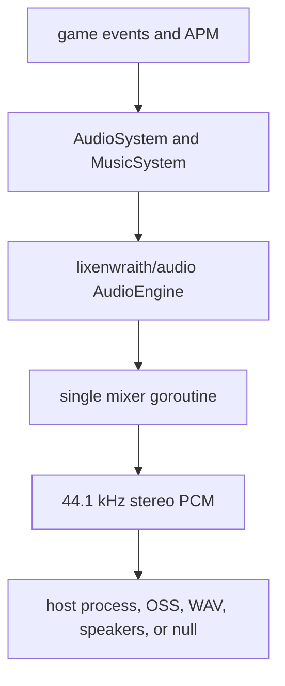

# Audio Architecture

vif's audio is `lixenwraith/audio`, a pure-Go synthesis, sound effect, mixing and
music-sequencing engine with no CGO dependency, nested at `pkg/audio` and taken
through a `replace`. Game policy is layered over it by the audio service and the
`AudioSystem`/`MusicSystem` pair. The engine's own design, from its stream
contract to the rip, is the [audio library's document](../pkg/audio/doc/audio.md)
(cited below as "library §n"); this one is how vif drives it.

Three words name what it plays, in code and documents alike:

- **audio** is everything: the engine, its service and backend, and the
  speakers' channel mask, pause and telemetry;
- **music** is what the sequencer plays: patterns (beats, melodies, basses and
  fills) on the music bus, arranged by the conductor;
- **sfx**, a sound effect, is a sound played on a trigger outside the music, on
  the sfx bus.

A **sound** is the synthesized one-shot both draw on: an sfx plays one, and so
does each drum of the music's kit (library
[§5](../pkg/audio/doc/audio.md#5-sounds-and-sound-effects),
[§7](../pkg/audio/doc/audio.md#7-music-sequencer)).

## 1. Layered design

- `internal/service.AudioService` configures, constructs, starts and stops the
  engine and contributes it as a capability.
- `internal/system.AudioSystem` plays requested sfx, applies mute and pause, and
  publishes audio telemetry.
- `internal/system.MusicSystem` maps APM and explicit music events to tempo,
  intensity, harmony and patterns.
- `audio.AudioEngine` is the thread-safe control surface: the sound and pattern
  registries and the backend's lifecycle and failover.
- `audio.Mixer` owns every live voice and the sequencer, and renders the output
  buffers.
- The backend consumes signed 16-bit little-endian stereo frames.

The engine carries no ECS or APM concept. The app injects its sfx levels and
sound shapes, and `MusicSystem` interprets the game's five-second APM signal.

Runtime mode and build capability select whether this layer exists. In a full
build, `ModePlay`, `ModeReplay` and `ModeScript` register the audio service;
`ModeHeadless` and `ModeServer` do not. `vif_noaudio` and `vif_headless` omit the
service, engine resource, full audio systems, and the root `audio` package;
lightweight null systems still consume local audio events and publish audio as
unavailable, preserving telemetry and system controls. The browser build keeps
them all and streams to the page as a host's speakers (below, [platforms
§8](multi-platform.md#8-adding-another-renderer-or-android-host)). Event
payloads carry audio identifiers from the dependency-free `audio/model`
package, which every build compiles. Replay rebuilds simulation from recorded
events, including sound requests; the journal carries no mute state, so
`-mute`, `-ab` and `-mw` are the viewer's. The viewer's pause holds the mixer,
as the game's pause does, and so do a seek and the end of the stream. A copy
that takes over to go back keeps the speakers and the conductor's state, since
the engine does not rewind (`system.HandOverSound`).

What vif sets of the engine:

- **Buffer.** `vif.toml` `[audio] buffer_ms`, 10–200 in steps of 10, is the
  mixer period (`AudioConfig.Buffer`), 50 ms when unset (library
  [§2](../pkg/audio/doc/audio.md#2-stream-contract)).
- **Backend.** `-ab <name>`, long form `-audio-backend <name>`, restricts
  selection to one backend (`ForceBackend`), `null` and `wav:path/to/out.wav`
  among them (library
  [§3](../pkg/audio/doc/audio.md#3-backend-detection-and-failover)). `-mw[=DIR]`
  (`-music-wav`, `paths.music`) records the music bus (`RecordMusic`) to
  `vif-mus-<stamp>.wav` in the state root's `music/` directory, a sibling of
  `log/` ([layout §5](filesystem-layout.md#5-logs-journals-and-runtime-output));
  `-ab null -mw` records on a machine with no device. If no backend survives,
  the service keeps the silent engine: gameplay continues, sound requests become
  no-ops with rejection telemetry, and absence of a device is not an
  application-start failure.
- **Speakers.** A host that has its own hands them over as `app.Config.Host.Audio`,
  the engine's `Sink`, which a scenario change plays on through: Android's is its
  `AudioTrack`; the browser's posts each buffer that sounds to the page, which
  plays it through an AudioWorklet.
- **Telemetry.** Played and dropped totals and rejection categories are surfaced
  through the game status registry.
- **Sfx.** A scenario requests an sfx by its sound's name, `EventSoundRequest {
  sound = "chime" }`, or gives a button one, and `AudioSystem` resolves the name
  as it plays; such a name skips startup resolution, so a mistyped one is silent
  and counts only as a bad-ID rejection. The sfx volume is the player's `[play]
  sfx_volume`.
- **Mute.** `Ctrl-S` cycles the composed audio mask through silence, sfx only,
  music only, and both. Every build starts with both on, as the embedded
  `vif.toml`'s `[play]` says, until the player's own settings say otherwise;
  `-mute` starts a run muted. Each change is written back for the next run.
  `EventAudioMuteToggle` cycles, flips or sets channels from a key, a system or
  the configuration menu, and `EventAudioMuteChanged` announces the mask
  applied. The game leaves every slot and track sounding.
- **Pause.** The game's pause is the engine's (library
  [§6](../pkg/audio/doc/audio.md#6-mixer-buses-mute-and-pause)), applied even if
  `AudioSystem` is disabled, and a run that ends fades the same way before the
  engine stops. Muted, `MusicSystem` sends only what outlasts the mute
  (patterns, tempo): a start or a note waits for the unmute, and an unmute does
  not restart music the run stopped.
- **Disabled systems.** Disabling `audio` gates both channels; disabling `music`
  gates music alone. Mute keys still update the user's preference, but cannot
  open a disabled channel. Re-enabling restores that preference. The status bar
  reports effective playback, including a stopped sequencer or unavailable
  backend. Pause and telemetry remain connected while disabled, and
  startup/reset waits for scenario gates to settle.

## 2. Adaptive game conductor

`MusicSystem` is the conductor. Once per game update it observes five-second
music APM and maps it to an intensity tier: Calm below 60, Normal from 60,
Elevated from 140, Intense from 220 and Peak from 300.

The target tempo is `100 + 100·√(APM/480)` BPM: 100 at rest, 135 at 60 APM, 150
at 120, 168 at 220, 179 at 300, and the engine's 200 maximum only at the 480
ceiling, which a pointer alone (four gestures a second, 171 BPM) cannot reach. The
conductor slews rather than jumping (12 BPM/s upward, 6 downward), ignores
changes smaller than three BPM until the slew settles on its target, and the
sequencer applies each on the next beat.

The tier follows the APM under hysteresis (`parameter.TierTracker`): it holds
four seconds after any change before rising, then goes straight to the APM's
tier; it falls one tier at a time, each after the APM has sat 30 under the
tier's floor for five seconds. A burst reaches its tier in one or two swaps
instead of one a bar, and a lull steps down over a phrase or two instead of
collapsing inside the five-second window. A tier change draws from the current
group under quantization/crossfade/reveal policy (library
[§7](../pkg/audio/doc/audio.md#7-music-sequencer)), and a slot already sounding
its draw keeps playing. The conductor seeds the sequencer from the run's own
music stream, so each run draws its own pools. The `music.*` status group (the
telemetry HUD's music card, and the periodic stat log) names the group, tier,
requested tempo and the pattern in each slot, and reads `-` (tempo 0) while
music is muted, stopped or disabled.

Explicit music events can start/stop, set patterns, play a melody note, change
intensity, tempo, seed, swing, or harmony. A manually held intensity can later
be released so APM control resumes. APM policy stays under `internal/parameter`
and `internal/system`, leaving the engine reusable.

## 3. Authored music and sound overrides

The service receives optional files resolved through the common config-root
hierarchy:

- `sounds.toml` supplies sound and voice definitions and name-based overrides;
- `music.toml` supplies pattern definitions.

The categorized locations are `audio/sounds.toml` and `audio/music.toml`.
`-config-sounds` and `-config-music` are strict individual overrides. See
[External filesystem layout](filesystem-layout.md).

An invalid user definition leaves the shipped one in place; a document that does
not parse or names an unknown key is ignored whole. A user `sounds.toml` may
`include` files inside its own directory, which the game, `-check` and soundlab
resolve alike, so a file soundlab saves with its includes is what play loads.
Play reports the first line of the engine's combined specification error on the
status bar; `vif -check` checks music, then sounds, before startup and stops at
the first document that fails, listing every invalid definition in it.

The shipped banks are the audio module's `bank` package, its `sfx.toml`,
`drums.toml`, `voices.toml` and `music.toml` embedded there and handed to the
engine as `BaseSounds`, `BaseVoices` and `BasePatterns` (`bank.Sounds`,
`bank.Patterns`); the engine itself ships no authored content. Both documents may
define `[macros]` and invoke them ([TOML macros](toml-macros.md)); the shipped
bank writes each drum lane and note line through one. `melody_gen` reserves its
fixed ID in code and takes its placement from the bank; the generator rewrites
its last track. Group pools are fixed at `Start`. Later same-name registrations
replace a definition while preserving its runtime ID, which allows live tooling
to update a playing registry.

## 4. Soundlab

Soundlab is the supported authoring environment built on the same engine.
`internal/soundlab` holds the session, its documents, the verb table and the
TUI, which runs over any `terminal.Terminal`; `cmd/soundlab` is its terminal
command, the flags and the REPL, and a host with its own screen and speakers
runs the package in-process, handing `NewSession` the speakers. It offers:

- a command REPL;
- a full-screen TUI: a browser of patterns, sounds and voices beside a mixer that
  draws every slot on one timeline, mutes a slot or a track and solos a track, a
  structural inspector, and the pattern editor, new or on an existing pattern: a
  drawn keyboard that records takes onto the key's degrees, and a step grid with a
  piano roll;
- headless `.slab` script execution;
- validation, live registry apply/revert, audition, sequencer slot assignment,
  TOML save, WAV export, and MIDI both ways: a pattern or a song written as a
  Standard MIDI File, and a MIDI file loaded as patterns and a song.

Soundlab registers the same sound and pattern banks the game does, from the audio
module's `bank`, and takes vif's `-config-dir`, `-config-music` and
`-config-sounds`. It resolves both overrides through `internal/paths` exactly as
the game does, registers them, and opens them as its documents, so its registry
and the game's hold identical specs. Of `vif.toml` it reads only `[paths] root`
and `[audio] buffer_ms`, so a key another vif build wrote is named and skipped,
never dropped from the file as a game run drops it. A save writes where the next run reads
first: the `-config-music`/`-config-sounds` file when given, else
`audio/<file>` under `-config-dir` or else the user root, shadowing any copy in
a lower root. It does not apply the game's sfx levels and sound shapes, so its
auditions and exports play a spec as authored.

The working document and live registry are separate: edits do not affect audio
until `apply`; `revert` restores the document from the canonical registry. Its
dotted path grammar follows TOML tags and Go types, while domain validation
runs at `validate`/`apply`. See `cmd/soundlab/README.md` for the command/TUI
reference.

MIDI goes through the library's one table, `midiInstruments` (library
[§8](../pkg/audio/doc/audio.md#8-midi-files)): `write <pattern|song> <file.mid>`
writes a pattern or a song (`WriteSongMIDI`, `WritePatternMIDI`), and `load` and
`merge <file.mid> [name]` read a file as patterns and a song (`MIDIScore.Song`),
whose bars play out of time where the file is not in 4/4 until songs carry a
meter ([todo](todo.md#give-songs-and-patterns-a-meter)). `truth` and `corpus
<dir> from` read `ReadMIDI`'s transcript. Soundlab turns the phrase fill off
(`SetAutoFill(false)`), and its mixer mutes slots and tracks and solos tracks
(library [§6](../pkg/audio/doc/audio.md#6-mixer-buses-mute-and-pause)).

Over the library's rip (library
[§9](../pkg/audio/doc/audio.md#9-ripping-a-recording)), soundlab's verbs:

- `rip` adds a rip's patterns to the document, dirty, and sets the transport's
  tempo and key, so a slot plays the estimate at once; `rip ... bpm <n>` pins
  the tempo alone, `rip ... lead` names the rule that picks the melody
  (`Ripper.Lead`), and `rip <file.mid> <name>` reads a MIDI file as a rip
  (`MIDIScore.Rip`). For each register the front end heard no voice for, `rip`
  searches the voice's genes and wave for the nearest (`RenderNote`,
  `MelDistance`), seeded with every registered voice; `fit` runs it again with
  more generations.
- `agree` compares two rips of one piece (`MatchNotes`); `truth` scores a rip
  against notes given as text or a tapped rhythm (`ParseTranscript`) or a MIDI
  file (`truth <name> <file.mid>`), counting the notes heard by level as well
  (`NoteLevels`); `notes` lists a transcript, each note's brightness with the
  unmeasured counted, and `notes <name> <file.mid>` writes one (`WriteMIDI`) to
  correct in a sequencer. `corpus <dir> from` labels a file's other drum strikes
  (`MIDIScore.Struck`) as onsets alone.
- Soundlab listens with the first root's `audio/rip.toml` when one is there, and
  hears with the first root's `audio/ripmodel.bin`, which `tool/rip-train` trains
  on loops soundlab exports (`corpus`); `render` writes what the slots hold to a
  WAV through `RenderMusic`, so an estimate is heard without a device.
- `tune` searches the rip's parameters over loops rendered from the registered
  patterns across tempos and keys with `lixenwraith/genetic`'s generational
  engine, the current set seeding the pool, and writes a set that beats it
  ([TODO](todo.md#tune-the-rip) for what the corpus still lacks).
- `compress` runs the grouping (`Rip.Cluster`), refines the assignment with
  `lixenwraith/genetic` under a term for the patterns in use, rips the song's
  render back on the song's own grid (`Ripper.Grid`) and scores it against the
  rip; `song` shows, renders or conducts a song through the live sequencer, or
  renders one line of it alone, the instruments named after the file.
- `refine` closes the loop: the voices fitted again and the tonal steps'
  velocities and lengths searched with `Fidelity` as the fitness, a step kept
  only when it rises, each voice held within a tenth of its tonal floor, the
  fit's own distance from the recording's notes, so the score of the mix does not
  drift a voice into one that fills the mix.
- `bench` grades the analysis and a loaded model on fresh renders, clean and
  augmented (`corpus ... aug`). With `sampled <dir>`, both play half of a loop's
  tonal lines on NSynth's recorded notes in place of the voices: an instrument
  whose pitches reach the line's notes within three semitones, each note shifted
  from the nearest, cut into its recording's release at the note-off, mixed
  against the rest of the loop, and labelled with no voice.

[Rip design](rip-design.md) is where the rip is going from here: the loop that
refines voices and patterns against that score.

## 5. Extension checklist

For a new sound effect:

1. author and validate it as the [library's
   checklist](../pkg/audio/doc/audio.md#10-extension-checklist) says, in the
   audio module's `bank` or a tested override document;
2. for an sfx Go emits, add its sound's name to the game's sfx table
   (`parameter.SfxSet`, `sfxTable`) with its level and shape, and run startup
   resolution so a missing mapping fails early; an sfx only configuration names
   needs neither;
3. emit `EventSoundRequest` from the mechanic rather than calling the engine
   from arbitrary systems.

For a new instrument, author a `[[voice]]` in the bank's `voices.toml` or in a
user `sounds.toml` and name it in a pattern's track; soundlab auditions it with
`note` and its keys.

For music, keep new APM/campaign decisions in `MusicSystem` or configuration
events and keep the sequencer unaware of gameplay concepts.

## 6. Source map

- The engine and its banks: the `lixenwraith/audio` module at `pkg/audio`, its
  README and its own source map (library
  [§11](../pkg/audio/doc/audio.md#11-source-map))
- Game service: `internal/service/adapter_audio.go`
- Game event adapters: `internal/system/audio.go`, `music.go`; `speakers.go`
  holds the mask both publish and the handover; `audio_none.go` the null systems
- Mode and build selection, replay default: `internal/app/config.go`,
  `audio.go`, `audio_none.go`, `play.go`
- Game policy: `internal/parameter/audio.go`, `music.go`, `sfx.go`,
  `sfx_audio.go`
- Authoring tool: `internal/soundlab`, its command `cmd/soundlab`,
  `cmd/soundlab/README.md`; the rip's trainer `tool/rip-train`, and the rip's
  design `doc/rip-design.md`
