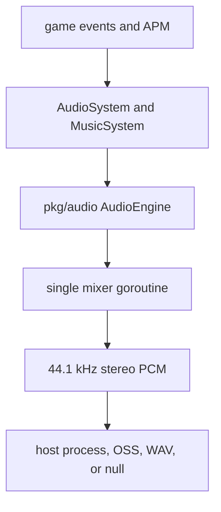
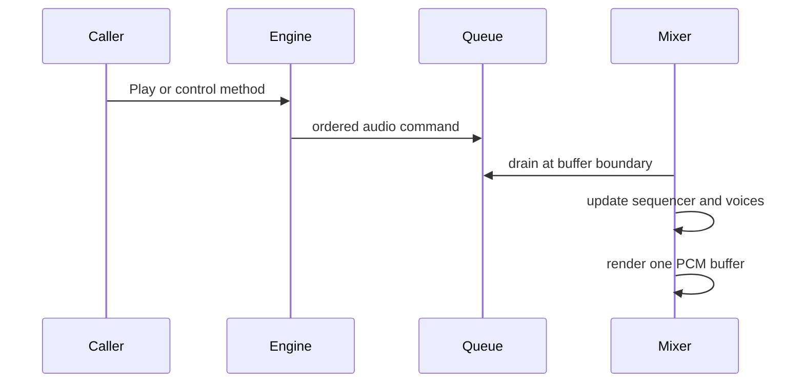
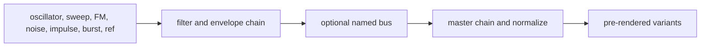

# Audio Architecture

vif includes a pure-Go synthesis, sound effect, mixing, and music-sequencing
engine. It streams raw PCM to an external host process/device; there is no CGO
audio dependency. Game policy is layered over the reusable `pkg/audio` engine
by the audio service and the `AudioSystem`/`MusicSystem` pair.

Three words name what it plays, in code and documents alike:

- **audio** is everything: the engine, its service and backend, and the
  speakers' channel mask, pause and telemetry;
- **music** is what the sequencer plays: patterns (beats, melodies, basses and
  fills) on the music bus, arranged by the conductor;
- **sfx**, a sound effect, is a sound played on a trigger outside the music, on
  the sfx bus.

A **sound** is the synthesized one-shot both draw on: an sfx plays one, and so
does each drum of the music's kit (§5, §7).

## 1. Layered design



- `internal/service.AudioService` configures, constructs, starts and stops the
  engine and contributes it as a capability.
- `internal/system.AudioSystem` plays requested sfx, applies mute and pause, and
  publishes audio telemetry.
- `internal/system.MusicSystem` maps APM and explicit music events to tempo,
  intensity, harmony and patterns.
- `pkg/audio.AudioEngine` is the thread-safe control surface: the sound and
  pattern registries and the backend's lifecycle and failover.
- `pkg/audio.Mixer` owns every live voice and the sequencer, and renders the
  output buffers.
- The backend consumes signed 16-bit little-endian stereo frames.

`pkg/audio` carries no ECS or APM concept. The app injects its sfx levels and
sound shapes, and `MusicSystem` interprets the game's five-second APM signal.
Beside the standard library the package imports only `lixenwraith/toml` and its
`macro` expander, so it can leave the module whole.

Runtime mode and build capability select whether this layer exists. In a full
build, `ModePlay`, `ModeReplay` and `ModeScript` register the audio service;
`ModeHeadless` and `ModeServer` do not. `vif_noaudio` and `vif_headless` omit the
service, engine resource, full audio systems, and `pkg/audio` implementation;
lightweight null systems still consume local audio events and publish audio as
unavailable, preserving telemetry and system controls. The browser build keeps
them all and streams to the page as a host's speakers (§3, [platforms
§8](multi-platform.md#8-adding-another-renderer-or-android-host)). Event
payloads carry audio identifiers from the dependency-free `pkg/audio/model`
package, which every build compiles. Replay rebuilds simulation from recorded
events, including sound requests; the journal carries no mute state, so
`-mute`, `-ab` and `-mw` are the viewer's. The viewer's pause holds the mixer,
as the game's pause does, and so do a seek and the end of the stream. A copy
that takes over to go back keeps the speakers and the conductor's state, since
the engine does not rewind (`system.HandOverSound`).

## 2. Stream contract

| Property | Value |
|---|---|
| Sample rate | 44,100 Hz |
| Channels | 2 (stereo); the mix is mono, written to both |
| Format | Signed 16-bit little-endian PCM |
| Bytes per frame | 4 |
| Buffer duration | 50 ms; `vif.toml` `[audio] buffer_ms`, 10–200 in steps of 10 |
| Frames per buffer | 441 per 10 ms (2,205 at 50) |

Every mixer pass drains pending commands, renders music and sfx into
separate floating-point buses, sidechain-ducks music under sfx, applies the
pause gain ramp, holds the sum under a peak limiter (it sees each peak 64
samples ahead and ramps its gain over that time, releasing over 80 ms, so
stacked kicks duck without a click), converts samples, and writes one PCM
buffer. The output writer is the only backend-specific part of that path.

## 3. Backend detection and failover

Automatic candidates are tried in this order:

| Priority | Backend | Host target |
|---|---|---|
| 1 | `pacat` | PulseAudio protocol, also commonly available through PipeWire compatibility. |
| 2 | `pw-cat` | Native PipeWire. |
| 3 | `aplay` | ALSA command-line playback. |
| 4 | `sox` | The SoX `play` executable. |
| 5 | `ffplay` | FFmpeg playback. |
| 6 | `oss` | `/dev/dsp`, considered only on FreeBSD. |

Detection first checks executable/device availability. Attachment starts a
candidate, writes one silent buffer, and waits through a short survival window;
bad arguments, an unavailable daemon, or an immediate broken pipe fall through
to the next candidate. A process that accepts data but routes it nowhere cannot
be detected by this probe.

The supervisor can move to an untried candidate if the active process exits.
Backend lifecycle has its own mutex because failover and shutdown can race.

`-ab <name>`, long form `-audio-backend <name>`, restricts selection to one
backend. Two explicit-only synthetic
backends are useful in automation:

- `-ab null` runs the full mixer and discards samples;
- `-ab wav:path/to/out.wav` captures the live stream into a finalized WAV file.

`-mw[=DIR]` (`-music-wav`, `paths.music`) records the music bus alone, before
ducking, to `vif-mus-<stamp>.wav` in the state root's `music/` directory, a
sibling of `log/` ([layout §5](filesystem-layout.md#5-logs-journals-and-runtime-output)):
what plays, so a muted or paused stretch adds nothing. It needs a running
mixer; `-ab null -mw` records on a machine with no device.

If no backend survives, the service degrades to a valid silent engine. Gameplay
continues, sound requests become no-ops with rejection telemetry, and absence
of a device is not an application-start failure.

A host that has its own speakers skips detection: `AudioConfig.Sink` (from
`app.Config.Host.Audio`) is a writer the mixer streams to as the `host` backend,
whatever name was forced. Unlike the WAV and OSS sinks it is not closed with the
engine: the host's speakers outlive a run, and the next one, after a scenario
change, streams to the same writer.
Android's is its `AudioTrack`; the browser's posts each buffer that sounds to the
page, which plays it through an AudioWorklet.

## 4. Concurrency and command ownership



Playback, transport, tempo, patterns, harmony, and hot reload share one command
channel, preserving arrival order. Pause and music mute are flags the mixer
reads each pass, and sfx mute rejects a play before it is queued. The live
sequencer, pattern players, voices, sounding sfx, and buses are confined to
the mixer goroutine and need no inner locks.

Commands sent before `Start` are retained in a 64-entry ordered buffer. After
startup, the mixer channel holds 256 commands. A full queue rejects the command;
play rejections are categorized as not running, silent, paused, muted, bad ID,
or queue full. Played/dropped totals and rejection categories are surfaced
through the game status registry.

Shutdown stops the mixer/backend with a bounded wait so a wedged audio process
cannot prevent restoration of the terminal's raw mode.

## 5. Sounds and sound effects

A sound is a declarative `SoundDef`: one or more layers, optional intermediate
buses, and processor chains. `Play` sounds one as an sfx; the drum kit plays
four as instruments (§7).



Sources include oscillators, sweeps, FM, noise, impulses, burst trains,
references to earlier layers, and silence. Processors include filters,
envelopes/decay, modulation, shaping, clipping, and gain. Validation bounds
duration, frequencies/Nyquist behavior, topology, operation count, and authored
structure before rendering.

A sound may be rendered once a velocity (`velocities`, up to four), its variant
set a layer. A layer's gain follows the velocity to its `vel_gain` power; an
oscillator's or a sweep's start frequency, a filter's frequency, a decay's tau
and a shaper's drive to their `vel_track` power. Each variant is a stroke landing
at its own place in [-1, 1], spread over the set in a seeded order and the same
in every velocity layer, and `stroke` scales a gain or a parameter by it. A
sound that sets none of these renders once at full velocity, as every sfx does.

At startup the engine:

1. registers `AudioConfig.BaseSounds` and `BaseVoices`, which the game fills
   from the embedded bank in `internal/asset/audio` via `parameter.BuiltinSounds`;
2. loads a resolved optional `audio/sounds.toml`, its sounds and voices
   replacing same-name definitions and a new voice name adding an instrument;
3. freezes the name-to-ID registry of sounds;
4. pre-renders the variant cache, under the game's sound shapes
   (`SoundShapes`), and the kit: the drums' velocity layers and the tonal voices;
5. resolves the game's sfx levels (`SfxLevels`) by stable sound name;
6. registers `melody_gen`, `BasePatterns` and a resolved `audio/music.toml`
   (same name replaces), and builds the group arrangement before probing
   backends.

Each sound normally has three pre-rendered variants. The mixer rotates variants
to reduce repetition, allows at most two concurrent sfx per sound and 12 in all,
and steals according to its admission policy when needed. Rapid repeats within
250 ms attenuate toward a 0.25 floor and recover over 600 ms. Sounding sfx duck
the music bus to 70%, with fast attack and slower release; the sfx volume
(`SfxVolume`, the player's `[play] sfx_volume`) scales every sfx and leaves the
music alone.

Sound IDs are process-local registration values. Configuration and persistent
documents must use names, not numeric IDs: a scenario requests an sfx by its
sound's name, `EventSoundRequest { sound = "chime" }`, or gives a button one, and
`AudioSystem` resolves the name as it plays. Such a name skips startup resolution, so a
mistyped one is silent and counts only as a bad-ID rejection.

## 6. Mixer buses, mute, and pause

Sfx and music have independent mute bits. `Ctrl-S` cycles the composed audio
mask through silence, sfx only, music only, and both. Every build starts with
both on, as the embedded `vif.toml`'s `[play]` says, until the player's own
settings say otherwise; `-mute` starts a run muted. Each change is written back
for the next run. `EventAudioMuteToggle` cycles, flips or sets channels from a
key, a system or the configuration menu, and `EventAudioMuteChanged` announces
the mask applied.

Pause is a device/output state, not merely a gameplay-system toggle. It applies
even if `AudioSystem` is disabled and ramps the master gain over 250 ms; music
plays out the ramp, then freezes with its position kept for resume. A run that
ends fades the same way before the engine stops. Muted, `MusicSystem` sends only
what outlasts the mute (patterns, tempo): a start or a note waits for the unmute,
and an unmute does not restart music the run stopped.

A sequencer slot mutes alone (`SetSlotMuted`): its pattern plays on in time,
silent, so it comes back on the step it has reached, and the mute outlasts a
change of pattern. A track mask (`SetTrackMask`, a bit a track, which the reveal
also drives) silences tracks of one pattern: the slot holds it for that pattern
and sets it whenever the pattern begins there, so a mask set while the slot waits
for its bar line lands with it, and another pattern begins whole. The game leaves
every slot and track sounding; soundlab's mixer mutes slots and tracks and solos
tracks.

Disabling `audio` gates both channels; disabling `music` gates music alone.
Mute keys still update the user's preference, but cannot open a disabled channel.
Re-enabling restores that preference. The status bar reports effective playback,
including a stopped sequencer or unavailable backend. Pause and telemetry remain
connected while disabled, and startup/reset waits for scenario gates to settle.

## 7. Music sequencer

The sequencer uses a 16th-note grid (`4` steps per beat), 4/4 bars, and four
crossfading slots:

| Slot | Conventional role |
|---|---|
| 0 | Rhythm/drums. |
| 1 | Melody/harmony-following layer. |
| 2 | Free layer or automatic phrase fill. |
| 3 | Bass, the group's anchor. |

A pattern has up to 64 steps, 32 tracks, and 512 events per track. A track sets
its instrument, chord-following, and humanization; its events set step position,
velocity, scale degree, octave, an accidental (`acc`, the semitones off the
degree, so a note outside the key is written exactly), duration, and
probability. The tonal voices are
data: a `[[voice]]` of the sound document names an instrument and its synthesis,
an oscillator stage (sine, saw or square), with a vibrato and a vowel's
formants if a voice has them, through a resonant low-pass under a
filter envelope into an ADSR, or a string, as a delay line or as its partials
(`VoiceDef`). The shipped five are `voices.toml`; a document's voice of a shipped
name retunes that instrument in place and a new name adds an instrument, which
patterns name as they name any. `DefineVoice` hot-swaps one: the next note plays
the new voice while a sounding one finishes on its own, and an instrument no voice
defines plays a plain sine. Of the shipped
voices, the pad and the lead are band-limited saws. An oscillator voice's unison
runs free: each oscillator of a stack starts at its own phase (a lone one at 0),
seeded by the note and its trigger order so a replay plays the same, and a
detuned one wanders about its place in the spread by up to three tenths of the
detune, over 3 to 14 s; the filter envelope (`env_amount` at full velocity)
opens as far as the velocity takes it, and `drive` rounds the pad's edge as it
does the lead's. A string is never held at a sustain: it fades as it rings, a
held note ends on its own, and the note-off is its damper (`release`); the
ADSR's decay and sustain shape the oscillators
alone. The pluck is a delay line after Karplus and Strong with Jaffe and
Smith's extensions: a seeded noise burst, through the comb of where it is
plucked (`strike_pos`) and a low-pass that darkens a soft note (`hammer_hz` at
full velocity), with its mean taken out, rings in a line of the period's whole
samples and a first-order all-pass for its fraction, so every note is in tune;
the loop's two-point low-pass (`bright` its stretch) and a loss per period
derived from `ring`, the fundamental's T60 at middle C, set that decay, the
low-pass lessened where its loss alone would cut a high note short. As in the
modal voices, `decay_track` shortens it above middle C and lengthens it below
(none keeps `ring` at every pitch); the pluck's 1.1 is a recorded guitar's
slope, its T60 halving about every octave. The bass and the piano are modal voices: a string as its partials, each
a decaying phasor at `k·f0` stretched by the string's inharmonicity, at the
amplitude the strike position's comb, the spectral tilt (1/k struck, 1/k²
plucked), the body and the hammer leave it, decaying faster the higher it sits.
The body is a third-order high-pass at `bright` kHz: a soundboard radiates the
partials under it weakly, as a piano does its bass fundamentals. The hammer is
a low-pass at `hammer_hz` times the velocity to the 1.5, so a soft note is
darker as well as quieter, a recorded piano's pp a third of an octave darker
than its mf. The lowest partials the body sounds carry a second, slightly
detuned string whose slower aftersound gives the double decay; both start in
phase, and a beat that would leave them over a quarter cycle apart where the
second overtakes the first moves to a quarter, so the hand-over never cancels
the partial. A few milliseconds of filtered noise are the hammer or finger
contact. The piano has a grand's stretch, its decay, brightness and dynamics
fitted to a recorded piano's notes at pp, mf and ff (the University of Iowa
samples, C1 to C7); the bass is a pizzicato double bass fitted the same way to
Iowa's, a thump that falls away within a second, its note-off a 45 ms damper.

The drum kit plays cached sounds: a hit takes the next stroke of the velocity
layer nearest its velocity and plays it at that velocity, so a harder hit is
brighter as well as louder. The shipped pieces follow published methods. The
kick's fundamental falls from 92 to 52 Hz as the head's tension settles, from
higher the harder it is struck, with two upper modes, the beater's pulse and its
felt. The snare is its (0,1) mode split in two by the coupled heads and three
upper modes under the stick's crack and the wires, a soft stroke ringing
shorter. The hihat is the TR-808's six square partials and noise through the
plates' band, choked as they close, the clap four noise bursts a few
milliseconds apart and then the room. Strokes differ where they land (centre or
edge, a hat's tip or shoulder), not in pitch. Against recordings free for any
use (Freesound CC0 kits, Iowa's hihat), levels re peak at 50/100/250 ms and the
centroid of the first 100 ms, soft to hard:

```
        kit                                   recordings
kick    -10/-20/-36 .. -9/-17/-35   80..337   Sonor p1..p6 -10/-10/-25 .. -8/-19/-27   86..311
snare   -14/-25/-45 .. -7/-14/-35  430..417   Pearl light, hard -14/-23/-41, -6/-15/-35 301, 318
hihat   -12/-22/-41 .. -10/-20/-40 6250..7540 Iowa mf, ff -10/-26/-38, -9/-24/-26      7855, 7813
clap     -6/-16/-46               2280..2530  four players' claps -1..-14/-14..-31     1480..2650
```

Tempo is clamped to 80–200 BPM. Tempo changes can wait for the next beat;
patterns can transition immediately or quantized to the bar. The incoming
pattern plays at full level from its first trigger while the outgoing one's
ringing tails fade out, over at least 256 samples so none is hard-cut; a slot
holds three players, so a transition arriving while the last one still fades
retires a second tail rather than cutting the first. A reveal
builds a rising tier up from as many tracks as the outgoing pattern sounded,
adding one a bar, so a build-up never starts thinner than what it replaces.
Slot 2 substitutes a seeded fill on the last bar of each eight-bar phrase and
restores the previous pattern on the downbeat. The fill is on by default;
`SetAutoFill(false)` turns it off, as soundlab does.

Drawn music comes from groups. A pattern's `role` (rhythm, melody, fill or
bass), `groups` and `tiers` place it; `Start` builds each group's pool per tier and
role from the registry. A group's bass patterns are its anchor: a tier change
keeps the bass that still covers the tier and redraws rhythm and melody, so what
the group plays follows what it played before. The sequencer holds one group,
moving only when it does not cover the tier; each phrase downbeat swaps one drawn
slot, melody, rhythm and bass in turn, to another member of its pool, once four
bars have passed since any drawn slot changed; and after four phrases every drawn
slot moves to another group behind the phrase's fill. A draw takes the pool
member played least this run, so a held tier works through its pool before
repeating.

Three ideas organise the drawing, from the outside in:

| Term | What it is | When it changes |
|---|---|---|
| group | A style: one bass figure and kick feel, with its own rhythms, melodies, basses and fills (`groups`). | After four phrases, every drawn slot together. |
| tier | How much is going on, calm to peak (`tiers`); the conductor picks it from the APM. | With the action, under hysteresis (§8). |
| motif | One melodic idea at five weights, one per tier, within a group (`motif`): the ladder a melody climbs and descends as the tier moves. | A phrase variation moves to another motif, after a rest bar. |

So a tier change keeps the melody's motif and takes its member at the new tier,
which for the shipped themes is the same line with more or fewer layers under
it, and only a phrase variation changes the idea: the melody then fades out
through the fill bar and the new motif enters alone on the downbeat. A melody
change quantized to the bar lands on the end of the pattern's own cycle, so a
four-bar theme is heard through. Fills come from the same group and tier. A slot
placed explicitly is left alone.

Harmony holds root note, scale, and chord progression. Pattern degrees resolve
through the current harmony at trigger time. With the same seed and identical
bar-aligned command schedule, generated music is reproducible; wall-clock
arrival relative to bars is not a recorded replay contract, but draws and steps
roll on separate streams of the seed, so a bar of skew between two runs moves
no later draw: the arrangement holds where the notes under it differ. The
conductor seeds the sequencer from the run's own music stream, so each run draws
its own pools.

## 8. Adaptive game conductor

`MusicSystem` is the conductor. Once per game update it observes five-second
music APM and maps it to:

| APM range | Intensity tier |
|---|---|
| below 60 | Calm |
| 60–139 | Normal |
| 140–219 | Elevated |
| 220–299 | Intense |
| 300 and above | Peak |

The target tempo is `100 + 100·√(APM/480)` BPM: 100 at rest, 135 at 60 APM, 150
at 120, 168 at 220, 179 at 300, and the engine's 200 maximum only at the 480
ceiling, which a pointer alone (four gestures a second, 171 BPM) cannot reach. The
conductor slews rather than jumping (12 BPM/s upward, 6 downward), ignores
changes smaller than three BPM until the slew settles on its target, and the
sequencer applies each on the next beat.

The tier follows the APM under hysteresis (`parameter.TierTracker`): it holds
four seconds after any change before rising, then goes straight to the APM's
tier; it falls one tier at a time, each after the APM has sat 30 under the
tier's floor for five seconds. A burst reaches its tier in one or two swaps
instead of one a bar, and a lull steps down over a phrase or two instead of
collapsing inside the five-second window. A tier change draws from the current
group under quantization/crossfade/reveal policy, and a slot already sounding
its draw keeps playing. The `music.*` status group (the telemetry HUD's music
card, and the periodic stat log) names the group, tier, requested tempo and the
pattern in each slot, and reads `-` (tempo 0) while music is muted, stopped or
disabled.

Explicit music events can start/stop, set patterns, play a melody note, change
intensity, tempo, seed, swing, or harmony. A manually held intensity can later
be released so APM control resumes. APM policy stays under `internal/parameter`
and `internal/system`, leaving `pkg/audio` reusable.

## 9. Authored music and sound overrides

The service receives optional files resolved through the common config-root
hierarchy:

- `sounds.toml` supplies sound and voice definitions and name-based overrides;
- `music.toml` supplies pattern definitions.

The categorized locations are `audio/sounds.toml` and `audio/music.toml`.
`-config-sounds` and `-config-music` are strict individual overrides. See
[External filesystem layout](filesystem-layout.md).

An invalid user definition leaves the shipped one in place; a document that does
not parse or names an unknown key is ignored whole. A user `sounds.toml` may
`include` files inside its own directory, which the game, `-check` and soundlab
resolve alike, so a file soundlab saves with its includes is what play loads.
Play reports the first line of the engine's combined specification error on the
status bar;
`vif -check` checks music, then sounds, before startup and stops at the first
document that fails, listing every invalid definition in it.

The shipped banks are `internal/asset/audio/sfx.toml`, `drums.toml`,
`voices.toml` and `music.toml`, embedded and handed to the engine as
`BaseSounds`, `BaseVoices` and `BasePatterns`; `pkg/audio` ships no authored
content. Both documents may define
`[macros]` and invoke them ([TOML macros](toml-macros.md)); the shipped bank
writes each drum lane and note line through one. `melody_gen` reserves its fixed
ID in code and takes its placement from the bank; the generator rewrites its last
track. Group pools are fixed at `Start`. Later same-name
registrations replace a definition while preserving its runtime ID, which allows
live tooling to update a playing registry.

## 10. Soundlab

Soundlab is the supported authoring environment built on the same engine.
`internal/soundlab` holds the session, its documents, the verb table and the
TUI, which runs over any `terminal.Terminal`; `cmd/soundlab` is its terminal
command, the flags and the REPL, and a host with its own screen and speakers
runs the package in-process, handing `NewSession` the speakers. It offers:

- a command REPL;
- a full-screen TUI: a browser of patterns, sounds and voices beside a mixer that
  draws every slot on one timeline, mutes a slot or a track and solos a track, a
  structural inspector, and the pattern editor, new or on an existing pattern: a
  drawn keyboard that records takes onto the key's degrees, and a step grid with a
  piano roll;
- headless `.slab` script execution;
- validation, live registry apply/revert, audition, sequencer slot assignment,
  TOML save, WAV export, and MIDI both ways: a pattern or a song written as a
  Standard MIDI File, and a MIDI file loaded as patterns and a song.

Soundlab registers the same sound and pattern banks the game does, from the same
embedded assets, and takes vif's `-config-dir`, `-config-music` and
`-config-sounds`. It resolves both overrides through `internal/paths` exactly as
the game does, registers them, and opens them as its documents, so its registry
and the game's hold identical specs. Of `vif.toml` it reads only `[paths] root`
and `[audio] buffer_ms`, so a key another vif build wrote is named and skipped,
never dropped from the file as a game run drops it. A save writes where the next run reads
first: the `-config-music`/`-config-sounds` file when given, else
`audio/<file>` under `-config-dir` or else the user root, shadowing any copy in
a lower root. It does not apply the game's sfx levels and sound shapes, so its
auditions and exports play a spec as authored.

The working document and live registry are separate: edits do not affect audio
until `apply`; `revert` restores the document from the canonical registry. Its
dotted path grammar follows TOML tags and Go types, while domain validation
runs at `validate`/`apply`. See `cmd/soundlab/README.md` for the command/TUI
reference.

MIDI goes through one table, `midiInstruments` in `pkg/audio/midi.go`, a row a
shipped instrument: a kit piece's General MIDI keys on the drum channel, the
first the one written, and a voice's program with the families of eight
programs read back as it (pianos, chromatic and pitched percussion the piano,
basses the bass, guitars and plucked strings the pluck, organs, strings,
ensembles, pads and effects the pad, brass, reeds, pipes and synth leads the
lead), so a program no row writes plays on its family's voice. A voice a
document added is written on the program of the shipped voice nearest it, its
wave first, then its genes (`midiProgram`).

- Writing (`WriteSongMIDI`, `WritePatternMIDI`; soundlab's `write <pattern|song>
  <file.mid>`): a type-1 file whose first track holds the tempo, the key
  signature and a time signature wherever the bar changes, then a track a
  pattern track by slot, instrument and order, each note its steps long at its
  velocity, resolved through the song's harmony as the sequencer resolves it; a
  drum a sixteenth on channel 10. A pattern is a song that plays it once through.
  A bar is 16 steps, else 12 (3/4) where the pattern's length divides by 12,
  else the pattern whole (`barSteps`, `timeSignature`). Probability, humanize
  and tuning are not written.
- Reading (`MIDIScore.Song`; soundlab's `load` and `merge <file.mid> [name]`):
  the file's parts quantized on its ticks, a step its sixteenth at its first
  tempo folded by octaves into the sequencer's range, as `MIDIScore.Rip`
  folds; a pattern a part a bar, named and shared between bars as `compress`
  names them, the drum channel the beat, a part on a bass program the bass and
  the rest the melody, a track a line, each note at its velocity and length;
  and the song that plays them, in the key signed or the key the notes hold. A
  bar is its signature's steps (3/4 and 6/8 twelve, 3/8 six); one no pattern
  holds in whole steps is read in sixteen. It returns what it could not keep, a
  line each: a tempo change and its bar, a meter, a program played on its
  family's voice, a key the kit lacks, notes merged, cut or left out.
- The sequencer counts every bar 16 steps until songs carry a meter
  ([todo](todo.md#give-songs-and-patterns-a-meter)), so a song read from 3/4
  plays its bars out of time while each pattern loops right on its own.
- `ReadMIDI`'s transcript, which `truth` and `corpus <dir> from` read, is the
  same with or without the programs, keys and signatures the reader takes for
  a song (`TestReadMIDIReadsTheSameTranscript`).

## 11. Ripping a recording

`RipWAV` and `RipSamples` listen to a recording and estimate what the sequencer
would need to play it: the tempo, where the bars fall, the key, the chord root
each bar leans on, and per bar the kick, snare and hihat hits, the melody and the
bass line as steps of the sixteenth grid (`Rip`). `Patterns` writes them as
patterns of up to four bars, named `<name>_beat_<n>`, `<name>_melody_<n>` and
`<name>_bass_<n>` in a group of their own and no tier; soundlab's `rip` adds
them to the document, dirty, and sets the transport's tempo and key, so a slot
plays the estimate at once. `ReadWAV` reads the file, any PCM or float width. A `Ripper` with a `Grid` pins
the tempo and the downbeat, as a render's are known; a grid with a negative
downbeat pins the tempo alone, the beats tracked at it and the bar line decoded,
for a recording whose tempo the listener knows or wants on another metrical
level (soundlab's `rip ... bpm <n>`).

The analysis runs at 22.05 kHz over 93 ms frames every 11.6 ms, each split into
a harmonic and a percussive part by the medians across time and across frequency
around it. It reads the recording's tuning first (`Rip.Tuning`): over windows
four times longer, every spectral peak votes its offset from the nearest
semitone, and the pitch table is read on the mean offset, so a clip tuned forty
cents flat, where every note sits between two semitone rows and wobbles between
them, reads as one in tune. The percussive onsets, each drum's band against its own peak with the
kick's counting double, give the tempo (autocorrelation under a log-Gaussian
prior centred on 120 BPM, folded into the sequencer's range) and the beats (a
dynamic programme that holds to the period). A hit is a kick by its rise under
100 Hz, a hihat by its rise above 5 kHz, a snare by the middle with some noise
above 5 kHz, and may be two drums at once; the bar line is the phase whose
downbeats carry a kick, no snare and the key's root in the bass, the snare on two
and four, and the most change of chroma; a note or a hit more than half a step
before the first bar line opens a pickup bar before it, its beats extrapolated
into the time before the recording when it begins inside that bar
(`Rip.Downbeat` is negative then), so a phrase that leads into the first bar is
kept. The key is the root and scale whose tones
hold the most chroma and whose others the least, the bass register voting for the
tonic. Pitch salience sums a candidate's partials, the bass register's from its
first three, read from a window four times longer as well as the rip's own,
the two combined by their geometric mean so the long window tells the
semitones apart at 110 Hz, where the short window's main lobe spans two, and
the short window says when a note starts and ends; the melody's salience has
the bass's partials cancelled, and those of a neighbour nearly as strong, the
other bin of a wobble, so a bass's octave does not read as a melody note; a hidden path through the frames, scored
against the costs of moving and of starting or ending a note, is cut into notes,
which land on the key's nearest degree with the semitones left as an accidental,
the notes' median lag against the beats taken out first, since a pitch path
starts a few frames after the attack the beats sit on. The melody register is
decoded as two lines at once, a path over pairs of pitches where each line pays
its own costs of moving and of starting or ending, no pair a unison, a semitone
or a harmonic interval apart, and the first line paying `cross` a frame to be
the quieter, so it is the line the ear follows and the second the one under it
through a crossing or a short rest; the second line's notes are kept where they
reach `second_voice` of the first's strength, so a slow line under a pluck is
heard too, in the bar's own `Under` steps, a track of its own in the pattern
and a voice of its own (`Rip.UnderVoice`). The decoder follows the louder line,
and the lead is often the softer, so the two lines' notes are then parted again
by what a line keeps, its pitch from note to note, the length of its notes,
their strength and no two at once (`streams`), and the lead is the line a rule
names (`Ripper.Lead`, soundlab's `rip ... lead`): the busier by default, the
one with the most notes for its sounding time, or the higher, lower, louder or
softer. The bass line is decoded up to A3, over the melody's lowest rows: a
reached note the bass line does not continue is not the bass's, and a note both
registers hear goes to the line it continues, the one whose nearest other note
is nearer in pitch, so a bass line that climbs over E3 is not cut and a melody
that dips keeps its note.
Two transcripts of one piece are compared by `MatchNotes` (soundlab's `agree`),
each line's notes aligned in order under the transposition that matches most,
and a transcript against notes given as text in the `notes` verb's own form
(`ParseTranscript`, soundlab's `truth`), which a listener corrects by hand, or
as a rhythm tapped out without pitches (`unit eighth`, `start 0.34s`, `melody
(1-2-3---4-56---)x3 ...`), matched by when the notes start, or as a Standard MIDI
File (`ReadMIDI`, `truth <name> <file.mid>`): the ground truth the numbers above
lack. `ReadMIDI` reads type 0 or 1 under its tempo map; a track named melody,
under or bass is that line, and of the other parts (a track's notes on one
channel) the lowest is the bass when its notes centre under E3, kept whole as
the bass decoder settles a line that climbs over it, the rest the melody then
the under in file order, any further part left out; the drum channel's kicks,
snares and hats are hits (`RipHit`), a ride, tambourine or shaker a hat, and
its other strikes (a tom, a crash) onsets of no line (`MIDIScore.Struck`),
which `corpus <dir> from` labels as onsets alone. `MatchHits` lays the hits on
the rip's own (`Rip.Hits`, each step placed on its beats) under the stretch and
offset that match most, each within half a step. `NoteLevels` reads how loud the recording
plays each note given, its first harmonics' peak around its onset placed by
the agreement's map (`Agreement.At`, through the notes the register matched),
so `truth` counts the notes heard by level as well. A file read is a rip of its
own too (`MIDIScore.Rip`, soundlab's `rip <file.mid> <name>`): its notes
quantized on its ticks, its first tempo folded by octaves into the sequencer's
range, four-beat bars from where its time signature starts, the key `keyOf` its
notes' pitch classes as the analysis takes it of the chroma, and a note outside
E1 to C7 dropped; each line plays on the shipped voice its program plays on
(`MIDIScore.Voices`, through §10's table). `WriteMIDI` writes a transcript the
other way, a track a line and the drums on the drum channel at the rip's tempo
(`notes <name> <file.mid>`), to correct in a sequencer. The song a rip
compresses into carries the recording's tuning (`SongDef.Tuning`), and the
engine plays or renders it there (`AudioEngine.SetTuning`), as the voice fit
renders its candidate notes there (`RenderNoteAt`), so a render stands beside
the recording at its own pitch.

`RipParams` holds every threshold, each with a range (`RipGeneRanges`) and a
place in a gene vector (`Genes`, `RipParamsFromGenes`), among them `compress`,
the power the harmonic spectrum is raised to before the salience, under one to
flatten the partials a saturated mix piles on every note; a `[rip]` table in a TOML
document carries a set (`LoadRipParams`, `MarshalRipParams`), and soundlab
listens with the first root's `audio/rip.toml` when one is there. `DefaultRipParams`
is the hand-set start. The engine grades a set itself: `RenderMusic` plays
registered patterns offline, `ExpectedRip` is the rip a perfect listener would
make of them, and `CompareRips` scores a rip against it, tempo within two BPM,
bars found, and the drums, melody and bass as the harmonic mean of recall and
precision per step and pitch. `Fidelity` grades a render against the recording
itself rather than against its rip, which cannot see its own mistakes: both are
heard through one front end into a `RipSound` (`Ripper.Sound`: the frames, the
log-mel bands and the beats, a rip's or a pinned grid's), paired bar by bar on
each one's own beats, and the cosine of their pitch salience, of their mel bands
and of their onset strength over each beat is averaged, each one where they
sound alike; soundlab's `refine` judges the voices and the steps by it, each
voice held within a tenth of its tonal floor, the fit's own distance from the
recording's notes, so the score of the mix does not drift a voice into one
that fills the mix. Soundlab's `tune` searches the parameters over
loops rendered from the registered patterns across tempos and keys with
`pkg/genetic`'s generational engine, the current set seeding the pool, and writes
a set that beats it ([TODO](todo.md#tune-the-rip) for what the corpus still
lacks).

The front end is a seam (`RipFrontEnd`): whatever hears the recording into
`RipFrames`, the onset strengths, the pitch salience and the chroma per frame,
feeds the same decoders. The analysis above is one front end; `ripmodel` is the
other, a transformer over the log-mel frames `MelFrames` makes, whose heads say
per frame what struck, what sounds, which pitch is struck or let go and how hard
(`RipFrames.Strike`, `Release`, `Velocity`),
and the wave and voice genes (`VoiceDef.Genes`) the note is played with, so a
rip through it also names the voices its registers were played with
(`Rip.Voices`). From strikes the melody register's notes start where a pitch is
struck, as hard as it was, and last while it sounds or until it is let go
(`Release`, the pitch ringing on as far as a new strike goes), any number at once, in place of the two-line
path, which stays on the notes a pedal leaves ringing; a strike starts none when
its pitch never sounds, when it is a stronger strike's partial in the register,
or within `StrikeGap` of the pitch's last, and one under `StrikeAgain`, or under a
strike a tone either side, leaves the pitch's sounding note ringing. `tool/rip-train` trains it
on loops soundlab exports (`corpus`), and soundlab hears with the first root's
`audio/ripmodel.bin` when there is one; `render` writes what the slots hold to a
WAV through `RenderMusic`, so an estimate is heard without a device.

A rip also keeps its transcript, every note heard in seconds of the recording
before the grid (`Rip.Notes`), each note of the melody register with its
brightness (`RipNote.Bright`): its fundamental's share of its first six
partials' magnitudes, each partial the peak within 3% of k times the note's
frequency at the rip's tuning under a 4096-point window, averaged over the
note's frames on which no partial of a note under that window, melody or bass,
falls within that 3%; one is a pure tone and a saw reads about a half. A note
whose fundamental is covered on every frame, as over the bass's octave or
double octave, is unmeasured (`RipUnmeasured`, -1), never read through the
covering partial, as are bass notes and notes given as text. Soundlab's `notes`
prints it and counts the unmeasured; nothing decides on it yet. The
transcript is what a voice is fitted to: `RenderNote`
plays a voice at a note's pitch, loudness and length offline, `MelFrames` of the
render and of the recording around the note meet in `MelDistance`, and soundlab's
`rip` searches the voice's genes and wave for the nearest, seeded with every
registered voice, for each register the front end heard no voice for (`fit`
runs it again with more generations). The bars of a rip compress into a
dictionary: `BarDistance` is the steps two bars do not share over the steps
either has, `Cluster` groups items within a threshold by their mean distance,
each group's medoid standing for it, `Rip.Cluster` does that for one part, and
`Rip.Song` writes the result as one-bar patterns, `<name>_<part>_a`, `_b`, ...,
and a `SongDef`: the patterns each slot plays bar by bar at a tempo and in a
key, a `[[song]]` in the pattern document (`LoadPatternFile`,
`MarshalPatternFile`, `ValidateSong`), resolved to a timeline of pattern IDs
(`Timeline`) that `RenderTimeline` plays offline, the patterns changed at the
bar lines. Soundlab's `compress` runs the grouping, refines the assignment with
`pkg/genetic` under a term for the patterns in use, rips the song's render back
on the song's own grid (`Ripper.Grid` pins a known tempo and downbeat and skips
their decoders) and scores it against the rip; `song` shows, renders or
conducts a song through the live sequencer, or renders one line of it alone,
the instruments named after the file; `refine` closes the loop, the
voices fitted again and the tonal steps' velocities and lengths searched with
that score as the fitness, a step kept only when it rises; `bench` grades the
analysis and a loaded model on fresh renders, clean and augmented (`corpus ...
aug`). [Rip design](rip-design.md) is where the rip is going from
here: the loop that refines voices and patterns against that score.

What it does not yet tell apart: a bass note's attack from a kick, a plucked
chord's attack from a snare, two voices in one register, and a note off the key
from a change of key. What it writes is the engine's grid and scale, an estimate
to edit, not a transcription.

## 12. Extension checklist

For a new sound effect:

1. author and validate a named sound definition;
2. add it to `internal/asset/audio` or a tested override document;
3. for an sfx Go emits, add its sound's name to the game's sfx table
   (`parameter.SfxSet`, `sfxTable`) with its level and shape, and run startup
   resolution so a missing mapping fails early; an sfx only configuration names
   needs neither;
4. emit `EventSoundRequest` from the mechanic rather than calling the engine
   from arbitrary systems;
5. verify rapid-fire, polyphony, mute, pause, silent-backend, and 256-command
   saturation behavior.

For a new instrument, author a `[[voice]]` in `voices.toml` or in a user
`sounds.toml` and name it in a pattern's track; soundlab auditions it with `note`
and its keys.

For music, keep new APM/campaign decisions in `MusicSystem` or configuration
events and keep the sequencer unaware of gameplay concepts.

## 13. Source map

- The package's own README, the module's at the spin-off: `pkg/audio/README.md`
- Engine and backend lifecycle: `pkg/audio/engine.go`, `detector.go`, `wav.go`
- Ripping a recording: `pkg/audio/rip.go`, `dsp.go`, `wav.go`; its transcripts
  compared and read or written, and patterns and songs as MIDI files:
  `match.go`, `midi.go`; its learned front
  end `pkg/audio/ripmodel`, over `pkg/transformer`, trained by `tool/rip-train`;
  the design: `doc/rip-design.md`
- Mixer and sfx admission: `pkg/audio/mixer.go`, `cache.go`, `kit.go`,
  `sound_render.go`
- Sound and voice schema, loading and registries: `pkg/audio/sound_spec.go`,
  `sound_valid.go`, `sound_load.go`, `sound_registry.go`, `voice_spec.go`
- Shared protocol identifiers: `pkg/audio/model`
- Shipped sound and music banks: `internal/asset/audio/*.toml`,
  `internal/parameter.BuiltinSounds`, `BuiltinPatterns`
- Sequencer and patterns: `pkg/audio/sequencer.go`, `pattern*.go`, `harmony.go`,
  `motif.go`, `track.go`, `voice.go`
- Game service: `internal/service/adapter_audio.go`
- Game event adapters: `internal/system/audio.go`, `music.go`; `speakers.go`
  holds the mask both publish and the handover; `audio_none.go` the null systems
- Mode and build selection, replay default: `internal/app/config.go`,
  `audio.go`, `audio_none.go`, `play.go`
- Game policy: `internal/parameter/audio.go`, `music.go`, `sfx.go`,
  `sfx_audio.go`
- Authoring tool: `internal/soundlab`, its command `cmd/soundlab`,
  `cmd/soundlab/README.md`
