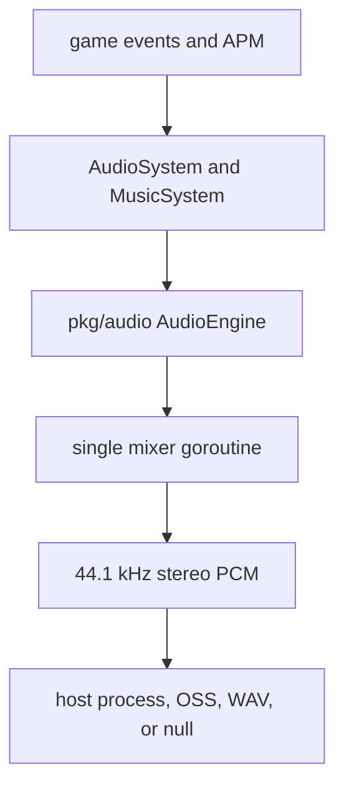
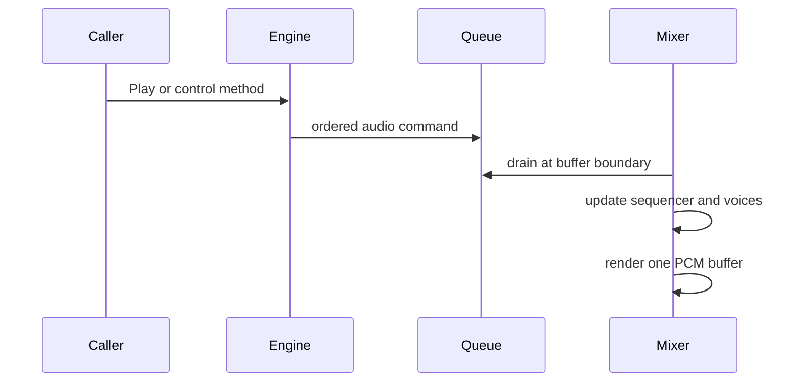
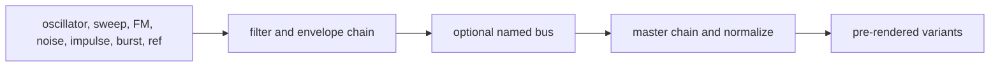

# Audio Architecture

vif includes a pure-Go synthesis, sound effect, mixing, and music-sequencing
engine. It streams raw PCM to an external host process/device; there is no CGO
audio dependency. Game policy is layered over the reusable `pkg/audio` engine
by the audio service and the `AudioSystem`/`MusicSystem` pair.

Three words name what it plays, in code and documents alike:

- **audio** is everything: the engine, its service and backend, and the
  speakers' channel mask, pause and telemetry;
- **music** is what the sequencer plays: patterns (beats, melodies, basses and
  fills) on the music bus, arranged by the conductor;
- **sfx**, a sound effect, is a sound played on a trigger outside the music, on
  the sfx bus.

A **sound** is the synthesized one-shot both draw on: an sfx plays one, and so
does each drum of the music's kit (§5, §7).

## 1. Layered design

- `internal/service.AudioService` configures, constructs, starts and stops the
  engine and contributes it as a capability.
- `internal/system.AudioSystem` plays requested sfx, applies mute and pause, and
  publishes audio telemetry.
- `internal/system.MusicSystem` maps APM and explicit music events to tempo,
  intensity, harmony and patterns.
- `pkg/audio.AudioEngine` is the thread-safe control surface: the sound and
  pattern registries and the backend's lifecycle and failover.
- `pkg/audio.Mixer` owns every live voice and the sequencer, and renders the
  output buffers.
- The backend consumes signed 16-bit little-endian stereo frames.

`pkg/audio` carries no ECS or APM concept. The app injects its sfx levels and
sound shapes, and `MusicSystem` interprets the game's five-second APM signal.
Beside the standard library the package imports only `lixenwraith/toml` and its
`macro` expander, so it can leave the module whole.

Runtime mode and build capability select whether this layer exists. In a full
build, `ModePlay`, `ModeReplay` and `ModeScript` register the audio service;
`ModeHeadless` and `ModeServer` do not. `vif_noaudio` and `vif_headless` omit the
service, engine resource, full audio systems, and `pkg/audio` implementation;
lightweight null systems still consume local audio events and publish audio as
unavailable, preserving telemetry and system controls. The browser build keeps
them all and streams to the page as a host's speakers (§3, [platforms
§8](multi-platform.md#8-adding-another-renderer-or-android-host)). Event
payloads carry audio identifiers from the dependency-free `pkg/audio/model`
package, which every build compiles. Replay rebuilds simulation from recorded
events, including sound requests; the journal carries no mute state, so
`-mute`, `-ab` and `-mw` are the viewer's. The viewer's pause holds the mixer,
as the game's pause does, and so do a seek and the end of the stream. A copy
that takes over to go back keeps the speakers and the conductor's state, since
the engine does not rewind (`system.HandOverSound`).

## 2. Stream contract

| Property | Value |
|---|---|
| Sample rate | 44,100 Hz |
| Channels | 2 (stereo); the mix is mono, written to both |
| Format | Signed 16-bit little-endian PCM |
| Bytes per frame | 4 |
| Buffer duration | 50 ms; `vif.toml` `[audio] buffer_ms`, 10–200 in steps of 10 |
| Frames per buffer | 441 per 10 ms (2,205 at 50) |

Every mixer pass drains pending commands, renders music and sfx into
separate floating-point buses, sidechain-ducks music under sfx, applies the
pause gain ramp, holds the sum under a peak limiter (it sees each peak 64
samples ahead and ramps its gain over that time, releasing over 80 ms, so
stacked kicks duck without a click), converts samples, and writes one PCM
buffer. The output writer is the only backend-specific part of that path.

## 3. Backend detection and failover

Automatic candidates are tried in this order:

| Priority | Backend | Host target |
|---|---|---|
| 1 | `pacat` | PulseAudio protocol, also commonly available through PipeWire compatibility. |
| 2 | `pw-cat` | Native PipeWire. |
| 3 | `aplay` | ALSA command-line playback. |
| 4 | `sox` | The SoX `play` executable. |
| 5 | `ffplay` | FFmpeg playback. |
| 6 | `oss` | `/dev/dsp`, considered only on FreeBSD. |

Detection first checks executable/device availability. Attachment starts a
candidate, writes one silent buffer, and waits through a short survival window;
bad arguments, an unavailable daemon, or an immediate broken pipe fall through
to the next candidate. A process that accepts data but routes it nowhere cannot
be detected by this probe.

The supervisor can move to an untried candidate if the active process exits.
Backend lifecycle has its own mutex because failover and shutdown can race.

`-ab <name>`, long form `-audio-backend <name>`, restricts selection to one
backend. Two explicit-only synthetic
backends are useful in automation:

- `-ab null` runs the full mixer and discards samples;
- `-ab wav:path/to/out.wav` captures the live stream into a finalized WAV file.

`-mw[=DIR]` (`-music-wav`, `paths.music`) records the music bus alone, before
ducking, to `vif-mus-<stamp>.wav` in the state root's `music/` directory, a
sibling of `log/` ([layout §5](filesystem-layout.md#5-logs-journals-and-runtime-output)):
what plays, so a muted or paused stretch adds nothing. It needs a running
mixer; `-ab null -mw` records on a machine with no device.

If no backend survives, the service degrades to a valid silent engine. Gameplay
continues, sound requests become no-ops with rejection telemetry, and absence
of a device is not an application-start failure.

A host that has its own speakers skips detection: `AudioConfig.Sink` (from
`app.Config.Host.Audio`) is a writer the mixer streams to as the `host` backend,
whatever name was forced. Unlike the WAV and OSS sinks it is not closed with the
engine: the host's speakers outlive a run, and the next one, after a scenario
change, streams to the same writer.
Android's is its `AudioTrack`; the browser's posts each buffer that sounds to the
page, which plays it through an AudioWorklet.

## 4. Concurrency and command ownership

Playback, transport, tempo, patterns, harmony, and hot reload share one command
channel, preserving arrival order. Pause and music mute are flags the mixer
reads each pass, and sfx mute rejects a play before it is queued. The live
sequencer, pattern players, voices, sounding sfx, and buses are confined to
the mixer goroutine and need no inner locks.

Commands sent before `Start` are retained in a 64-entry ordered buffer. After
startup, the mixer channel holds 256 commands. A full queue rejects the command;
play rejections are categorized as not running, silent, paused, muted, bad ID,
or queue full. Played/dropped totals and rejection categories are surfaced
through the game status registry.

Shutdown stops the mixer/backend with a bounded wait so a wedged audio process
cannot prevent restoration of the terminal's raw mode.

## 5. Sounds and sound effects

A sound is a declarative `SoundDef`: one or more layers, optional intermediate
buses, and processor chains. `Play` sounds one as an sfx; the drum kit plays
four as instruments (§7).

Sources include oscillators, sweeps, FM, noise, impulses, burst trains,
references to earlier layers, and silence. Processors include filters,
envelopes/decay, modulation, shaping, clipping, and gain. Validation bounds
duration, frequencies/Nyquist behavior, topology, operation count, and authored
structure before rendering.

At startup the engine:

1. registers `AudioConfig.BaseSounds` and `BaseVoices`, which the game fills
   from the embedded bank in `internal/asset/audio` via `parameter.BuiltinSounds`;
2. loads a resolved optional `audio/sounds.toml`, its sounds and voices
   replacing same-name definitions and a new voice name adding an instrument;
3. freezes the name-to-ID registry of sounds;
4. pre-renders the variant cache, under the game's sound shapes
   (`SoundShapes`), and the kit: the drums' variants and the tonal voices;
5. resolves the game's sfx levels (`SfxLevels`) by stable sound name;
6. registers `melody_gen`, `BasePatterns` and a resolved `audio/music.toml`
   (same name replaces), and builds the group arrangement before probing
   backends.

Each sound normally has three pre-rendered variants. The mixer rotates variants
to reduce repetition, allows at most two concurrent sfx per sound and 12 in all,
and steals according to its admission policy when needed. Rapid repeats within
250 ms attenuate toward a 0.25 floor and recover over 600 ms. Sounding sfx duck
the music bus to 70%, with fast attack and slower release; the sfx volume
(`SfxVolume`, the player's `[play] sfx_volume`) scales every sfx and leaves the
music alone.

Sound IDs are process-local registration values. Configuration and persistent
documents must use names, not numeric IDs: a scenario requests an sfx by its
sound's name, `EventSoundRequest { sound = "chime" }`, or gives a button one, and
`AudioSystem` resolves the name as it plays. Such a name skips startup resolution, so a
mistyped one is silent and counts only as a bad-ID rejection.

## 6. Mixer buses, mute, and pause

Sfx and music have independent mute bits. `Ctrl-S` cycles the composed audio
mask through silence, sfx only, music only, and both. Every build starts with
both on, as the embedded `vif.toml`'s `[play]` says, until the player's own
settings say otherwise; `-mute` starts a run muted. Each change is written back
for the next run. `EventAudioMuteToggle` cycles, flips or sets channels from a
key, a system or the configuration menu, and `EventAudioMuteChanged` announces
the mask applied.

Pause is a device/output state, not merely a gameplay-system toggle. It applies
even if `AudioSystem` is disabled and ramps the master gain over 250 ms; music
plays out the ramp, then freezes with its position kept for resume. A run that
ends fades the same way before the engine stops. Muted, `MusicSystem` sends only
what outlasts the mute (patterns, tempo): a start or a note waits for the unmute,
and an unmute does not restart music the run stopped.

A sequencer slot mutes alone (`SetSlotMuted`): its pattern plays on in time,
silent, so it comes back on the step it has reached, and the mute outlasts a
change of pattern. The game leaves every slot sounding; soundlab's mixer mutes
them one by one.

Disabling `audio` gates both channels; disabling `music` gates music alone.
Mute keys still update the user's preference, but cannot open a disabled channel.
Re-enabling restores that preference. The status bar reports effective playback,
including a stopped sequencer or unavailable backend. Pause and telemetry remain
connected while disabled, and startup/reset waits for scenario gates to settle.

## 7. Music sequencer

The sequencer uses a 16th-note grid (`4` steps per beat), 4/4 bars, and four
crossfading slots:

| Slot | Conventional role |
|---|---|
| 0 | Rhythm/drums. |
| 1 | Melody/harmony-following layer. |
| 2 | Free layer or automatic phrase fill. |
| 3 | Bass, the group's anchor. |

A pattern has up to 64 steps, 32 tracks, and 512 events per track. A track sets
its instrument, chord-following, and humanization; its events set step position,
velocity, scale degree, octave, duration, and probability. The tonal voices are
data: a `[[voice]]` of the sound document names an instrument and its synthesis,
an oscillator stage (sine, saw or square) through a resonant low-pass under a
filter envelope into an ADSR, or a string, as a delay line or as its partials
(`VoiceDef`). The shipped five are `voices.toml`; a document's voice of a shipped
name retunes that instrument in place and a new name adds an instrument, which
patterns name as they name any. `DefineVoice` hot-swaps one: the next note plays
the new voice while a sounding one finishes on its own, and an instrument no voice
defines plays a plain sine. The drum kit plays cached sounds. Of the shipped
voices, the pad and the lead are band-limited saws; the pluck a delay line a noise
burst sets ringing. The bass and the piano are modal voices: a string as its partials, each
a decaying phasor at `k·f0` stretched by the string's inharmonicity, at the
amplitude the strike position's comb, the spectral tilt (1/k struck, 1/k²
plucked) and a velocity-dependent hammer low-pass leave it, decaying faster the
higher it sits; the lowest partials carry a second, slightly detuned string whose
slower aftersound gives the double decay, and a few milliseconds of filtered
noise are the hammer or finger contact. The piano has a grand's stretch and the
soundboard's roll-off; the bass is finger-plucked into a pickup resonance and an
amp, its note-off a 45 ms damper.

Tempo is clamped to 80–200 BPM. Tempo changes can wait for the next beat;
patterns can transition immediately or quantized to the bar. The incoming
pattern plays at full level from its first trigger while the outgoing one's
ringing tails fade out, over at least 256 samples so none is hard-cut; a slot
holds three players, so a transition arriving while the last one still fades
retires a second tail rather than cutting the first. A reveal
builds a rising tier up from as many tracks as the outgoing pattern sounded,
adding one a bar, so a build-up never starts thinner than what it replaces.
Slot 2 substitutes a seeded fill on the last bar of each eight-bar phrase and
restores the previous pattern on the downbeat. The fill is on by default;
`SetAutoFill(false)` turns it off, as soundlab does.

Drawn music comes from groups. A pattern's `role` (rhythm, melody, fill or
bass), `groups` and `tiers` place it; `Start` builds each group's pool per tier and
role from the registry. A group's bass patterns are its anchor: a tier change
keeps the bass that still covers the tier and redraws rhythm and melody, so what
the group plays follows what it played before. The sequencer holds one group,
moving only when it does not cover the tier; each phrase downbeat swaps one drawn
slot, melody, rhythm and bass in turn, to another member of its pool, once four
bars have passed since any drawn slot changed; and after four phrases every drawn
slot moves to another group behind the phrase's fill. A draw takes the pool
member played least this run, so a held tier works through its pool before
repeating.

Three ideas organise the drawing, from the outside in:

| Term | What it is | When it changes |
|---|---|---|
| group | A style: one bass figure and kick feel, with its own rhythms, melodies, basses and fills (`groups`). | After four phrases, every drawn slot together. |
| tier | How much is going on, calm to peak (`tiers`); the conductor picks it from the APM. | With the action, under hysteresis (§8). |
| motif | One melodic idea at five weights, one per tier, within a group (`motif`): the ladder a melody climbs and descends as the tier moves. | A phrase variation moves to another motif, after a rest bar. |

So a tier change keeps the melody's motif and takes its member at the new tier,
which for the shipped themes is the same line with more or fewer layers under
it, and only a phrase variation changes the idea: the melody then fades out
through the fill bar and the new motif enters alone on the downbeat. A melody
change quantized to the bar lands on the end of the pattern's own cycle, so a
four-bar theme is heard through. Fills come from the same group and tier. A slot
placed explicitly is left alone.

Harmony holds root note, scale, and chord progression. Pattern degrees resolve
through the current harmony at trigger time. With the same seed and identical
bar-aligned command schedule, generated music is reproducible; wall-clock
arrival relative to bars is not a recorded replay contract, but draws and steps
roll on separate streams of the seed, so a bar of skew between two runs moves
no later draw: the arrangement holds where the notes under it differ. The
conductor seeds the sequencer from the run's own music stream, so each run draws
its own pools.

## 8. Adaptive game conductor

`MusicSystem` is the conductor. Once per game update it observes five-second
music APM and maps it to:

| APM range | Intensity tier |
|---|---|
| below 60 | Calm |
| 60–139 | Normal |
| 140–219 | Elevated |
| 220–299 | Intense |
| 300 and above | Peak |

The target tempo is `100 + 100·√(APM/480)` BPM: 100 at rest, 135 at 60 APM, 150
at 120, 168 at 220, 179 at 300, and the engine's 200 maximum only at the 480
ceiling, which a pointer alone (four gestures a second, 171 BPM) cannot reach. The
conductor slews rather than jumping (12 BPM/s upward, 6 downward), ignores
changes smaller than three BPM until the slew settles on its target, and the
sequencer applies each on the next beat.

The tier follows the APM under hysteresis (`parameter.TierTracker`): it holds
four seconds after any change before rising, then goes straight to the APM's
tier; it falls one tier at a time, each after the APM has sat 30 under the
tier's floor for five seconds. A burst reaches its tier in one or two swaps
instead of one a bar, and a lull steps down over a phrase or two instead of
collapsing inside the five-second window. A tier change draws from the current
group under quantization/crossfade/reveal policy, and a slot already sounding
its draw keeps playing. The `music.*` status group (the telemetry HUD's music
card, and the periodic stat log) names the group, tier, requested tempo and the
pattern in each slot, and reads `-` (tempo 0) while music is muted, stopped or
disabled.

Explicit music events can start/stop, set patterns, play a melody note, change
intensity, tempo, seed, swing, or harmony. A manually held intensity can later
be released so APM control resumes. APM policy stays under `internal/parameter`
and `internal/system`, leaving `pkg/audio` reusable.

## 9. Authored music and sound overrides

The service receives optional files resolved through the common config-root
hierarchy:

- `sounds.toml` supplies sound and voice definitions and name-based overrides;
- `music.toml` supplies pattern definitions.

The categorized locations are `audio/sounds.toml` and `audio/music.toml`.
`-config-sounds` and `-config-music` are strict individual overrides. See
[External filesystem layout](filesystem-layout.md).

An invalid user definition leaves the shipped one in place; a document that does
not parse or names an unknown key is ignored whole. A user `sounds.toml` may
`include` files inside its own directory, which the game, `-check` and soundlab
resolve alike, so a file soundlab saves with its includes is what play loads.
Play reports the first line of the engine's combined specification error on the
status bar;
`vif -check` checks music, then sounds, before startup and stops at the first
document that fails, listing every invalid definition in it.

The shipped banks are `internal/asset/audio/sfx.toml`, `drums.toml`,
`voices.toml` and `music.toml`, embedded and handed to the engine as
`BaseSounds`, `BaseVoices` and `BasePatterns`; `pkg/audio` ships no authored
content. Both documents may define
`[macros]` and invoke them ([TOML macros](toml-macros.md)); the shipped bank
writes each drum lane and note line through one. `melody_gen` reserves its fixed
ID in code and takes its placement from the bank; the generator rewrites its last
track. Group pools are fixed at `Start`. Later same-name
registrations replace a definition while preserving its runtime ID, which allows
live tooling to update a playing registry.

## 10. Soundlab

Soundlab is the supported authoring environment built on the same engine.
`internal/soundlab` holds the session, its documents, the verb table and the
TUI, which runs over any `terminal.Terminal`; `cmd/soundlab` is its terminal
command, the flags and the REPL, and a host with its own screen and speakers
runs the package in-process, handing `NewSession` the speakers. It offers:

- a command REPL;
- a full-screen TUI: a browser of patterns, sounds and voices beside a mixer that draws
  every slot on one timeline and mutes a slot, a structural inspector, and the
  pattern editor, new or on an existing pattern: a drawn keyboard that records
  takes onto the key's degrees, and a step grid with a piano roll;
- headless `.slab` script execution;
- validation, live registry apply/revert, audition, sequencer slot assignment,
  TOML save, and WAV export.

Soundlab registers the same sound and pattern banks the game does, from the same
embedded assets, and takes vif's `-config-dir`, `-config-music` and
`-config-sounds`. It resolves both overrides through `internal/paths` exactly as
the game does, registers them, and opens them as its documents, so its registry
and the game's hold identical specs. Of `vif.toml` it reads only `[paths] root`
and `[audio] buffer_ms`, so a key another vif build wrote is named and skipped,
never dropped from the file as a game run drops it. A save writes where the next run reads
first: the `-config-music`/`-config-sounds` file when given, else
`audio/<file>` under `-config-dir` or else the user root, shadowing any copy in
a lower root. It does not apply the game's sfx levels and sound shapes, so its
auditions and exports play a spec as authored.

The working document and live registry are separate: edits do not affect audio
until `apply`; `revert` restores the document from the canonical registry. Its
dotted path grammar follows TOML tags and Go types, while domain validation
runs at `validate`/`apply`. See `cmd/soundlab/README.md` for the command/TUI
reference.

## 11. Ripping a recording

`RipWAV` and `RipSamples` listen to a recording and estimate what the sequencer
would need to play it: the tempo, where the bars fall, the key, the chord root
each bar leans on, and per bar the kick, snare and hihat hits, the melody and the
bass line as steps of the sixteenth grid (`Rip`). `Patterns` writes them as
patterns of up to four bars, named `<name>_beat_<n>`, `<name>_melody_<n>` and
`<name>_bass_<n>` in a group of their own and no tier; soundlab's `rip` adds
them to the document, dirty, and sets the transport's tempo and key, so a slot
plays the estimate at once. `ReadWAV` reads the file, any PCM or float width.

The analysis runs at 22.05 kHz over 93 ms frames every 11.6 ms, each split into
a harmonic and a percussive part by the medians across time and across frequency
around it. The percussive onsets, each drum's band against its own peak with the
kick's counting double, give the tempo (autocorrelation under a log-Gaussian
prior centred on 120 BPM, folded into the sequencer's range) and the beats (a
dynamic programme that holds to the period). A hit is a kick by its rise under
100 Hz, a hihat by its rise above 5 kHz, a snare by the middle with some noise
above 5 kHz, and may be two drums at once; the bar line is the phase whose
downbeats carry a kick, no snare and the key's root in the bass, the snare on two
and four, and the most change of chroma. The key is the root and scale whose tones
hold the most chroma and whose others the least, the bass register voting for the
tonic. Pitch salience sums a candidate's partials, the bass register's from its
first three and the melody's with the bass's partials cancelled, so a bass's
octave does not read as a melody note; a hidden path through the frames, scored
against the costs of moving and of starting or ending a note, is cut into notes,
which land on the key's nearest degree. `RipParams` holds every threshold.
`DefaultRipParams` is the hand-set start, meant to be refined by a search over
material the engine renders itself, whose patterns are known
([TODO](todo.md#tune-the-rip)).

What it does not yet tell apart: a bass note's attack from a kick, a plucked
chord's attack from a snare, two voices in one register, and a note off the key
from a change of key. What it writes is the engine's grid and scale, an estimate
to edit, not a transcription.

## 12. Extension checklist

For a new sound effect:

1. author and validate a named sound definition;
2. add it to `internal/asset/audio` or a tested override document;
3. for an sfx Go emits, add its sound's name to the game's sfx table
   (`parameter.SfxSet`, `sfxTable`) with its level and shape, and run startup
   resolution so a missing mapping fails early; an sfx only configuration names
   needs neither;
4. emit `EventSoundRequest` from the mechanic rather than calling the engine
   from arbitrary systems;
5. verify rapid-fire, polyphony, mute, pause, silent-backend, and 256-command
   saturation behavior.

For a new instrument, author a `[[voice]]` in `voices.toml` or in a user
`sounds.toml` and name it in a pattern's track; soundlab auditions it with `note`
and its keys.

For music, keep new APM/campaign decisions in `MusicSystem` or configuration
events and keep the sequencer unaware of gameplay concepts.

## 13. Source map

- The package's own README, the module's at the spin-off: `pkg/audio/README.md`
- Engine and backend lifecycle: `pkg/audio/engine.go`, `detector.go`, `wav.go`
- Ripping a recording: `pkg/audio/rip.go`, `dsp.go`, `wav.go`
- Mixer and sfx admission: `pkg/audio/mixer.go`, `cache.go`, `kit.go`,
  `sound_render.go`
- Sound and voice schema, loading and registries: `pkg/audio/sound_spec.go`,
  `sound_valid.go`, `sound_load.go`, `sound_registry.go`, `voice_spec.go`
- Shared protocol identifiers: `pkg/audio/model`
- Shipped sound and music banks: `internal/asset/audio/*.toml`,
  `internal/parameter.BuiltinSounds`, `BuiltinPatterns`
- Sequencer and patterns: `pkg/audio/sequencer.go`, `pattern*.go`, `harmony.go`,
  `motif.go`, `track.go`, `voice.go`
- Game service: `internal/service/adapter_audio.go`
- Game event adapters: `internal/system/audio.go`, `music.go`; `speakers.go`
  holds the mask both publish and the handover; `audio_none.go` the null systems
- Mode and build selection, replay default: `internal/app/config.go`,
  `audio.go`, `audio_none.go`, `play.go`
- Game policy: `internal/parameter/audio.go`, `music.go`, `sfx.go`,
  `sfx_audio.go`
- Authoring tool: `internal/soundlab`, its command `cmd/soundlab`,
  `cmd/soundlab/README.md`
