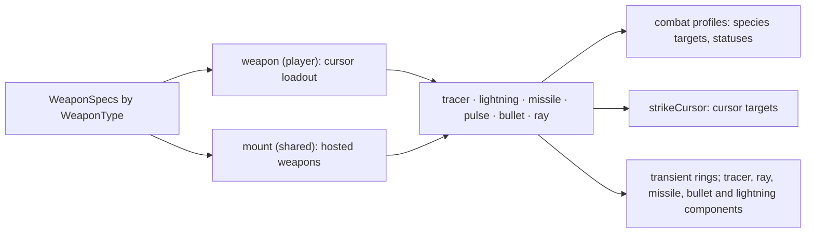

# Combat and weapons

How weapons are defined, who fires them, how their hits resolve, what a hit can
leave behind, and what crosses between instances. The domain rules cited as D-n
are in [the domain model](domain-design.md); per-weapon tuning is in
`internal/parameter`.

## 1. The boundary

A weapon belongs to its host's domain, and nothing about a weapon leaks into
another one.

| | Weapon on a cursor | Weapon mounted on a Shared host |
|---|---|---|
| Simulated by | the cursor's owner only (D-2) | every instance, identically |
| State | `WeaponComponent`, owner-authored (D-13) | `MountComponent` on the host, in the capture |
| Positions read | the predicted cursor cell (D-18) | Shared positions only, roster order on ties |
| Shots and visuals | Player-domain, on the owner alone | Player-domain, re-derived on every instance (D-6) |
| What crosses | impacts only: damage, knockback, stun, burn (D-3) | nothing |
| Hits on cursors | none (no PvP) | applied by each cursor's owner alone |

A peer never sees a remote cursor's orbs, tracers, projectiles, bolts, rings or
rays, and never receives its loadout's behaviour; it receives what that loadout
did to the Shared world, as the artifacts in §5. A mount raises only local
events: its cursor hits go through `strikeCursor`, which acts only on a cursor
this instance simulates.

## 2. Layers

`component.WeaponSpecs` is the one table of weapon kinds: status name, delivery,
combat attack family, cursor cooldown and charge cap, whether the kind is innate
and fires from the cursor, the cardinals a tracer volley covers (`Directions`),
the hosted range and the `CursorDamage` a hosted hit costs (`HostedDamage`), and
what the kind gains at its cap (§4). A new kind adds a row; drivers and renderers
index by kind.

| Kind | Delivery | On a cursor | Mounted |
|---|---|---|---|
| Gun | tracer | innate; one streak per cardinal from the cursor, direct damage on contact, the polarity's glyph effect along the way | none |
| Rod | lightning | direct hit per unique nearest target, bolt from the orb | zaps the aimed cursor |
| Launcher | missile | one homing missile per charge; the blast is explosion geometry | one hostile missile that homes on cursors |
| Disruptor | pulse | stun burst centred on the orb when a target is inside | strikes every cursor inside its ring |
| Turret | bullet | one spread bullet per charge, direct damage | hostile bullets; storm's red circle is one |
| Emitter | ray | timed ray from the cursor through its orb at an assigned target, sweeping as the orb orbits; at the cap it is sustained (§4) | warns, fires, rests along a locked ray |

## 3. Drivers

**`weapon`** (player) owns cursor loadouts: charges and cooldowns, one orb per
held kind that has one, and firing on main fire. A cursor is built holding one
charge of each innate kind, the gun; loot grants the other kinds; a zero crossing of the
cursor's energy clears those and keeps the gun; `EventWeaponRemoveRequest` takes
any kind, the gun included, for a region fought without it. Aimed deliveries
share one nearest-target query from the cursor, sized to the largest ready
loadout; every shot leaves from its kind's orb, or the cursor while the orb is
unplaced or the kind has none. Spread draws from the Player stream.

Tracers are the weapon system's own, as rays are: the gun's volley spawns one
per direction and lane, and every tick each sweeps its row or column cell by
cell, striking the first wall or combatant it meets and draining its trail
there. A tracer takes the cursor's polarity when fired: a positive one turns the
red glyphs it crosses into blossom, a negative one turns blue ones green and
releases decay from them.

**`mount`** (shared) fires the one weapon a Shared host carries. A level attaches
it with `EventMountRequest` (host, weapon, interval, range, muzzle, lane, width),
capturing the host from `EventSpeciesCreated` as a gateway is attached; a species
may set the component itself. Each tick it:

- aims at the nearest cursor within range, aspect-corrected, from Shared positions;
- fires when ready and, under `MountArmed`, only while the host holds `Armed`;
- leaves a shot from the host pushed `Muzzle` cells toward the aim;
- seeds a shot's spread from the tick and the host, never a stream, so store order
  and a correction's replay cannot reorder draws (D-8).

A ray is a `vmath.Ray` in a `RayComponent`: any angle, run to the first wall or
the map edge, one width up to its knee and another past it. A cursor's ray sits on
its orb: laid every tick from the cursor through the orb, one cell wide to the orb
and three past it, so it sweeps as the orb orbits. It strikes every tick, and
combat's per-player, per-weapon immunity rates each target, because a sweep crosses
a far target in about one tick. More charges fire longer and multiply its area hits'
damage through `Scale`; its cooldown runs from firing, so they also fire more of it.

A ray mount cycles on its host's `RayComponent`: at rest until ready, then a
warning with the ray laid and locked (its lane, or straight at the aim), then firing,
striking the cursors inside every `RayHitInterval`, then rest for its interval. A
laned ray needs no cursor in range; that is the level obstacle. Width is the
mount's to set; a cursor's is fixed.

Storm's red circle carries a turret mount the storm arms from the state each tick
opens with, so the burst fires on its active ticks exactly; the storm renderer
reads the mount's aim for its muzzle.

## 4. At the charge cap

Charges only rise, so a kind at `MaxCharges` keeps its cap effect until the
loadout is lost. The row names the effect; a zero field leaves the kind as it
is below the cap.

| Kind | At the cap | Row |
|---|---|---|
| Gun | three lanes per direction, one row or column apart; two charges give two | `MaxCharges` |
| Rod | each unique hit arcs once to the nearest other target within `ArcRange`, in the rod's own priority: a request of the same family from the struck cell, so the zap runs target to target; a target the volley struck or arced to is skipped, and nothing random decides a hit | `ArcRange` |
| Launcher | fires on `MaxedCooldown`, half its cooldown | `MaxedCooldown` |
| Disruptor | the pulse artifact carries `Charged`, and the pulse profile's `Charged` chain burns every hit entity (§5) | the profile |
| Turret | streams between waves: a wave arms a per-kind timer the weapon system ticks only while that wave's cooldown runs, firing `Stream` bullets at the nearest target every `WeaponStreamInterval` without resetting the cooldown or flashing the orb; the timer is its author's alone, so a new author's starts over at most one interval late | `Stream` |
| Emitter | the ray is sustained while main fire is held: every fire request, taken by the main cooldown or not, lights a ray on the orb where none burns, needing no target, and renews its `RayHold`; a held ray stays at full strength, a timed ray still burning converting in place; main fire resets no cooldown and flashes no orb; when the hold lapses the ray burns out as a timed one | `Sustained` |

## 5. Resolution, statuses, and what crosses

Hits on species resolve through the profile matrix in `internal/profile/combat.go`,
`[attack][attacker][defender]`: damage type and value, knockback, stun, chains.
The damage type picks the resolver: direct, area, or over-time, which leaves a
status instead of taking hit points. Damage allowances are per player and attack
family within the target's immunity window (D-3); chained effects keep their
originating weapon's allowance. Knockback and stun immunity each cover all players
and weapons. Species-authored invulnerability is the ward status and blocks every
weapon's damage.

A status is one slot per kind on `CombatComponent`, no stacking: remaining time,
a period and its timer, a magnitude, the crediting cursor and the family it
records under. Combat ages every slot each tick. The ward is the one slot a hit
never writes: quasar shields, storm phase and the shielded snake head refresh it
from their own systems, and combat refuses every hit's damage and every tick while
it runs. Stun suppresses movement and is never refreshed while it runs, so a target
under fire from two players still leaves it. Burn is the charged pulse's chained
over-time attack, `CombatAttackBurn`: `BurnDamage` every `BurnPeriod` for
`BurnDuration`, the last refresher credited, each tick recorded under the burn
family, flashing the target and setting `LastDamagedBy` on it and its header.
Nothing spends the burn family's immunity, so only a ward refuses a burn or its
tick; a tick spends no window, so a player's own burn never blocks their direct
hits. The digest names every slot field, so a status is compared state.

Hits on cursors are `CursorDamage`: energy through an active shield, heat without
one. Projectiles find the cursor they touch with `CursorContactAt`, shields
first. Species contact costs `profile.Contact` through `strikeCursor`:
`strikeContacts` for composites, with the shield's impact crossing, and Kraken's
own footprint test for its hundreds of cells.

| Cursor weapon hit | Artifact |
|---|---|
| Tracer, rod, turret bullet on a Shared target | one direct request stamped Shared (stamped class) |
| Missile blast, disruptor pulse | explosion geometry: centre, radius, attack, owner, and whether the weapon was at its cap |
| Special-fire detonation | one batch of explosion centres sharing radius, attack and owner |
| Ray on a Shared target, each tick it covers it | area crossing: target, member set, owner, scale |
| Any hit on a drain | local; drains are Player-domain |

Follow-ups are derived, never transported (D-5). The tracer's impact chains into
a lightning direct attack whose energy-drain effect spawns the zap from the
cursor, which is why the tracer's bolt starts at the cursor and the rod's at its
orb; a charged pulse's area hit chains one burn request per hit entity, the same
on every instance.

## 6. Presentation

Renderers draw only what exists on their instance. Orbs take their kind's colour
from `orbPalette` and show the bullseye at the cap. A discharge's `WeaponPalette`
is positive or negative by the cursor's energy, or hostile for a mount; a tracer
keeps the palette it was fired with and draws as a background-only trail that
contracts as it drains. Pulse rings are a fixed-capacity list in
`TransientResource`, raised by `EventPulseVisualRequest`. Rays are drawn straight
from their `RayComponent`: a white core, sides in the palette where the ray widens,
a mount's warning as its core line alone. Missiles and bullets draw hostile colours
from their `Hostile` flag; lightning uses its colour table. Each has a 256-colour
path.

## 7. Tick order

`weapon` runs early with the player state and advances tracers last in its tick.
Host species run next, then `mount` after every host so a host arms before its
mount fires, then `combat`, which also ages statuses and lands burn ticks.
Lightning, missile and bullet integrate after combat; `transient` ages rings late.

## 8. Adding a weapon

1. Add the kind to `WeaponType` and its row to `WeaponSpecs`, with parameters; an
   innate kind sets `Innate` and `FromCursor`, a cap effect fills its field.
2. Reuse a delivery, or add one with a case in `WeaponSystem.fireLoadout` and
   `MountSystem.fire`.
3. Give its attack family a profile against every cursor defender; an over-time
   family sets `Status`, `Period` and `Duration`.
4. Add its orb colours, loot type with its `LootSpecs` and `LootVisuals` rows, and
   a tier in `profile.Drops`, unless it is innate.
5. A player-domain push of a replicated event must be named in `crossingPushes`
   with the artifact it crosses; `TestEventClassMatchesSystemProfile` enforces it.

Telemetry: the `weapon` card holds the loadout, orbs and tracers in flight,
the `weapon.fired` and `weapon.rejects` groups the counters, `weapon.tracer_*` the
sweep; the `combat.damage.family` group is the damage each attack family deals,
which is how a weapon's effect reads; `combat.effect_burn` and `combat.burn_ticks`
count burns left and ticks landed; `mount`, `missile` and `bullet` hold their own.
