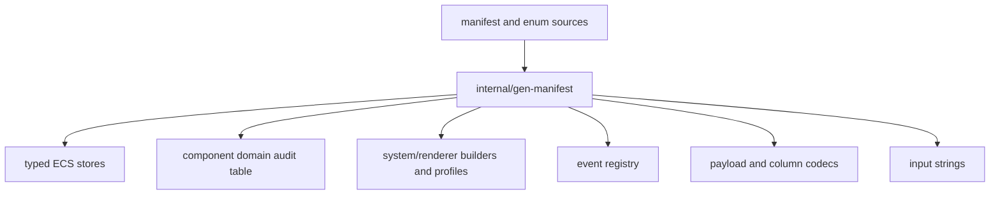

# Development, Builds, Diagnostics, and Operations

This guide covers the repository's generated-code contract, build variants,
verification surface, platform boundaries, and runtime diagnostics. The package
responsibility map is in [Package map](package-map.md).

## 1. Toolchain and dependencies

`go.mod` declares Go `1.27.4`; use that version or a compatible newer toolchain.
The application has no CGO requirement, but it is not standard-library-only.
The modules it requires:

- `github.com/lixenwraith/terminal`: raw terminal, input events, cell flush,
  color-mode detection and the `tui` widgets; the page host and its scripts, the
  Android view's mapping (`android`) and the cell font (`glyph`, `atlas`).
- `github.com/lixenwraith/terminal/window`: the desktop window, a module nested in
  terminal's repository, required at terminal's version.
- `github.com/lixenwraith/color`: RGB/palette values and blend functions.
- `github.com/lixenwraith/toml`: scenario, FSM, content, keymap, audio, bot-graph,
  `vif.toml`, script and journal-payload parsing.
- `github.com/lixenwraith/log`: asynchronous structured file logger behind
  `internal/vlog`.
- `github.com/lixenwraith/audio`: synthesis, mixing, the sequencer, MIDI, the rip
  and the shipped banks.
- `github.com/lixenwraith/genetic`: the streaming engines and the registry that
  evolve species parameters.
- `github.com/lixenwraith/ascimage`: dual-mode cell images: a wall pattern's
  `.aimg`, the logo's quadrant fit, and `bin/ascimage` from `make tools`.
- `github.com/lixenwraith/auth`: Argon2id-SCRAM for a passphrase door and an
  account sign-in: the credential a player derives, the exchange both ends run. Its
  JWT half is unused ([Auth and session design D7](auth-session-design.md#0-decisions)).
- `golang.org/x/sys`: Windows' system calls: `pkg/network`'s error codes, and the
  window build's console, message box and WASAPI stream (`cmd/vif`).
- `github.com/ebitengine/purego`: the build's own stream loads the sound server's
  client library through it with cgo off (`cmd/vif/pulse.go`), as the window
  (`terminal/window`) loads Xlib, EGL and GLES 2 or desktop OpenGL.
- Indirect: `x/term`, which the terminal module uses; and `x/crypto` and
  `golang-jwt/jwt/v5`, Argon2 and the JWT half `auth` carries.

Audio sends PCM to optional host commands; see the audio library's
[§3](https://github.com/lixenwraith/audio/blob/main/doc/audio.md#3-backend-detection-and-failover) for runtime
backend choices. A compiler, module download access, and a terminal are enough
to build the normal binary. When the `GO` command is missing, a target that
compiles shows Go's install by hand and offers the system's package (Arch,
Debian's snap, FreeBSD, Homebrew) or Go's latest release, checked against the
SHA-256 go.dev lists and unpacked as `.go/` (`GO_DIST`), last on `make`'s `PATH`
for this checkout alone (`script/toolchain.sh`). Beyond Go, `make android` names each JDK or Android SDK piece it
lacks, which `make android-toolchain` installs ([android/README.md](../android/README.md#build)).

## 2. Common build workflow

```bash
git clone https://github.com/lixenwraith/vif
cd vif
make dev       # generated code + race-enabled debug build
./bin/vif
```

`make` with no target prints `help`, which lists every target below but `generate`:

- `generate`: run the manifest/event/input code generator.
- `dev`: generate and build `cmd/vif` with the race detector/debug symbols.
- `release`: build a stripped `-trimpath` native binary without CGO: the terminal
  and, on Linux and FreeBSD, the desktop window `-g` opens. Where purego, which the
  window links, does not build (Termux), `release`, `nolog` and `gui` stop before
  compiling and name `make cli` and `TAGS=vif_nogui`. It writes `bin/NOTICES`
  (`notices`) and copies the cell font's license, the terminal module's
  `atlas/LICENSE`, to `bin/LICENSE.font`. Only `dev`, `test` and `verify`
  regenerate: the binary targets build the committed generated files, as a
  packager does.
- `headless`: build `bin/vif-headless` without terminal presentation, renderers, or
  audio.
- `gui`: build `bin/vif-gui`, the release binary opening the desktop window by
  default (`vif_gui`); `-g=false` is its terminal.
- `cli`: build `bin/vif-cli`, the terminal alone, no desktop window (`vif_nogui`),
  for Termux or a machine without X.
- `nolog`: release-style build with the `novlog` tag.
- `wasm`: build log-free `web/vif.wasm` for the browser page in `web/`, with its
  toolchain's `web/wasm_exec.js`, the page's scripts (`page`) and its `NOTICES`.
- `page`: write the page's two scripts, which no commit holds, into `PAGE_DIR`
  (`web/`): `terminal.js`, the terminal module's `web/page.js` followed by
  `web/vif.js`, and the module's `worker.js`, of the version the build links.
- `extension`: build `wasm`, then pack the page as a Chrome extension:
  `bin/vif-chrome/` to load unpacked and `bin/vif-chrome.zip` for the store
  (`EXT_VERSION`, `EXT_KEY`; [Packaging §8](packaging.md#8-chrome-web-store)).
- `windows`: the experimental terminal build for `windows/amd64`, cross-built with
  cgo off and no window, audio or log (`novlog vif_noaudio vif_nogui`).
- `windows-gui`: the window build for `windows/amd64` as `bin/vif-gui.exe`
  (`vif_gui novlog`), linked with no console, so no terminal; sound through WASAPI.
- `windows-package`: that build as a release's zip holds it, in
  `bin/vif-windows-amd64/` (`WINDOWS_DIR`): `bin/vif.exe`, the wad beside its
  `bin/`, the licenses and a README.
- `run`: build the dev binary and execute it.
- `test`: generate and run `go test -race ./...`.
- `verify`: generate, test, vet, and compile the full (also with cgo off), `novlog`,
  audio-free, headless, `vif_nogui`, WASM and Windows variants, the full and WASM
  ones also with `GOEXPERIMENT=simd`, vet and test the `android` module, and test
  the window module (§5).
- `arch-check`: report `pkg/*` packages that import `internal/*`; diagnostic and
  separate from `verify`.
- `tools`: build every `tool/*` command, and `bin/ascimage` from the
  `lixenwraith/ascimage` version `go.mod` requires.
- `router`: build the website-to-K3s session router as `bin/vif-router`.
- `serve`: build WASM and the small HTTP server, then serve `web/`.
- `install-config`: copy `wad/`, bot graphs, keymaps and `vif.toml` into the user
  config root, an `input/keymap.toml` or `vif.toml` already there brought up to
  date with its lines kept ([Filesystem §4](filesystem-layout.md#4-installation)).
- `purge`: beside `install-config` or `install`, in either order, has that install
  first remove what an earlier one put in its root, a player's bot files, keymap
  and settings with it; alone it removes nothing.
- `wad-archive`: pack that same install as `bin/vif-wad.tar.gz` (`WAD_ARCHIVE`),
  unpacking as `vif/` into the directory that holds a config root; the release
  publishes it.
- `steam-linux`, `steam-windows`: assemble a Steam depot in `bin/steam/linux/` or
  `bin/steam/windows/` (`STEAM_DIR`), laid out as `windows-package`'s;
  `steam-upload` sends them through `steamcmd` ([Packaging §9](packaging.md#9-steam)).
- `release-readme`: print the README of one release archive (`RELEASE_TARGET`,
  `RELEASE_LABEL`), rendered from `deploy/package/release-readme.md`.
- `notices`: write `bin/NOTICES` (`NOTICES`): the licenses of Go and of every module
  the build links, the host's release or the one `GOOS`, `GOARCH` and `TAGS` name,
  from the module cache or `vendor/`; `NOTICES_OF=android` is the Android
  library's. `release` runs it, `wasm` writes the page's beside `vif.wasm`, and
  `install` stops without the file.
- `install`: install the binary, manual, desktop entry, icons, shell completion,
  licenses and docs under `PREFIX`, and the wad as `$(SYSCONFDIR)/vif`; a user who
  cannot write `/usr/local/bin` gets `~/.local` and the user root. Compiles
  nothing: `make release install` builds first.
- `uninstall`: remove what `install` put under `PREFIX`, keeping the config root.
- `image`: build the dedicated-session container image from
  `deploy/docker/Dockerfile`.
- `image-check`: run the built image's own `-check` as its numeric user, read-only
  and with no network.
- `android`: build the debug APKs, one per ABI, as `bin/vif-debug-arm64.apk` and
  `bin/vif-debug-x86_64.apk`, first naming any JDK or Android SDK piece missing.
- `android-install`: install the debug APK of the ABI of the device `adb` sees.
- `android-toolchain`: install what `android` needs, asking first
  ([android/README.md](../android/README.md#build)).
- `clean`: remove `bin/` and the Android build directories.

`TAGS` appends build tags to each `cmd/vif` build and `PORT` changes the WASM
server port. `SIMD` (default `auto`) builds the presentation targets (`dev`,
`release`, `gui`, `cli`, `nolog`, `wasm`, `windows`, `windows-gui`, `android` and
the packages built from them) with `GOEXPERIMENT=simd` where the toolchain takes
it, so lixenwraith/terminal's cell diff runs on AVX2, NEON or WebAssembly SIMD128;
`SIMD=1` insists and `SIMD=0` leaves it out. The experiment is Go's, outside the
Go 1 promise, and on amd64 also moves the runtime's map hashing onto
`simd/archsimd`; a SIMD browser build needs WebAssembly SIMD, which every current
browser has. `GO` names the toolchain command (on FreeBSD, the versioned package
`go.mod` asks for).
`GO_BUILDFLAGS` (default `-trimpath`) and `GO_LDFLAGS` (default `-s -w`) are the
release-style flags; they are not `GOFLAGS` and `LDFLAGS`, which the go command
and the C linker read from the environment themselves.
`VIF_CONFIG_DIR` retargets `install-config`; `DESTDIR`, `PREFIX` (default
`/usr/local`) and `SYSCONFDIR` (`/etc` for `PREFIX=/usr`, the user config base for
a user install, else `$(PREFIX)/etc`) retarget `install`. See [Packaging](packaging.md).
`CONTAINER_ENGINE`, `IMAGE` and `IMAGE_TAG` retarget the image build — the engine
defaults to `docker` and accepts `podman` — and `IMAGE_VERSION` and `IMAGE_REVISION`
(default the tag and `HEAD`) become its OCI labels. The image is a `scratch` layer
holding one static non-root `vif_headless` binary with its `NOTICES` and `LICENSE`; `image-check` is the only way to
prove it starts, because there is no shell in it to ask.
Release-style profile targets use stripped linker flags; `dev` intentionally
retains diagnostics and enables race instrumentation.

Runtime modes and compile-time profiles are different boundaries. `-serve` in a
full binary skips presentation initialization; `make headless` also removes its
terminal adapter and generated renderer registry from the build. The tag contract,
measured artifacts, browser constraints, and future-renderer path are in
[Build profiles and platform boundaries](multi-platform.md).

## 3. Generated code

The human-edited source is `internal/manifest/definition.go` plus the event and
input enum declarations. `go generate ./internal/manifest/...` runs
`internal/gen-manifest` and rewrites:

| Generated file | Derived from | Contains |
|---|---|---|
| `internal/engine/component_store_gen.go` | manifest components | typed component fields, mask bits, initialization, per-entity/batch removal/wipe |
| `internal/engine/component_domain_gen.go` | `ComponentDef.Domain` | `componentDomains`, the replication-domain audit table |
| `internal/engine/snapshot_world_gen.go` | manifest components | the shared-world capture, its delta, the install/reconcile passes over every store, and the player-world capture a journal's opening carries |
| `internal/engine/snapshot_pages_gen.go` | manifest components | the canonical page rows a correction manifest is hashed over, and the writer one repaired page is applied through |
| `internal/engine/snapshot_columns_gen.go` | the component types | each store's columnar keyframe layout: entities as deltas, then each field over every row |
| `internal/manifest/build_gen.go` | manifest systems | core constructors, active-name list, profiles, and snapshot declarations |
| `internal/manifest/build_audio_gen.go` | systems with the `audio` capability | audio-capable constructors and names |
| `internal/manifest/build_noaudio_gen.go` | audio capability boundary | audio-free event-sink constructors |
| `internal/manifest/render_gen.go` | manifest renderers | terminal renderer constructors and priorities |
| `internal/event/registry_gen.go` | `internal/event/type.go` and payload comments/types | event name/type/payload registry and the replication class table |
| `internal/event/payload_gen.go` | registered payload structs | the field tables the wire and journal codec walks |
| `internal/input/strings_gen.go` | selected input enum const blocks | enum string/reverse lookup tables |



Do not edit files beginning `Code generated by gen-manifest`. Generation uses
the Go parser and formatter and deliberately sorts discovered enum/state data
where stable output matters. If formatting fails it leaves a `.err` artifact
beside the intended output for diagnosis.

Any change to components, system/renderer assembly, event declarations, or
input enums must include regenerated output. The release workflow regenerates
before it builds and fails a tag whose tree that changes (§6); the test workflow
does not check.

## 4. CLI reference

`-h`, `-help` and `--help` print the table below to **stdout** and exit zero, so
`./bin/vif -h | grep authority` works without redirecting stderr. A malformed
flag still goes to stderr with exit 2, which is the `flag` package's contract for
a usage error. Short and long forms of the same option share one line here and
one line in the program's own help; they are the same flag, not aliases, so
`-s` and `-config-scenario` write the same field and the last one on the command
line wins. That help is `helpSections` in `cmd/vif/usage.go`, which also renders
`doc/vif.6` and the shell completions in `deploy/package/`. A flag sets its value
for that run alone and is never written back; `vif.toml` holds the defaults
([Filesystem layout §3](filesystem-layout.md#3-resolution-policy)).

With `-l` the game prints `logging enabled: <file> (level …, scope …)` on stdout
before it takes the screen, and a mistyped flag prints its error first and the
usage after it, so what a wrapper shows of an exit is the whole main screen, not its
last line.

### Session

| Flag | Purpose |
|---|---|
| `-host <doors>` | Play at once and open the run to participants at one or more doors, comma-separated: `:7777` for tcp, `ws://:7777` or `wss://:7777` for WebSocket. |
| `-serve <doors>` | Bind a headless session with no local cursor, a dedicated host, at one or more doors, as `-host` takes them. |
| `-cert <file>`, `-key <file>`, `-selfsign` | The certificate chain a `wss://` door serves and its key, PEM, the key defaulting to the `-cert` file; or a certificate made for this run, encrypted and taken as it is by a terminal that joins. For `-host`, `-serve` or `:host`. |
| `-join <addr>` | Join `[tcp://\|vif://\|vifs://]host:port[/name]` or a `ws(s)://` URL, or a new session an `http(s)://` site creates; the host supplies the seed and the scenario, and the joiner keeps its own typing corpus. Grammar in [Services and networking](services-and-networking.md) §6. |
| `-ca <file\|sha256:hex>` | With `-join` or `-spectate`, what a `wss://` host's certificate is trusted by beyond the system's roots and a self-signed one taken as it is: a PEM file of its issuer, or the certificate's own fingerprint. |
| `-spectate <addr>` | Watch a session at an address `-join` takes, from one of its players and taking no place in it; a slot after the address names the player looked from first. It only watches, so it takes no `-host`, `-join`, `-serve`, `-bot`, `-listen`, `-relay` or `-j` ([Multiplayer §5.8](multi-player.md#58-watching-a-session)). |
| `-spectators <n>` | How many spectators a session this run hosts feeds at once, `0`..`parameter.FeedAudienceMax`; `0` takes none, unset `parameter.FeedAudience`. |
| `-name <name>` | With `-host` or `-serve`, the session name this host answers to, so one address serves several. |
| `-players <n>` | Roster ceiling including self, `2`..`parameter.MaxPlayers`, beside the scenario's `max_players`, the lower holding; with a `-join` site, the size requested. Unset holds the whole roster; under the scenario's `min_players` it is refused. With `-serve` it counts guests from `1`, because the server is not one of them, and the session starts on its first guest and admits the rest as they arrive. |
| `-bot [N[:graph]\|graph\|verb ...]` | Add bots beside this run's participant, which under `-headless` or `-watch` is the first bot; no count is one and no graph the scenario's own bot, `default` where it carries none, and a count of 0 adds none. With `-serve`, bots keep the session occupied. A verb of `:bot` that keeps bot files (`list`, `create`, `import`, `export`, `clear`) acts and exits ([Bots](bots.md#a-players-bot-files)). |
| `-authority host\|migrate` | With `-host` or `-serve`, where authorship goes when the authoring participant leaves; a guest adopts the host's policy. `host`, the default, keeps it with the starting machine, so losing that machine leaves each survivor playing alone; `migrate` walks the succession chain, each surviving member that declared a port taking a term of its own in its turn, never a bot. |
| `-no-cheats` | Refuse the grants, `:god`, `:demon`, `:energy`, `:heat`, `:boost` and `:w`, in this run and to every participant of a session it hosts, which a successor keeps; a fleet pod's Job sets it ([Multiplayer §5](multi-player.md#5-membership-topology-and-authority-continuity)). |
| `-slow-window <dur>`, `-slow-late <n>`, `-slow-bytes <n>` | A host's eviction policy for a participant that cannot keep up: this many late epochs per second of game time over the window, on a link carrying at least this many bytes per second of it. A zero window never evicts; a zero rate drops its condition. See [Multiplayer](multi-player.md) §3.5. |
| `-shed-window <dur>` | A host's shedding when it cannot keep its own tick: past a tenth of the ticks it owed dropped over the window, it dismisses its newest bot, then its newest player, one a window. `0` never sheds. See [Multiplayer](multi-player.md) §3.5. |
| `-listen <addr>` | With `-join`, the address the other participants reach this one at in a migrate session, which makes it a candidate whatever `[play] takeover` says; a guest with neither is a leaf, never a candidate ([Multiplayer](multi-player.md) §5.3). |
| `-relay <addr>` | With `-join`, admit participants that cannot reach the host here and carry their traffic, or at a door published through `vif://<router>` ([Multiplayer](multi-player.md) §5.6). |
| `-passphrase <phrase\|new>` | With `-host` or `-serve`, the passphrase the doors take through an Argon2-SCRAM exchange, or `new` for one made and printed; with `-join`, the one shown to a door that asks. Eight bytes at least; `:session` shows a host's ([Multiplayer](multi-player.md) §5.4). |
| `-admit <open\|ticket:key>` | What a `-host` or `-serve` door admits beside a pass: `open`, any key; or the site's tickets under the router's public key(s), comma-separated, and no bare key, which a fleet pod's Job sets ([fleet design §4](kubernetes-fleet.md#4-security-posture)). |
| `-size <WxH\|fit>` | The size a run's map is fixed at, or `fit` for its screen's as it starts ([Runtime §1](runtime.md#1-process-modes)). A player's map keeps it however their terminal or window is resized and through each new game, a window opens at it, and their guests play on it. Omitted, a player's map follows their screen and a bot alone or a script plays 120x40, watched or not; on a server, the first person's terminal, or the size they name, sizes the session, or a bot's 120x40 when the server seats bots of its own. Refused with `-spectate` and `-replay`. |
| `-probe <addr>` | Serve `/health` and `/metrics`; `-serve` only. |
| `-first-join <dur>` | End a `-serve` run if no guest has connected within `dur`; zero waits forever. |
| `-empty <dur>` | End a `-serve` run `dur` after the last guest leaves; zero keeps the session. Also the window a dropped guest has to reclaim its slot. |
| `-drain <dur>` | How long a termination signal waits for a `-serve` roster to empty before exiting anyway; zero exits at once, and a second signal always does. |

### Configuration

| Flag | Purpose |
|---|---|
| `-d`, `-config-embedded` | Use the embedded scenario and content, over `vif.toml`'s; mutually exclusive with `-s` and `-f`. |
| `-config-dir <dir>` | Search one categorized config root (`scenario/ input/ audio/ content/ image/ bot/`) before the user and system roots. |
| `-s`, `-config-scenario <name-or-path>` | Installed scenario name or path below `scenario/`, a `scenario.toml`, a directory containing one, or a web link to either. |
| `-f`, `-config-content <path>` | Content directory, or a single pinned `.txt`/`.toml` file. |
| `-k`, `-config-keymap <name-or-path>` | Keymap override TOML, or the name of one in a root's `input/` or embedded, as `vim` ([Input §10](input-and-modes.md#10-keymap-override-files)). |
| `-config-music <path>` | Music pattern override TOML; strict optional. |
| `-config-sounds <path>` | Sound definition override TOML; strict optional. |

The first config root holding a `vif.toml` supplies the defaults of the path flags
and the audio buffer; a flag on the command line wins
([Filesystem layout](filesystem-layout.md#3-resolution-policy)).

### Presentation and audio

| Flag | Purpose |
|---|---|
| `-color auto\|256\|true` | Color depth. `auto` (the default) detects the terminal; `256` draws for a text console's sixteen colors; `true` forces truecolor. |
| `-g`, `-gui[=false]` | Open the game in a desktop window (Xlib, EGL and GLES 2 or desktop OpenGL loaded at run time on Linux and FreeBSD, a Win32 window on Windows) instead of the terminal. The default of a `vif-gui` build or with `vif.toml`'s `[presentation] window = true`, which `-g=false` turns off; a `vif_nogui` build refuses it. |
| `-cli` | Play in the terminal whatever `vif.toml` or a `vif-gui` build says; wins over `-g`. The Windows window build, which has no console, refuses it and `-g=false`. |
| `-maximized[=false]`, `-fullscreen[=false]` | The state the desktop window opens in, asked of the window manager (`_NET_WM_STATE`); `vif.toml`'s `[presentation] maximized` and `fullscreen` set the default, and a terminal run ignores both. |
| `-scale <n>` | With `-g`: draw the window's font at `n` times its pixels each way, for a HiDPI screen; default 1. Ctrl with `=` or `-`, or with the wheel, zooms the window from there and Ctrl-0 puts its font back ([Build profiles §8](multi-platform.md#8-adding-another-renderer-or-android-host)). |
| `-mute[=false]` | Start muted; `-mute=false` starts with sound. Unset, `vif.toml`'s `[play]` channels stand, sound on by default. |
| `-ab`, `-audio-backend <name>` | Play through one output alone: the build's own `pulse`, `alsa` or `wasapi`, a player, `pacat`, `pw-cat`, `aplay`, `sox`, `ffplay` or `oss`, or `null` or `wav:path`. |

### Run

| Flag | Purpose |
|---|---|
| `-nw`, `-no-wait[=false]` | Start each new game, and seat each join, at once rather than at its player's key, click or tap; `-nw=false` waits. Unset, `vif.toml`'s `[play] wait` stands, waiting by default. |
| `-seed <n>` | Root RNG seed; zero draws one and logs it. |
| `-speed <rate>` | Initial play-mode rate: `1/8`, `1/4`, `1/2`, `1`, `2`, `4`, `8`. With `-script` or autonomous bots it is the run's wall pace instead and additionally accepts `max`. |
| `-tick <dur>` | Game time one tick advances, 10 to 100 ms, default 50 ms. A host's is its session's, which every joiner adopts; tick-counted rules play faster at a shorter tick. |
| `-script <path>` | Run a bounded authored TOML tick schedule; may be combined with `-host` or `-join`. |
| `-headless` | With bots, run without a human or terminal; solo runs are unpaced. With `-replay`, verify the journal's digests unattended. |
| `-games <n>` | With `-headless`, how many games a bot alone whose graph learns plays at once, one more than the cores unless given ([Bots](bots.md#learning)). |
| `-field` | With `-watch` or `-headless`, a bot alone whose graph learns plays what its populations field and teaches them nothing; headless it prints a line a round, its score, how it ended and what paid ([Bots](bots.md#learning)). |
| `-watch` | Present a script or the first bot, with no human player. |
| `-r`, `-replay <path>` | Present a recorded journal instead of starting interactive play. |
| `-check` | Resolve and validate `vif.toml`, the scenario and its behavior programs, keymap, audio, content and bot graphs; print the result and exit. |
| `-schema` | Print the FSM and event schema as JSON, then exit. |

### Diagnostics

| Flag | Purpose |
|---|---|
| `-l`, `-log[=DIR]` | Enable structured logging; `DIR` overrides the user-state log directory. |
| `-lv`, `-log-level <level>` | `trace`, `debug`, `info`, `warn` or `error`; implies `-l`. |
| `-ls`, `-log-scope <spec>` | Which subsystems log (see below); implies `-l`. |
| `-lt`, `-log-stat <ticks>` | Status snapshot period in game ticks; zero disables; implies `-l`. |
| `-lr`, `-log-recorder <ticks>` | Flight recorder depth in game ticks; zero disables; implies `-l`. |
| `-log-session-id <id>` | Stamp every record with a deployment session ID and name the file after it (§8); implies `-l`. |
| `-log-stdout` | Write the log to stdout as JSON instead of to a file; implies `-l`. |
| `-j`, `-journal[=DIR]` | Record every journaled-origin event (all but system and device) and every own crossing to a replay journal (§8); `DIR` overrides the user-state journal directory. |
| `-mw`, `-music-wav[=DIR]` | Record the music alone to a WAV file; `DIR` overrides the user-state music directory ([Audio](audio.md)). |
| `-dev[=false]` | Capture runtime stderr to a file; on by default for `-race` builds. |

### Help

| Flag | Purpose |
|---|---|
| `-h`, `-help` | Print the help and exit. |
| `-version` | Print the module version and commit a package should report. |

### Log scopes

`-ls` and `:log scope` share one grammar, printed at the foot of `-h`:

| Row | Meaning |
|---|---|
| Names | each scope with its letter: `app (a)` … `tap (t)`, listed in [logging](logging-and-diagnostics.md) §4 |
| Sets | `all` is every scope — `dispatch` included — and `none` is nothing |
| Combine | join names or letters with `+`, `,` or a space: `app+fsm+stat` and `afs` are one set |
| Adjust | a leading `+` or `-` adds to or removes from the set already selected, instead of replacing it |

So `-ls afs` replaces the mask, `-ls +d` adds dispatch to it, and `-ls -t`
silences taps. `-ls all+dispatch` is `all` said twice.

### Combination rules

`-lv`, `-ls`, `-lt`, `-lr`, `-log-session-id` and `-log-stdout` imply `-l`; `-j`,
`-mw` and `-dev` do not. `-ls` is parsed through `vlog.ParseScopes`
during flag parsing, before terminal startup, so a bad spec fails before the
screen is taken. A bare `-l`, `-j` or `-mw` remains boolean, so a directory
requires `-l=DIR`, `-j=DIR` or `-mw=DIR`, not a space; a leftover argument is
reported and ignored.

`-schema`, `-check`, `-replay` and `-script` are mutually exclusive; a script seats
`-bot`'s bots beside its own run. `-watch` needs a script or a bot, and `-headless`
a bot or a replay; neither combines with `-serve`, nor `-headless` with `-watch`.

`-first-join`, `-empty` and `-drain` are refused without `-serve`, for the reason
`-probe` is: an interactive run is ended by the person who started it, and a flag
that ends a process must not silently do nothing.

`-serve` is a host of its own and does not combine with `-host` or `-join`. `-host`
and `-join` are mutually exclusive and available on interactive play and on driven
`-script` and bot runs. They, `-serve`, `-spectate`, `-probe`, `-players`,
`-spectators`, `-bot`, `-authority`, `-listen`, `-relay`, `-name`, `-cert`, `-key`,
`-selfsign`, `-ca` and the lifetime bounds are an error beside `-check`, `-schema`
or `-replay`. An interactive `-host` plays at once and opens its
port once the clock runs; `:host <addr> [host|migrate]` does the same on a run that
is **already playing**, at whatever tick it has reached — same acceptor, same
identity allocation, same capture. The joiner dials before constructing its `App`,
so the anchor seed is installed before RNG/content initialization. `:join <target>`
is the other half: a solo run, its bots included, or one its session left alone,
dials target while it plays on and rebuilds itself joined once admitted, from the
live seats, play settings and journal rather than its startup flags. `:session`
reports what a run is part of.

### Two-terminal verification

```bash
# host
./bin/vif -d -host 127.0.0.1:7777

# joiner
./bin/vif -join 127.0.0.1:7777
```

Or, on a run that is already playing, type `:host :7777` in terminal 1 and dial it
from terminal 2 — the guest arrives holding the host's world at the tick it had
reached. `:session` on either side reports the role, address, identity, the cursor
slot that identity drives, peers and tick.

Both sides should show `2P` and its round trip, two cursors, and the same shared actors and
score/progression after either participant moves, types and fires. Use terminals
of different sizes and resize one mid-run: the shared map must not follow either
terminal. Quit the joiner and continue on the host; its badge becomes `Net: down`
and the remote cursor waits as a Wraith until the joiner comes back or its wait
runs out ([Multiplayer §5.4](multi-player.md#54-wraiths)). The map stays latched either way — a run
that opened a session keeps its bounds — which `:session` names rather than the
status bar, along with the peers, the tick and how many succession candidates the
chain holds. For a LAN, bind `:7777` and join the host's reachable address, or
turn `:lan on` at the host and join from the menu's Nearby games.
Public-internet routing uses the same socket code, but a direct tcp link is
plaintext and admits any key, so it is for trusted peers only.

### Authored headless scripts

The `-script` format is a deliberately small deterministic input schedule. Its
top level names schema 1, a hard tick budget, and optional headless geometry.
Each `[[action]]` targets the completed `(run, tick)` position and sets exactly
one of `intent`, `text`, `command`, or `event`:

```toml
schema = 1
ticks = 2000
width = 120
height = 40

[[action]]
tick = 1
command = "god"

[[action]]
tick = 10
intent = "motion_right"
count = 6

[[action]]
tick = 100
event = "QuasarSpawnRequest"
payload = "x = 40\ny = 15"
```

Intent names are canonical keymap action names, plus `press`, which presses the
captured key its `char` names. `text` emits one semantic
text-character intent per rune; `command` performs command-mode entry, text,
and confirmation as separate settled groups. An event resolves through the
generated registry, and its payload decodes as a scenario's `EmitEvent` does
([FSM reference](fsm-reference.md#event-emission)), the running scenario's
behavior programs among its species, when the script binds. Local and Bus events
default to the player domain, Shared events to shared; Stamped events require
`domain = "player"` or `"shared"`.
Unknown top-level and action fields are errors. `run` and `tick` default to zero;
`count` applies only to an intent, and the char-wait intents (`f F t T`, `r`'s
and the marks') and `press` additionally require a one-rune `char`; a parser
prefix, such as an operator, and `repeat_change`, with no change of the parser's
to repeat, are refused. Geometry must either omit both dimensions or set both.

Pacing defaults to a property of the run rather than of the flags
(`scriptPacing`, `internal/app/script.go`). A solo script executes flat out; a run
with `-host`, `-join` or bots is wall-paced at the fixed game tick so independent
participants exchange artifacts normally; and a solo script that opens a session
itself with `:host` starts pacing at that moment, with the clock re-anchored there
rather than carried forward — otherwise the ticks it ran flat out would be a debt
the pacing immediately spends. That is what makes a mid-run join scriptable.

`-speed` overrides the default. A ladder token makes one tick occupy the game
interval divided by the rate, so `-speed 2` runs a script at twice real time and
`-speed 1/2` at half; `-speed max` removes pacing entirely and is refused alongside
`-host`, `-join` or bots, because a participant that outruns its peers is not
simulating the session it is in.

Every participant of one session runs at its host's rate: a joiner, a script's or
a bot's run included, adopts the rate its offer names, and the host's `:speed`
crosses to every participant at one tick, which a guest's cannot
([Multiplayer §3.6](multi-player.md#36-holding-a-session)).

### A dedicated host

`-serve` runs a host with no terminal, no renderer, no audio and no cursor of its
own — the shared world, the authority, the correction cadence and the roster, and
nothing a person would use locally. Holding no cursor is a roster property rather
than an absence: the coordinator keeps its participant identity and roster entry,
and its slot is `parameter.NoPlayerSlot`.

```bash
./bin/vif -serve :7777 -players 2 -size 120x40 -l -lv info -ls afs
./bin/vif -join server.example:7777          # each person, elsewhere
```

A server has no terminal to derive geometry from, so `-size` fixes the D-14 map
latch every joiner adopts; without it the first person's terminal sizes the map
before the lobby closes (`adoptLobbyGeometry`,
`internal/app/internal/membership/session.go`), or a
bot's 120x40 when it seats bots of its own, as those start the game at once. A
scenario that sets up its own map keeps it either way. It logs a session summary
periodically rather than drawing a status bar, so `-l -lv info` is how the run is
watched. A server whose roster empties parks: it stops its clock at once, so the
world a returning guest reclaims is the world it left. An unbounded server starts
a fresh run after `parameter.SessionVacantReset`; one with `-empty` preserves the
same run until that grace expires. A returning participant releases the park and
receives the world at its stopped tick, into the slot its departure released. See
[Runtime](runtime.md) §1.2.

A server started this way runs until somebody stops it. One that was *allocated* —
created by a website when a player asked for a game — bounds its own life instead:

```bash
./bin/vif -serve :7777 -probe :7778 -log-stdout -lv info \
    -players 4 -size 120x40 -first-join 90s -empty 90s -drain 20s
```

It ends if no guest arrives inside the first window, ends after the roster has been
empty for the second, and answers a termination signal by draining — readiness
false, dials refused, existing gameplay untouched — for up to the third. One
`session ended` log line names which of those happened. The flags are refused
outside `-serve`; the policy is `internal/lifecycle` and the phases are documented
in [Runtime](runtime.md) §1.2. This is what `deploy/` runs; see
[Deploying the session fleet](kube-docker-deploy.md).

`-players` is a ceiling on every host shape and unset means the whole roster, as is
the scenario's `max_players`. A server starts on its first guest, or on the
scenario's `min_players`, and takes the rest through the mid-run gate, so the
example above holds at most four guests but plays as soon as one arrives. An
interactive `-host` plays from its first tick and opens its port once the clock
runs. Only a driven host (`-script`, or a `-headless`/`-watch` bot) that names
`-players` waits in its lobby for that whole party before releasing tick zero
(`lobbyQuorum`, `internal/app/internal/membership/session.go`). A dialing host is
admitted at most `parameter.NetworkAdmitBurst` times per `NetworkAdmitWindow`,
because the admission that follows a handshake reads and sends a whole world and a
peer cycling through it would otherwise spend one connect per capture. A run's own
bots join in-process and spend none.

### A scripted participant

A script in a session is an ordinary participant: it holds a roster slot, produces
crossings at the agreed apply ticks, and is corrected like any other guest. That
makes one side of a session reproducible while a person plays the other — a
scripted demonstration to join, or a fixed opponent to fuzz against while looking
for a defect that must survive being reproduced.

```bash
# terminal 1 — the scripted side; add -watch to present it here as well
./bin/vif -script script/sparring-host.toml -host 127.0.0.1:7777 -players 2

# terminal 2 — the person
./bin/vif -join 127.0.0.1:7777
```

`script/sparring-guest.toml` is the same arrangement with the roles reversed: the
person hosts and the script joins. Re-running either command reproduces the
scripted side exactly, so what changes between runs is only what the person did.

`-watch` presents a scripted run on its own terminal over the same manual clock
and the same script geometry, so the presented and headless forms simulate
identically. A presented run that is in a session offers pan and quit only: the
viewer's step and speed would move this instance alone, and a session stops only
by its host's hold and changes rate only by its host's `:speed`.

The two halves also play each other headless: start the host half as above and
run `./bin/vif -script script/sparring-guest.toml -join 127.0.0.1:7777` beside it.
For a mid-run join, start the host half without `-host` and give its script a
`command` action `:host <addr>`; it runs solo until then, and the guest dials once
the host logs `hosting opened mid-run`.

In a session the driver schedules actions on the ticks it has issued, not on the
world's position: a join, a correction's jump or a reset moves the world and not the
schedule, so a guest half may join mid-run and a nonzero `run` is refused. A solo
run stays absolute, and an action whose position it has passed is an error.

Use distinct log directories so each terminal's session log and journal are
unambiguous. Scripts do not inspect/assert world state or transport a snapshot;
process exit, paired journals, status records, and the cross-process gate provide
those verdicts. Interactive play remains the acceptance path for actual terminal
responsiveness and rendering.

`app.PlayJournal` and `journal.Load` can reassemble several rotated files by
`jseq`, but `-r` passes one path, so positional paths after it are not a
multi-file form. A replay takes seed, config, content, timing and geometry from its
anchor (`ConfigFromAnchor`); the viewer's flags supply only the `-config-dir` root
the anchor's scenario resolves in, audio, color and `-mw` (`internal/app/play.go`).
Logging and `-dev` apply as usual; `-j` does not journal a replay. `-headless -r`
replays flat out without presenting and fails on the first digest it does not
reproduce.

### Bots beside a run

`-bot` seats bots as participants, each a headless instance in the same
process that joins its holder in-process.
Commands, compositions and examples are in [Bots](bots.md).

### End-to-end checks

`script/test.sh` holds the checks no Go test makes, because they need a built
binary on a real terminal, `make` or the deploy scripts: the release wad archive
(`bundle`), a scenario change through `app.Run`'s restart loop and a guest following
it (`scenario`, `follow`), runs behind relays keeping their session past its host's
loss (`tree`), the session template against the router (`fleet`) and
what a node needs before a pod starts (`deploy`). `all` runs those and prints PASS
or FAIL; `botscore` and `load` measure and stay out of it.

```sh
./script/test.sh list
./script/test.sh all
```

See [script/README.md](../script/README.md).

## 5. Validation and tests

A change is gated by what [AGENTS.md](../AGENTS.md) names: `go build ./...`,
`gofmt -l` on the changed files, and `go test` on the packages the change
touches, with `make generate` first when an event or manifest definition changed.
A change behind a build constraint also builds that target:
`GOOS=js GOARCH=wasm go build ./...` or `go build -tags vif_headless ./...`.

`make verify`, `go test ./...`, `go vet ./...` and `script/test.sh all` are sweeps
the project owner runs, not per-change steps. `make verify` regenerates, runs
`go test -race ./...`, builds `./...` plain, with cgo off and under `novlog`,
`vif_noaudio`, `vif_headless` and `vif_nogui`, tests `./internal/...` under
`vif_noaudio` and the manifest and system suites under `vif_headless`, `cmd/vif`
under both, vets and tests the `android` module, tests the window module
(`github.com/lixenwraith/terminal/window`) with cgo off,
cross-builds `js/wasm` and both `windows/amd64` builds, the terminal's
(`novlog vif_noaudio vif_nogui`) and the window's (`vif_gui novlog`), builds `./...`
natively and for `js/wasm` under `GOEXPERIMENT=simd`, fails if the headless
command imports the renderer or audio implementation or a build links what its
profile leaves out (purego or the window under `vif_nogui`, purego in the Windows
window build, Windows' system calls in a Linux one, another build's speakers), and
runs `go vet ./...` and the `vif_gui` vet of that module and `cmd/vif`, natively
and for Windows. It does not execute a Windows artifact or a real terminal/audio
backend; Windows is played by hand, so far under Wine alone, and what it owes is
in [Build profiles §4](multi-platform.md#4-platform-matrix).

Tests cover `cmd/vif`, the headless/replay application harness
(seeded soak, mutation, bisect, reset, journal density, replay, operator-state
comparison, staged corrections, hosting, joins, migration, mesh reach and the
dedicated host), the network protocol and handshake, the admission tokens and
fuzz targets over every frame a stranger's bytes reach, the router's in-band
exchange, the account exchange against a stand-in service, convergence, snapshots, clocks,
scheduler and time control, event journaling and authored scripts,
input/help/mode commands, FSM staging and local-lifecycle reconciliation, the
session lifecycle and probe, parameters, profiling, audio, genetics, vectors and
geometry, cell mapping, physics, the WebSocket and link-pace packages, the session
router, `vif-log`, and selected system and renderer surfaces. Coverage is
selective: many gameplay systems and renderers, content parsing, the generator and
the other `tool/*` commands have no focused test file. Programs under `sandbox/`
are experiments, not tests.

`BenchmarkHeadlessTicks` in `internal/app` ticks a driven App on the embedded
scenario, on `td` and on `cave`; run it with `-benchtime=1500x -benchmem` so
every run simulates the same ticks of one seed and the allocation counts compare
exactly, and compare `SnapshotSimulation` before and after a change that must not
move the simulation. `BenchmarkKrakenRegion` beside it measures the Kraken in the
campaign's kraken region, one `tick` and the `frames` the kraken renderer draws of
it, and `BenchmarkDevourer` the same of the Devourer in its region once two guts
hang. The Kraken's cost showed first in the browser build, which runs it
under Node from `internal/app`:

```bash
GOOS=js GOARCH=wasm go test -c -o kraken.wasm .
node "$(go env GOROOT)/lib/wasm/wasm_exec_node.js" kraken.wasm -test.run '^$' -test.bench BenchmarkKrakenRegion -test.benchtime 1500x
```

Go's `wasm_exec.js` refuses a run under Node whose arguments and environment pass
about 8 KB ("total length of command line and environment variables exceeds
limit"), as a cloud container's environment does: run it under `env -i` with `PATH`
and `HOME`, and `GOCACHE` and `GOMODCACHE` for a `go test`. The browser tests
(`-run Browser ./cmd/vif ./pkg/network`, and the page host's by import path,
`-run Page github.com/lixenwraith/terminal`) run that way, with
`GOOS=js GOARCH=wasm go test -exec="$(go env GOROOT)/lib/wasm/go_js_wasm_exec"`.
An `internal/app` test file calling what `js/wasm` lacks takes `//go:build !js`, as
`readings_test.go` does, or the package's wasm test binary stops building.

The soak profiles are tiered, because the widest one costs too much for an edit
cycle; no workflow sets `VIF_SOAK`, so it runs only when asked for.
`soakScale(short, normal, full)` in `internal/app` selects a repetition or step
count per profile:

```bash
go test -short ./internal/app        # smoke
go test ./internal/app               # the default profile
VIF_SOAK=full go test ./internal/app # the wide seed sweep
```

Every iteration is reproducible from its seed, so a failure found by the wide sweep
reruns alone with `-run 'TestReplaySoak/<seed>'`, the seed written in hex as the
subtest name prints it.

Most `internal/app` tests call `t.Parallel`. The exceptions drive a real socket
against wall-clock deadlines or run the staged `tc netem` gate, which shapes
loopback for the whole machine; both are marked and stay sequential. The netem gate
is Linux-only and opt-in: it skips unless `VIF_NETEM=1`, root and `tc` are present.

Configuration work also runs:

```bash
go run ./cmd/vif -check -s path/to/scenario
go run ./cmd/vif -check -s td                    # installed scenario by name
go run ./cmd/vif -schema > /tmp/vif-schema.json
```

`-check` validates system names against the manifest and then the declared
dependency graph, rejecting a scenario that leaves an enabled system without a
system it requires. It also rejects an invalid `reconcile = true` marker: only an
immediate, unguarded `ClassLocal` `EmitEvent` in `on_enter`/`on_exit` may be
replayed by a live FSM import. Persistent holds are modeled on a common parent with
paired marked acquisition/release actions.

Two lints are ordinary `internal/system` tests: `TestNoOrderDependentMapRange`
reports map iteration whose order can reach simulation state, and
`TestSystemDomainProfiles` checks every declared domain profile against the RNG
streams, entity domains and component stores its system touches. Each allowlist
entry carries a reason.

For audio documents, use stapes' `validate`; for visual behavior, exercise the
blend tester and both color modes. Runtime terminal interactions still need a
manual smoke test because unit tests do not reproduce every emulator.

## 6. CI workflows

`.github/workflows/test.yml` runs on pushes to `main`, `master`, `develop` and
`claude/*`, and on pull requests to `main`, `master` or `develop`. Its single job,
on the Go `go.mod` names, runs `go vet ./...`, `go build ./...`, the other profiles
and targets, the window and Android module tests, the browser build's tests under
Node (the terminal module's `Page` tests, by import path, and the `Browser` tests
of `pkg/network` and `cmd/vif`, through `go_js_wasm_exec`), and
`go test -race ./...` with `GORACE` halting on the first
race. The test steps print failures alone, a race's report beside its package.

`.github/workflows/release.yml` runs nightly, on demand and on a `v*` tag. It
regenerates the registries and, on a tag, fails if that changed the tree, vets
and tests, then builds CGO-free archives for `linux-amd64`, `linux-arm64`,
`linux-amd64-headless`, `freebsd-amd64`, `windows-amd64` (the window build, through
`make windows-package`) and `web`, the wad archive through `make wad-archive`, the
Chrome extension through `make extension`, which `script/extension-check.mjs`
loads in Chromium first, a source archive on a tag, the Android APKs through
`android/toolchain.sh gradlew` on a second runner, and `SHA256SUMS` over
everything. Off a tag it also pushes the headless image to GHCR and moves the
`nightly` prerelease; a tag drafts a release and, once the repository variable
`STEAM_UPLOAD` is `true`, uploads the Steam depots. [Packaging](packaging.md) §2
lists what each publishes.

The test workflow also builds the `novlog`, `vif_noaudio`, `vif_headless` and
`vif_nogui` profiles and the FreeBSD, browser and Windows targets. Neither workflow
runs the tagged test suites, the dependency assertions of `make verify` (§5), or
terminal/audio smoke tests.

## 7. Platform matrix

- **Linux**, the primary native target: Unix signals/crash reset; the build's own
  speakers (the sound server's stream, the card) ahead of process audio backends;
  optional stderr fd capture.
- **FreeBSD**, a native target: Unix handling plus optional `/dev/dsp` OSS backend.
- **`js/wasm`**, a supported constrained build: the `terminal.Page` host, a WebGL
  canvas drawn from cell frames and an AudioWorklet fed the mixer's PCM; embedded
  scenario/content/keymap, `vlog` stub, no host discovery or raw socket transport.
- **Windows amd64**, `CGO_ENABLED=0` and no purego: the window build
  (`vif_gui novlog`, no console, sound through WASAPI) is the release's zip and
  Steam depot, so far run under Wine; the terminal build (`novlog vif_noaudio
  vif_nogui`) is experimental, with the known issues in [Build profiles
  §4](multi-platform.md#4-platform-matrix).
- **Android**, a native target, a debug-signed APK: `android/`, its own module:
  `gomobile bind` around `app.Run`, a `SurfaceView` cell drawer over
  `terminal/android`'s view and `AudioTrack`; the wad as its system root
  ([android/README.md](../android/README.md)).
- **Other native OSes**, not a documented support contract: they may compile
  through generic files but are not covered by Makefile verification; 32-bit
  targets are not supported ([Build profiles §4](multi-platform.md#4-platform-matrix)).

### WASM host

`web/index.html` holds a canvas and a hidden text field; `web/terminal.js`, which
`make wasm` assembles from the terminal module's `page.js` and `web/vif.js`, sizes
the grid to the cells the page holds, starts the Go WASM instance in a Worker (the
module's `worker.js`), so a frame the page takes long to draw never delays a tick,
a probe echo or a socket read, draws each frame the Worker hands it (the cells
changed since the last, `terminal.RuneFrame`) with one WebGL quad over a glyph mask
rasterized at the cell's device size from Hack, the web font `vif.wasm` carries,
and reports keys, text, the pointer and resizes to it
([Build profiles §8](multi-platform.md#8-adding-another-renderer-or-android-host)).
Where the browser offers no WebGL (Brave and other Chromium builds blocklist older
GPUs, and `--ignore-gpu-blocklist` needs device access an ordinary session may not
have) the page paints on a 2D canvas instead and says so in a notice at the start:
each changed cell is a fill and a glyph tinted through a scratch cell, the same
picture, slower on a large grid.
On a touch-first screen (phone, tablet) a tap raises no system
keyboard; three taps on the status bar toggle
it, as on Android, and so does a strip along the top, which also sends Tab (and Esc
while it is up), opens the menu as Ctrl-G does and goes fullscreen where the browser can. Neither the strip nor the keyboard refits the
grid: the keyboard covers it, and the status bar's bottom row is drawn again above
it ([Build profiles §8](multi-platform.md#8-adding-another-renderer-or-android-host));
the page resizing (a rotation, a window, fullscreen) and a zoom (a pinch, or Ctrl
and the wheel, within the range Go names, Android's too) do, and a solo map
follows; the run keeps the cell a zoom leaves with the page's settings. Every page
opens on the start screen, and the Worker holds the compiled program until its tap,
click or key press ([Build profiles §8](multi-platform.md#8-adding-another-renderer-or-android-host)).
Before launch it maps `window.VIF_ARGS` and repeated `arg` query parameters into the
program's argv; a site that renames the files says so with `data-wasm`,
`data-worker`, `data-exec` and `data-audio` on the script element
([Build profiles](multi-platform.md#6-browser-launch-arguments)). `make serve`
builds `web/vif.wasm` and serves this directory.

`web/` is the deployed launcher, not a harness that resembles one. Its files are
relative to the page, so the directory works at whatever path a site installs it.
Copy the directory; do not rewrite a path in it.

The browser build does not perform native config-root discovery for `scenario.toml`,
keymap, content, audio overrides, or logs. Embedded assets make it playable;
logging compiles out. Browser JavaScript cannot open the framed TCP
socket used by native `-join`, so a browser joins over the session's `wss://`
route instead — the page's own WebSocket wrapped as a `net.Conn` — and `-host`,
`-serve` and a `host:port` target fail validation. Arguments can select embedded
behavior but cannot turn a URL into a filesystem path. See
[Build profiles and platform boundaries](multi-platform.md) for the transport and
the open HTTP resource-provider design.

## 8. Structured logging

`internal/vlog` is a leaf facade over the external logger so any game package
can log without importing application composition. Native builds write
asynchronous JSON Lines files named `vif-log-<060102-150405>.jsonl`.

| Policy | Value |
|---|---|
| Queue | 8,192 records |
| Flush | 50 ms |
| File rotation | 64 MB |
| Total log budget | 512 MB |
| Minimum free disk | 100 MB |
| Retention | 24 hours |
| Heartbeat | 60 seconds |
| Process-exit drain | 2 seconds |
| Panic flush | 200 ms |

With `-log-session-id`, the file is named for the ID, the per-file cap is 8 MB,
and the total budget, minimum free disk and retention are disabled, so one
commissioned writer cannot remove another session's files. The fleet node owns the
shared-directory bound and cleanup policy.

Every record can carry subsystem plus run/tick correlation stamps. Scopes are
listed in [logging](logging-and-diagnostics.md) §4; unknown subsystem labels fall
into tap. Errors bypass scope filtering, while level still applies.

[Logging and diagnostics](logging-and-diagnostics.md) is the full reference for
record shapes, scopes, the status registry, the flight recorder, and the
diagnostic playbooks. This section covers only the build-facing policy.

Replay capture is a separate `vif-jrn-<060102-150405>` JSONL sink, with a `-N`
suffix when that name is taken. `-j` records every journaled-origin event and
every own crossing regardless of session log level/scope, and its anchor carries
the seed, RNG session, config/corpus identity and fingerprint, fixed tick interval,
and simulation geometry. `-r` runs those records through a manual-clock App; this
is reproduction input, not another diagnostic scope.

Logging is disabled at compile time for `wasm` or `novlog`. In enabled builds,
log arguments are formatted asynchronously: call sites must pass primitive
values/copies, never component pointers, pooled event payloads, or reusable
scratch slices whose contents may change before formatting.

`:log` can start/stop a session and change level/scope/snapshot interval at
runtime. Stop detaches the sink immediately and drains off the world-locking
command goroutine.

## 9. Status and snapshots

`internal/status.Registry` dynamically registers typed atomic bool, int,
float, and string metrics. Systems cache returned pointers during initialization
and update them without map lookups in hot paths.

Snapshot indexing projects stable keys into bounded semantic groups and sorts
groups/members. Allocation buffers, combat attribution, FSM regions, and active
player slots therefore remain separate readable records without renaming keys.
`Registry.Freeze`, called by `Scheduler.Prepare` from `Start`, from `RunTicks`, or
when a caller-driven App is constructed (`newDriven`, `newScriptApp`), closes the
metric set and caches that index permanently; a registration afterwards yields a
detached cell and increments `stat.late`. Periodic snapshots run after a completed
tick and after releasing the world lock, so all tick-owned writes are settled and
async logging cannot extend lock time.

`-lt`/`:log stat` controls periodic emission; the default period is a coarse
heartbeat because the flight recorder holds fine-grained history. `-lr`/`:log
rec` controls the recorder, which keeps the last N ticks of the full registry
in memory and writes only on a trigger. `:t save` writes an on-demand
standalone context plus registry snapshot captured under the world lock.

## 10. Crash and runtime capture

Application goroutines should start through `core.Go`, which recovers panics,
invokes the logging crash hook, restores/finalizes the terminal, prints the
stack, and exits according to platform behavior. The crash hook first runs a
registered flush callback, so the flight-recorder window reaches disk ahead of
the panic record. The terminal poll goroutine has an additional emergency reset
because its blocking loop is especially capable of stranding raw mode.

On a Linux or FreeBSD text console, a capture with `releases` switches the
keyboard raw, and before the first switch the terminal module runs the vif binary
again as `console-guard`. The guard puts the keyboard and the tty back if vif dies
where no handler of its own runs: `kill -9`, the OOM killer, a Go fatal error.
It runs the `init` of every package initialized before the terminal module's, so
a package `init` only computes and registers: no files, goroutines, signals or
network. On FreeBSD the guard goes by vif's name, so `pkill -9 vif` ends it too;
kill vif by its PID. With both gone, `sudo kbd_mode -u -C /dev/ttyN` restores a
Linux console; the terminal module's README gives FreeBSD's.

Go runtime diagnostics such as race reports write directly to file descriptor
2 and would corrupt/disappear behind an alternate screen. `-dev` redirects
stderr to `vif-stderr-<timestamp>.log` in the log directory before terminal
startup, periodically parses complete blocks, and logs lightweight
path/offset/size summaries. At shutdown it restores the original descriptor and
removes an empty capture. Race builds enable this automatically unless
`-dev=false`.

The redirect needs Unix descriptor duplication; elsewhere `-dev` prints `runtime
capture disabled` and the run continues uncaptured. Never treat runtime-capture
files as unbounded permanent telemetry—archive or remove them according to
development needs.

## 11. Contribution workflow

1. Read the high-level architecture and the relevant domain document.
2. Keep edits within the package ownership rules in [Package map](package-map.md).
3. Update manifest/event/input source declarations and regenerate where needed.
   A new system is declared in `internal/manifest/definition.go`, profile and
   dependencies included; see [the domain model](domain-design.md).
4. Add a test only for a rule nothing covers yet and that could regress: one test
   per rule, named for it ([AGENTS.md](../AGENTS.md) Tests).
5. Run the [§5](#5-validation-and-tests) gates (`go build ./...`, `gofmt -l` on
   the changed files, `go test` on the touched packages, and the constrained
   target's build), `-check` for configuration, and the relevant manual
   terminal/color/audio smoke test. `make verify` is the owner's full sweep.
6. Update domain docs when a public rule, lifecycle, configuration schema,
   external boundary, or known limitation changes.
7. Keep generated files and human source in the same commit.

Do not “fix” unrelated dirty-tree changes during a focused contribution. Avoid
blocking I/O inside the world lock and storing game behavior in renderers.
Components are pure data and their logic lives in the owning system; renderers
reading shared state are the exception. A system file serves only its own system:
no system calls another's helpers, apart from the unattributed files pinned in
`helperFiles` (`internal/system/domain_test.go`) and the timer slot's `armTimer`
and `timerRunning`. Math constants live in `pkg/vmath` and tunables in
`internal/parameter` and `internal/parameter/visual`, never inline. Host service
implementations stay behind their package boundaries. Anything iterating a map
before a write, an RNG draw or an event push has to sort first; determinism
across instances is the invariant the domain model rests on.

## 12. Builds in a container

A cloud container reaches what a build needs only through its proxy; these get each
build through it.

### Android

- The APK needs egress to `dl.google.com`. With it and a JDK,
  `android/toolchain.sh install` asks nothing and sets the SDK up in minutes,
  under a scratch `ANDROID_HOME` if one is set
  ([android/README.md](../android/README.md#build)). Gradle then stops on Maven
  Central's 429 to a shared egress, even for an artifact another repository holds:
  an init script passed with `-I`, hooking `beforeSettings` and pointing every
  `mavenCentral()` at Google's mirror
  (`https://maven-central.storage-download.googleapis.com/maven2/`), builds the
  APKs in about four minutes.
- The Java app type-checks without an SDK: `javac --release 17 -cp android-all.jar`
  over `android/app/src/main/java`, a stub for `R` and the binding, where the jar is
  Robolectric's `org.robolectric:android-all` from Maven Central at the release
  `compileSdkVersion` names (`16-robolectric-13921718` for `android-36.1`), and the
  binding is what gobind writes without an SDK:

  ```sh
  go -C android tool gobind -lang=java -javapkg=com.lixen.vif -outdir=<dir> \
      github.com/lixenwraith/vif/android/game
  ```

  `androidTest` adds `junit:junit:4.13.2` and a stub of `AndroidJUnit4`. The jar's
  `UnsupportedAppUsage` warnings are noise.
- The Android CLI that `toolchain.sh` bootstraps reads without being run: its
  launcher fetches `https://dl.google.com/android/cli/<version>/<host>/android-cli`
  (`latest` for the version), a native stub followed by a zip of a JRE and
  `main.jar`; Python's `zipfile` opens that zip from its first `PK\x03\x04`, and
  `javap -c -constants` reads `com.android.cli.ui.commands.Sdk` and
  `com.android.cli.sdk.SdkManager`.

### The session image

- `deploy/docker/Dockerfile` pins the Go image's index digest. Its current one is
  read by a HEAD of `registry-1.docker.io/v2/library/golang/manifests/<tag>` with an
  `auth.docker.io` pull token and the OCI index `Accept` header, as
  `Docker-Content-Digest`. HEAD the pin first: it matches unless Docker Hub rebuilt
  the tag on a newer Alpine since, which a GET of the pinned digest shows in its
  manifests' `org.opencontainers.image.created`. Docker Hub answers a shared egress
  429 at times: retry after a pause.
- The image builds in a cloud container under `sudo env HTTPS_PROXY=... dockerd`,
  from a scratch copy of the Dockerfile that copies the proxy's CA in from a
  `--build-context` and sets `SSL_CERT_FILE` before `apk add`, built with
  `--network host` and the proxy's variables as build args.

### Other architectures

`qemu-user-static` from apt runs a test binary built for another architecture
(`GOARCH=arm64 go test -c -o x.test ./<pkg>`, then `qemu-aarch64-static ./x.test`):
arm64's NEON path under `GOEXPERIMENT=simd`, and a big-endian `s390x` build, run
that way.

### Static analysis

- `go install golang.org/x/tools/cmd/deadcode@latest` outside the module builds
  with the tool's own minimum Go (1.26), which refuses this module ("package
  requires newer Go version go1.27"): install it, and staticcheck, under
  `GOTOOLCHAIN=go1.27.4`. deadcode asks the Go version with `GO111MODULE=off go
  list`, which follows neither `go.mod`'s toolchain line nor `GOTOOLCHAIN`, so on a
  container whose base Go is older it stops on "requires go1.26 or later": put the
  module's toolchain first on `PATH` (`$(go env GOROOT)/bin`).
- deadcode reads one profile: a function can read dead on linux and be live on
  `js/wasm` or Android, so call one dead only where every profile compiling its file
  reports it. Its `-test` run stops on `vif_headless` and windows, where
  `internal/app`'s tests do not build: list the packages without it. The Android
  module has no `main`: a scratch one under `android/tmp/` calling every bound
  function, run with `GOOS=android` and `-filter '^github.com/lixenwraith/vif(/|$)'`,
  stands in for gomobile's wrapper.
- What it lists that is reserved and stays: `pkg/vmath` and `pkg/vmath/physics`,
  which other repositories import; `appendF32`/`readF32`, what gen-manifest emits
  for a float32 field; and the vlog stub's mirrors of live functions.

## 13. Looking at the game without a device

A container has no screen, keyboard, phone or sound card; these stand in for them.

- Give each run a scratch config and state root (`XDG_CONFIG_HOME`,
  `XDG_STATE_HOME`), so it reads and writes no file of the player's and a setting it
  writes back never reaches their `vif.toml`. Both paths are absolute: a relative
  `XDG_CONFIG_HOME` is no root, and a run under it reads and keeps nothing, saying
  nothing, while under a relative `XDG_STATE_HOME` a run writes its state to
  `~/.local/state`, the player's own. `-mute`
  keeps a run silent, and a tmux server of its own (`tmux -L <name>`) keeps it out
  of the player's sessions. A scenario copied to `<dir>/scenario/base/<name>` runs
  as `-config-dir <dir> -s <name>`.
- A script that sets `HOME`, for a private sound server or a Wine prefix, moves
  Go's module and build caches with it, and the next `go` command downloads the
  toolchain and every module again: run `go` before sourcing it.
- The Steam runtime is entered as [Packaging §9](packaging.md#in-the-runtime) says.

### The terminal in tmux

- Run `bin/vif` in a tmux pane (`-nw` starts it without waiting for a key) and read
  it with `tmux capture-pane -p -e -N`: `-e` keeps the SGR colors, and `-N` the
  trailing cells of the default colors, where a converter would otherwise paint
  black over the theme's background. Turned into HTML spans and shot with
  Playwright, a capture shows real colors; `TERM=linux COLORTERM=` gives the console
  tier.
- A capture carries SGR state from one line into the next, so a converter that
  resets colors at each line paints wrong backgrounds, and a 256-color run writes
  entries 0-15 as `30`-`37`, `90`-`97` and their backgrounds, not `38;5;n`: a
  parser reading only that form reads them as unset.
- Reading a capture: the status bar is two rows, its items above its line (the
  first the FSM state and its time, `GT:` the tick, `PAUSED` a hold); a status
  message longer than its room rises onto the row above (the bar's `spill`) and the
  last row reads empty, so read the last two. The column ruler counts from the
  cursor, and the large glyph some way off it is the magnifier, the glyph under the
  cursor in the large face. A cursor on a glyph shows as the glyph: read the cursor
  from the telemetry overlay's player card (`:t`, `/player.0`).
- Drive it with `tmux send-keys`. Keys start from Normal, where Escape opens the
  menu and pauses the run. `:emit <Event> { ... }` raises any event, `:god` arms
  every weapon, `a` toggles auto-fire, and `:log on` writes the JSONL log under
  the state root's `vif/log/` (`$XDG_STATE_HOME` when absolute, else
  `~/.local/state`), where every install logs; vif never writes `/var/log`.
  `send-keys` drops a `;`: one alone is its command separator and a trailing one in
  a `-l` string is cut, so `fx;;;;` sends three repeats; send `'\;'` as its own
  argument.
- `tmux kill-server` returns before the server is gone: a `new-session` sent at once
  can land on the dying one and take the next command down with "server exited
  unexpectedly". Wait a moment, or start under a new `-L` name.
- What a capture hides:
  - A dark map (`EventSightRequest`): `:emit EventSightRequest { dark = false,
    trail = true }` lights it and draws the walk so far.
  - A cell: a scratch copy of the scenario whose status message prints a variable
    (`message = "goal {}"` with `payload_vars`) names one, and the cursor's entity
    number, captured off `EventCursorSpawned`, feeds
    `:emit EventCursorMoveRequest { entity, x, y }`, which a stepped map still
    applies.
  - What dies under fire: `:god`'s weapons hide it. `:energy 900000000` survives
    without them, `:w rod 9` or `:w launcher 9` arms one weapon, and `-s blank` has
    nothing else on the map; a swarm there with no weapon armed lives out its 35 s,
    under five at `:speed 8`.
- Reaching a moment:
  - A game left running plays on between captures: `magic` unattended falls in two
    and a half minutes and starts over, so a clock near zero after a change is that,
    not the change. `:emit DeathWaveRequest {entity = 2}` runs its death wave, its
    cursor being entity 2.
  - A campaign encounter: `:emit EventFSMRegionRequest { op = "pause", region =
    "main" }`, then `{ op = "spawn", region = "kraken", state = "KrakenSetup" }`
    (the Devourer's is `devourer` at `DevourerSetup`). A fresh cursor stands where
    the Kraken rises, so `:energy 900000000` first, or its strike starts a new game.
  - `armada`'s squadrons: auto-fire off (`a`), the ship kept alive
    (`:energy 900000000`) and the formation ended
    (`:emit EventBehaviorCancelRequest {}`), which brings the squadron wave on.
  - One moment tick by tick: `:step ev <Event> pause` runs to the tick the event is
    dispatched, `:step 1` advances a tick and `:step off` resumes. A paused frame is
    dimmed by half (`DimFactor`): for true colors resume and capture every 50 ms,
    which lands one capture a tick. A drain's end raises `EventSpeciesKilled` too, so
    `:system drain disable` first.
- An effect a second long is caught by capturing on a loop (`tmux capture-pane -p -e`
  every 100 ms to numbered files) and rendering the frames that show it. A flat tint
  is one SGR run a row, so its frames are found by one cell's background read from
  each capture, not by counting sequences.
- Two looks of one effect compare at one tick: a `-script <file> -watch` run is the
  same game whatever draws it, a build a look, each in its own tmux session, and
  `-speed 1/2` lets a capture every 50 ms land on every tick, read from the bar's
  `GT:`. A mark on the cell a cursor stands on lies under that cursor's shield, 21
  cells by 11: script the cursor to leave, and look at both moments.

### A session in tmux

- Each run of a session needs a state root of its own (`XDG_STATE_HOME`): a place is
  kept under the key that root holds, so a second run from one root is refused as
  "this player's place is still linked to the run it left". `-nw` seats a run
  without its press, and a run started with `-bot -watch` is driven and never
  redials.
- A host loss is three runs: a host opened with `:host`, two guests that `:join` it
  mid-run, then `:q` on the host. `:session` on each guest, and its log's `session`
  and `net` lines (`-l=<dir>`), say who took the term or why nobody did. `kill -9`
  on a `-serve` host is a host lost, where a signal it takes drains, and
  `kill -STOP` is one gone silent, whose loss shows a link timeout later, as the
  guest's convergence floor breaches.
- A takeover needs the host's `-authority migrate` and a guest's `[play] takeover =
  true` in its scratch `vif.toml` before it starts. The two alerts of a silent host
  race by milliseconds, so compare builds by their log.
- A tree is a guest with `-relay <addr>`, a run that joined there with a `-relay` of
  its own, and one behind that: `./script/test.sh tree` loses its host. A Go test has
  no restart loop, so a run coming back through its relay's new run is seen only
  there.
- A browser plays a scenario that is not embedded, as the tutorial, only as a
  server's guest, so a change to one is read that way too: `-serve <addr> -players 1
  -probe <addr>` and a `-join` in tmux. A page's reload is `kill -9` on that guest and
  a second run from its `XDG_STATE_HOME`, which takes the place back while the probe
  reads `ready=true` with `guests` at `capacity`.
- `timeout -s TERM` signals its child and then its whole group, so a `-serve` run
  under it takes two signals, and the second ends it at once, before its seats save
  what they learned: stop one with `timeout --foreground` or `kill`.
- A game end on a host its bots alone occupy comes sooner from a graph that does
  nothing (`[bot]`, one region, one empty state): `fighter`'s drains end it in about
  100 s of game time, where its own bots last minutes. A `-serve` run takes no
  `-speed`.

### Headless probes

- A scenario whose keys are its only input plays headless from a `-script` of
  `press` intents under `-speed max -lv debug -log-stdout`: the FSM's transitions,
  and the stat lines every 200 ticks (`combat`, `swarm`, the event tallies), say what
  the presses did, a 200-second game in seconds.
- A scenario's balance is read by a scratch test in `internal/app` under a build tag
  of its own: a headless `App` ticked under a policy that reads
  `Resources.Scenario.Var` and the stores in `RunSafe`, and presses keys through
  `a.inputMachine.Process` or drives by intents; `App.SetDispatchTap` hands it each
  event as dispatched, which no capture shows. Auto-fire is the router's, so the
  probe injects `input.IntentFireMain` every five ticks; a gateway sends one body a
  tick at most.
  - Read a policy that presses nothing beside one that plays (`magic`'s turns the
    attack to the side holding the most bodies, by a breadth-first search over the
    turns a few moves deep, and strikes by a turn along its edge, at a turn a second
    and at four), on the smallest map and a large one, since a body's walk
    is the weapons' time over it, and where the bodies stand (a count by block of 8
    by 4 cells) before believing a game that never ends.
  - A reset stands a new cursor: read `Player.Slot(0)` each tick, and take the
    scenario's `level` falling as the game lost, or the old cursor's empty stores
    read as play. A crush in `cave` starts a new game, which
    `Positions.Rock().Origin` stepping back marks, so the probe clears what it
    recorded there.
  - A squadron's route is read as its ships land
    (`Resources.Scenario.Var("route")`), each ship's cells plotted a tick.
- A probe's files are kept out of commits by a pattern in `.git/info/exclude`
  (`internal/app/zz_probe*_test.go`), not by name: `git add -A internal` takes a
  second probe a named line misses, and the build tag keeps every gate green over it.
- A renderer's look iterates fastest off the game: a scratch test draws it into a
  `render.RenderBuffer` over a stand-in frame, as its own test does, and writes the
  cells to a PNG, a half block two pixels high.
- That test does not show how layers compose: a flash's glyph under a fading ground
  can blend to nothing, and a fade over a cell nothing painted (black in staging,
  the theme background after `finalize`) can go through black, both seen only in
  the running game's colors. An effect is read frame by frame, composed as the game
  composes it, by a scratch program under `tmp/`: a headless `App`,
  `manifest.BuildRenderers` on a `render.NewRenderOrchestrator` whose `Surface` keeps
  the cells `Flush` hands it, and each frame's `RenderContext` with `GameTime` a part
  of a tick past `Resources.Time.PaceTime`.
  - Its world draws in 256 colors until `Config.ColorMode` is set; a kill is
    `Combat.HitPoints = 0` on a header, on its members for an ablative kind; a dead
    species' loot and its scenario's strobe are in the frames too, and the cells
    written as HTML spans shoot as a filmstrip.
  - The program takes a build tag of its own: a headless build has no
    `BuildRenderers`, so untagged it stops `go build -tags vif_headless ./...`.

### The window under Xvfb

The desktop window runs under `Xvfb` with Mesa's `libegl1`, `libgles2` and
`libgl1-mesa-dri` and `LIBGL_ALWAYS_SOFTWARE=1`; `openbox` beside it grants
`-maximized` and `-fullscreen`. With no window manager its keys go by
`xdotool search --name '^vif$'`, `windowfocus` (not `windowactivate`), then `key`.
`xwininfo -root -tree` reads the window's pixels, a cell being 12x24 until a zoom,
which the scratch `vif.toml`'s `[presentation] cell` reads back; `xdotool windowsize`
resizes it, and the run's size is its log's `init completed` line
(`-l=<dir> -lv debug`).

### Real keys

- Xvfb, Alacritty and xdotool install in an Ubuntu container for real key and mouse
  input: `xdotool key` types, and tmux inside the window reads the screen back,
  though tmux in between drops the key protocol. Alacritty 0.13 from apt also needs
  `libxkbcommon-x11-0` and runs under `LIBGL_ALWAYS_SOFTWARE=1`; it speaks the key
  protocol, and Xvfb autorepeats a key held by `xdotool keydown` (660 ms, then
  25 Hz), so presses, repeats and releases reach vif as from a desk. With no window
  manager `xdotool windowfocus` gives it the keys. `ffmpeg -f x11grab` records the
  window to set against a probe's wall-clock lines.
- Neovim comes from the Nix cache where apt is off limits, and
  `neovim-unwrapped.src` is its source where github.com is blocked (0.11.7 on
  `nixos-25.11`, 0.12.6 on `nixpkgs-unstable`):

  ```sh
  nix-build -E 'with import (fetchTarball "https://channels.nixos.org/<channel>/nixexprs.tar.xz") {}; neovim-unwrapped' -o <dir>/nvim
  ```

  Run it in Alacritty with `--listen <sock>`: `nvim --server <sock> --remote-send`
  types, and `--remote-expr` reads `mode()` or a terminal buffer's text, with no
  screenshot; it blocks while a `Press ENTER` prompt stands, so bound it with
  `timeout`.
- Neovim's terminal sends no release
  ([Build profiles §4](multi-platform.md#4-platform-matrix)): a text key taps, and
  Escape, an arrow or an F-key stays held in the terminal module's table until its
  next press. Read a hold from the game's log (`-lv trace -ls input+push`:
  `IntentKeyPress`, `IntentKeyRelease`) on a scratch scenario that captures a key
  at boot. Neovim 0.12 inside apt's Alacritty 0.13.2 also gets Escape, Enter, Tab
  and Backspace twice, in Neovim itself too; 0.11 and Alacritty 0.17.0 (Nix's) are
  not affected.

### The browser under Playwright

- The browser launcher runs end to end in the container: `make wasm`, serve a copy
  of `web/` with `python3 -m http.server` and drive it with Playwright. A checkout's
  `web/` holds no `terminal.js` or `worker.js` until then: a copy built by hand
  (`GOOS=js GOARCH=wasm go build -o <copy>/vif.wasm ./cmd/vif`) takes them from
  `make page PAGE_DIR=<copy>`.
  - `?arg=-join=ws://127.0.0.1:9/x` ends the run at once with a refused join's
    message, and a native `-host ws://127.0.0.1:<port> -bot 2` in tmux is a session
    the page joins or spectates, its status line read beside the page's.
  - With `wad/scenario/base` linked into the served copy, `?arg=-s=http://127.0.0.1:<port>/<link>/td/`
    plays `td` from its link, the Worker fetching each file once.
  - The start screen covers the page and takes the press that starts the game:
    `page.tap('#loading')` times out on it, a `touchscreen.tap` or `mouse.click`
    at a point starts it.
  - A `devices['Pixel 7']` context is the phone's page, where a held `mouse.down` on
    the canvas's last rows is the finger that opens the menu;
    `page.keyboard.press('Control+g')` is the desktop's.
  - `page.goBack({ waitUntil: 'commit' })` is the Back button, landing on the
    entries the page pushes in a gesture, which a key `press` in the game is.
  - `page.evaluate` and `page.waitForFunction` run as a user gesture, so a test that
    polls a page keeps `navigator.userActivation.isActive` true: a path that must
    find no gesture needs six seconds with no evaluate, an ask sent from the service
    worker, or a stubbed `userActivation`.
- The page's screen is read by an init script wrapping `window.Worker`, which hears
  the worker's `frame` messages before the page does: each record's second word is
  its cell's rune, so the records, kept as the terminal module's `applyFrame` keeps
  them, give the screen's text. A menu's or an away's pause shows nothing on the
  status bar, but the map cells changed over a second tell a running game from a
  paused one, and the first frame after a return against the last before it tells
  whether the game ran while away.
- A stand-in for the site is a few lines of node: `GET` and `POST /vif/api/sessions`
  answering a `ws_url`, and an `upgrade` handler that writes the request on to a
  native `vif -host ws://127.0.0.1:<port> -name <id> -bot 2`. The name must be the
  route's last segment, or the host answers `this address is not serving the session
  that was dialed`.
- Chromium on Linux takes its proxy from the environment, so in a container whose
  `HTTPS_PROXY` is set its own calls home, and any stray request of a test, leave
  through it: `--proxy-server=http://127.0.0.1:<port>` naming a local server that
  answers 502 to everything keeps a run on loopback, which is never proxied, and its
  record is what the browser tried. Chromium also keeps a singleton socket under
  `TMPDIR` and stops on a long one (`Socket path too long`): an agent's scratchpad
  path is too long, `/tmp` is not.

### The Android emulator

The emulator boots without KVM (`-no-window -gpu swiftshader_indirect -accel off`,
about 14 minutes on 4 vCPUs) but runs some 30x slower than a phone, so Android's 5 s
input limit swallows taps behind "isn't responding" dialogs: a device pass belongs
on a phone or an accelerated emulator. `adb shell input` taps one finger;
`adb shell uinput -` injects multi-touch from JSON, after one frame with no finger
down, or the first tap reads as a 3 s press.

### Windows under Wine

- A Windows build runs under Wine. Ubuntu's Wine 9.0 wants `/run/user/0` to exist, a
  prefix of its own (`WINEPREFIX`, made by `wineboot -u` in 10 s), `WINEDEBUG=-all`,
  `WINEDLLOVERRIDES="mscoree,mshtml="`, a display (an `Xvfb` of its own, with openbox
  for a managed window) and a `wineserver -p` kept up, or every run starts a server
  and its services. An idle prefix still costs 2 % of a core: `wineserver -k` when
  done.
- `make windows-package` and `wine bin/vif.exe` from the folder is the game, driven
  with xdotool as on X11; its sound needs `PULSE_SERVER` naming a private server
  (below). A package's Windows tests run there:
  `GOOS=windows go test -c -tags "vif_gui novlog" -o x.exe ./cmd/vif`, then
  `wine x.exe -test.run <name>` from the package's directory.
- Wine hands a windowsgui program the shell's streams, so what it prints shows with
  no console attached, and its message box appears only where it has no console:
  `wine bin/vif.exe -cli` from a shell shows the box, and the same from a batch file
  under `wineconsole cmd /c` prints in the console. Windows gives such a program no
  streams from a console, which is why the build attaches
  ([Build profiles §4](multi-platform.md#4-platform-matrix)).

### Sound with no sound card

- A private sound server: `pipewire`, `wireplumber` and `pipewire-pulse` under
  `dbus-run-session`, with `XDG_RUNTIME_DIR`, `HOME` and
  `PULSE_SERVER=unix:$XDG_RUNTIME_DIR/pulse/native` in a scratch directory;
  wireplumber gives it a null sink, `auto_null`, and `pw-top -b` reads the quantum.
  The runtime directory's path must leave room for `pipewire-0-manager` inside a
  socket address's 107 bytes.
- On Ubuntu 24.04 `pipewire-pulse` conflicts with the `pulseaudio` daemon, and
  installing it removes the other: unpack the daemon's package (`dpkg-deb -x`) and
  run it as `pulseaudio -n -F <file> -p <its modules>` with its two library
  directories on `LD_LIBRARY_PATH`; as root it only warns. Its idle null sink renders
  2 s blocks and takes over a second to start a stream: keep a silent
  `pacat --latency-msec=50 /dev/zero` on it.
- The latest distribution's sound stack runs in a chroot of Arch's bootstrap image,
  its pacman trusting the proxy's CA, with a null sink made by
  `pw-cli create-node adapter` (`object.linger=true`) and
  `pw-record --target <sink> -P stream.capture.sink=true` on it. A run sounds only
  once a key starts the game: recorded with no input, every build reads as silence.
- The kernel's PCM is tested with no sound card in QEMU, TCG being enough: Arch's
  `linux` package's `vmlinuz`, an initramfs of a static busybox, the `.ko.zst`
  modules decompressed (`soundcore`, `snd`, `snd-timer`, `snd-pcm`, `snd-aloop`,
  `snd-dummy`) and a static `vif_nogui` test binary that `-overlay` adds a scratch
  test to boot and run in 15 s.
  - `snd-aloop pcm_substreams=1` makes a held device busy and captures on device 1,
    bit for bit, what device 0 plays, at the rate and width the side opened first
    set: its capture opened at 48 kHz or in 32 bits makes a card that takes no other.
  - `snd-dummy model=ac97` is a 48 kHz-only card.
  - A test paced by `time.Sleep` falls behind the device and underruns: pace it by a
    ticker, as the mixer is.

## 14. Measuring

A change made for performance reports its reading before and after
([AGENTS.md](../AGENTS.md)); these keep a reading honest.

### Comparing two builds

- Benchmarks in a cloud container move a fifth between runs, and benchstat is not
  installed: build main's and the branch's test binaries (`go test -c` in a
  `git worktree` of main) and compare medians of alternating runs. A bench file the
  branch adds is copied into the worktree, kept on main's API where the branch
  changed one. A tick reads in two modes, one binary 22 µs in a round and 28 to 32 in
  the next: for a few percent, read the minimum of seven to nine rounds beside the
  median.
- Two builds with the same instructions can read 15% apart on one probe by link
  layout alone: rebuild both with `-ldflags=-randlayout=N` for a few N and compare
  the spreads before believing either, or, where the hot function did not change,
  diff its `go tool objdump -s <regexp> <binary>` in both with the addresses masked.
  valgrind's callgrind counts the instructions one function runs
  (`--toggle-collect='*Reach*.Nearest'`), which link layout does not move, so it
  tells a build that does more work from one laid out differently; it asserts on
  Go's preemption signal, so run the test binary with
  `GODEBUG=asyncpreemptoff=1 GOMAXPROCS=1`.
- On a machine other jobs share, read `/proc/stat` over each run and keep the share
  of all cores busy with the reading: a batch splits into quiet runs and the rest
  afterwards, where a repeat may not find the machine quiet either. A build or a
  probe beside a timed run takes a tenth off its rate.
- A headless test reads the checkout's `wad/` (`soakRoot`), so main's test binary run
  from the branch's package directory reads the branch's scenarios and refuses a key
  main does not know: run main's from its worktree's package directory. A harness
  built before a change refuses a scenario entry with a key it does not know: run it
  on a copy of `wad/` taken before the change.
- A variant of one file for a measurement is `go build -overlay <json>` from a copy
  outside the tree (`{"Replace":{"<the file>":"<the copy>"}}`), as `go test -overlay`
  is for a mutation: the worktree never holds the variant.
- Two binaries simulate alike when a scratch test in each prints
  `snapshot.DigestWorld` and `Positions.Order()` every fifty ticks of the headless
  shapes and the outputs diff empty; the divergence harness
  ([Netcode §3.5](netcode-design.md#35-the-divergence-harness)) reads the link, this
  the world.
  - `DigestWorld` hashes no flash field (`RemainingHitFlash`, `HitEntity`), so a
    branch adding one still compares with main; a region is held tighter by printing
    its components, member tables and `Rand.SaveStreams(core.DomainShared)` beside it
    each tick.
  - `DigestWorld` hashes entity ids, so a change in how many Player entities live
    differs from its first tick and says nothing. Trace without ids, a tick at a time
    on the harness's host (`shapedFight`): each shared section's rows
    (`CaptureShared`, `snapshot.BuildManifest`; `w.cursor` holds a participant key and
    differs every run), every stream's state (`Rand.SaveStreams`) and the counts of
    glyphs, drains and particles. The first stream to differ names the system that
    drew differently; the cause is proven when main, made to do the same in a
    scratch edit, traces as the branch does on every tick.
- The result of a flat form in `pkg/vmath` or `pkg/vmath/physics` is simulation
  state, so a refactor of one is compared with its previous body, kept in a scratch
  test, on random inputs by `math.Float64bits`,
  negative zeros among them, before the headless digests are read: `v -= v*0` turns
  a negative zero positive, so a branch that skips a subtraction is not one that
  subtracts nothing. A system's pass is held the same way: `git show HEAD:<file>`
  under a scratch tag with its types renamed, both stepped over twin random worlds,
  every velocity compared by its bits.
  - A pass that visits pairs in another order keeps them only if each target still
    takes its pushes and sums its sources in the old order (soft collision's
    scatter).
  - A term hoisted out of a float sum keeps the sum's bits only in the sum's own
    order, `(a+b)+c`; a table or an angle identity in its place moves cells.
  - A rewritten reader of the world is proven where it reads: a copy of the tree
    keeps the old one beside the new, and the reader (a bot's `mind.steer`, reading
    every sensor both ways) stops at the first that differs by `math.Float64bits`.

### Benches that mislead

- A benchmark that feeds a pure function constants measures nothing: the call folds
  at compile time, and a sine fed a constant read 0.9 ns where, in the same build,
  one fed a variable read 5.5. Feed package variables, and read a loop over varied
  inputs beside the lone call, since inlining and what one iteration waits on
  differ there.
- What runs once a frame or a step runs cold in the game: a renderer's first call in
  a live frame runs about twice its hot-bench time, its tables and code gone cold
  under the frame's other work (the ember paints in 9-12 µs repeated at once and
  20-26 µs as the frame's first), and a field read of an entity after its scan runs
  cold in a bot's steer. Read a gain live, with `:d prof` under `:log on`
  (`prof.top` lines) or a `time.Now` probe round the call in a scratch build, before
  calling a bench gain felt. Two binaries timed side by side differ by 30 ns a steer
  from run to run: each plays alone, in turn, three rounds or more.
- A renderer that paints on some frames alone hides them in a bench's mean: time
  each `Render` of a scratch run and read the 99th percentile, as the Devourer's
  painted frame read 3.1 ms under a 0.57 ms mean.
- B/op can rise as retained memory falls: a smaller heap collects sooner, and each
  collection empties the event batch `sync.Pool`s, which then allocate again. Read
  both sides with `GOGC=off` before blaming an allocation: td's headless ticks read
  6% more bytes with the grid 30 MB smaller, and the same bytes with the collector
  off.
- A renderer bench's own traps are in
  [Rendering §11](rendering.md#11-adding-a-renderer).

### What the compiler did

- The compiler keeps a struct in registers only up to 32 bytes, four fields a level
  and no array, which is `Line`'s eight int32s in four pairs. A larger walk steps in
  place through a pointer method and names its fields: `Line3` read 68 µs over the
  bench segments as arrays stepped by value, 106 as named fields by value and 10 as
  named fields in place (`Advance`).
- A loop around a call spills every live value before its first pass, so a helper
  that calls once in the common case takes it straight and loops in a function of
  its own (`pkg/position`'s `clear` takes its one layer straight, `plane.deep`
  loops). A value kept live across a hot per-cell loop can cost more than the work it
  guards: a burn's cut held across the Kraken renderer's stamping loop slowed a
  living Kraken's frames 4% with nothing burning. Filter before the loop, keep the
  loop in a function that takes only what it reads (`KrakenRenderer.stamp`), and
  measure the common path against main.
- A helper's scratch of a known ceiling lives on its caller's stack: an `Append` form
  leaks `dst` only to its result, so `var buf [N]T` passed as `buf[:0]` allocates
  nothing, as `updateOrbs` samples its orbit; `-gcflags=-m` printing no
  `moved to heap` for the buffer confirms it. Growing a slice once and writing each
  element in place beats appending a two-int array a sample (`AppendEllipseGrid`, 620
  to 310 ns for 64 samples).
- A closure handed through a table escapes, an allocation a call, as does a local
  array sliced into a call through a table: a scan a table calls is told its visitor
  as an interface whose value the caller already holds, which
  `TestASteerAndASightingAllocateNothing` holds at none for a bot's steer.
  `go build -gcflags=-m` names what moves.
- To name every function a change stops inlining, list
  `go build -gcflags='github.com/lixenwraith/vif/...=-m' ./...` before and after and
  compare the sorted `can inline` lines; `go build -gcflags=-m=2 <pkg>` prints each
  function's cost against the budget of 80.

### Profiles and allocations

- Find an allocation before removing it: `-memprofile` with `-memprofilerate 1`,
  then `pprof -sample_index=alloc_objects`. A concatenation that does not escape
  (`-gcflags=-m`) and fits 32 bytes stays on the stack
  ([Rendering §9](rendering.md#9-ui-and-debug-projections)).
- Label each tick with `pprof.Do` and profile at the default 100 Hz: at 1,000 to
  2,000 Hz a cloud container kept a quarter of the samples or fewer.

### A terminal's bytes

- What an effect or a layer costs a terminal is its bytes, which no CPU bench shows.
  - In the game: run it under `script -qfc '<vif ...>' <file>` in the pane and read
    the file's size before and after the effect, against an idle window as long. A
    shape in one tone changes a cell twice, as it comes and as it goes; one shaded
    across its width changes every cell it covers every frame, 3.6 MB a death wave
    where two tones sent 0.34.
  - Off it: a scratch test in `internal/app` hands each frame of an orchestrator
    holding that layer alone to `terminal.NewWithBackend` over a backend that counts
    what it is written, waiting for each write as `sandbox/termbench`'s sink does.
    The Devourer read 2.38 MB/s so, 99% of the game's output, while its renderer
    took 2% of a core. A layer's frames without its `SetCoarseBg` are read under
    `go test -overlay` of a copy without it.
- tmux can throw frames away while vif sees nothing
  ([Rendering §1](rendering.md#1-frame-pipeline)): it reads a pane at once, so writes
  return and held frames stay near zero. Attach a client (Alacritty, or a Python pty
  reader sized with `TIOCSWINSZ`) and poll `#{client_discarded}` and
  `#{client_written}` through one control client
  (`tmux -C attach -f no-output,ignore-size`, a `display -p -c <client>` a sample),
  not a fork a sample: a rising discard is the client frozen some 200 ms and repainted
  whole. `client_written` against vif's `wchar` (`/proc/<pid>/io`) is tmux's
  amplification, and the `\e[?2026h` a pty reader counts are the whole frames it got;
  a pty takes some 12 KB a write. tmux's master, built beside the system's, runs
  under a `-L` server of its own.
- Frames that reach a screen are counted from the X server: `ffmpeg -f x11grab
  -framerate 120 -video_size <WxH> -i :<n>+<x>,<y> -t <s> -f framecrc <file>` writes a
  checksum a sample, and the changes between neighbors are the distinct frames. The
  game changes its picture some 20.5 times a second at the default tick, whatever
  `engine.fps` reads, and every frame at `-speed 4`.

### Threads, clocks and audio

- A goroutine waiting more than a few milliseconds inside a purego (or cgo) call
  costs the runtime's sysmon some 58 wakeups a call: `/proc/<pid>/task/*/schedstat`
  by thread shows one thread switching a thousand times a second, and a write that
  blocks every period cost 0.9 to 2 % of a core that way. One that leaves a system
  call only to wait in the next never passes the scheduler: from 10 ms on sysmon
  takes its P at every wait and polls every 20 µs, 5 % of a core for the polling
  thread under Wine. `runtime.Gosched()` once a turn stops it
  ([Build profiles §8](multi-platform.md#8-adding-another-renderer-or-android-host)),
  and a locked goroutine pays two thread wakes for it.
- A recorder on a sink's monitor must not set the graph's pace: on PipeWire
  `stdbuf -o0 pw-record --target <sink> -P stream.capture.sink=true --latency 2s ... -`
  (a `parec --latency-msec` there asks a quantum of its own, and pw-record's stdout
  is otherwise buffered by 4096 bytes); on PulseAudio `parec --process-time-msec=5`.
  Stamp each read and anchor the sample clock on the least (arrival - frames/rate).
  PulseAudio's rewinds rewrite frames the monitor already gave, so time a sound there
  by the read that brought it.
- A pipe player's queue is the pipe's unread bytes: `FIONREAD` on the write end reads
  it. It only grows, to the pipe's 64 KiB (371 ms of 44.1 kHz stereo s16), which is
  latency no stat line shows.
- Go under Wine reads a clock up to 16 ms stale between waits (`time.Now` reads the
  shared user page, which wineserver refreshes as it wakes): stamp with
  `QueryPerformanceCounter`, which there is Linux's `CLOCK_MONOTONIC_RAW` in 100 ns,
  so a Linux process beside it stamps on the same clock. Go's sleeps and tickers are
  sound under Wine.

### Long runs

- A cloud machine restarts, ending the run in flight and whatever `nohup` had
  started, and nothing runs between a session's turns. Queue runs by a done marker a
  run, so a restart costs one, play them at `nice -n 19`, send each run's lines to its
  file line-buffered, and chain a long run as legs, each on what the last kept. A
  waiter that follows a queue by `pgrep -f` finds its own command line: bracket a
  letter of the pattern.
- A run reads a file it names as its process starts, so one queued behind others on a
  file of the checkout fails once that file changes: a chain holds copies. A script a
  background run is running is replaced by a rename, never edited in place: bash
  reads a script as it goes.

## 15. Source map

| Concern | Primary source |
|---|---|
| Build targets | `Makefile`, `go.mod`, `script/toolchain.sh` |
| CLI and filesystem policy | `cmd/vif/main.go`, `cmd/vif/usage.go`, `internal/app/config.go`, `internal/app/internal/config`, `internal/resource/resolve.go`, `internal/paths` |
| Code generation | `internal/manifest/manifest.go`, `definition.go`, `internal/gen-manifest` |
| CI | `.github/workflows/test.yml`, `release.yml` |
| End-to-end checks | `script/test.sh`, `script/*.toml`, `script/extension-check.mjs` |
| Browser host | `cmd/vif/browser.go`, `web/index.html`, `web/vif.js`, `web/terminal.css`, `web/fonts/`; the terminal module's `page_js.go`, `web/page.js`, `web/worker.js` |
| Desktop window and the build's own speakers | `cmd/vif/gui.go`, `gui_windows.go`, `speakers.go`, `pulse.go`, `alsa.go`, `wasapi.go`; the terminal module's `window` |
| Android host | `android/game`, `android/app/src/main/java/com/lixen/vif`, `android/toolchain.sh` |
| Session admission: keys, passes, tickets, passphrase doors and accounts | `internal/network/admission.go`, `account.go`, `session.go`, `internal/app/internal/membership/place.go`, `signin.go`, `host.go`, `session.go`; [Auth and session design](auth-session-design.md) |
| Doors, the `vifs://` TLS front door and its trust | `pkg/network/endpoint.go`, `pkg/websocket`, `internal/app/internal/config/membership.go` |
| Fleet router and the identity service's forward | `tool/vif-router`, `deploy/guest`, `deploy/k3s`, `deploy/website/vif.nginx.example`; the service itself is `lixenwraith/identity` |
| Logging | `internal/vlog/*.go` |
| Metrics and flight recorder | `internal/status/*.go`, `internal/engine/snapshot.go` |
| Journal, replay, fuzz, and authored scripts | `internal/event/journal*.go`, `origin.go`, `internal/journal`, `internal/app/replay.go`, `play.go`, `script.go`, `internal/app/internal/scribe` |
| Crash/runtime capture | `internal/core/crash_handler*.go`, `dev.go`, `redirect_*.go` |
