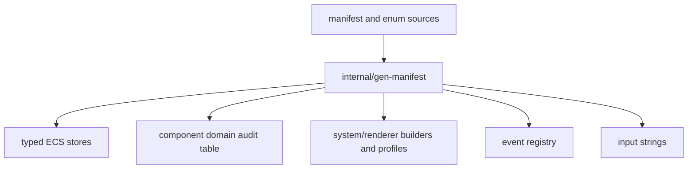

# Development, Builds, Diagnostics, and Operations

This guide covers the repository's generated-code contract, build variants,
verification surface, platform boundaries, and runtime diagnostics. The package
responsibility map is in [Package map](package-map.md).

## 1. Toolchain and dependencies

`go.mod` declares Go `1.27.2`; use that version or a compatible newer toolchain.
The application has no CGO requirement, but it is not standard-library-only.
The modules it requires:

| Module | Responsibility used here |
|---|---|
| `github.com/lixenwraith/terminal` | Raw terminal, input events, cell flush, color-mode detection. |
| `github.com/lixenwraith/color` | RGB/palette values and blend functions. |
| `github.com/lixenwraith/toml` | Scenario, FSM, content, keymap, audio, bot-graph, `vif.toml`, script and journal-payload parsing, and genetics persistence. |
| `github.com/lixenwraith/log` | Asynchronous structured file logger behind `internal/vlog`. |
| `github.com/ebitengine/purego` | Loading Xlib, EGL and GLES 2 at run time for the desktop window, with cgo off. |
| `golang.org/x/sys`; `x/term` (indirect) | The desktop window's Unix calls; terminal support for the terminal module. |

Audio sends PCM to optional host commands; see [Audio](audio.md) for runtime
backend choices. A compiler, module download access, and a terminal are enough
to build the normal binary. When the `GO` command is missing, a target that
compiles proposes the Arch, Debian (snap) or FreeBSD package install and runs it
only on a yes. Beyond Go, `make android` names each JDK or Android SDK piece it
lacks, which `make android-toolchain` installs ([android/README.md](../android/README.md#build)).

## 2. Common build workflow

```bash
git clone https://github.com/lixenwraith/vif
cd vif
make dev       # generated code + race-enabled debug build
./bin/vif
```

`make` with no target prints `help`, which lists every target below but `generate`:

| Target | Effect |
|---|---|
| `generate` | Run the manifest/event/input code generator. |
| `dev` | Generate and build `cmd/vif` with the race detector/debug symbols. |
| `release` | Build a stripped `-trimpath` native binary without CGO: the terminal and, on Linux and FreeBSD, the desktop window `-g` opens. Where purego, which the window links, does not build (Termux), `release`, `nolog` and `gui` stop before compiling and name `make cli` and `TAGS=vif_nogui`. Only `dev`, `test` and `verify` regenerate: the binary targets build the committed generated files, as a packager does. |
| `headless` | Build `bin/vif-headless` without terminal presentation, renderers, or audio. |
| `gui` | Build `bin/vif-gui`, the release binary opening the desktop window by default (`vif_gui`); `-g=false` is its terminal. |
| `cli` | Build `bin/vif-cli`, the terminal alone, no desktop window (`vif_nogui`), for Termux or a machine without X. |
| `nolog` | Release-style build with the `novlog` tag. |
| `wasm` | Build log-free `web/vif.wasm` for the browser page in `web/`, with its toolchain's `web/wasm_exec.js`. |
| `windows` | Experimental audio/log-free `windows/amd64`, `CGO_ENABLED=0` cross-build. |
| `run` | Build the dev binary and execute it. |
| `test` | Generate and run `go test -race ./...`. |
| `verify` | Generate, test, vet, and compile the full (also with cgo off), `novlog`, audio-free, headless, `vif_nogui`, WASM and Windows variants, and vet and test the `android` module (§5). |
| `arch-check` | Report `pkg/*` packages that import `internal/*`; diagnostic and separate from `verify`. |
| `tools` | Build `cmd/ascimage`, `cmd/soundlab`, and every `tool/*` command. |
| `allocator` | Build the website-to-K3s session allocator as `bin/vif-allocator`. |
| `serve` | Build WASM and the small HTTP server, then serve `web/`. |
| `install-config` | Copy `wad/`, bot graphs, keymap and `vif.toml` into the user config root, the last two only when absent; `CLEAN=1` (here and for `install`) removes the previous install first. |
| `wad-archive` | Pack that same install as `bin/vif-wad.tar.gz` (`WAD_ARCHIVE`), unpacking as `vif/` into the directory that holds a config root; the release publishes it. |
| `release-readme` | Print the README of one release archive (`RELEASE_TARGET`, `RELEASE_LABEL`), rendered from `deploy/package/release-readme.md`. |
| `install` | Install the binary, manual, desktop entry, icons, shell completion, licence and docs under `PREFIX`, and the wad as `$(SYSCONFDIR)/vif`; a user who cannot write `/usr/local/bin` gets `~/.local` and the user root. Compiles nothing: `make release install` builds first. |
| `uninstall` | Remove what `install` put under `PREFIX`, keeping the config root. |
| `image` | Build the dedicated-session container image from `deploy/docker/Dockerfile`. |
| `image-check` | Run the built image's own `-check` as its numeric user, read-only and with no network. |
| `android` | Build the debug APK as `bin/vif-debug.apk`, first naming any JDK or Android SDK piece missing. |
| `android-install` | Install `bin/vif-debug.apk` on the device `adb` sees. |
| `android-toolchain` | Install what `android` needs, asking first ([android/README.md](../android/README.md#build)). |
| `clean` | Remove `bin/` and the Android build directories. |

`TAGS` appends build tags to each `cmd/vif` build and `PORT` changes the WASM
server port. `GO` names the toolchain command (on FreeBSD, the versioned package
`go.mod` asks for).
`GO_BUILDFLAGS` (default `-trimpath`) and `GO_LDFLAGS` (default `-s -w`) are the
release-style flags; they are not `GOFLAGS` and `LDFLAGS`, which the go command
and the C linker read from the environment themselves.
`VIF_CONFIG_DIR` retargets `install-config`; `DESTDIR`, `PREFIX` (default
`/usr/local`) and `SYSCONFDIR` (`/etc` for `PREFIX=/usr`, the user config base for
a user install, else `$(PREFIX)/etc`) retarget `install`. See [Packaging](packaging.md).
`CONTAINER_ENGINE`, `IMAGE` and `IMAGE_TAG` retarget the image build — the engine
defaults to `docker` and accepts `podman` — and `IMAGE_VERSION` and `IMAGE_REVISION`
(default the tag and `HEAD`) become its OCI labels. The image is a `scratch` layer
holding one static non-root `vif_headless` binary; `image-check` is the only way to
prove it starts, because there is no shell in it to ask.
Release-style profile targets use stripped linker flags; `dev` intentionally
retains diagnostics and enables race instrumentation.

Runtime modes and compile-time profiles are different boundaries. `-serve` in a
full binary skips presentation initialization; `make headless` also removes its
terminal adapter and generated renderer registry from the build. The tag contract,
measured artifacts, browser constraints, and future-renderer path are in
[Build profiles and platform boundaries](multi-platform.md).

## 3. Generated code

The human-edited source is `internal/manifest/definition.go` plus the event and
input enum declarations. `go generate ./internal/manifest/...` runs
`internal/gen-manifest` and rewrites:

| Generated file | Derived from | Contains |
|---|---|---|
| `internal/engine/component_store_gen.go` | manifest components | typed component fields, mask bits, initialization, per-entity/batch removal/wipe |
| `internal/engine/component_domain_gen.go` | `ComponentDef.Domain` | `componentDomains`, the replication-domain audit table |
| `internal/engine/snapshot_world_gen.go` | manifest components | the shared-world capture, its delta, the install/reconcile passes over every store, and the player-world capture a journal's opening carries |
| `internal/engine/snapshot_pages_gen.go` | manifest components | the canonical page rows a correction manifest is hashed over, and the writer one repaired page is applied through |
| `internal/manifest/build_gen.go` | manifest systems | core constructors, active-name list, profiles, and snapshot declarations |
| `internal/manifest/build_audio_gen.go` | systems with the `audio` capability | audio-capable constructors and names |
| `internal/manifest/build_noaudio_gen.go` | audio capability boundary | audio-free event-sink constructors |
| `internal/manifest/render_gen.go` | manifest renderers | terminal renderer constructors and priorities |
| `internal/event/registry_gen.go` | `internal/event/type.go` and payload comments/types | event name/type/payload registry and the replication class table |
| `internal/input/strings_gen.go` | selected input enum const blocks | enum string/reverse lookup tables |



Do not edit files beginning `Code generated by gen-manifest`. Generation uses
the Go parser and formatter and deliberately sorts discovered enum/state data
where stable output matters. If formatting fails it leaves a `.err` artifact
beside the intended output for diagnosis.

Any change to components, system/renderer assembly, event declarations, or
input enums must include regenerated output. The release workflow regenerates
before it builds and fails a tag whose tree that changes (§6); the test workflow
does not check.

## 4. CLI reference

`-h`, `-help` and `--help` print the table below to **stdout** and exit zero, so
`./bin/vif -h | grep authority` works without redirecting stderr. A malformed
flag still goes to stderr with exit 2, which is the `flag` package's contract for
a usage error. Short and long forms of the same option share one line here and
one line in the program's own help; they are the same flag, not aliases, so
`-s` and `-config-scenario` write the same field and the last one on the command
line wins. That help is `helpSections` in `cmd/vif/usage.go`, which also renders
`doc/vif.6` and the shell completions in `deploy/package/`.

### Session

| Flag | Purpose |
|---|---|
| `-host <addr>` | Play at once and open the run to participants, for example `:7777`, or `ws://:7777` for WebSocket. |
| `-serve <addr>` | Bind a headless session with no local cursor: a dedicated host. Takes `ws://` like `-host`. |
| `-join <addr>` | Join `[tcp://\|vif://]host:port[/name]` or a `ws(s)://` URL, or a new session an `http(s)://` site creates; the host supplies the seed and the scenario, and the joiner keeps its own typing corpus. Grammar in [Services and networking](services-and-networking.md) §6. |
| `-name <name>` | With `-host` or `-serve`, the session name this host answers to, so one address serves several. |
| `-players <n>` | Roster ceiling including self, `2`..`parameter.MaxPlayers`, beside the scenario's `max_players`, the lower holding; with a `-join` site, the size requested. Unset holds the whole roster; under the scenario's `min_players` it is refused. With `-serve` it counts guests from `1`, because the server is not one of them, and the session starts on its first guest and admits the rest as they arrive. |
| `-bot [N[:graph]\|graph]` | Add bots beside this run's participant, which under `-headless` or `-watch` is the first bot; operands default to `1:default`, and a count of 0 adds none. With `-serve`, bots keep the session occupied. See [Bots](bots.md). |
| `-authority host\|migrate` | With `-host` or `-serve`, where authorship goes when the authoring participant leaves; a guest adopts the host's policy. `host` keeps it with the starting machine, so losing that machine leaves each survivor playing alone; `migrate` hands it to the first surviving member of the succession chain, else the lowest surviving identity, never a bot's. Default `host` with `-serve`, `migrate` otherwise. |
| `-slow-window <dur>`, `-slow-late <n>`, `-slow-bytes <n>` | A host's eviction policy for a participant that cannot keep up: this many late epochs per second over the window, on a link carrying at least this many bytes per second. A zero window never evicts; a zero rate drops its condition. See [Multiplayer](multi-player.md) §3.5. |
| `-listen <addr>`, `-no-advertise` | With `-join`, the address the other participants reach this one at in a migrate session, or none at all, which keeps it a leaf, elected only when no chain member survives ([Multiplayer](multi-player.md) §5.3). |
| `-size <WxH>` | Terminal-equivalent geometry for a run with no terminal of its own. Omitted on a server, the first person's terminal sizes the session, or a bot's 120x40 when the server seats bots of its own. |
| `-probe <addr>` | Serve `/health` and `/metrics`; `-serve` only. |
| `-first-join <dur>` | End a `-serve` run if no guest has connected within `dur`; zero waits forever. |
| `-empty <dur>` | End a `-serve` run `dur` after the last guest leaves; zero keeps the session. Also the window a dropped guest has to reclaim its slot. |
| `-drain <dur>` | How long a termination signal waits for a `-serve` roster to empty before exiting anyway; zero exits at once, and a second signal always does. |

### Configuration

| Flag | Purpose |
|---|---|
| `-d`, `-config-embedded` | Use the embedded scenario and content; mutually exclusive with `-s` and `-f`. |
| `-config-dir <dir>` | Search one categorized config root (`scenario/ input/ audio/ content/ image/ bot/`) before the user and system roots. |
| `-s`, `-config-scenario <name-or-path>` | Installed scenario name, a `scenario.toml`, or a directory containing one. |
| `-f`, `-config-content <path>` | Content directory, or a single pinned `.txt`/`.toml` file. |
| `-k`, `-config-keymap <path>` | Keymap override TOML. |
| `-config-music <path>` | Music pattern override TOML; strict optional. |
| `-config-sounds <path>` | Sound definition override TOML; strict optional. |

The first config root holding a `vif.toml` supplies the defaults of the path flags
and the audio buffer; a flag on the command line wins
([Filesystem layout](filesystem-layout.md#3-resolution-policy)).

### Presentation and audio

| Flag | Purpose |
|---|---|
| `-color auto\|256\|true` | Colour depth. `auto` (the default) detects the terminal; `256` draws for a text console's sixteen colours; `true` forces truecolor. |
| `-g`, `-gui[=false]` | Open the game in a desktop window (Xlib, EGL and GLES 2 loaded at run time; Linux and FreeBSD) instead of the terminal. The default of a `vif-gui` build or with `vif.toml`'s `[presentation] window = true`, which `-g=false` turns off; a `vif_nogui` build refuses it. |
| `-cli` | Play in the terminal whatever `vif.toml` or a `vif-gui` build says; wins over `-g`. |
| `-maximized[=false]`, `-fullscreen[=false]` | The state the desktop window opens in, asked of the window manager (`_NET_WM_STATE`); `vif.toml`'s `[presentation] maximized` and `fullscreen` set the default, and a terminal run ignores both. |
| `-scale <n>` | With `-g`: draw the window's font at `n` times its pixels each way, for a HiDPI screen; default 1. |
| `-mute[=false]` | Start muted; `-mute=false` starts with sound. Unset, `vif.toml`'s `[play]` channels stand, sound on by default and written back as the player changes them; a channel the flag set and the player left alone is never written. |
| `-ab`, `-audio-backend <name>` | Force an audio backend: `pacat`, `pw-cat`, `aplay`, `sox`, `ffplay`, `oss`, `null`, or `wav:path`. |

### Run

| Flag | Purpose |
|---|---|
| `-seed <n>` | Root RNG seed; zero draws one and logs it. |
| `-speed <rate>` | Initial play-mode rate: `1/8`, `1/4`, `1/2`, `1`, `2`, `4`, `8`. With `-script` or autonomous bots it is the run's wall pace instead and additionally accepts `max`. |
| `-script <path>` | Run a bounded authored TOML tick schedule; may be combined with `-host` or `-join`. |
| `-headless` | With bots, run without a human or terminal; solo runs are unpaced. With `-replay`, verify the journal's digests unattended. |
| `-watch` | Present a script or the first bot, with no human player. |
| `-r`, `-replay <path>` | Present a recorded journal instead of starting interactive play. |
| `-check` | Resolve and validate `vif.toml`, the scenario, keymap, audio, content and bot graphs; print the result and exit. |
| `-schema` | Print the FSM and event schema as JSON, then exit. |

### Diagnostics

| Flag | Purpose |
|---|---|
| `-l`, `-log[=DIR]` | Enable structured logging; `DIR` overrides the user-state log directory. |
| `-lv`, `-log-level <level>` | `trace`, `debug`, `info`, `warn` or `error`; implies `-l`. |
| `-ls`, `-log-scope <spec>` | Which subsystems log (see below); implies `-l`. |
| `-lt`, `-log-stat <ticks>` | Status snapshot period in game ticks; zero disables; implies `-l`. |
| `-lr`, `-log-recorder <ticks>` | Flight recorder depth in game ticks; zero disables; implies `-l`. |
| `-log-session-id <id>` | Stamp every record with a deployment session ID and name the file after it (§8); implies `-l`. |
| `-log-stdout` | Write the log to stdout as JSON instead of to a file; implies `-l`. |
| `-j`, `-journal[=DIR]` | Record every journaled-origin event (all but system and device) and every own crossing to a replay journal (§8); `DIR` overrides the user-state journal directory. |
| `-mw`, `-music-wav[=DIR]` | Record the music alone to a WAV file; `DIR` overrides the user-state music directory ([Audio](audio.md)). |
| `-dev[=false]` | Capture runtime stderr to a file; on by default for `-race` builds. |

### Help

| Flag | Purpose |
|---|---|
| `-h`, `-help` | Print the help and exit. |
| `-version` | Print the module version and commit a package should report. |

### Log scopes

`-ls` and `:log scope` share one grammar, printed at the foot of `-h`:

| Row | Meaning |
|---|---|
| Names | each scope with its letter: `app (a)` … `tap (t)`, listed in [logging](logging-and-diagnostics.md) §4 |
| Sets | `all` is every scope — `dispatch` included — and `none` is nothing |
| Combine | join names or letters with `+`, `,` or a space: `app+fsm+stat` and `afs` are one set |
| Adjust | a leading `+` or `-` adds to or removes from the set already selected, instead of replacing it |

So `-ls afs` replaces the mask, `-ls +d` adds dispatch to it, and `-ls -t`
silences taps. `-ls all+dispatch` is `all` said twice.

### Combination rules

`-lv`, `-ls`, `-lt`, `-lr`, `-log-session-id` and `-log-stdout` imply `-l`; `-j`,
`-mw` and `-dev` do not. `-ls` is parsed through `vlog.ParseScopes`
during flag parsing, before terminal startup, so a bad spec fails before the
screen is taken. A bare `-l`, `-j` or `-mw` remains boolean, so a directory
requires `-l=DIR`, `-j=DIR` or `-mw=DIR`, not a space; a leftover argument is
reported and ignored.

`-schema`, `-check`, `-replay` and `-script` are mutually exclusive; a script seats
`-bot`'s bots beside its own run. `-watch` needs a script or a bot, and `-headless`
a bot or a replay; neither combines with `-serve`, nor `-headless` with `-watch`.

`-first-join`, `-empty` and `-drain` are refused without `-serve`, for the reason
`-probe` is: an interactive run is ended by the person who started it, and a flag
that ends a process must not silently do nothing.

`-serve` is a host of its own and does not combine with `-host` or `-join`. `-host`
and `-join` are mutually exclusive and available on interactive play and on driven
`-script` and bot runs. They, `-serve`, `-probe`, `-players`, `-bot`, `-authority`,
`-listen`, `-no-advertise`, `-name` and the lifetime bounds are an error beside
`-check`, `-schema` or `-replay`. An interactive `-host` plays at once and opens its
port once the clock runs; `:host <addr> [host|migrate]` does the same on a run that
is **already playing**, at whatever tick it has reached — same acceptor, same
identity allocation, same capture. The joiner dials before constructing its `App`,
so the anchor seed is installed before RNG/content initialization. `:join <target>`
is the other half: a solo run, its bots included, or one its session left alone,
dials target while it plays on and rebuilds itself joined once admitted, from the
live seats, play settings and journal rather than its startup flags. `:session`
reports what a run is part of.

### Two-terminal verification

```bash
# host
./bin/vif -d -host 127.0.0.1:7777

# joiner
./bin/vif -join 127.0.0.1:7777
```

Or, on a run that is already playing, type `:host :7777` in terminal 1 and dial it
from terminal 2 — the guest arrives holding the host's world at the tick it had
reached. `:session` on either side reports the role, address, identity, the cursor
slot that identity drives, peers and tick.

Both sides should show `2P` and its round trip, two cursors, and the same shared actors and
score/progression after either participant moves, types and fires. Use terminals
of different sizes and resize one mid-run: the shared map must not follow either
terminal. Quit the joiner and continue on the host; its badge becomes `Net: down`
and only the remote cursor disappears. The map stays latched either way — a run
that opened a session keeps its bounds — which `:session` names rather than the
status bar, along with the peers, the tick and how many succession candidates the
chain holds. For a LAN, bind `:7777` and join the host's reachable address.
Public-internet routing uses the same socket code, but a direct tcp link is
plaintext and unauthenticated, so it is for trusted peers only.

### Authored headless scripts

The `-script` format is a deliberately small deterministic input schedule. Its
top level names schema 1, a hard tick budget, and optional headless geometry.
Each `[[action]]` targets the completed `(run, tick)` position and sets exactly
one of `intent`, `text`, `command`, or `event`:

```toml
schema = 1
ticks = 2000
width = 120
height = 40

[[action]]
tick = 1
command = "god"

[[action]]
tick = 10
intent = "motion_right"
count = 6

[[action]]
tick = 100
event = "QuasarSpawnRequest"
payload = "x = 40\ny = 15"
```

Intent names are canonical keymap action names, plus `press`, which presses the
captured key its `char` names. `text` emits one semantic
text-character intent per rune; `command` performs command-mode entry, text,
and confirmation as separate settled groups. An event resolves through the
generated registry and its payload uses the same TOML field names as the
journal. Local and Bus events default to the player domain, Shared events to
shared; Stamped events require `domain = "player"` or `"shared"`.
Unknown top-level and action fields are errors. `run` and `tick` default to zero;
`count` applies only to an intent, and the four char-wait intents and `press`
additionally require a one-rune `char`. Geometry must either omit both dimensions or set both.

Pacing defaults to a property of the run rather than of the flags
(`scriptPacing`, `internal/app/script.go`). A solo script executes flat out; a run
with `-host`, `-join` or bots is wall-paced at the fixed game tick so independent
participants exchange artifacts normally; and a solo script that opens a session
itself with `:host` starts pacing at that moment, with the clock re-anchored there
rather than carried forward — otherwise the ticks it ran flat out would be a debt
the pacing immediately spends. That is what makes a mid-run join scriptable.

`-speed` overrides the default. A ladder token makes one tick occupy the game
interval divided by the rate, so `-speed 2` runs a script at twice real time and
`-speed 1/2` at half; `-speed max` removes pacing entirely and is refused alongside
`-host`, `-join` or bots, because a participant that outruns its peers is not
simulating the session it is in.

Every participant of one session must use the same rate. Only the `max` case is
enforced, because the runtime cannot see a peer's pace: a faster participant is
rebased to the authority's tick by every correction, which keeps the session
correct and moves the world under a script's own schedule. A dedicated host runs
real time; an interactive host runs its own rate, which an interactive guest
adopts from the offer and nobody changes while a peer is linked. A script sharing
the session must match it.

### A dedicated host

`-serve` runs a host with no terminal, no renderer, no audio and no cursor of its
own — the shared world, the authority, the correction cadence and the roster, and
nothing a person would use locally. Holding no cursor is a roster property rather
than an absence: the coordinator keeps its participant identity and roster entry,
and its slot is `parameter.NoPlayerSlot`.

```bash
./bin/vif -serve :7777 -players 2 -size 120x40 -l -lv info -ls afs
./bin/vif -join server.example:7777          # each person, elsewhere
```

A server has no terminal to derive geometry from, so `-size` fixes the D-14 map
latch every joiner adopts; without it the first person's terminal sizes the map
before the lobby closes (`adoptLobbyGeometry`, `internal/app/session.go`), or a
bot's 120x40 when it seats bots of its own, as those start the game at once. A
scenario that sets up its own map keeps it either way. It logs a session summary
periodically rather than drawing a status bar, so `-l -lv info` is how the run is
watched. A server whose roster empties parks: it stops its clock at once, so the
world a returning guest reclaims is the world it left. An unbounded server starts
a fresh run after `parameter.SessionVacantReset`; one with `-empty` preserves the
same run until that grace expires. A returning participant releases the park and
receives the world at its stopped tick, into the slot its departure released. See
[Runtime](runtime.md) §1.2.

A server started this way runs until somebody stops it. One that was *allocated* —
created by a website when a player asked for a game — bounds its own life instead:

```bash
./bin/vif -serve :7777 -probe :7778 -log-stdout -lv info \
    -players 4 -size 120x40 -first-join 90s -empty 90s -drain 20s
```

It ends if no guest arrives inside the first window, ends after the roster has been
empty for the second, and answers a termination signal by draining — readiness
false, dials refused, existing gameplay untouched — for up to the third. One
`session ended` log line names which of those happened. The flags are refused
outside `-serve`; the policy is `internal/lifecycle` and the phases are documented
in [Runtime](runtime.md) §1.2. This is what `deploy/` runs; see
[Deploying the session fleet](kube-docker-deploy.md).

`-players` is a ceiling on every host shape and unset means the whole roster, as is
the scenario's `max_players`. A server starts on its first guest, or on the
scenario's `min_players`, and takes the rest through the mid-run gate, so the
example above holds at most four guests but plays as soon as one arrives. An
interactive `-host` plays from its first tick and opens its port once the clock
runs. Only a driven host (`-script`, or a `-headless`/`-watch` bot) that names
`-players` waits in its lobby for that whole party before releasing tick zero
(`lobbyQuorum`, `internal/app/session.go`). A dialling host is admitted at most
`parameter.NetworkAdmitBurst` times per `NetworkAdmitWindow`, because the admission
that follows a handshake reads and sends a whole world and a peer cycling through it
would otherwise spend one connect per capture. A run's own bots join in-process and
spend none.

### A scripted participant

A script in a session is an ordinary participant: it holds a roster slot, produces
crossings at the agreed apply ticks, and is corrected like any other guest. That
makes one side of a session reproducible while a person plays the other — a
scripted demonstration to join, or a fixed opponent to fuzz against while looking
for a defect that must survive being reproduced.

```bash
# terminal 1 — the scripted side; add -watch to present it here as well
./bin/vif -script script/sparring-host.toml -host 127.0.0.1:7777 -players 2

# terminal 2 — the person
./bin/vif -join 127.0.0.1:7777
```

`script/sparring-guest.toml` is the same arrangement with the roles reversed: the
person hosts and the script joins. Re-running either command reproduces the
scripted side exactly, so what changes between runs is only what the person did.

`-watch` presents a scripted run on its own terminal over the same manual clock
and the same script geometry, so the presented and headless forms simulate
identically. A presented run that is in a session offers pan and quit only: step
and rate are instance-local, and a session stops only by its host's hold.

The two halves also play each other headless: start the host half as above and
run `./bin/vif -script script/sparring-guest.toml -join 127.0.0.1:7777` beside it.
For a mid-run join, start the host half without `-host` and give its script a
`command` action `:host <addr>`; it runs solo until then, and the guest dials once
the host logs `hosting opened mid-run`.

In a session the driver schedules actions on the ticks it has issued, not on the
world's position: a join, a correction's jump or a reset moves the world and not the
schedule, so a guest half may join mid-run and a nonzero `run` is refused. A solo
run stays absolute, and an action whose position it has passed is an error.

Use distinct log directories so each terminal's session log and journal are
unambiguous. Scripts do not inspect/assert world state or transport a snapshot;
process exit, paired journals, status records, and the cross-process gate provide
those verdicts. Interactive play remains the acceptance path for actual terminal
responsiveness and rendering.

`app.PlayJournal` and `journal.Load` can reassemble several rotated files by
`jseq`, but `-r` passes one path, so positional paths after it are not a
multi-file form. A replay takes seed, config, content, timing and geometry from its
anchor (`ConfigFromAnchor`); the viewer's flags supply only the `-config-dir` root
the anchor's scenario resolves in, audio, colour and `-mw` (`internal/app/play.go`).
Logging and `-dev` apply as usual; `-j` does not journal a replay. `-headless -r`
replays flat out without presenting and fails on the first digest it does not
reproduce.

### Bots beside a run

`-bot` seats bots as participants, each a headless instance in the same
process that joins its holder in-process.
Commands, compositions and examples are in [Bots](bots.md).

### End-to-end checks

`script/test.sh` holds the checks no Go test makes, because they need a built
binary on a real terminal, `make` or the deploy scripts: the release wad archive
(`bundle`), a scenario change through `app.Run`'s restart loop and a guest following
it (`scenario`, `follow`), the session template against the allocator (`fleet`) and
what a node needs before a pod starts (`deploy`). `all` runs those and prints PASS
or FAIL; `botfitness` and `load` measure and stay out of it.

```sh
./script/test.sh list
./script/test.sh all
```

See [script/README.md](../script/README.md).

## 5. Validation and tests

A change is gated by what [AGENTS.md](../AGENTS.md) names: `go build ./...`,
`gofmt -l` on the changed files, and `go test` on the packages the change
touches, with `make generate` first when an event or manifest definition changed.
A change behind a build constraint also builds that target:
`GOOS=js GOARCH=wasm go build ./...` or `go build -tags vif_headless ./...`.

`make verify`, `go test ./...`, `go vet ./...` and `script/test.sh all` are sweeps
the project owner runs, not per-change steps. `make verify` regenerates, runs
`go test -race ./...`, builds `./...` plain, with cgo off and under `novlog`,
`vif_noaudio`, `vif_headless` and `vif_nogui`, tests `./internal/...` under
`vif_noaudio` and the manifest and system suites under `vif_headless`, `cmd/vif`
under both, vets and tests the `android` module, tests `pkg/window` with cgo off,
cross-builds `js/wasm` and `windows/amd64` (`novlog vif_noaudio`), fails if the
headless command imports the renderer or audio implementation, and runs
`go vet ./...` and the `vif_gui` vet of `pkg/window` and `cmd/vif`. It does not
execute a Windows artifact or a real terminal/audio backend; Windows is played by
hand, not a supported release target, and its known issues are in [Build profiles
§4](multi-platform.md#4-platform-matrix).

Tests cover `cmd/vif`, `cmd/soundlab`, the headless/replay application harness
(seeded soak, mutation, bisect, reset, journal density, replay, operator-state
comparison, staged corrections, hosting, joins, migration, mesh reach and the
dedicated host), the network protocol and handshake, convergence, snapshots, clocks,
scheduler and time control, event journaling and authored scripts,
input/help/mode commands, FSM staging and local-lifecycle reconciliation, the
session lifecycle and probe, parameters, profiling, audio, genetics, vectors and
geometry, cell mapping, physics, the WebSocket and link-pace packages, the session
allocator, `vif-log`, and selected system and renderer surfaces. Coverage is
selective: many gameplay systems and renderers, content parsing, the generator and
the other `tool/*` commands have no focused test file. Programs under `sandbox/`
are experiments, not tests.

`BenchmarkHeadlessTicks` in `internal/app` ticks a driven App on the embedded
scenario and on `td`; run it with `-benchtime=1500x -benchmem` so every run
simulates the same ticks of one seed and the allocation counts compare exactly, and
compare `SnapshotSimulation` before and after a change that must not move the
simulation. `BenchmarkKrakenRegion` beside it measures the Kraken in the
campaign's kraken region, one `tick` and the `frames` the kraken renderer draws of
it; its comment shows the browser build's run under Node, where the Kraken's cost
showed first.

The soak profiles are tiered, because the widest one costs too much for an edit
cycle; no workflow sets `VIF_SOAK`, so it runs only when asked for.
`soakScale(short, normal, full)` in `internal/app` selects a repetition or step
count per profile:

```bash
go test -short ./internal/app        # smoke
go test ./internal/app               # the default profile
VIF_SOAK=full go test ./internal/app # the wide seed sweep
```

Every iteration is reproducible from its seed, so a failure found by the wide sweep
reruns alone with `-run 'TestReplaySoak/<seed>'`, the seed written in hex as the
subtest name prints it.

Most `internal/app` tests call `t.Parallel`. The exceptions drive a real socket
against wall-clock deadlines or run the staged `tc netem` gate, which shapes
loopback for the whole machine; both are marked and stay sequential. The netem gate
is Linux-only and opt-in: it skips unless `VIF_NETEM=1`, root and `tc` are present.

Configuration work also runs:

```bash
go run ./cmd/vif -check -s path/to/scenario
go run ./cmd/vif -check -s td                    # installed scenario by name
go run ./cmd/vif -schema > /tmp/vif-schema.json
```

`-check` validates system names against the manifest and then the declared
dependency graph, rejecting a scenario that leaves an enabled system without a
system it requires. It also rejects an invalid `reconcile = true` marker: only an
immediate, unguarded `ClassLocal` `EmitEvent` in `on_enter`/`on_exit` may be
replayed by a live FSM import. Persistent holds are modeled on a common parent with
paired marked acquisition/release actions.

Two lints are ordinary `internal/system` tests: `TestNoOrderDependentMapRange`
reports map iteration whose order can reach simulation state, and
`TestSystemDomainProfiles` checks every declared domain profile against the RNG
streams, entity domains and component stores its system touches. Each allowlist
entry carries a reason.

For audio documents, use `soundlab validate`; for visual behavior, exercise the
blend tester and both color modes. Runtime terminal interactions still need a
manual smoke test because unit tests do not reproduce every emulator.

## 6. CI workflows

`.github/workflows/test.yml` runs on pushes to `main`, `master`, `develop` and
`claude/*`, and on pull requests to `main`, `master` or `develop`. Its single job,
on the Go `go.mod` names, runs `go vet ./...`, `go build ./...`, the other profiles
and targets, the window and Android module tests, the browser build's tests under
Node (`pkg/browser` and the `Browser` tests of `internal/network`, through
`go_js_wasm_exec`), and `go test -race -v ./...` with `GORACE` halting on the first
race and writing `race.*`, which is uploaded for seven days on failure.

`.github/workflows/release.yml` runs nightly, on demand and on a `v*` tag. It
regenerates the registries and, on a tag, fails if that changed the tree, vets
and tests, then builds CGO-free archives for `linux-amd64`, `linux-arm64`,
`linux-amd64-headless`, `freebsd-amd64`, `windows-amd64` (`novlog vif_noaudio`)
and `web`, the wad archive through `make wad-archive`, a source archive on a tag,
the Android APK through `android/toolchain.sh gradlew` on a second runner, and
`SHA256SUMS` over everything. Off a tag it also pushes the headless image to GHCR
and moves the `nightly` prerelease; a tag drafts a release. [Packaging](packaging.md)
§2 lists what each publishes.

The test workflow also builds the `novlog`, `vif_noaudio`, `vif_headless` and
`vif_nogui` profiles and the FreeBSD, browser and Windows targets. Neither workflow
runs the tagged test suites, the dependency assertions of `make verify` (§5), or
terminal/audio smoke tests.

## 7. Platform matrix

| Target | Status | Key behavior |
|---|---|---|
| Linux | Primary native target | Unix signals/crash reset; process audio backends; optional stderr fd capture. |
| FreeBSD | Native target | Unix handling plus optional `/dev/dsp` OSS backend. |
| `js/wasm` | Supported constrained build | `pkg/browser` host, a WebGL canvas drawn from cell frames and an AudioWorklet fed the mixer's PCM; embedded scenario/content/keymap, `vlog` stub, no host discovery or raw socket transport. |
| Windows amd64 | Experimental | `CGO_ENABLED=0`, `novlog`, `vif_noaudio`; published as a zip that plays in a terminal, with the known issues in [Build profiles §4](multi-platform.md#4-platform-matrix). |
| Android | Native target, a debug-signed APK | `android/`, its own module: `gomobile bind` around `app.Run`, a `SurfaceView` cell drawer and `AudioTrack`; the wad as its system root ([android/README.md](../android/README.md)). |
| Other native OSes | Not a documented support contract | May compile through generic files but are not covered by Makefile verification; 32-bit targets are not supported ([Build profiles §4](multi-platform.md#4-platform-matrix)). |

### WASM host

`web/index.html` holds a canvas and a hidden text field; `web/terminal.js` sizes
the grid to the cells the page holds, starts the Go WASM instance in a Worker
(`web/worker.js`), so a frame the page takes long to draw never delays a tick, a
probe echo or a socket read, draws each frame the Worker hands it (the cells changed
since the last, `pkg/glyph`) with one WebGL quad over a glyph mask rasterized from a
monospace font at the cell's device size, and reports keys, text, the pointer and
resizes to it ([Build profiles §8](multi-platform.md#8-adding-another-renderer-or-android-host)).
Where the browser offers no WebGL (Brave and other Chromium builds blocklist older
GPUs, and `--ignore-gpu-blocklist` needs device access an ordinary session may not
have) the page paints on a 2D canvas instead and says so in a notice at the start:
each changed cell is a fill and a glyph tinted through a scratch cell, the same
picture, slower on a large grid.
On a touch-first screen (phone, tablet) a tap raises no system
keyboard; two fingers tapped together twice toggle it, as on Android, and so does a
strip along the top, which also sends Tab (and Esc while it is up) and goes
fullscreen where the browser can. Neither the strip nor the keyboard refits the
grid: the keyboard covers it, and the status bar's bottom row is drawn again above
it ([Build profiles §8](multi-platform.md#8-adding-another-renderer-or-android-host));
the page resizing (a rotation, a window, fullscreen) and a zoom (a pinch, or Ctrl
and the wheel, within the range Go names, Android's too) do, and a solo map
follows; the run keeps the cell a zoom leaves with the page's settings. Every page
opens on the start screen, and the Worker holds the compiled program until its tap,
click or key press ([Build profiles §8](multi-platform.md#8-adding-another-renderer-or-android-host)).
Before launch it maps `window.VIF_ARGS` and repeated `arg` query parameters into the
program's argv; a site that renames the files says so with `data-wasm`,
`data-worker` and `data-exec` on the script element
([Build profiles](multi-platform.md#6-browser-launch-arguments)). `make serve`
builds `web/vif.wasm` and serves this directory.

`web/` is the deployed launcher, not a harness that resembles one. Its files are
relative to the page, so the directory works at whatever path a site installs it.
Copy the directory; do not rewrite a path in it.

The browser build does not perform native config-root discovery for `scenario.toml`,
keymap, content, audio overrides, or logs. Embedded assets make it playable;
logging compiles out. Browser JavaScript cannot open the framed TCP
socket used by native `-join`, so a browser joins over the session's `wss://`
route instead — the page's own WebSocket wrapped as a `net.Conn` — and `-host`,
`-serve` and a `host:port` target fail validation. Arguments can select embedded
behavior but cannot turn a URL into a filesystem path. See
[Build profiles and platform boundaries](multi-platform.md) for the transport and
the open HTTP resource-provider design.

## 8. Structured logging

`internal/vlog` is a leaf facade over the external logger so any game package
can log without importing application composition. Native builds write
asynchronous JSON Lines files named `vif-log-<060102-150405>.jsonl`.

| Policy | Value |
|---|---|
| Queue | 8,192 records |
| Flush | 50 ms |
| File rotation | 64 MB |
| Total log budget | 512 MB |
| Minimum free disk | 100 MB |
| Retention | 24 hours |
| Heartbeat | 60 seconds |
| Process-exit drain | 2 seconds |
| Panic flush | 200 ms |

With `-log-session-id`, the file is named for the ID, the per-file cap is 8 MB,
and the total budget, minimum free disk and retention are disabled, so one
commissioned writer cannot remove another session's files. The fleet node owns the
shared-directory bound and cleanup policy.

Every record can carry subsystem plus run/tick correlation stamps. Scopes are
listed in [logging](logging-and-diagnostics.md) §4; unknown subsystem labels fall
into tap. Errors bypass scope filtering, while level still applies.

[Logging and diagnostics](logging-and-diagnostics.md) is the full reference for
record shapes, scopes, the status registry, the flight recorder, and the
diagnostic playbooks. This section covers only the build-facing policy.

Replay capture is a separate `vif-jrn-<060102-150405>` JSONL sink, with a `-N`
suffix when that name is taken. `-j` records every journaled-origin event and
every own crossing regardless of session log level/scope, and its anchor carries
the seed, RNG session, config/corpus identity and fingerprint, fixed tick interval,
and simulation geometry. `-r` runs those records through a manual-clock App; this
is reproduction input, not another diagnostic scope.

Logging is disabled at compile time for `wasm` or `novlog`. In enabled builds,
log arguments are formatted asynchronously: call sites must pass primitive
values/copies, never component pointers, pooled event payloads, or reusable
scratch slices whose contents may change before formatting.

`:log` can start/stop a session and change level/scope/snapshot interval at
runtime. Stop detaches the sink immediately and drains off the world-locking
command goroutine.

## 9. Status and snapshots

`internal/status.Registry` dynamically registers typed atomic bool, int,
float, and string metrics. Systems cache returned pointers during initialization
and update them without map lookups in hot paths.

Snapshot indexing projects stable keys into bounded semantic groups and sorts
groups/members. Allocation buffers, combat attribution, FSM regions, and active
player slots therefore remain separate readable records without renaming keys.
`Registry.Freeze`, called by `Scheduler.Prepare` from `Start`, from `RunTicks`, or
when a caller-driven App is constructed (`newDriven`, `newScriptApp`), closes the
metric set and caches that index permanently; a registration afterwards yields a
detached cell and increments `stat.late`. Periodic snapshots run after a completed
tick and after releasing the world lock, so all tick-owned writes are settled and
async logging cannot extend lock time.

`-lt`/`:log stat` controls periodic emission; the default period is a coarse
heartbeat because the flight recorder holds fine-grained history. `-lr`/`:log
rec` controls the recorder, which keeps the last N ticks of the full registry
in memory and writes only on a trigger. `:t save` writes an on-demand
standalone context plus registry snapshot captured under the world lock.

## 10. Crash and runtime capture

Application goroutines should start through `core.Go`, which recovers panics,
invokes the logging crash hook, restores/finalizes the terminal, prints the
stack, and exits according to platform behavior. The crash hook first runs a
registered flush callback, so the flight-recorder window reaches disk ahead of
the panic record. The terminal poll goroutine has an additional emergency reset
because its blocking loop is especially capable of stranding raw mode.

On a Linux or FreeBSD text console, a capture with `releases` switches the
keyboard raw, and before the first switch the terminal module runs the vif binary
again as `console-guard`. The guard puts the keyboard and the tty back if vif dies
where no handler of its own runs: `kill -9`, the OOM killer, a Go fatal error.
It runs the `init` of every package initialized before the terminal module's, so
a package `init` only computes and registers: no files, goroutines, signals or
network. On FreeBSD the guard goes by vif's name, so `pkill -9 vif` ends it too;
kill vif by its PID. With both gone, `sudo kbd_mode -u -C /dev/ttyN` restores a
Linux console; the terminal module's README gives FreeBSD's.

Go runtime diagnostics such as race reports write directly to file descriptor
2 and would corrupt/disappear behind an alternate screen. `-dev` redirects
stderr to `vif-stderr-<timestamp>.log` in the log directory before terminal
startup, periodically parses complete blocks, and logs lightweight
path/offset/size summaries. At shutdown it restores the original descriptor and
removes an empty capture. Race builds enable this automatically unless
`-dev=false`.

The redirect needs Unix descriptor duplication; elsewhere `-dev` prints `runtime
capture disabled` and the run continues uncaptured. Never treat runtime-capture
files as unbounded permanent telemetry—archive or remove them according to
development needs.

## 11. Contribution workflow

1. Read the high-level architecture and the relevant domain document.
2. Keep edits within the package ownership rules in [Package map](package-map.md).
3. Update manifest/event/input source declarations and regenerate where needed.
   A new system is declared in `internal/manifest/definition.go`, profile and
   dependencies included; see [the domain model](domain-design.md).
4. Add a test only for a rule nothing covers yet and that could regress: one test
   per rule, named for it ([AGENTS.md](../AGENTS.md) Tests).
5. Run the [§5](#5-validation-and-tests) gates (`go build ./...`, `gofmt -l` on
   the changed files, `go test` on the touched packages, and the constrained
   target's build), `-check` for configuration, and the relevant manual
   terminal/color/audio smoke test. `make verify` is the owner's full sweep.
6. Update domain docs when a public rule, lifecycle, configuration schema,
   external boundary, or known limitation changes.
7. Keep generated files and human source in the same commit.

Do not “fix” unrelated dirty-tree changes during a focused contribution. Avoid
blocking I/O inside the world lock and storing game behavior in renderers.
Components are pure data and their logic lives in the owning system; renderers
reading shared state are the exception. A system file serves only its own system:
no system calls another's helpers, apart from the unattributed files pinned in
`helperFiles` (`internal/system/domain_test.go`) and the timer slot's `armTimer`
and `timerRunning`. Math constants live in `pkg/vmath` and tunables in
`internal/parameter` and `internal/parameter/visual`, never inline. Host service
implementations stay behind their package boundaries. Anything iterating a map
before a write, an RNG draw or an event push has to sort first; determinism
across instances is the invariant the domain model rests on.

## 12. Source map

| Concern | Primary source |
|---|---|
| Build targets | `Makefile`, `go.mod` |
| CLI and filesystem policy | `cmd/vif/main.go`, `cmd/vif/usage.go`, `internal/app/config.go`, `internal/resource/resolve.go`, `internal/paths` |
| Code generation | `internal/manifest/manifest.go`, `definition.go`, `internal/gen-manifest` |
| CI | `.github/workflows/test.yml`, `release.yml` |
| End-to-end checks | `script/test.sh`, `script/*.toml` |
| Browser host | `web/index.html`, `web/terminal.js`, `web/worker.js`, `web/terminal.css` |
| Logging | `internal/vlog/*.go` |
| Metrics and flight recorder | `internal/status/*.go`, `internal/engine/snapshot.go` |
| Journal, replay, fuzz, and authored scripts | `internal/event/journal*.go`, `origin.go`, `internal/journal`, `internal/app/replay.go`, `play.go`, `script.go` |
| Crash/runtime capture | `internal/core/crash_handler*.go`, `dev.go`, `redirect_*.go` |
