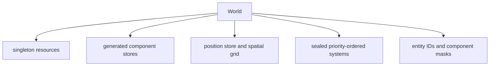
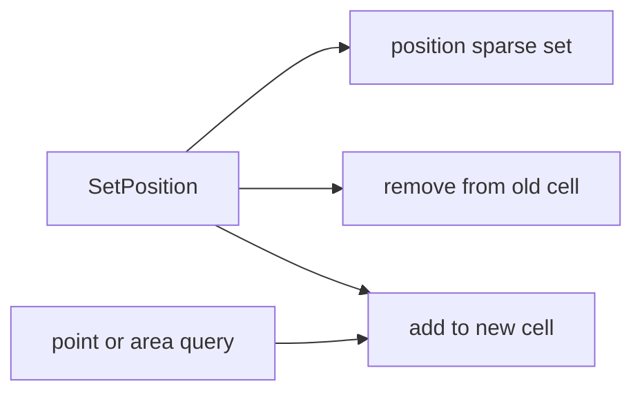
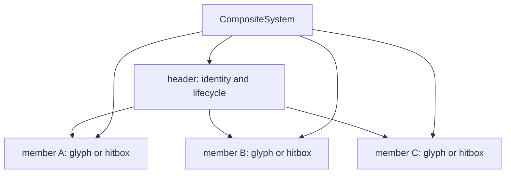
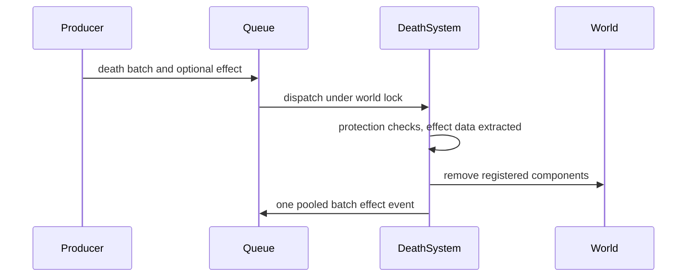

# ECS and Event Model

This document describes the data model used by the live game. It is the
medium-level companion to [Architecture overview](architecture.md) and
[Runtime model](runtime.md). The important design constraint is that component
storage, resources, systems, and event handlers all share one serialized world
mutation boundary.

## 1. World ownership

`internal/engine.World` owns the complete mutable simulation:



An entity is `[domain:8][id:56]`: a replication domain tag over a domain-local
identifier. The world keeps one counter per domain, both starting at `1`, so
`0` is the conventional no-entity value in either. `CreateEntity` names its
domain at every call site, `Clear` resets both sequences and their session
counters, and created and destroyed counts are tracked per domain. Component
masks let generated destruction code remove only the stores present on an
entity. Which domain an entity, event or RNG stream belongs to is the subject
of [the domain model](domain-design.md).

All component stores, positions, resources that participate in a tick, entity
IDs, and system execution are protected by the world's update mutex. The game
tick, event consumer, input router, and renderer acquire that same mutex. They
therefore observe whole state transitions rather than partially applied ones.
Atomic counters and explicitly self-synchronized resources are the exceptions
and are safe for post-tick telemetry. The WASM build is single-threaded, and its
mutex is a no-op.

Systems may be added only during construction. `Scheduler.Prepare`, run by
`Start`, `RunTicks` or a harness, seals the world; registering another system
after that point panics. Systems run sequentially in ascending priority (the
`parameter.Priority*` constants), with registration order breaking equal
priorities.

`internal/manifest/definition.go` declares what priority does not express.
`SystemDef.Domain` classifies a system shared, player or dual and is checked
against its code by `internal/system/domain_test.go`; see [the domain
model](domain-design.md). `SystemDef.Requires` and `Optional` name the systems
it needs, graded required or optional; the grades gate disabling a system
([FSM and configuration](fsm-and-configuration.md#10-region-lifecycle-and-system-policy)).
`SystemDef.Snapshot` declares the D-19 obligation to save private
future-affecting state. The system type carries none of these: `World.AddSystem`
takes the domain and dependencies from `manifest.ProfileFor`, also for
`MetaSystem`, which `manifest.ContextSystems` declares and the app adds once its
`GameContext` exists. The app then checks the dependencies through
`World.CheckSystemDependencies` (`core.TopoSort`), so an unknown name or a cycle
fails startup. The graph orders nothing: each system initializes itself, in its
constructor (manifest order) and on `EventGameResetRequest`, and the tick order
comes from `Priority()`.

## 2. Entities and typed stores

Most components use `engine.Store[T]`, a sparse-set-style typed store:

| Structure | Purpose |
|---|---|
| entity-to-slot index | Finds a component's dense slot by the entity's ID, two array reads. |
| dense entity slice | Enumerates entities that have the component. |
| dense component slice | Stores values without interface conversion. |
| swap removal | Removes a component in expected constant time by moving the final slot. |

Operational rules:

- `GetComponent` returns a value copy; update it with `SetComponent`.
- `GetPtr` exposes an in-store pointer for a hot path, but any append or removal
  from that store can invalidate it. A per-tick loop reads a large component
  (`SnakeHead` 2,104 bytes, `Combat` 256) through it; one of 120 bytes or under
  is as well copied.
- Entity slices returned for live iteration must not be used while structurally
  changing the same store. Collect work first or use a snapshot/copy helper.
- Entity destruction is generated from the component manifest and removes all
  bits/stores represented by the entity's mask.
- Store access assumes the caller already owns the world lock; stores do not add
  nested locks.

The index is a page table per domain indexed by the entity's ID. IDs are
per-domain counters, so a page of `1<<parameter.StoreIndexPageBits` slots covers
a burst of entities, and a page is freed when its last entity leaves: the index
follows the live IDs, not the highest one issued (0.6 MB on td, where a map per
store held 2.7 MB, and td's tick is 23 % shorter). A capture installs entities under
IDs a peer chose, so table and pages stay within `StoreIndexFloorBytes` plus
`StoreIndexEntityBytes` per entity; an entity the bound refuses a page is kept in
a map, at about a map's memory, which no simulated run reaches.

Position is the deliberate exception. `engine.Position` mirrors the typed-store
operations while also maintaining the spatial index, so movement cannot update
one without updating the other.

## 3. Position and spatial queries

`SpatialGrid` maps every map coordinate to a fixed-capacity `Cell`. A cell can
hold up to `parameter.MaxEntitiesPerCell` entity IDs (currently 31). This avoids
per-query allocation in collision, typing, and targeting hot paths. Shared
occupants precede Player ones, `ReservedPlayerPerCell` (12) caps the Player
half, and queries take a `DomainScope` ([the domain
model](domain-design.md#3-spatial-and-entity-classification)).

The grid is dense, so a map costs cells: `Cell` is exactly 256 bytes, and the
grid is sized to its map with grow-only backing, so a shrink never reallocates.
`engine.ClampMapSize` is the single gate in front of that allocation, bounding a
map by `parameter.MaxMapWidth`, `MaxMapHeight` and `MaxMapCells` (32 MB of cells
per world at the ceiling). It clamps rather than rejects because a `LevelSetup`
payload is replicated: every participant applies the same one, so a clamp reaches
the same bounds everywhere where a payload dropped on one instance and applied on
another is a divergence. `World.SetupLevel` and the resize and reset paths write
the map size through `ConfigResource.FloorMapSize`, which raises it to the
scenario's `[map]` floor and then clamps, and `SpatialGrid.Resize` clamps again
before it allocates. Config and the grid therefore describe one map, and a
width and height whose product overflows `int` never reaches the allocator.



The position layer provides point and area queries, out-of-bounds checks, wall
masks, line-of-sight traversal, and free-space searches using patterns or a
spiral. `WallTest` serves a derivation that probes every cell from a per-mask
wall grid rebuilt only when the wall epoch or the grid's generation moved: a
wall's placement and its store membership move the epoch, and a `BlockMask`
written in place calls `Position.WallsChanged`. `Shift` moves a rigid group without
contending with itself for a cell, and `TopGlyphAt` names the one glyph per cell
that is drawn and typed. Reapplying an entity's existing cell is idempotent
when the grid already contains it, avoiding remove/reinsert churn for composite
members; a soft-clipped entity still retries insertion. Bresenham-style grid
traversal is used where a mechanic needs a line through cells.

Cell capacity is a performance contract, not a hard entity limit. If more than
the configured maximum occupy one cell, the position store still contains the
extra entities but the fixed cell index cannot represent all of them. Collision
or lookup code that relies only on that cell may therefore soft-clip excess
occupants. Spawn and movement designs should avoid pathological stacking.

## 4. Component catalog

`internal/manifest/definition.go` is the authoritative component registration
list; every registered component gets a generated typed store, mask bit and
place in the shared-world capture.

| Group | Components |
|---|---|
| Identity and presentation | `Glyph`, `Sigil`, `Nugget`, `Cursor`, `Protection`, `Kinetic`, `Wall`, `Loot`, `Gateway` |
| Player state | `Energy`, `Heat`, `Shield`, `Boost`, `Weapon`, `Orb`, `Ping`, `CursorView` |
| General behavior | `Particle`, `Tracer`, `Navigation`, `Combat`, `Genotype`, `Lightning`, `Missile`, `Mount`, `Ray`, `Spirit`, `Materialize` |
| Species and structures | `Target`, `TargetAnchor`, `Drain`, `Quasar`, `Swarm`, `Storm`, `StormCircle`, `Bullet`, `Pylon`, `Snake`, `SnakeHead`, `SnakeBody`, `SnakeMember`, `Eye`, `Tower`, `Kraken` |
| Composite entities | `Header`, `Member` |
| Transient effects and overlays | `Flash`, `Fadeout`, `Splash`, `Marker`, `Button` |
| Lifecycle | `Death`, `Timer` |
| Special storage | `Position` |

The grouping above is conceptual and unrelated to the replication domain. That
is a property of the entity a component attaches to, and
`engine.componentDomains` is the audit table naming the components legal in one
domain only, generated into `component_domain_gen.go` from `ComponentDef.Domain`
in `internal/manifest/definition.go`.

Components are data. Behavior, rules over one component's own fields included,
belongs in the owning system, and cross-system requests belong in events. Enums
and static per-kind tables live alongside a component when they define the
meaning of its data, such as weapon specs, materialize styles or glyph levels.
The only functions in `internal/component` are reads a renderer or mode shares
with a system, since neither imports `internal/system` (timer progress, the
Kraken's tentacle shape, button layout), and the snapshot detach of components
holding slices.

`ParticleComponent` is the unified data shape for the Player-domain decay,
blossom and dust behaviors. `ParticleBehavior` is the discriminator used by the
component, spawn/wave payloads, and pooled death effects. `ParticleSystem` uses
one Player-domain RNG stream and one integration path (anchor pull or fall, then
a swept path through the cells entered); a per-behavior profile table holds what
differs, and each behavior's contact rule and collision bookkeeping are its own.

## 5. Singleton resources

Resources carry state that has exactly one instance per world or coordinates
services shared by many systems. `GameContext` creates the world resources, the
app seeds `Rand` with the run seed, the systems that write `RouteGraph`,
`Adaptation` and `Genetics` create them, services contribute `Files`, `Content`
and `Audio`, and `Network` comes from the network service or a transport the app
attaches.

| Resource | Role |
|---|---|
| `Time` | Tick-derived game time, the clock's real time, and the tick delta. |
| `Config` | Map, viewport and camera geometry, crop policy, the scenario's map floor, and color mode. |
| `Game` | Mode, game tick counter and APM. |
| `Player` | Bounded cursor roster, occupied slots, the slot selected for local input/camera, and the D-18 placement prediction. |
| `Event` | The event queue. |
| `Rand` | Root seed and the labelled per-domain RNG streams systems draw in `Init` (D-8). |
| `Target` | Resolved navigation target groups, written by `NavigationSystem`. |
| `RouteGraph` | Navigation graph instances and route distributions. |
| `Adaptation` | Per-gateway route-selection learner weights and pre-sampled route pools. |
| `Genetics` | Population registry spawners sample genotypes from. |
| `Transient` | Player-domain explosion and pulse presentation. |
| `View` | Player-domain screen effects: grayout, strobe and this instance's button echo. |
| `NavigationDebug` | Per-runtime operator view of navigation internals. |
| `Status`, `Prof` | Registered atomic metrics, closed by `Freeze` before the first tick, and the profiler. |
| `Files` | Categorized external file capability. |
| `Content` | Loaded immutable content corpus capability. |
| `Audio` | Audio engine; absent from headless, `vif_noaudio` and WASM builds. |
| `Network` | Poll-model transport endpoint, session identity and the session layer's seams; nil in ordinary play (network role `RoleNone`), bound for `-host`/`-join` or a session opened mid-run. |

Target group `0` is reserved for live cursors and contains up to the navigation
target cap of eight, even though the player roster itself has 16 slots. A field
seeded from that group routes an actor toward the nearest reachable cursor.
Other groups can likewise retain up to eight entity or position targets, which
is relevant to eye/tower scenarios.

`CursorSystem` is the sole owner of cursor lifecycle and placement. FSM,
terminal input, replay, bots, and remote participant input all request spawn,
despawn, local-slot selection, or movement through typed events. The system
updates the ordinary cursor component/entity and then announces the applied
result, keeping one path for every producer. A local placement is also predicted
at once (D-18): `World.PushCursorMove` queues the cell in the roster, which
`World.CursorCell` and the view read until the announcement reconciles it.

## 6. Composite entities

Large actors and formations are modeled as one header plus member entities.
`HeaderComponent` owns member entries containing entity IDs and relative
offsets; each `MemberComponent` points back to its header.



Composite types define where damage and ownership live:

| Type | Damage/lifecycle meaning | Examples |
|---|---|---|
| `CompositeTypeUnit` | Header is the actor; members provide visual or collision hitboxes. | Quasar, swarm, eye, Kraken, snake head. |
| `CompositeTypeAblative` | Members take damage and can be destroyed independently. | Storm circles, player towers, pylons, snake body. |
| `CompositeTypeContainer` | Header groups members and takes no combat damage. | Storm and snake roots, gold sequences. |

`CompositeSystem` moves each member to its header offset unless the header sets
`SkipPositionSync` (its owner places members itself), destroys a member the
offset puts off the map, tombstones members whose `Member` component is gone,
and compacts the list. It emits integrity-breach events instead of silently
leaving broken backlinks, and destroys an emptied header unless it carries
`Combat` at zero hit points, the ablative case its owner retires. A destroy
request sends the living members through one death batch with its effect and
destroys the header. Species systems own formation motion and lifecycle.

A breach reports a loss, not a death: an ablative owner retires the composite
only on `RemainingCount == 0`, because a partial loss is what ablative damage is.
Retiring means destroying the header, not clearing an alive flag — the survivors
of a header nobody destroyed stay in the Combat store and in the spatial grid,
targetable by systems that no longer render them.

Typing and combat deliberately work at either layer: a typed member can report
to its header for ordered word mechanics, while a combat hitbox can route damage
according to the composite type.

## 7. Destruction and protection

Destruction is event-oriented when effects or protection checks matter.
`DeathSystem` destroys each requested batch as it is dispatched, and in its
`Update` silently destroys entities tagged with `DeathComponent` (the crop
cleanup's path), using reusable buffers.



`ProtectionComponent` masks operations such as deletion or blanket destruction;
each cursor is created with full protection. `CursorSystem` deliberately owns
the direct destruction path for an explicit cursor despawn. Other direct
`World.DestroyEntity` and batch-destruction callers assume they have already
established that removal is safe, so gameplay code should prefer the
appropriate death request unless it owns that invariant.

Every death request is an `EventDeathBatch` carrying a pooled
`DeathRequestPayload`, emitted through `event.EmitDeath` or
`EmitParticleDeath`. Mixed-domain input is split into one domain-pure batch per
domain, so a shared death record never names a player entity. A flash, particle or
fadeout effect is read from each entity before the batch is destroyed and
published as one pooled batch event. Code must not retain a pooled payload after
its handler returns.

### Timers

`TimerComponent` gives an entity three countdowns, indexed by `TimerSlot`: a
lifetime, a deadline and a cooldown. `TimerSystem` runs right after
`NetworkSystem`, before any owner, and ages every armed slot by the tick. An
expired lifetime ends its entity through a silent death batch that settles as
the tick closes. The timer collects expired lifetimes by state on every pass, so
a batch that never settled is retried; a death-protected entity's lifetime just
stops. A deadline or cooldown stays expired until its owner acts and re-arms or
stops it. Owners arm a slot through the timer system's `armTimer`, which attaches
the component on first use, and stop one by writing the idle zero `Countdown`.
The component has only reads (`Running`, `Expired`, `Progress`, `Elapsed`), which
owners and renderers use instead of keeping their own clock.

A slot armed by a handler settled before a tick's systems run counts that tick,
because the pass follows that dispatch; one armed in an owner's `Update`, or by
a handler the closing settle runs, starts counting on the next tick. Systems
whose entities end or act on a slot declare `Requires: timer`.
Cursor countdowns stay in their owner-authored stores (D-13), and species phase
timers stay in the species component beside the phase they time;
[Machine design](machine-design.md) is the future design for those.

## 8. Event transport

Systems do not call peer systems. They publish `event.GameEvent` values:

```go
type GameEvent struct {
    Payload     any
    Type        EventType
    Seq         uint64
    CrossingSeq uint64
    Origin      Origin
    Domain      core.Domain
    Phase       EventPhase
}
```

`Seq` is the queue slot assigned at push and orders concurrent producers.
`Origin` names the producer (`system`, `input`, `macro`, `command`, `network`,
`debug`, `session` or `device`), ambient from `World.WithOrigin` or explicit.
`Domain` is the domain the replication filter reads: the producer's, ambient
from `World.WithDomain` or explicit through `PushLocal`, `PushCrossing` and
`PushEventDomain`, or for a Stamped type the one its producer resolved, such as
the dying entities' domain on a death batch (D-7, D-10). `CrossingSeq` marks this
instance's own crossing as the barrier published it, and `Phase` marks a shared
derivation a predicting guest may have to make again (`PhasePredicted`); a
reward that follows one waits for `EventSpeciesKillConfirmed`. The dispatcher
routes on none of them.

`EventNone` is zero: the FSM's tick-transition sentinel (`Tick` in graphs) and
the no-effect value of an effect field such as a death batch's. It is never
dispatched.

The queue is a bounded, lock-free multi-producer/single-consumer ring:

- producers reserve a slot and publish it with a per-slot flag;
- scheduler-owned dispatch paths form one logical consumer; the event loop,
  tick, immediate-input, and reset paths serialize consumption with the world
  lock;
- consumption and handler execution happen while the world lock is held;
- if producers outrun the consumer, the oldest pending item is overwritten and
  the dropped-event metric increments;
- an event `event.OnWire` selects is first offered to the installed wire sink,
  which defers it into the playout barrier and publishes the local copy at its
  agreed tick (D-3);
- before a journaled event is published, an installed replay journal encodes
  its typed payload and queue/stamp metadata while the producer still owns it;
- the capacity is `parameter.EventQueueSize`, 2,048 events.

Each event is offered to the HFSM, then to the registered system handlers in
tick order; the dispatch tap a driven bot or harness installs sees it first.
This makes state transitions and captures part of the same deterministic
event-settling phase as gameplay reactions. A settle drains the queue in passes,
up to `parameter.EventLoopIterations` (16), so reactions can publish follow-up
work without unbounded recursion. A tick settles a pending pointer placement as
input and the wire artifacts due at it, then what was pushed since the last tick
(`pre`), the FSM's events (`post`) and the systems' events (`close`). Input,
reset and harness settles use the same loop; a reset holds the last game's
machine out of the settle that unpauses it. The closing settle makes an outcome
a system applies through a queued event part of the tick that decided it on
every reader, and a reset any of these settles dispatches ends the tick there.
The independent 4 ms event loop settles what was pushed outside a tick, such as
the session layer's records, between 50 ms game ticks.

### Replay capture

The queue also owns the replay position `(run, tick, boundary)`: run advances
when a reset rebases tick, tick opens at the top of a simulation body, and
boundary after each non-empty explicit settle group (the tick's own `pre`,
`post` and `close` phases and a reset's settles are not groups). The counters
advance even without a journal, so one attached mid-run stamps its first event
honestly. Every origin but `system` (derived simulation work) and `device` (this
machine's speakers) is captured, as is this instance's own crossing whatever its
origin, and replay reinjects records in queue-slot order. `EventQueue.Note`
journals a record that is never dispatched, such as `EventCursorPredicted` or
`EventSessionState`, at the slot the next publish takes.

`JournalRecord` stores TOML payload text against the generated registry
prototype, with its journal, queue and own crossing sequences and the producer
domain; `JournalRecord.Replicated` selects the records every instance of one
seed must agree on. Anchors every 600 ticks, digests every 20 and the worlds
this instance installed rather than simulated complete the schema; their shapes
and the replay constraints are in
[Logging and diagnostics](logging-and-diagnostics.md) §9.

## 9. Event catalog and payload contracts

`internal/event/type.go` is the authoritative event list. Its declaration
comments are consumed by generation to produce event names, payload reflection,
the replication class table, schema output, and command-mode `:emit` support.
The comment carries an optional payload type and a required replication class:

	// EventFoo (FooPayload) [bus] short description
	// EventFoo [local] short description

The class is `local`, `shared`, `bus` or `stamped`, and generation fails on a
constant that carries none; see [the domain model](domain-design.md) D-10. When
adding or changing an event, update the declaration and payload together, then
regenerate. The class decides the records every instance's journal must agree on
(`event.Replicated`); `event.OnWire` selects the narrower set a peer must
receive: a Bus event a Player producer pushed as a crossing, or a Stamped one
resolving Shared that `stampedCrossings` in `wire.go` names, never a re-derived
Shared event, a `Derived` follow-up or an event a peer produced.

The catalog covers these domains:

| Domain | Representative responsibilities |
|---|---|
| Session and level | map setup, terminal resize, reset, pause, time scale and stepping |
| Audio and music | sound requests, mute state, music start/stop, beat and melody patterns, tempo, intensity, seed and swing |
| FSM and meta | region control, system commands, cycle damage multiplier, overlays, status messages, debug views |
| Player and input | cursor lifecycle/placement, character input, deletion, key capture and captured-input presses, mode, ping, per-cursor energy, heat, boost, shield and weapons, nugget and gold jumps |
| World structure | walls, maze, composites, gateways, towers, buttons, navigation targets and route graphs, wind and glyph drift |
| Species and combat | spawn and cancel requests, creation, death, fusion and spirits, attacks and heals, explosions, projectiles, loot, genetics |
| Visual effects | flash, fadeout, splash, particles, lightning, materialize, markers, motion markers, grayout and strobe |
| Multiplayer network | connect/disconnect, participant join/departure, playout lead, cursor state sync, session state |

Payload ownership depends on the event. Death requests, explosion batches, typed
characters and the flash, particle and fadeout batch payloads are pooled and
returned by their consumer; handlers must treat payloads as borrowed for the
duration of `HandleEvent`. A handler that needs data later should copy the
fields it owns into a component, resource, or new value.

## 10. Adding ECS behavior safely

1. Add data to `internal/component` and register a new component in the
   manifest, with the entity domain it may attach to, only if per-entity storage
   is required.
2. Add event types and typed payloads for cross-system requests or domain facts,
   each annotated with its replication class.
3. Implement behavior as a system with a stable `Name`, priority, `Update`, and
   explicit `EventTypes` subscription. Do not call into another system's file:
   shared mechanics take the world from a file that declares no system
   (`helperFiles` in `internal/system/domain_test.go` pins that set), and a
   countdown is armed through `armTimer` ([Package map](package-map.md) §2).
4. Register the system in the manifest with its domain profile, dependencies and
   snapshot obligation; keep construction keys and `Name()` equal so
   configuration and `:system` commands are unsurprising.
5. Do not retain live store pointers/slices across structural mutation or event
   boundaries.
6. Make protection, composite routing, and pooled-payload ownership explicit.
7. Run generation and the verification workflow described in
   [Development guide](development.md).

## 11. Source map

| Concern | Primary source |
|---|---|
| World and lock | `internal/engine/world.go`, `internal/engine/sync_*.go` |
| Scheduler, settles and tick order | `internal/engine/scheduler.go`, `internal/parameter/priority.go` |
| System declarations | `internal/manifest/definition.go`, `graph.go`, `internal/engine/ecs.go` |
| Generic store | `internal/engine/store.go` |
| Generated stores/masks/domains | `internal/engine/component_store_gen.go`, `component_domain_gen.go` |
| Positions and grid | `internal/engine/position.go`, `internal/engine/spatial_grid.go` |
| Resources | `internal/engine/resource.go`, `resource_transient.go`, `resource_audio.go` |
| Components | `internal/component/*.go`, `internal/manifest/definition.go` |
| Composites | `internal/component/header.go`, `member.go`, `internal/system/composite.go` |
| Events and producer origins | `internal/event/type.go`, `payload.go`, `origin.go`, `class.go`, `queue.go`, `router.go`, `pool.go`, `batch_pool.go` |
| Wire predicate and frames | `internal/event/wire.go` |
| Replay record and anchor schema | `internal/event/journal.go`, `journal_sink.go` |
| Destruction | `internal/event/api.go`, `internal/system/death.go` |
| Timers | `internal/component/timer.go`, `internal/system/timer.go` |
