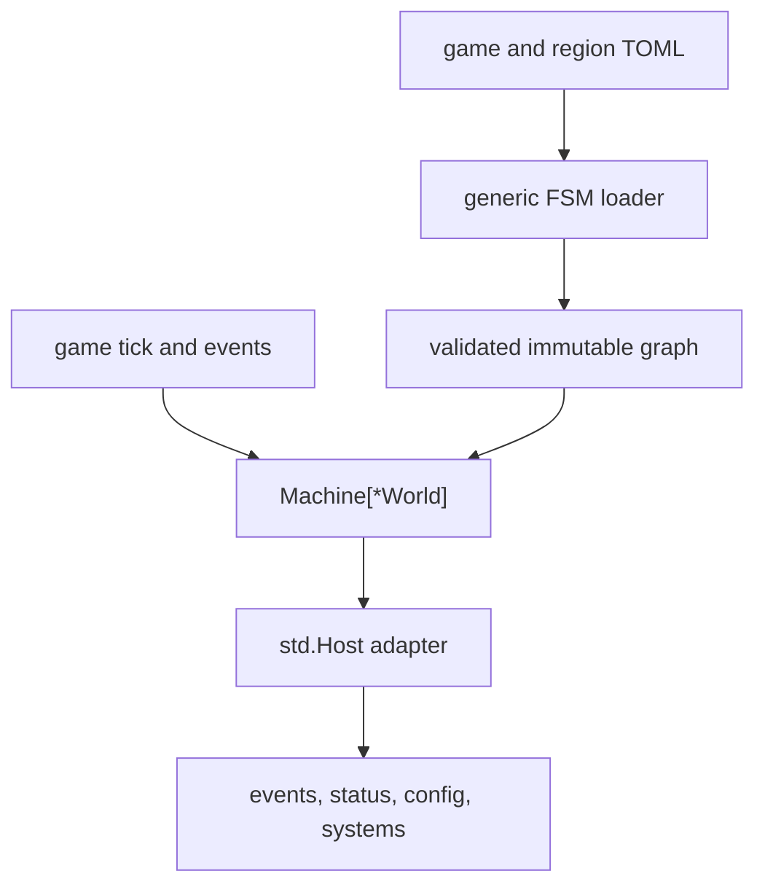
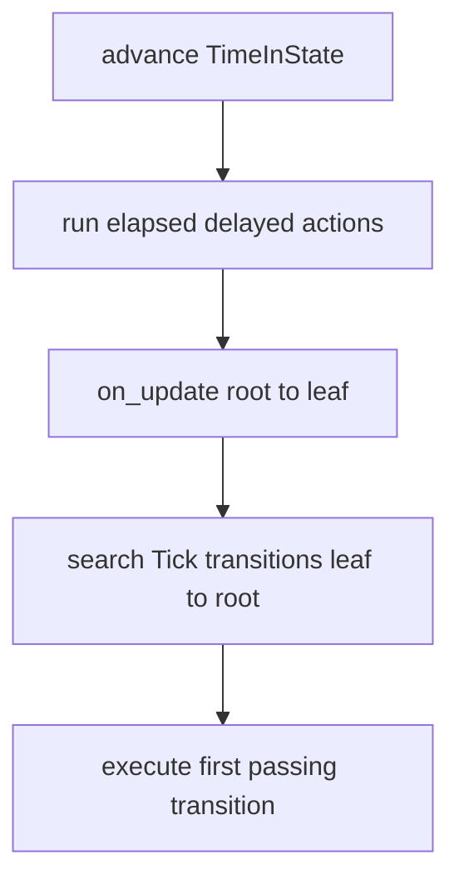
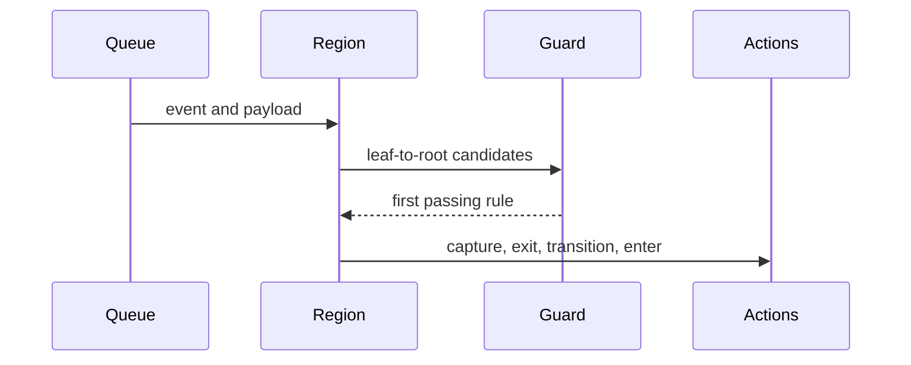
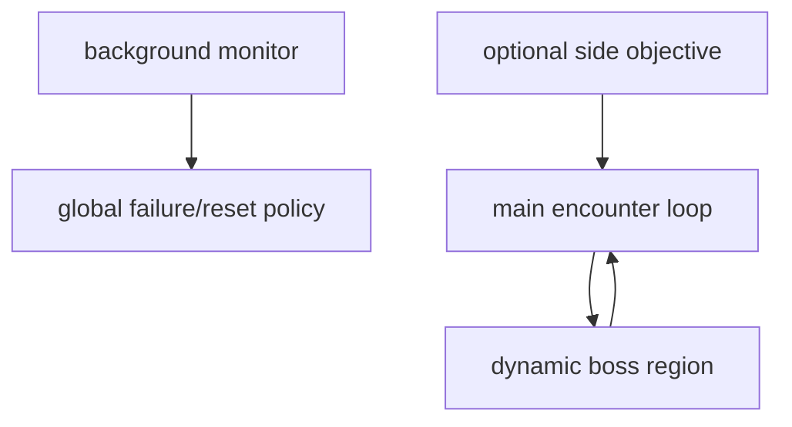

# FSM and Gameplay Configuration

vif's encounter progression is a generic hierarchical state machine
bound to the game through a small host adapter. TOML defines regions, state
hierarchies, transitions, guards, and actions; Go systems implement the actual
mechanics those actions request.

## 1. Boundary and data flow



`internal/fsm` is generic over its context type and imports no gameplay
systems. `internal/fsm/std` defines reusable actions/guards against a capability
`Host[T]`. `internal/manifest/fsm_bridge.go` supplies those capabilities for
`*engine.World`. A nil `Host` field leaves its actions inert and its guards false,
so a config still loads, and a nil `Seed` roots every `RandomVar` draw at zero;
with `Host.Refuse` set, `EmitEvent` and the system actions fail the load instead
when their hook is nil, and `-schema` leaves them out of that vocabulary. Bot
graphs run the same machine and library over a bot's own context with such a host
([Bots](bots.md#shared-vocabulary)).

The result is a strict policy/mechanism split:

- TOML decides when encounters start, end, repeat, pause, or escalate;
- the FSM decides deterministic transition semantics;
- events request mechanics without knowing which state caused them;
- systems implement mechanics without knowing the campaign graph.

## 2. Scenario resolution

The scenario entry is resolved in this order:

1. `-s <path-or-name>`, defaulting to `[paths] scenario` in `vif.toml`, where a
   path is an entry file or a directory holding `scenario.toml`, and a name
   resolves under `scenario/<name>/` in the configured roots;
2. `scenario/main/scenario.toml` under a root passed with `-config-dir` (or
   `[paths] root`);
3. the same under the user config root, normally `~/.config/vif`;
4. the same under the checkout's `wad/` for a binary in its `bin/`, then under
   each system root, `/usr/local/etc/vif` and `/etc/vif`;
5. the embedded main campaign in `internal/asset/scenario/`.

`-s main` also falls back to that campaign when no root holds an override; there
is no duplicate main scenario under `wad/`.

All external resources share this root hierarchy; see
[External filesystem layout](filesystem-layout.md) for the categorized tree and
resolution policy.

The resolved entry, its macro files and its region files are read whole into a
`resource.Scenario` before the FSM loads, and the loader reads that rather than
the host filesystem. A scenario holds at most 64 `.toml` files, 256 KiB each and
1 MiB in all, whether read from disk or received from a peer. It is identified by
its name and by the SHA-256 of its canonical form, which is what a replay and a
join are refused on; `-check` prints both.

A scenario need not be on this host at all. A joining participant whose own
resolved scenario does not match the session's digest asks the coordinator for
those bytes during the handshake and holds them in memory;
`resource.Options.Provided` is that scenario, and it wins
over every other selector because the run holding one has already agreed to
simulate exactly those bytes. See
[Services and networking](services-and-networking.md#72-join-identity-and-who-decides-it).

A run plays one scenario. The regions a scenario declares register one metric set
each, and `Scheduler.Prepare` freezes the registry before the first tick, so
loading a second scenario into a running machine would need keys the frozen set
does not hold. `:n <scenario>` therefore ends the run and starts another on the
same command line with a different `-s`; `resource.ValidateScenario` proves the
new one loads before the old one is torn down, and a name that resolves to the
running scenario's digest resets the game instead. In a live session only the
host may change scenario.

`-d` selects the embedded scenario and content. It is mutually exclusive with
`-s` and `-f`; combining them fails validation.

Region files are resolved through the same filesystem as the entry file and
relative to its directory. They may contain only `[states]`; nested region
declarations or other top-level keys are rejected. The entry's `macro_files` resolve
the same way and are scenario files too, so the digest covers them; every file
expands against the entry's macros before regions merge ([TOML macros](toml-macros.md)).
Circular includes and duplicate state names are errors, and a path outside the
entry's directory is rejected. The entry's `[behaviors]` files are scenario files
in the same way, each a behavior program compiled once per run
([FSM reference](fsm-reference.md#behavior-programs)).

Use `vif -check [-s <name-or-path>]` to resolve, load and validate the scenario
plus its behavior programs, keymap, audio overrides, content and every bot graph
without starting the terminal game. `vif -schema` prints generated JSON describing
known events and their payload fields, the vocabularies of a scenario, a bot graph
and a behavior program with their arguments, comparison operators and
script-visible config fields.

## 3. Root schema

```toml
description = "A short description for scenario selection."
min_players = 1
max_players = 4
macro_files = ["macros.toml"]

[systems]
disabled_systems = ["system_runtime_name"] # or only_systems = [...], not both

[map]
min_width = 50
min_height = 20

[regions.main]
initial = "MainStart"
file = "main.toml"
background = false
enabled_systems = ["glyph"]
disabled_systems = ["particle"]

[regions.boss]
file = "boss.toml" # no initial: dynamic region

[regions.puzzle]
file = "puzzle.toml"
only_systems = ["typing", "button"] # or disabled_systems, not both
```

| Field | Meaning |
|---|---|
| `description` | Optional short scenario summary, carried with the scenario during transfers. |
| `min_players`, `max_players` | How many players, bots counted, the scenario runs with: `0..parameter.MaxPlayers`, max at least 1 and min. Undeclared, 1 and a full roster. `max_players` is a ceiling beside `-players`, the lower one holding, and a startup lobby waits for `min_players` ([Runtime §1.2](runtime.md#12-the-dedicated-host)); a min of 0 waits for one until a game with nobody in it can run. |
| `macro_files`, `macros` | Macro libraries and definitions every scenario file may invoke ([TOML macros](toml-macros.md)). |
| `systems.disabled_systems` | Systems the baseline leaves off. Names are validated against runtime `System.Name()` values. |
| `systems.only_systems` | Every toggled system not named is off in the baseline; the inverse of `disabled_systems`, for a scenario that needs few mechanics. |
| `map.min_width`, `map.min_height` | Floor under the map's size, positive integers a map can hold, applied before the FSM boots and by every resize, reset and level setup; a smaller terminal crops the view and the camera follows the cursor. |
| `map.fixed` | `"WxH"`, the size a scenario's map holds throughout, for front-ends such as the fleet lobby; the scenario's level setups are what hold it. A scenario whose regions size the map differently leaves it out. |
| `regions.<name>.initial` | Initial state for a region started during machine initialization. Omit for a region spawned later. |
| `file` | File supplying additional `[states.*]` tables. |
| `background` | Keeps the region out of the foreground summary the status bar shows; it still updates, handles events and publishes its own `fsm.<region>.*` metrics. |
| `enabled_systems` | Systems on while the region runs. |
| `disabled_systems` | Systems off while the region runs, unless a running system requires one. |
| `only_systems` | While the region runs, every toggled system that neither this list nor another running region names is off; the region's narrowed phase, exclusive with its `disabled_systems`. |

Initial regions are sorted by name before startup. That sorted insertion order
becomes their deterministic update/event order. Dynamically spawned regions are
appended in spawn order. A capture carries the machine's order and an import
adopts it, so an installed machine runs its regions as the sender does.

## 4. States and hierarchy

```toml
[states.Wave]
parent = "Root"
on_enter = [
    { action = "SetVar", payload = { name = "remaining", value = 5 } },
]
on_update = []
on_exit = []
transitions = []

[states.WaveActive]
parent = "Wave"
```

Every state defaults to parent `Root`. The loader assigns deterministic state
IDs by sorted state name, verifies parent references, and compiles root-to-leaf
paths for least-common-ancestor transitions. User actions are forbidden on the
shared `Root` node because they would execute once per active region; put
one-shot work in a dedicated initial state.

Each live region owns:

- its name and active leaf state;
- the root-to-leaf active path;
- time in the active leaf;
- a pause flag;
- delayed actions associated with state owners.

Variables are signed 64-bit integers shared across all regions of one machine;
region spawn and terminate leave them alone. A game reset runs every region's
`on_exit` leaf to root, clears regions, variables and delayed actions, and
re-initializes the initial regions
([Runtime](runtime.md#10-reset-and-operator-state)).

## 5. Tick processing

For each unpaused active region, a game tick performs:



Only one tick transition can be taken per region per FSM update. Within a
state, declaration order is priority. If none passes, lookup bubbles to the
parent. A passing internal `Tick` transition consumes that tick and can shadow
outer tick transitions, so use it deliberately.

The scheduler updates the machine once per game tick by the fixed tick interval,
after the tick's opening event settle and before the systems run
([Runtime](runtime.md#5-simulation-tick-steps)); a paused game ticks only when
stepped, so region time and delayed countdowns stop with it. A paused region
neither updates nor handles events; other regions continue.

## 6. Event processing

The event queue offers each event to the FSM before system handlers. For every
unpaused region in its deterministic snapshot, the machine looks for matching
transitions from leaf to root and executes the first whose guard passes.

Each region keeps a trigger mask of the event types its active path names, and
the machine their union over unpaused regions, so an event no active state reacts
to is rejected with one bit test. `Reacts` answers for every state, active or not,
which is how a bot driver picks the events its graph sees.

Regions spawned while handling an event do not receive that same event because
iteration uses a snapshot. A region terminated during handling is skipped when
its turn arrives.



One event may cause one transition in each parallel region. Handling in one
region does not prevent another region from observing it.

## 7. Transition semantics

```toml
{ trigger = "EventGoldCompleted", target = "Reward" }
{ trigger = "Tick", target = "Timeout",
  guard = "StateTimeExceeds", guard_args = { ms = 5000 } }
{ trigger = "EventSpeciesCreated", internal = true,
  guard = "PayloadSpeciesIn", guard_args = { field = "species", names = ["drain"] },
  actions = [{ action = "IncrementVar", payload = { name = "seen" } }] }
```

Normal transition order is:

1. capture requested payload fields into variables;
2. execute `on_exit` from active leaf up to, but not including, the LCA;
3. remove delayed actions owned by exited states;
4. commit the target path and reset leaf time;
5. execute transition actions;
6. execute `on_enter` from below the LCA to the new leaf.

A transition targeting the current leaf is action-only: it does not exit,
re-enter, or reset `TimeInState`. An `internal = true` transition has no target,
consumes the trigger, runs its actions, and preserves state/time. Internal
transitions declared on ancestors remain active for every descendant.

### Payload capture

`capture_vars` maps an event payload field to an FSM variable:

```toml
{ trigger = "EventSpeciesCreated", target = "Attach",
  guard = "PayloadSpeciesIn", guard_args = { field = "species", names = ["pylon"] },
  capture_vars = { entity = "anchor_id" } }
```

Fields resolve by TOML tag and then Go field name. Signed/unsigned integers,
entity IDs, floats, and booleans are converted to `int64` (boolean true is 1).
Capture precedes exit/transition/enter actions, so the target state's
`on_enter` can use the value.

## 8. Actions and delayed work

Actions can appear in `on_enter`, `on_update`, `on_exit`, or a transition. Every
action supports an optional guard and `delay_ms`. An action guard sees no event
payload and is checked when the action is reached; a delayed action runs unguarded
when its delay elapses.

| Group | Actions |
|---|---|
| Variables | `SetVar`, `IncrementVar`, `DecrementVar`, `MultiplyVar`, `DivideVar`, `ModuloVar`, `ClampVar`, `CopyVar`, `RandomVar` |
| Regions | `SpawnRegion`, `TerminateRegion`, `PauseRegion`, `ResumeRegion` |
| Systems | `EnableSystem`, `DisableSystem`, `ReconcileSystems` |
| Game bridge | `EmitEvent` |
| Status/config | `StatusToVar`, `ConfigToVar` |

Variable arithmetic can use literal `value`/`delta` or `source_var`, and can
apply optional `min`/`max` clamps. Division and modulo by zero are no-ops.

`EmitEvent` compiles its event name and payload type at config load time:

```toml
{ action = "EmitEvent", event = "EventGatewaySpawnRequest",
  payload = { anchor_entity = 0, species = 7 },
  payload_vars = { anchor_entity = "anchor_id" } }
```

`payload_vars` can replace nested fields using quoted dot paths such as
`"rooms.0.center_x"`. Struct segments use TOML tags first; numeric segments
index an already populated slice. Injection does not append elements. A
string field takes the value in place of each `{}`, so a status message can
carry a count.

`RandomVar` sets `name` to a draw in `[min, max]` from the run's shared seed, an
optional `seed_var` and the required `index_var`, so a sequence replays from its
index on every instance instead of being stored.

An action with no `payload` table still emits the registered payload type,
zero-valued, which is what makes an effect's *scope* configurable without
touching the regions that do not care about it. A region is session-wide: every
instance runs the same machine and enters the same state, so an effect it raises
reaches every participant, each raising its own; the host pushes a `ClassLocal`
event with `PushLocal`, which never replicates. Where that is wrong — the
quasar's grayout and drain pause belong to the one cursor the quasar was fused
from — the event carries `CursorScopePayload`, entity zero means session-wide,
and the region injects the owner it already elected by:

```toml
{ action = "EmitEvent", event = "EventDrainPause",
  payload = { entity = 0 }, payload_vars = { entity = "fuse_owner" } }
```

Only the instance simulating that cursor acts on it; an `EmitEvent` of the same
event with entity zero stays session-wide.

A delayed action is scheduled against its owning state and counts down in
region time. It survives child-to-child transitions while its owner remains on
the active path and is discarded when that owner exits. Transition-delayed
actions are owned by the target state; internal-transition-delayed actions by
the current leaf.

## 9. Guards

Comparison operators are `eq`, `neq`, `gt`, `gte`, `lt`, and `lte`; an omitted
`op` compares for equality, and any other fails the load.

| Guard | Arguments | Meaning |
|---|---|---|
| `StateTimeExceeds` | `ms` | Active leaf time has reached the duration. |
| `RegionExists` | `region` | Named region is spawned, paused or not. |
| `VarEquals` | `var`, `value` | FSM variable equality. |
| `VarCompare` | `var`, `op`, `value` | Variable/literal comparison. |
| `VarCompareVar` | `var_a`, `op`, `var_b` | Variable/variable comparison. |
| `StatusBoolEquals` | `key`, `value` | Live boolean status metric comparison. |
| `StatusIntCompare` | `key`, `op`, `value`, `since` | Live integer status metric comparison; `since` counts from a variable `StatusToVar` set. |
| `ConfigIntCompare` | `field`, `op`, `value` | Supported integer config field comparison. |
| `ConfigBoolCompare` | `field`, `value` | Supported boolean config field comparison. |
| `PayloadIntCompare` | `field`, `op`, `value` | Event payload numeric field comparison. |
| `PayloadIntCompareVar` | `field`, `op`, `var` | Event payload numeric field against an FSM variable. |
| `PayloadBoolEquals` | `field`, `value` | Event payload boolean field comparison. |
| `PayloadStringEquals` | `field`, `value` | Event payload string field comparison. |
| `PayloadSpeciesIn` | `field`, `names` | Event payload species is one of the named code species or behavior programs, resolved at load. |
| `PayloadExists` | none | Event payload is non-nil. |
| `And`, `Or` | `guards`: array of `{ name, args }` | Recursively combine parameterized/static guards; an empty list passes. |
| `Not` | `guard`: one `{ name, args }` | Negates one guard. |
| `AlwaysTrue` | none | Always passes. |
| `StateTimeExceeds2s`, `StateTimeExceeds10s` | none | Convenience static duration guards. |

`ConfigToVar` and the config guards expose only the fields in
`internal/engine/config_access.go`, bound at load, not arbitrary
reflection over the resource. Consult `-schema` and
[the authoring reference](fsm-reference.md#config-fields) when authoring.

## 10. Region lifecycle and system policy

`SpawnRegion` validates the declared region and initial state at load, creates a
fresh runtime region, then performs root-to-leaf entry. `TerminateRegion` runs the
active path's `on_exit` leaf to root, then removes the runtime region and its
delayed actions. Pause/resume preserves active state and time.

The root `[systems]` table sets the baseline: every system but `disabled_systems`,
or only `only_systems`. The running regions, those neither paused nor ending,
adjust it: when any has `only_systems`, the union of those lists replaces the
baseline, so regions beside a narrowed phase keep what they name; every running
region's `enabled_systems` add to that and its `disabled_systems` take away. A
region with `only_systems` decides every toggled system, any other the systems its
lists name. `ReconcileSystems` sets the systems to that wanted set after
initialization, a reset and a capture import, and the four region actions and every
`:region` operation run it whenever the running set changes, so a phase's toggles
end with the phase. A system a running region decides, or whose wanted state
changed, goes to it; any other keeps what an action or the `:system` command left
it at. Toggles travel as `EventMetaSystemCommandRequest` events. This keeps
mechanics constructed but dormant until needed.

System lists use runtime names, which equal their manifest keys. A system toggles
only if it subscribes to and honors `EventMetaSystemCommandRequest`; `cursor`,
`camera`, `meta` and `network` do not, so no list can strand the roster, the view,
pause and reset, or a session's peers.

A disable is checked against the declared dependency graph. `-check` rejects a
config that leaves an enabled system without a required dependency, naming the
region, or `[systems]` when the root list itself does; it judges each region alone,
on its `only_systems` or the baseline, since a union of closed sets stays closed.
At run time every system left running keeps what it requires on, whoever turned it
on: `ReconcileSystems` keeps a dependency on against `disabled_systems` and turns one
back on for a system it starts, and `World.AllowSystemDisable` refuses a
`DisableSystem` action or the `:system` command while a running system requires the
target. A dependent that is off holds nothing on, so disabling both ends stays
legal; an optional dependency is reported once, not per resume.

### Installing a captured machine

A capture carries each active region's state name, dwell and pause flag, the
variables, and pending delayed actions by compiled action ID; the graph travels
with the build. Import has a staging form (`Machine.Import`) and a live one
(`ImportReconciled`). Both resolve the whole capture before mutating the machine,
so a name or action ID this build lacks refuses it; the staging form then places
the state without side effects. Regions the capture omits stop.
`Scheduler.ImportFSM` then reconciles system toggles, since an installed position
runs no entry actions, and republishes region telemetry.

The live form also reconciles persistent local lifecycle. Ordinary entry and exit
actions do not replay: their Shared results are already in the capture, and
one-shot local rewards or presentation bursts must not happen twice. A config
author explicitly marks only durable `ClassLocal` `EmitEvent` actions:

```toml
[states.QuasarHold]
parent = "Root"
on_enter = [
  { action = "EmitEvent", event = "EventGrayoutStart",
    payload = { entity = 0 }, payload_vars = { entity = "fuse_owner" }, reconcile = true },
  { action = "EmitEvent", event = "EventDrainPause",
    payload = { entity = 0 }, payload_vars = { entity = "fuse_owner" }, reconcile = true },
]
on_exit = [
  { action = "EmitEvent", event = "EventGrayoutEnd",
    payload = { entity = 0 }, payload_vars = { entity = "fuse_owner" }, reconcile = true },
  { action = "EmitEvent", event = "EventDrainResume",
    payload = { entity = 0 }, payload_vars = { entity = "fuse_owner" }, reconcile = true },
]
```

On import, marked actions on paths no longer held run leaf-to-root against the old
variables. After placement, marked entries run root-to-leaf against imported
variables. All releases precede all acquisitions, so a quasar-to-storm handoff
cannot clear the storm's new drain pause. If a referenced `payload_vars` value
changes while the path stays active, the owning path is exited and re-entered to
move the scope. Deleting a region is an exit, so a correction that retires a
quasar also lifts the guest's grayout and drain pause.

Load validation restricts `reconcile = true` to immediate, unguarded
`ClassLocal` `EmitEvent` actions in `on_enter`/`on_exit`. Persistent effects should
be acquired/released on a common parent state; one-shot fuse, spawn, reward,
message, sound, and strobe actions remain on child states and unmarked.

### Operator region primitives

`:region` exposes the scheduler-owned region lifecycle without reaching
through `App` to the machine:

| Command | Primitive |
|---|---|
| `:region list` | Report every declared region and whether it is active, paused, and in which state. |
| `:region spawn <name> <state>` | Spawn one declared inactive region at a named state. |
| `:region pause <name>` | Pause one active region without changing its state/time. |
| `:region resume <name>` | Resume one active region. |
| `:region terminate <name>` | Exit and remove one active region and its delayed work. |

Each command publishes exactly one `EventFSMRegionRequest` primitive. Compound
policy remains explicit: for example, entering a region that an escalation
chain would normally reach is issued as `pause` and then `spawn`, not hidden in
one command. Every successful mutating operation reapplies region system policy.
`:region` is unavailable in a live session and in a replay, where `:r` is `:replay`.

### Telemetry and transition taps

Before registry freeze, the scheduler registers five metrics for every
declared region:

`fsm.<region>.state`, `.index`, `.elapsed`, `.max_duration`, and `.paused`.

`.index` is the state's position in name order and `.max_duration` the `ms` of the
state's own `StateTimeExceeds` transition guard, zero when it has none. Inactive
regions publish `-`, `-1`, zero durations, and `false`. The foreground summary the
status bar shows (`fsm.state`, `fsm.elapsed`, `fsm.max_duration`,
`fsm.state_index`, `fsm.state_count`) follows the first unpaused region that is
not `background` and keeps its last value while there is none; the per-region
sets show simultaneous background activity.

`Machine.OnTransition` observes every transition before any of its actions run,
internal and self transitions flagged as internal, and `Machine.OnRegion` every
region `init`, `spawn`, `pause`, `resume` and `terminate`. The scheduler logs transitions
at debug and region operations at info under `sub="fsm"`
([Logging](logging-and-diagnostics.md#subfsm)). These are observation taps, not
policy callbacks.

`:log rec fsm on` asks the flight recorder to flush on each external
transition with reason `fsm:<region>`; it is off by default because a busy FSM
would otherwise write continuously. `:step ... fsm` uses the same transition
tap to trip a run-until breakpoint after the transition record is emitted.
Standing breakpoints use the same taps: `:d break state <name>` pauses on a
transition into that state or a region starting in it, `:d break region <name>`
on that region's init or spawn.

## 11. Authoring pattern

A maintainable scenario usually separates concerns into regions:



- Put perpetual failure or resource monitoring in a background region.
- Spawn the required cursor roster from an initial/background region and wait
  for `EventCursorSpawned` (or retry `EventCursorSpawnFailed`) before emitting
  player-state events. A new world intentionally contains no cursor.
- Put one encounter family in one external state file.
- Spawn boss/side regions dynamically and pause the loop they supersede.
- Treat system status metrics as observations and events as domain facts.
- Use defensive tick transitions when an expected destruction event could be
  absent because an entity went out of bounds or a scenario was modified.
- Leave a spawn's setup state on the spawn's own event (`EventSpeciesCreated`,
  `EventGoldSpawned`) rather than on a clock, and send a refused spawn to a retry
  state, as `StormSetupRetry`, td's `StSpawnRetry` and gold's retry on
  `EventGoldSpawnFailed` do. After a flat delay, the active state's defensive
  timeout would retire a region whose spawn was refused as if it had been fought.
  What an entry action establishes for a later guard has to be carried state, such
  as an FSM variable set through `StatusToVar`: a receiver installed into a state
  never ran its `on_enter`.
- Keep actions small; complex mechanics should remain Go systems triggered by a
  typed event.

The embedded campaign uses `main`, `quasar`, `storm`, `kraken`, `tower`, and a
background `monitor` that owns cursor boot/retry, pays gold completions wherever
the sequence ends, and resets on `session.any_defeated`. This guard aggregates
replicated owner defeat reports; it does not read instance-local energy or heat
mirrors. Encounter `EventLevelSetup` actions pair `clear_entities = true` with
`preserve_loot = true`, so a level change keeps uncollected rewards; a defeat emits
`EventGameResetRequest`, the same new game `:n` starts, which clears the world,
rewards included. The full current flow is summarized in
[Gameplay design](gameplay.md), and [the authoring reference](fsm-reference.md)
shows cursor spawn payloads and capture.

## 12. Validation rules and diagnostics

Reading and loading a scenario validates at least:

- scenario file count, sizes and names, and the entry's `description` and `[map]`;
- presence of regions and valid initial states;
- unique state names and valid parent/target references;
- known event, guard, and action names;
- every key and value, guard and action arguments and event payloads included;
- legal internal transitions, no actions on `Root`, and `reconcile` placement;
- external-file cycles, illegal top-level content, and duplicate states;
- macro definitions, argument names and types, recursion and expansion bounds;
- state hierarchy/path validity;
- `only_systems` beside `disabled_systems`, at the root or in one region, and, in
  `resource.ValidateScenario`, unknown system names and required dependencies left
  disabled.

A key the loader does not read fails the load, named by where it sits
(`state 'A': unknown key "on_entr"`, `guard 'HasTarget': unknown key "whithin"`,
`action 'Text' takes no payload_vars`), as does a value its field cannot hold. The
entry's top-level keys are checked against those it reads, `[systems]`, regions,
states, transitions and actions against their config structs, and arguments and
payloads through `internal/fsm/dialect`. The payload fields a payload guard,
`capture_vars` or `payload_vars` names are not checked against the trigger's event.

State compilation accumulates multiple per-state errors where practical, so
`-check` is more useful than fail-on-first-error parsing. It does not execute a
full playthrough; runtime conditions and balance still require tests/manual
exercise.

## 13. Example

```toml
[regions.wave]
initial = "WaveStart"

[states.WaveStart]
on_enter = [
    { action = "SetVar", payload = { name = "kills", value = 0 } },
    { action = "EmitEvent", event = "EventDrainResume" },
]
transitions = [
    { trigger = "EventSpeciesKilled", internal = true,
      guard = "PayloadSpeciesIn", guard_args = { field = "species", names = ["drain"] },
      actions = [{ action = "IncrementVar", payload = { name = "kills" } }] },
    { trigger = "Tick", target = "WaveDone", guard = "VarCompare",
      guard_args = { var = "kills", op = "gte", value = 10 } },
]

[states.WaveDone]
on_enter = [
    { action = "EmitEvent", event = "EventDrainPause" },
]
```

In a real scenario, use the existing kill status metrics unless a local counter
has a distinct semantic purpose. The example mainly demonstrates an internal
event counter plus an outer tick transition.

## 14. Source map

| Concern | Primary source |
|---|---|
| Runtime semantics | `internal/fsm/machine.go`, `types.go` |
| Capture export/import and reconcile | `internal/fsm/export.go` |
| Region commands and scheduler adapter | `internal/mode/commands.go`, `internal/engine/scheduler.go` |
| TOML schema/compiler | `internal/fsm/config.go`, `loader.go`, `builder.go` |
| External and macro files | `internal/fsm/file_loader.go` |
| Macro expansion | `pkg/tomlmacro` |
| Scenario resolution, canonical form, `-check` | `internal/resource/resolve.go`, `scenario.go`, `check.go` |
| Standard actions/guards | `internal/fsm/std/*.go` |
| Ops, strict argument decode, guard trees, vocabulary entries | `internal/fsm/dialect` |
| Game host adapter, config fields, `-schema` | `internal/manifest/fsm_bridge.go`, `internal/engine/config_access.go`, `internal/manifest/schema.go` |
| Current embedded campaign | `internal/asset/scenario/*.toml` |
| External examples | `wad/scenario/*` |
| Extended syntax examples | `doc/fsm-reference.md` |
