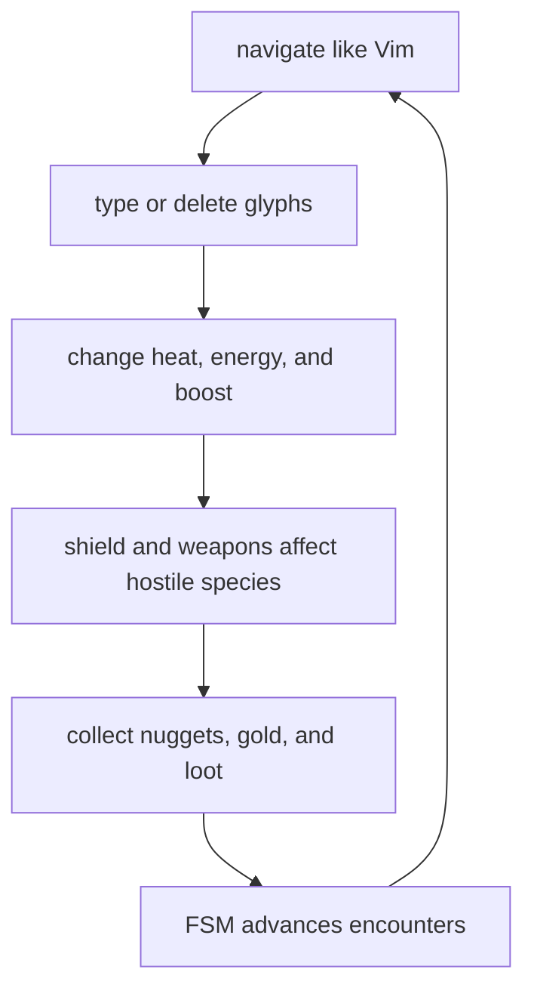
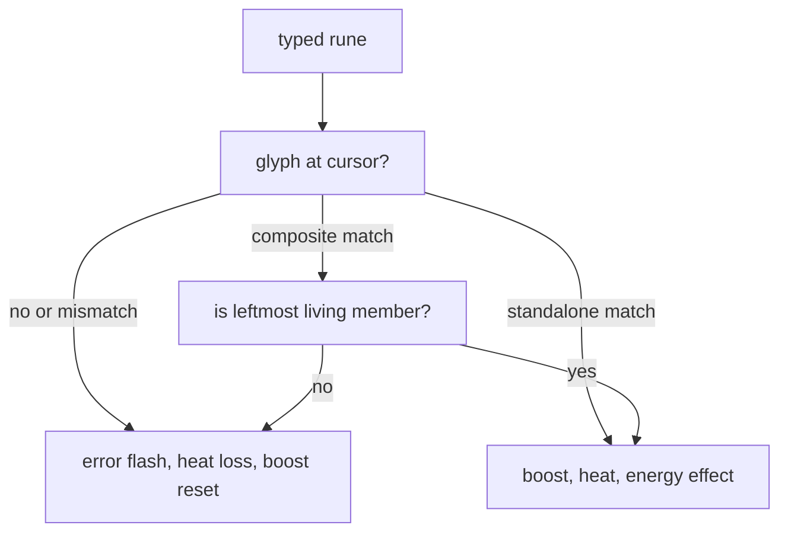

# Gameplay Design

vif combines Vim-style text navigation with a real-time typing and
survival game. This document describes the current mechanics as implemented.
Key bindings and parser details are in [Input and modes](input-and-modes.md),
while campaign sequencing is authored through the state machine described in
[FSM and configuration](fsm-and-configuration.md).

## 1. Core gameplay loop

The local cursor is both the player's text-editing position and the player
combat entity. Movement is discrete on the character grid. Hostile species,
projectiles, and effects may keep higher-precision `float64` kinetic state but
are projected back into the same grid for collision and rendering.

The embedded/default campaign is endless rather than a fixed sequence of
levels. Typing drives the resource economy, drains supply the first hostile
pressure, and kill counters let the FSM introduce composite encounters. The
author may replace that progression entirely with external TOML configuration.

## 2. Cursor and player state

The world starts with an empty, 16-slot cursor roster. Every shipped scenario's
boot state requests a cursor (the campaign, `blank` and `td` at the map centre,
`simon` below its buttons); `CursorSystem` places it on the
nearest free cell and attaches cursor, view, protection, ping, energy, heat,
shield, boost, weapon (holding the innate gun) and combat components, or under a
`[map]` with `cursors = false` the cursor and protection components alone: an
off-map cursor that only holds its player's slot. Each cursor owns an independent
copy of that state. A roster slot records whether this instance or a remote peer
drives the cursor and, for a bot, which participant holds it. One selected local
slot receives this instance's input and anchors the camera/UI.

Ordinary startup spawns one human-controlled local cursor. With `-host` and
`-join`, the startup gate assigns up to `parameter.MaxPlayers` slots and every
world creates the same roster in slot order, with one locally controlled cursor
and the rest remote. The boot script's initial heat and energy values are a
template applied to every admitted cursor, not only slot zero.

| State | Meaning |
|---|---|
| Position | Text cursor, player collision point, weapon origin, and camera subject. |
| Energy | Signed resource whose nonzero polarity activates the shield and colors attacks. |
| Heat | Bounded typing momentum; excess becomes overheat and can trigger a burst. |
| Boost | Timed reward from correct typing or credited kills that protects ordinary energy penalties and accelerates heat gain. |
| Shield | Elliptical defensive/collection area active whenever energy is nonzero. |
| Weapon | Charge counts, orbiting indicators, and independent cooldowns per weapon kind; see [Combat and weapons](combat.md). |
| Ping | Crosshair, selection/grid feedback, and cursor movement visuals. |
| Combat | Player ownership/type and hit-point metadata used by the combat matrix. |

Cursor entities cannot be destroyed through ordinary gameplay because their
protection mask is `ProtectAll`. `CursorSystem` owns explicit despawn. A game
reset (`:n` or defeat) clears the world but keeps the roster's membership, and
the boot state's spawn request rebuilds every slot from it; a level setup keeps
cursors and moves each into the new bounds.

## 3. Typing rules

Insert-mode character input emits a character event at the cursor cell.
`TypingSystem` selects the cell's top glyph, the one drawn, and validates the
rune. `Position.TopGlyphAt` picks it: a Shared glyph (a gold member) before a
player glyph, then the nearer drift layer (bright, normal, dark), then the lower
entity ID.

A correct character:

- activates boost for 0.5 s, or extends an active boost by 0.5 s;
- adds one heat, or two if boost was already active before the key;
- changes energy according to the glyph color and current heat;
- increments correct-input and streak metrics;
- blinks the energy meter in the glyph's colour, removes the glyph, and moves the
  cursor one cell right when the map edge permits.

A typing error, including a key on a cell with no glyph, flashes the cursor,
removes 10 heat, deactivates boost, plays the error sound, increments the error
metric, and resets the streak.

For composite text, the next valid member is the living member with the lowest
X, then Y, then entity ID. This enforces visible left-to-right typing even if
members were internally created in a different order. Gold members use the
universal heat/boost reward but omit normal color energy conversion; the FSM
owns the completion reward.

Delete operators are spatial actions, not simulated keystrokes. Characterwise
ranges clamp X on their first and last rows; linewise ranges cover every glyph
on selected rows. Glyphs with `ProtectFromDelete` survive. Deletion gathers
targets before publishing a batched death request, avoiding mutation during
store iteration.

## 4. Glyph production and decay

`GlyphSystem` pulls blocks from the immutable content corpus and places their
lines in free map space. It spawns only blue and green: each block takes the
type and level (dark, normal, bright) least represented on the map, ties drawn at
random. Red comes from decay, and gold marks gold members. A glyph's energy
depends on its colour and the typist's heat; its level sets its brightness, its
drift layer (§9) and its dust lifetime.

Spawn pacing adapts to screen occupancy: sparse maps receive text faster while
dense maps sharply reduce new placement. Placement needs at least one cursor,
excludes a region around every cursor, and retries only a bounded number of
positions. While a glyph drift is active, new lines are placed in a band
`DriftEntryBand` cells deep beside an upwind edge, each drawn in proportion to
the drift crossing it, so text enters where the drift carries it across; the
spawner reads the drift from the environment's published status.

`ParticleSystem` selects dust, decay or blossom rules from
`ParticleComponent.Behavior`, and everything that differs between them is one row
of its profile table. A wave (`EventParticleWave`, across the map or one button's
columns) drops decay from the top edge or raises blossom from the bottom. Decay
lowers the level of each Player-domain glyph it enters; a dark blue glyph becomes
bright green, a dark green one bright red, and a dark red one flashes away; it
also destroys nuggets. Blossom raises a glyph's level up to bright and is spent on
a red glyph. A decay and a blossom that meet annihilate. Both respect
`ProtectFromParticle`, die on walls and bounds, and have no lifetime. Every decay
particle orbits the nearest Kraken while it spins or charges, entering with a kick
in its spin; with no anchor left it drops straight down at fresh decay speed.

A behavior's profile holds an orbit for each anchor kind that pulls it: the cursor
for dust, a Kraken for decay, and a vortex's button for all three. A vortex
(`EventParticleVortex`) turns every Player glyph into particles of the behavior it
names, as a Kraken turns what it covers into decay, and for its duration holds all
of that behavior in a ring just clear of one button, round at the button's
proportions; then decay falls, blossom rises and dust returns to the cursor. A
vortex orbit is damped hard, since it draws particles from across the map.

Dust is what glyphs become: a drain crossing a normal or bright glyph, a dust-all
request (`:dust`, each gold round of a quasar encounter, a gold sequence destroyed
in `main`, or two storm circles colliding) converting every loose glyph while dark
ones flash away, and special fire (§7), which converts dark ones too. It orbits
the local cursor while that cursor's energy is nonzero, bounces off walls and
bounds, nudges the drains it crosses, and lives 2, 4 or 8 s by its glyph's level
through `TimerComponent`, fading a level each time its remaining life drops below
the lower level's lifetime. All three behaviors share one deterministic
Player-domain RNG stream. Flash, fade, splash, marker, explosion, and motion-marker
systems are transient feedback rather than durable text state.

## 5. Energy, heat, boost, and shield

### Energy

Energy is signed. Positive and negative values are both useful: either polarity
activates the shield, while attack color/polarity derives from the sign.

| Delta class | Rule |
|---|---|
| Reward | Increases absolute magnitude without crossing through zero. |
| Penalty | Converges toward zero, clamps there, and is multiplied by the cycle damage multiplier (`energy.damage_multiplier`). Boost or ember can block it. |
| Passive | Converges toward zero and clamps, but bypasses boost/ember protection. |
| Spend | Converges toward zero and may cross it; used by explicit player actions such as jumps. |

Energy loot and lightning energy drain are rewards, so both grow the current
magnitude: positive energy rises and negative energy becomes more negative.
At exactly zero no polarity remains, so the next reward establishes positive
polarity; a shield drain that first clamps negative energy to zero can therefore
look like a reversal when a later reward arrives, but the reward did not cross zero.
Nugget and gold jumps spend 1% and 10% of the current magnitude, respectively;
from either polarity they converge toward zero, while only an oversized fixed
spend crosses zero in one change.
Glyph changes remain signed by color and can move energy across zero.

Blue, green, and red glyphs start with different signed base values. The energy
system adjusts the actual change with current heat, so the relationship is part
of the live resource economy rather than a fixed reward table. The cycle damage
multiplier doubles on each `EventCycleDamageMultiplierIncrease` (every storm kill
in the campaign) and survives encounter changes; a game reset or
`EventCycleDamageMultiplierReset` returns it to one. Shield drains are the only
penalties the game produces, so an unshielded hit's heat loss is not multiplied.

### Heat and ember

Heat is clamped from `0` to `100`. Positive additions beyond the cap accumulate
overheat. Reaching the overheat threshold emits a heat burst, flashes the meter,
and activates the ember phase. Ember decays heat periodically and protects
ordinary energy penalties while active. A heat penalty also clears the
overheat accumulation. A scenario lights or puts out the ember with
`EventCursorArmRequest`, and an ember that burns its heat out crosses
`EventEmberSpent`, which a scenario can time a turn by.

Special-attack heat spending consumes overheat before current heat without
resetting the remaining overheat or triggering the penalty sound.

### Boost

Boost is a per-cursor timed reward. A correct character or a species kill
credited to that cursor activates it for 0.5 s when inactive or extends it by
0.5 s when already active. Combat systems retain the last damaging cursor on the
target, and fatal species lifecycle paths publish `EventSpeciesKilled` carrying
that credit; the kill reward waits for the confirmed kill, never a predicted
one, and lifecycle deaths or unowned attacks carry no cursor and grant no boost.
A typing error deactivates the typing cursor's boost.

While active, boost doubles the per-character heat gain and prevents ordinary
energy penalties. Passive drain and explicit spends remain effective.

### Shield

The shield activates whenever energy is nonzero and deactivates at zero. It is
an ellipse around the cursor, not a rectangular grid range. It:

- turns hostile hits and contacts into energy drain instead of heat loss;
- collects nuggets (loot is collected within two cells of its owner instead);
- supplies the bounds shown in Visual mode;
- drains 1% of current energy every second as passive drain.

Because passive drain converges to zero, keeping a shield active is never free.
The drain interval starts when the shield does, and a stamp ahead of this
instance's clock (a cursor installed from an authority further along) restarts
the interval. `energy.passive_count` and `energy.passive_drained` tell a drain
that has stopped from one that is working and being outpaced. Collision behavior
still varies by attacker through combat/species profiles.

## 6. Collectibles

### Nuggets

Each participant has at most one personal nugget, which only its own cursor
collects or jumps to. When absent, `NuggetSystem` attempts a random free-cell
spawn away from that cursor after the one-second spawn interval. A beacon
periodically converges materialize beams on it, in the nugget's colour and
shorter than a spawn's.

A nugget is collected by exact cursor overlap or by entering the active
shield/ember collection ellipse. Collection adds 10 heat. `Tab` jumps to the
nugget and spends one percent energy when a target exists.

### Gold sequences

A gold encounter creates a protected, bright, 10-character alphanumeric
composite at a free horizontal span. It lasts 10 seconds and must be typed in
left-to-right member order. Gold members resist deletion and particle effects,
but any species body covering one destroys it, a drain's included, and the
breach ends the sequence as destroyed.

`Shift-Tab` jumps to the first remaining gold member and spends ten percent
energy. Completion, timeout and external damage emit `EventGoldCompleted`,
`EventGoldTimeout` and `EventGoldDestroyed`; `EventGoldCancel` removes the
sequence silently. Completion credits the cursor that typed the most members, the
lowest slot on a tie. The Gold system cleans up the composite, but the FSM decides
what completion earns. A spawn request while a sequence runs is answered with that
one (`EventGoldSpawned`), so a region can adopt it. In the embedded campaign a
sequence outlives the handover between `main` and quasar in either direction, the
monitor pays every completion heat and energy wherever it ends, and the storm,
Kraken and tower setups cancel it. Only completion pays: a sequence a species
destroys dusts every glyph in `main`, as every end of a quasar round does, which
makes gold worth something to a player who never types it.

### Species loot

Once a kill is confirmed, it is evaluated against ordered, species-specific drop
tiers, rolled for each cursor this instance simulates. A unique tier skips weapon
loot the cursor holds at full charge or already has on the map. When it drops
nothing, the fallback counts of the entries it rolled, or of every entry if it
skipped them all, add to the drop of each later non-unique tier. Pity-adjusted
rolls improve repeated misses. Drops burst away from the death point, then home
using direct line of sight or a flow field and collect near the player.

A drop belongs to the cursor it was rolled for and only that cursor can collect
it, so both halves of the route are the owner's: the line of sight is tested
against the owner, and the fallback flow field is a private one seeded from the
owner's cell, not the shared field over every cursor. A drop that lands beside
another participant still goes home; one walled off from its owner comes to rest
where it is.

| Loot | Rune | Collection effect |
|---|---|---|
| Rod | `L` | Adds a rod charge/orb. |
| Launcher | `M` | Adds a launcher charge/orb. |
| Disruptor | `P` | Adds a disruptor charge/orb. |
| Turret | `B` | Adds a turret charge/orb. |
| Emitter | `R` | Adds an emitter charge/orb. |
| Gun | `T` | Adds a gun lane per direction, up to three, or on a scenario's path its next level. |
| Upgrade | `U` | Raises the gun a level, as a gun drop does; only an event drops it. |
| Heat | `H` | Adds the configured heat reward (currently 10). |
| Energy | `E` | Adds the configured energy reward (currently 10,000). |

Weapon loot is lettered for its attack: lightning, missile, pulse, bullet, ray,
tracer; the upgrade, a gun charge too, is lettered for a gun that climbs a path. The exact tier rates are gameplay balance data in `internal/profile/loot.go`;
documentation does not duplicate every rate because those values are expected
to change during tuning.

A scenario rewards a level with an event drop instead: `EventLootSpawnRequest`
places one kind at a cell for every cursor the instance simulates, with no roll,
and each drop homes on its owner as above. No species drops the gun; the
campaign's tower victory drops one at the tower, and vanguard drops a `U` where a
player shoots a raider down. Like any FSM entry action, the
drop does not replay on an instance a correction moves past the state raising it.

## 7. Weapons and attacks

Main fire has its own cooldown. It fires every owned, ready kind of the loadout,
the innate gun included, whose tracers take the cursor's energy polarity.
Automatic fire starts with main and special enabled; `a` cycles both → off →
main only. Main-only repeats the main-fire path without special attacks.

Special fire needs 1 heat; below that it converts nothing and emits no blast.
It converts all loose, living Player-domain **dark** green glyphs plus dark blue
glyphs for nonnegative energy or dark red glyphs for negative energy. Conversion
commits synchronously, then all existing and newly created dust is consumed into
one explosion center per occupied cell, within the center budget. Glyphs the
resulting blast covers are themselves converted and become the next attack's
dust; dark ones flash away instead, and shared or composite-member glyphs are
never taken. The blast spends its heat from overheat first, so 156 becomes 155
and 1 becomes 0. Without dust or eligible glyphs it spends nothing. Each center
deals 2 base damage and uses an explosion mass of 1.0. Player targets resolve
locally; only center/radius/attack geometry crosses for shared combat.

| Weapon | Model |
|---|---|
| Gun | Innate. One tracer from the cursor per cardinal of its aim, all four unless the scenario's `EventGunAimRequest` narrows it; direct damage on contact; a positive tracer turns the red glyphs it crosses into blossom, a negative one turns blue ones green and releases decay from them. Each impact chains into the rod's lightning, so the energy drain and its zap span the firing cursor and the species rather than the impact cell. Two charges fire the two side lanes, three add the centre back; a gun drop adds a charge. A scenario can set an upgrade path instead (`EventGunAimRequest`'s `path`): each level names the lanes, up to three, along each cardinal, a gun of n charges fires level n, and it holds a charge per level. |
| Rod | Direct lightning against unique nearest targets, rewarding energy in the attacker's current polarity; at the cap each hit arcs to the nearest other target in range. |
| Launcher | Homing/area missiles assigned from the nearest-target set; at the cap its cooldown halves. |
| Disruptor | Stun pulse centred on its orb; it fires only while a target is inside the ellipse; at two charges the pulse also burns. |
| Turret | One spread bullet per charge from its orb at the nearest targets; each hit is direct damage; at the cap it streams single bullets between waves. |
| Emitter | A sustained ray from the cursor through its orb to the first wall, one cell wide to the orb and three past it, sweeping as the orb orbits; more charges fire longer and hit harder, and at the cap the ray stays lit for as long as main fire is held. |

Weapon ownership is represented by charge count: zero means not owned. Each
owned kind but the gun has an orbiting orb entity and its own cooldown; the gun
fires under main fire's. Charges only rise, so a kind at its cap keeps its cap
effect until an energy zero crossing clears the loot; the gun survives that and
leaves only on a remove request. The combat system uses attack profiles to route
attacker/defender pairs, damage types, collision profiles, chained attacks, and
kinetic effects, so projectile systems embed no target-specific response.

The special-fire input path is separate from main fire; Backspace or Space uses
it under the default mapping. See source and keymap documentation when changing
this behavior because fire requests, auto-fire, macros, and mouse repeat all
share timing constraints.

Tracer visuals are background-only moving trails. They preserve any glyph
foreground in a traversed cell, use max-background blending so overlapping
auto-fire does not accumulate into a flash, and shrink the visible tail while
a blocked tracer drains to its stop point.

## 8. Hostile and structural actors

| Actor | Role |
|---|---|
| Drain | Local population is `ceil(current heat × 10 / 100)`, capped at 10 and excluding overheat: heat 0 gives 0; 1–10 gives 1; 11–20 gives 2; 91–100 gives 10. Materializes, chases, drains shield energy, removes heat on unshielded contact, turns the player glyphs it crosses into dust (§4) and breaks the gold sequence it crosses; one that crosses a swarm or quasar is absorbed into it, healing it. |
| Quasar | Large composite, 5 cells wide by 3 high. Tracks the cursor, emits lightning when the cursor leaves its effective range, and absorbs drains. It is created by fusing drains in the default progression. |
| Swarm | Fast composite, 4 cells wide by 2 high, created from enraged drains. It tracks/charges, may teleport around blocked line of sight, absorbs drains, and has bounded charges/lifetime. |
| Storm | Multi-part boss with independently moving circles and 3D orbital dynamics. The green circle pulses an area, the red circle carries a turret it fires in bursts at the nearest cursor, and the blue circle creates swarm pressure. |
| Pylon | Stationary ablative hostile structure/damage sponge that pushes nearby species. |
| Snake | Segmented composite species with separately modeled head and body members and formation lifecycle. It keeps one cursor target and its route until the target disappears, becomes unreachable, or another route is over one-third shorter. |
| Eye | Five-by-three composite navigation attacker. It belongs to a target group, homes along routes, and self-destructs on contact; its parameters are evolution-managed. |
| Tower | Stationary ablative structure the players defend (Shared domain). It blocks cursor placement and acts as a target in tower-defense scenarios. It owns itself: no player's weapon targets it, and its loss is the region's defeat rather than anyone's kill. |
| Kraken | Eight-tentacle boss whose footprint covers hundreds of cells. It waits, lashes with alternating tentacle sets, or spins and then charges at the farthest cursor; its footprint demolishes walls, clears nuggets and gold members, turns the glyphs it covers into decay, and strikes the cursors it touches. Its body stays inside the map; only in-map tentacle cells interact. |
| Gateway | Timed anchored spawner. It emits eye or snake spawn requests with route/adaptation metadata and disappears when its anchor is gone. |
| Bullet | Straight projectile stopped by bounds and walls; a mounted turret's strikes cursors and shields, a cursor's strikes species. |
| Data species | Up to eight composites a scenario's behavior programs define, each a body, a combat row, contact damage and a state machine over shared verbs; `BehaviorSystem` runs them all ([FSM reference](fsm-reference.md#behavior-programs)). |

The component `SpeciesType` catalog includes drain, swarm, quasar, storm,
pylon, snake, eye, tower, and kraken, then eight IDs for data species. Gateway
and bullet are mechanics/entities but not species. Species systems own
formation-specific movement and spawning; common damage is delegated to
`CombatSystem`, common movement math to `pkg/vmath/physics`, and path selection
to `pkg/navigation`.

## 9. Walls, maps, navigation, and environment

Walls are grid entities with a block mask (cursor, kinetic movers, particles,
spawning) and foreground, background or box-drawing visuals. A new wall displaces
what stands on its cell. Level setup can size the logical map independently of
the terminal viewport, never below the scenario's `[map]` minimum, decide whether
resizing crops it, and clear or preserve entities. Camera offsets translate
between map, viewport, and screen coordinates.

`EventMazeSpawnRequest` divides the map into maze cells of `cell_width` by
`cell_height`, carves a maze with open borders, optional braiding and random or
placed rooms, and fills the remaining cells with walls; a placed room is cleared
with a margin of one maze cell. Pattern assets can also become wall layouts. The
maze generator is in [AI, physics, and
evolution](ai-physics-and-evolution.md#7-maze-generation) §7. Navigation then
uses either flow fields toward a target or precomputed multi-route graphs
([Navigation](navigation-design.md)).

`EventCaveStart` lays a cave across the map and scrolls it left. `pkg/cave` gives
each column its ceiling and floor rows from the seed in integer arithmetic, so every
instance and platform lays the same rock: a gap between `min_gap` and `max_gap`
rows, walls of at least `min_wall`, a channel snaking at most `swing` rows off the
middle with knots every `wavelength` columns, `detail` rows of rough rock, opening
from a centred mouth over `ramp` columns. The rock is a field of ceiling and floor
rows per column, not wall entities, which every wall query reads. It draws in
`visual`, or in a stone art preset: `art` lists them (`none` for bare stone,
`strata`, `cracked`, `moss`, `crystal`, `masonry`) and the seed picks one. A
cell's glyph and colours follow from the preset, the seed, its profile column and
row, and how deep it lies from the nearest opening on which side, so the stone
moves with the rock and reads on a text console. Each step, at
most one a tick, moves the rock and every shared wall a column left, drops what
leaves the map and lays the column entering it. What the rock arrives on goes a
column left and a row toward its column's nearer opening, or straight left: a
cursor by a placement, so the rock only pushes. A flying composite the rock
reaches at any member moves whole the same way, else to the nearest place its
footprint fits, enraged or not, and one with room nowhere is destroyed with no
reward. A cursor the rock finds no room for, pressed against the left edge, is
crushed where it stands (`EventCursorCrushed`), which defeats it; a loose glyph is
removed as scenery. `EventCaveStop` leaves the rock where it stands.

`EnvironmentSystem` owns map-wide gameplay effects rather than rendering
post-process effects. Its first effect is wind: `EventWindStart` supplies force,
direction in terminal-plane radians, and duration; a later valid start replaces
the current wind and `EventWindCancel` ends it. Each tick varies force by up to
10% and direction by about five degrees from a deterministic Shared RNG stream,
then applies `force / mass` to mobile species. Drains, swarm, quasar, eye, snake
head, and storm circles (except while stunned) are affected. Cursor kinetics,
snake body-local deformation, pylons/towers, Kraken, weapons/projectiles/loot,
dust, and the decay/blossom particle behaviors are not wind targets. See
[Generic kinetic analysis](generic-kinetic.md) for the motion paths and the
future design that would extend wind to more of them.

Its second effect is glyph drift, a parallax background for side-scrolling
levels. `EventDriftStart` supplies a direction in the same radians, a speed in
cells per second (capped at `DriftMaxSpeed`) and `duration_ms`, where zero drifts
until `EventDriftCancel`. Every loose player glyph moves along that direction at
its level's fraction of the speed, `DriftLayerFactor`: bright at full speed,
normal at half, dark at a quarter, with rows scaled by the cell aspect so one
speed reads the same in every direction. Each level keeps an integer sub-cell
phase per axis that advances
by simulated time, so drift follows game speed, draws no RNG, and every instance
steps a layer on the same tick. A layer moves one cell and one axis at a time as
a rigid group, so no step crosses a wall's corner. A glyph that would leave the
map, enter a wall or find its target cell full is removed with no reward or
effect. Composite members (gold) and glyphs already tagged to die stay put, and
the cursor does not ride with the text under it. A new start keeps each phase
that still points the new way, so a change of pace does not jolt the text and a
reversal does not stall it, and disabling the system pauses the drift as it
pauses wind. Where layers share a cell the nearest draws on top and is the one
typing acts on (§3).

## 10. Embedded campaign progression

The campaign has one source, `internal/asset/scenario/`, compiled into native,
headless, and browser builds. `-s main` uses it unless a configuration root supplies
an explicit `scenario/main` override. Only the background monitor starts at boot;
it spawns and arms the cursor before opening `main`.

1. `main` cycles gold sequences and decay waves. Ten drain kills elect the causal
   cursor, pause `main`, and begin a quasar encounter.
2. The quasar holds that owner's grayout and drains. Three quasar kills lead to a
   storm; earlier kills return to `main`.
3. Each storm kill doubles the cycle damage multiplier on shield drains (§5);
   the notice reads `SPECIES DAMAGE INCREASED`. Three storm kills create
   a full-map maze without rooms and spawn one Kraken (§8) at its center, which
   demolishes the maze as it moves.
4. The first Kraken kill returns to `main`; another three storm kills open the
   second Kraken encounter. Its defeat starts tower defense. Thus the escalation
   is **3 storms → 1 Kraken → 3 storms → 1 Kraken → tower**. Each threshold counts
   kills since the escalation before it; `kills.*` keeps the game's totals.
5. Destroying the tower's pylons drops each participant a gun at the tower and
   resumes `main`; losing the tower fails the run.
   Encounter transitions preserve uncollected loot.
6. Any participant reaching zero heat **and** zero energy ends the run. The shared
   monitor consumes owner-authored defeat state and starts a new game, as `:n`
   does: the world, the kill tallies and every other statistic start over and the
   roster is rearmed. Every shipped scenario uses this defeat rule; tower defense
   also retains its objective-failure and victory conditions.

`wad/scenario/td` is a standalone 500-by-250 tower defense, `blank` is an authoring
scaffold, `simon` is a memory game, `warden` is blank's arena with a species its
own behavior program defines, and `vanguard` is a side-scroller. Each entry has a
short `description` for scenario listings.

`simon` lays four buttons across the map on keys 1-4, each with its note, rising
in pitch from 1 to 4, and each key drawn large in black that turns white as its
button lights. The buttons run up once before the first game, and any press cuts
that short. A level plays the sequence, one note longer than the last; after a
short pause the player repeats it by key or by clicking the buttons. Every note
shown or pressed sounds, so the game can be played with eyes closed (`Ctrl-S`
cycles the sound channels). A correct press blooms over its button
and a cleared level flashes green. From the first turn an ember burns the heat
down as the turn's clock; each shown note and each cleared level refill it, and
special fire spends it too. A wrong note or a burnt-out ember loses the game: the
field grays and turns to decay circling the button at fault, the one pressed or
the one due, while the due note lights and sounds; the next game starts as the
decay falls away. The level stops rising at 100 and the energy cell reads it.
Glyphs drift behind the buttons as a moving backdrop, and music stays off.

`warden` beams its warden into the top-left corner over a second: an orange
four-by-two body that homes on the cursor. Past twelve cells it stops, turns red
under a cyan countdown while a beam marks the cursor's cell, then charges the
cell the cursor holds as the countdown ends; a wall ends the charge, and a stun
drops it back to homing. A kill shows "Warden down" and beams another in three
seconds later; one that outlives its 35 seconds is replaced a second later. Its
program, `behavior/warden.toml`, is the template for a species of one's own
([FSM reference](fsm-reference.md#behavior-programs)).

`vanguard` flies the cursor through a cave (§9) scrolling left at eight columns a
second, its channel seven to fifteen rows high and never more than nine rows off
the middle, so a tall terminal climbs no steeper; each new game flies a new cave,
its rock in strata, cracked, moss or crystal stone.
Glyphs drift left behind the rock at three depths, and drains, nuggets, gold and
the fuse are off. Raiders, the cave's swarms, spawn at the right edge every four
seconds while fewer than three fly, in the nearest open rows when rock fills the
drawn one. A raider is a program of the scenario's own
(`behavior/raider.toml`) running the swarm's chase, lock, charge and teleport; it
lives until killed, and the rock pushes it as it pushes the cursor. One a player
shoots down drops a `U` where it fell, for every player, and each `U` raises the
gun a level of the scenario's nine: one shot forward, then two and three, one up
and one down, one back, two up and down, two back, three up and down, three back.
Forward is right, the way the ship flies. A crush is a defeat: the game starts
over at once, the gun back at one shot, and opens with "Crushed against the
edge".

## 11. System inventory

The manifest registers these tick systems, grouped here by responsibility. The
grouping is editorial and is not the replication domain, which each system
declares for itself:

| Group | Systems |
|---|---|
| Transport | `network` |
| Frame/player | `cursor`, `ping`, `transient`, `camera`, `energy`, `shield`, `heat`, `boost`, `weapon` |
| Typing/world | `typing`, `composite`, `wall`, `tower`, `gateway`, `loot`, `glyph`, `nugget`, `particle`, `gold` |
| Spawning/effects | `materialize`, `fuse`, `spirit`, `lightning`, `missile` |
| Motion/environment/combat | `navigation`, `soft_collision`, `environment`, `combat` |
| Species | `drain`, `quasar`, `swarm`, `storm`, `kraken`, `pylon`, `snake`, `eye`, `mount`, `bullet` |
| Particles/overlays | `flash`, `fadeout`, `marker`, `button`, `explosion`, `motion_marker`, `splash` |
| Lifecycle/learning | `death`, `timer`, `adaptation`, `genetic` |
| Sound | `audio`, `music` |

The table uses runtime `Name()` values, which match the manifest keys;
`TestActiveSystemsMatchRuntimeNames` keeps the two together, so configuration
validation, the `:system` command and the manifest all name a system the same
way. `meta` needs the `GameContext` and `behavior` the scenario's compiled
programs, so the app adds both directly and they declare their profiles in
`manifest.ContextSystems`; `meta` ticks with the rest, publishing map, camera and
cursor-position telemetry, and `behavior` runs the data species.

Each entry declares a domain profile and its dependencies in
`internal/manifest/definition.go`; see [the domain model](domain-design.md).

## 12. Balance and ownership map

| Concern | Source of truth |
|---|---|
| Player and collectible constants | `internal/parameter/gameplay.go`, `player.go`, `collectible.go` |
| Species tuning | `internal/parameter/{drain,quasar,swarm,storm,kraken,pylon,snake,eye,tower}.go` |
| Weapons, combat matrix and profiles | `internal/component/weapon.go` (`WeaponSpecs`), `internal/profile/combat.go`, `internal/parameter/combat.go`, `player.go`, `tracer.go`, `internal/system/combat.go` |
| Drop tables and rewards | `internal/profile/loot.go`, `internal/component/loot.go`, `internal/parameter/loot.go` |
| Drop routing and homing | `internal/system/loot.go`, `internal/profile/homing.go` |
| Environment effects | `internal/system/environment.go`, `internal/parameter/environment.go`, `internal/profile/mass.go` |
| System behavior | Matching files in `internal/system` |
| Default progression | `internal/asset/scenario/*.toml` |
| External scenarios | `wad/scenario/*` |

Changing a number in `parameter` changes a mechanic; changing a transition in
TOML changes when that mechanic is invoked. Keep that distinction intact when
adding a campaign or balancing a system.
