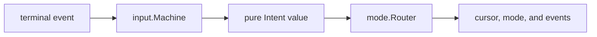
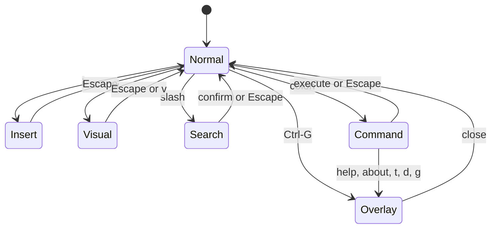

# Input, Modes, and Commands

The interaction layer deliberately separates terminal key decoding from game
behavior. `internal/input` parses host events into engine-independent semantic
intents; `internal/mode` applies those intents to the world while holding its
update lock.

## 1. Input pipeline



The terminal service polls in its own goroutine and writes to a bounded event
channel. The application input loop passes events to `input.Machine`, which
maintains only parsing context. The router owns engine-aware interaction state:
the last search pattern and find target, command history, cursor undo, macros,
mouse and button holds, and the fire anchors held buttons share with auto-fire.
It drives only the roster's selected local cursor; `CursorSystem` applies and
announces placement so live input, replay, bots, and remote producers share the
same entity-owned path.

`Intent` is a data structure, not a callback. It includes intent type, motion,
operator, special action, target mode, scroll direction, count, optional character,
the pointer cell (terminal coordinates, or a map cell when `MapCell` is set),
captured command text, and a flag identifying macro playback. This boundary makes
the parser testable without constructing an ECS world.

A scenario can take printable ASCII keys away from the play grammar, for a game
whose buttons are keys. An FSM state emits `EventKeyCaptureRequest { keys = "12345" }`
(empty `keys` releases them; `entity` scopes the capture to one cursor's instance)
and `MetaSystem` stores the set in `GameContext.KeyCapture`, which the parser reads
without the world lock. In Normal, Visual and Insert a captured key cancels any
pending count or operator and becomes `IntentKeyPress`. Search and Command text,
Escape and other special keys are untouched, and a reset releases the capture.

A captured key is the scenario's one input hook, whatever produces it:

- **Sources.** A typed key, a left press on the button of that key (§7), and a bot
  or script naming the `press` action with the key as its `char` all reach the
  router, which crosses `EventInputPressed { entity, key, source }` so the shared
  FSM sees it on every instance. `source` is 0 for a key, 1 for a pointer.
- **Release.** A terminal reports no key release, so only a pointer press has one:
  the router remembers the button a left press holds and crosses
  `EventInputReleased` when the pointer lets go, when reporting stops, or before
  the next press.
- **Gate.** The router presses only a captured key, only in Normal, Visual and
  Insert, never while input is suspended, and never from macro playback: a
  recorded round of a memory game is the wrong answer to the next one.
- **Echo.** `World.PushInputPress` sends each crossing with a local echo
  (`EventInputPressEcho`, `EventInputReleaseEcho`), which lights and sounds the
  button on the pressing instance at once. The crossing applies a playout lead
  later; it lights the shared button for everyone else and sounds only presses
  from peers, so a session can be played with eyes closed (D-18).

## 2. Modes



| Mode | Purpose | Simulation behavior |
|---|---|---|
| Normal | Motions, counts, operators, find/search repeat, actions, macros. | Continues unless the game was separately paused. |
| Visual | Normal's grammar over the shield's ping bounds: while the shield is active, `h j k l` step by the bounds radius and word, find and line motions scan every row the bounds cover. | Continues. |
| Insert | Type glyphs at the cursor; arrows move; Delete/Space/Backspace support edit-like deletion. | Continues in real time. |
| Search | Type a pattern; Enter jumps to the next match, wrapping round the map; `n`/`N` repeat later. | Continues. |
| Command | Edit and execute a colon command with history. | Pauses a single-instance game; a live network session continues. |
| Overlay | Navigate help, about, telemetry, the profiler report or the [configuration menu](config-menu.md); `/` filters telemetry cards. | Pauses a single-instance game; a live network session continues. |

Escape in Normal cancels a pending key sequence, or with none pending flashes the
ping grid; from any other mode it returns to Normal, and in the configuration menu
it goes back one level. The router unpauses before it runs a command: an overlay
command (`:help`, `:t`, `:g`) requests the pause again, and a reset pauses until the
scheduler has rebuilt the run. `MetaSystem` refuses a pause in a live session
unless every other participant is one of this run's bots (§9), which leaves Command
and Overlay as non-blocking inspection there.

## 3. Normal-mode grammar

The parser implements a focused Vim-like grammar rather than forwarding raw
key sequences:

```text
[count] motion
[count] d [count] motion
[count] d d
[count] f|F|t|T character
[count] d f|F|t|T character
g command
g direction color
q register / @ register
```

The internal parser states are idle, numeric count, character wait, operator
wait, operator-character wait, `g` prefix, operator-`g` prefix, marker color
wait, macro-record register wait, macro-play register wait, and infinite macro
wait. Invalid continuations cancel the pending grammar rather than leaking a
partial action into the game.

Counts begin with `1` through `9`; `0` continues an existing count but is a line
motion when idle. Each count caps at 9999, and operator and motion counts multiply.
Motions are clamped by map bounds and apply game-specific definitions of words,
paragraphs, columns, and map positions over the glyph grid. The status bar's key
cell shows the keys of a pending sequence, else the last one completed.

## 4. Default bindings

### Global and action keys

| Key | Action |
|---|---|
| `Ctrl-Q`, `Ctrl-C` | Quit; `[overlay_keys]` does not bind them, so overlay navigation ignores them. |
| `Ctrl-S` | Cycle audio mute state; overlay navigation ignores it too. |
| `Ctrl-G` | Open or close the [configuration menu](config-menu.md), from any mode. |
| `a` in Normal | Cycle auto-fire: both weapons → off → main only. |
| `Esc` | Cancel pending input, flash the ping grid in Normal, or return to Normal (§2). |
| Arrow keys, `Home`, `End` | Move in the applicable mode. |
| `Tab` | Jump to the active nugget. |
| `Shift-Tab` | Jump to the first remaining gold character. |
| `Enter` in Normal | Fire main weapons. |
| `Backspace` in Normal | Fire the special weapon path. |
| `Space` in Normal | Fire the special weapon path. |
| `PageUp`, `PageDown` | Half-page vertical motion; page overlays when an overlay owns input. |

### Normal motions

| Keys | Motion |
|---|---|
| `h j k l` | Left, down, up, right. |
| `H J K L` | Half-page left, down, up, right. |
| `w W` | Next word / next whitespace-delimited WORD. |
| `b B` | Previous word / WORD. |
| `e E` | End of word / WORD. |
| `0 ^ $` | Line start, first non-whitespace, line end. |
| `[ O` / `] o` | Nearest glyph above / below in the same column. |
| `M m G` | Map middle row, middle column, bottom row. |
| `{ }` | Previous / next paragraph. |
| `%` | Matching bracket. |
| `f F t T` + character | Find/till forward or backward. |
| `; ,` | Repeat the last find in the same or opposite direction. |

### Prefixes, editing, and modes

| Keys | Action |
|---|---|
| `gg` | Map top row. |
| `go`, `g$`, `gm` | Map origin, map end, map center. |
| `gh`, `gj`, `gk`, `gl` then `r`, `g`, or `b` | Show and jump to a red, green, or blue glyph in that direction. Repeating the direction key (`gll`) jumps to the nearest glyph of any colour. |
| `d` + motion | Delete the motion range. |
| `dd` | Delete the current line. |
| `x`, `D` | Delete current glyph / through line end. |
| `u` | Cursor-motion undo. |
| `i` | Enter Insert at the cursor. |
| `v` | Enter Visual mode. |
| `/` | Enter Search mode. |
| `:` | Enter Command mode. |
| `n`, `N` | Repeat search forward/backward. |

The implementation is Vim-inspired, not an attempt to reproduce every Vim
edge case. Commands operate on the two-dimensional game grid and delete glyph
entities, so behavior around empty cells, camera edges, and composites is
defined by vif's motion/operator code.

## 5. Insert, search, and command text editing

Printable Insert input becomes `EventCharacterTyped`. Arrow/Home/End/Page keys
remain navigation, and Tab, Shift-Tab and Enter keep their Normal actions. Delete
removes the current glyph. Insert-mode Space and Backspace use forward/back
deletion semantics in addition to moving the cursor.

Command keeps an editable line with a cursor: Left/Right and Home/End move within
it, and Up/Down browse command history. Search only appends typed characters, and
Backspace removes the last. Search remembers its last matched pattern and find
commands remember their last target/direction for `n`, `N`, `;`, and `,`.

The router retains up to 256 cursor undo positions and 256 command-history
entries. These are session interaction structures, not persisted editor files.

## 6. Macros

Macros record semantic intents after parsing, so they replay the same actions
even when they contain multi-key motions. Command and Overlay mode stay out of a
recording, the `:` or Ctrl-G that enters them included: playback waits in both,
so a macro replays Normal, Insert, Visual and Search actions only.

| Sequence | Behavior |
|---|---|
| `qa` ... `q` | Record into register `a`; an empty recording clears it. |
| `@a` | Play register `a` once. |
| `3@a` | Play it three times. |
| `@@a` | Play it indefinitely. |
| `@@@` | Play every non-empty register indefinitely. |
| `q` + playing register | Stop that register's playback and record over it. |
| `q@` or `Ctrl-@` (`Ctrl-Space`) | Stop all playback; `Ctrl-@` works in every mode but Overlay. |

Registers are lowercase `a` through `z`. Different registers can play
concurrently. The 16 ms input ticker polls playback; each active register emits
at most one intent when its 250 ms playback interval has elapsed, and playback
waits while input is suspended (paused, Command or Overlay). Simultaneous work is
ordered by playback start time. Intents from playback are marked, so they are never
re-recorded, press no captured key, and dispatch with the macro origin, which
admits no APM.

Macro state resets on the instance that issues `:new` or `:new!`, and when a
scenario change, join or journal start replaces the run; a reset the scenario
raises, or one crossed from the host, clears none, and nothing is saved across
process runs. Other operator preferences have a different reset contract (§9).

## 7. Mouse and automatic fire

When terminal mouse reporting is enabled:

| Input | Behavior |
|---|---|
| Left press | Move the cursor to the translated map cell and fire main. |
| Left press on a button | Press the button's key (§1); never moves or fires. |
| Left release | End held fire; release a held button. Passed on from every mode. |
| Left drag | Continue moving the cursor. |
| Held left | Repeat main fire at the shared repeat interval. |
| Right press/hold | Fire/repeat special without moving first. |
| Wheel | Move the cursor using the event coordinates. |
| Bare motion | Move only when free-mouse mode is enabled. |

Translation runs terminal to viewport by the game-area offsets, then viewport to
map through `ConfigResource.ViewportToMap`, which is the inverse of the centering
the renderer applies. A pointer in the margin around a map smaller than the
viewport resolves to no cell and is rejected rather than clamped, so a click can
only ever land on the cell drawn under it. The cursor is drawn on every cell the
pointer names at once; the simulation is placed on the newest of them once a tick,
so a fast sweep costs one placement a tick and cells it only passed are never
visited (D-18).

A bot's pointer names a map cell instead (`Intent.MapCell`), and the router takes
it only where `ConfigResource.MapToViewport` says the viewport shows it: a bot
reaches no further than a mouse on the same screen would.

`:mouse enable|disable|free` controls reporting and free motion. `:free` is a
short toggle for free mouse motion, on by default. The parser passes pointer input
on only in Normal, Visual and Insert, and the router drops it while the mouse is
disabled or input is suspended (paused, Command or Overlay); a release still ends
the hold of a press made before.

Automatic fire starts in both-weapons mode. `a` in Normal mode or bare `:auto`
cycles both weapons → off → main only → both weapons. `:auto on`, `:auto off`,
and `:auto main` select a state directly. Main-only repeats the main-fire
path, including ready equipped weapons, without requesting special attacks.
Manual and held-button attacks remain available in every state. Held-button and
auto-fire deadlines share de-duplication within each cooldown slot. `a` remains
ordinary text in Insert, Search, and Command modes.

## 8. APM signal

APM exists to drive adaptive music, not to score macros or raw device event
rate. The scheduler admits dispatched input-origin events as gestures, so a
replay reproduces the count from the journal:

- macro playback, auto-fire, every other origin, and input while paused admit nothing;
- one dispatch pass is one gesture: `:` pauses and changes mode, a click fires;
- one key mashed diminishes: a key (the event, with a motion's direction or a typed
  character) repeated within 500 ms counts only on its 1st, 2nd, 4th, 8th... press,
  so `h` and `l` in turn count in full while a held or hammered `l` counts by its log;
- a pointer placement (`pointer` on the move record) counts one gesture per six
  columns travelled (a row is two), at most one per placement and six a second, so a
  dodging pointer reads like mashed keys and a slow reposition like a few presses;
- a one-second bucket holds at most eight actions, a music APM of 480.

`GameState` publishes a 60-second APM and a five-second music APM. The status bar
shows the short window, which is the one the music system maps to tempo and
intensity; see [Audio](audio.md).

## 9. Command mode

The command dispatcher recognizes aliases shown in the first column.

| Command | Purpose |
|---|---|
| `:quit`, `:q` | Exit. |
| `:new`, `:n` | Reset simulation state; in a live session only the host may request it, and every participant resets. |
| `:new!`, `:n!` | Reset and purge the initiating operator's free-mouse, auto-fire, speed, telemetry HUD, pins, and breakpoints. |
| `:n <scenario>` | Rebuild the run on another scenario, by installed name or path. A scenario declares its own regions, so a different one needs a run of its own; naming the one already loaded resets in place instead. In a live session only the host may ask, and every guest rebuilds and rejoins with it. |
| `:help`, `:h`, `:?`; `:about` | Open overlays. |
| `:g`, `:config` | Open the [configuration menu](config-menu.md). |
| `:content` | Show corpus telemetry. |
| `:free [on\|off]`, `:f` | Toggle or set free mouse. |
| `:auto [on\|off\|main]`, `:a` | Cycle or set automatic fire. |
| `:mouse enable\|disable\|free`, `:m` | Control terminal mouse input. |
| `:host <addr> [host\|migrate]` | Open this running game to participants (`:host :7777`), under the authority policy named: `host` ends the session with this participant, `migrate` hands it to a survivor. Refused if the run is already in a session. |
| `:join <target>` | Replace this solo game with the session at target, in any form `-join` takes; a browser takes only its `wss://` link. Refused while in a session. The game plays on while the dial runs and is replaced only once the host admits it; a refusal leaves it as it was, and a join that fails after that starts a solo game. |
| `:session` | Report the session role, address, participant, cursor slot, peer links, tick and map latch, then the authority, reachability, slowest link and snapshot cadence. |
| `:bot [add [N[:graph]\|graph]\|drop <slot>]` | List your bots; add one or N using `default` when omitted; drop your bot by slot, or any bot when hosting. Decimal `10`, hex `A` and `0xA` name the same slot. |
| `:player [drop <slot>]` | List all players and bots. Host-only removal drops the player and its bots, or one bot alone; uses the same slot grammar. |
| `:system <runtime-name> enable\|disable`, `:s` | Toggle a system that honors meta-system commands. |
| `:flow [group]`, `:graph [group]` | Toggle navigation flow-field or route-graph debug views. |
| `:speed [rate\|+\|-\|reset]`, `:sp` | Report or set the rational simulation rate. |
| `:step [n]`, `:st` | Pause and advance complete ticks. |
| `:step [rate] fsm [region] [pause]` | Run until an FSM transition, optionally pausing there. |
| `:step [rate] ev <Event> [pause]` | Run until the named event is dispatched. |
| `:step off` | Disarm run-until and restore 1x. |
| `:region list\|spawn\|pause\|resume\|terminate ...`, `:r` | Issue one scheduler-owned region primitive. |
| `:replay restart\|tick <n>\|time <[[h:]m:]s>`, `:r` | In a replay only, where `:r` means it rather than `:region`: play again from the start, or go to a tick or 1x game time of the run shown. |
| `:log ...`, `:l` | Start/stop logging; set level/scope and snapshot period. |
| `:log rec [ticks\|flush\|fsm [on\|off]]` | Configure, request, or transition-trigger the flight recorder. |
| `:journal [start]` | Name the replay journal, or start one from here: a solo run restarts on its own world and a guest rejoins; a session's host journals from its start with `-j`. |
| `:telemetry [save\|hud\|unpin]`, `:t` | Open the telemetry overlay; `save` writes a point-in-time status snapshot, `unpin` clears pins. |
| `:hud [on\|off]` | Toggle or set the pinned-card HUD; `:t hud` is the same. |
| `:debug`, `:d [prof [on\|off]\|cpu [s]\|heap\|mutex [s]\|trace [s]]` | Open the profiler report, toggle the profiler, or write a CPU, heap or mutex profile or an execution trace; see [Logging and diagnostics](logging-and-diagnostics.md) §11. |
| `:d break event <Event>\|region <name>\|state <name>\|stat <key> [op] [value]` | Set a standing breakpoint: each time the event is dispatched, the region is entered (spawned, or started by a new game), any region enters the state, or the status cell starts to meet the comparison, the run pauses on the command line and leaving it resumes. Ops are `eq` (default), `ne`, `gt`, `ge`, `lt`, `le`; with no value a stat breaks once it is set — non-zero, true, or a string other than empty or `-`. Names match without case. Breakpoints persist across `:new`; `:new!` clears them. Refused in a live session. `:d break` lists them. |
| `:d break clear [<kind> <name> [op] [value]]` | Clear every breakpoint, or the ones matching; a stat named without a comparison clears every one on that key. |
| `:emit <EventName> [{ TOML payload }]`, `:e`, `:event` | Construct and publish a registered event for testing; the `Event` prefix is optional. |
| `:energy <value>`, `:heat <0-100>`, `:boost` | Directly manipulate player state for development. |
| `:god`, `:demon` | Set max heat, high positive/negative energy and every weapon. |
| `:blossom`, `:decay`, `:dust` | Trigger effect/gameplay events directly. |

The event registry validates `:emit` names and uses generated payload type
metadata to decode optional inline TOML. Rows from `:system` down are mainly
developer and authoring controls.

In a live session, pause, speed, step, breakpoints, system mutation, raw `:emit`
and FSM region operations are refused because applying them to only one scheduler
would desynchronise shared state. Pause alone is allowed to the authority while
every other participant is its own bot, which stands still with it; an arrival
ends the pause. Help, telemetry and about overlays stay local and do not pause,
logging and view controls are local inspection, and resizes retain D-14's locked
map bounds. Player grants and effect commands remain available because they author
the invoking cursor or use the ordinary player-to-shared crossing path. The host's
reset crosses at an agreed tick, so every participant resets; a guest reset is
refused. `:host` and `:bot` are outside the guard: `:host` creates the session
the guard protects and refuses a run already in one, and a bot joins through the
session's own gate as any participant does.

A watched bot is live play: `:n` and `:bot` use the normal command path. While
its operator types a command, graph input waits and a live session keeps ticking.
These permissions do not apply to a recorded replay.

`:host` and `:bot add` can bind a listener, and they and `:join` start goroutines,
**inside the router's critical section**: the whole intent path runs under the world
lock and `mode/` must never acquire it itself. Such a command reaches
`engine.SessionController`, whose methods are therefore the lock-held forms; an
implementation that took the lock again wedges the instance at the tick the command
lands on, with neither a tick nor a signal able to recover it.

Free-mouse and auto-fire preferences, time scale, telemetry HUD visibility, pinned
overlay cards and breakpoints are operator-owned and survive plain `:new`. Both
reset forms clear the issuing instance's macros, and every instance's captured
keys and transient command/overlay state. `:new!` additionally turns the issuing
instance's two preferences off, restores 1x, and clears its HUD, pins and
breakpoints; peers retain their own operator choices when the shared reset
arrives. Logging state is process diagnostic configuration and survives both forms.

Telemetry cards contain at most 15 metrics. Empty player slots are omitted until
they become active. A clipped selected card consumes `j`/`k` scroll steps before
selection moves beyond it; page motions still move by viewport rows. `/` edits a
card filter in the overlay's hint row while the overlay keeps its mode: every
space-separated term must occur in the group or one of its metric names, Enter
keeps the filter for navigation, Escape clears it, and closing the overlay drops
it. Pinning a card turns the HUD on. The live HUD starts at the viewport's
top-left and wraps pinned cards into columns. If the viewport cannot fit every
whole card, a `hidden` line names the omitted groups; the HUD intentionally has
no focus or navigation mode of its own.

Viewer keys are not entries in this command table or the keymap. A replay, and a
watched script or bot, reserve `SPACE . , + - h j k l 0 q` for viewer pause, step,
step back, speed, pan/reset, and quit (in a live session only pan and quit); those
keys never become simulation intents. `:` and `Ctrl-G` open the command line and
the menu over it. [Runtime and concurrency](runtime.md) describes playback.

System control uses `System.Name()`, which the manifest keys match. `:system`
refuses a disable that a system declares required, naming the dependents.

## 10. Keymap override files

Resolution order is:

1. path passed with `-k` (`-config-keymap`), or `vif.toml`'s `[paths] keymap`;
2. `input/keymap.toml` under `-config-dir`;
3. the same under the user root, the checkout `wad/` beside a `bin/` binary, then
   each system root;
4. the embedded `internal/asset/input/keymap.toml` document.

`make install-config` installs the embedded document without overwriting existing
user files. The action name `append` is an alias of `toggle_auto_fire`.
See [External filesystem layout](filesystem-layout.md) for the shared root policy.

An override is sparse: it is merged over the embedded table, so unspecified
bindings retain defaults. The help overlay reads its key column from the merged
table, so it shows a player's own bindings. The accepted TOML sections are:

| Section | Key form | Context |
|---|---|---|
| `[normal]` | one rune, `space`, `backslash`, or `zero` | Normal and Visual rune bindings. |
| `[normal_keys]` | terminal key name | Normal and Visual special keys. |
| `[operator]` | as `[normal]` | Motions accepted after `d`. |
| `[prefix_g]` | as `[normal]` | Second key after `g`. |
| `[overlay]` | as `[normal]` | Overlay rune bindings. |
| `[overlay_keys]` | terminal key name | Overlay special keys. |
| `[text_keys]` | terminal key name | Insert/Search/Command navigation/edit keys, and configuration-menu forms. |

Values are canonical action names from `internal/input/actionnames.go`, except
`press`, which a scenario's capture chooses the keys of. Use `"none"` to unbind a
default. Unknown sections are ignored by the explicit
section reader, while invalid key or action names inside supported sections
fail loading.

```toml
[normal]
space = "fire_main"
v = "none"

[normal_keys]
backspace = "undo"

[prefix_g]
m = "motion_origin"
```

## 11. Change checklist

When adding interaction behavior:

1. Add or reuse a semantic intent; do not embed an engine callback in the key
   table.
2. Extend parser state only when the action requires a multi-key grammar.
3. Route the intent under the world lock and emit a domain event where another
   system owns the effect.
4. Add the canonical action to the action registry if it is remappable.
5. Update default mappings, help overlay content (`internal/help/topics.go`),
   keymap examples, and tests together. A new command also joins `commandNames`
   in `commands.go`; a test fails on any command the help names that it lacks.
6. Decide explicitly whether the action counts toward APM, can be recorded, can
   run from playback, and is allowed while paused.

## 12. Source map

| Concern | Primary source |
|---|---|
| Intent/parser types | `internal/input/intent.go`, `state.go`, `machine.go`; enum strings in `strings_gen.go` (`go generate ./internal/manifest`) |
| Bindings and overrides | `internal/input/keytable.go`, `actionnames.go`, `keyconfig.go`, `binding.go` |
| Mode routing | `internal/mode/router.go`, `actions.go`, `motions*.go`, `operators.go` |
| Search | `internal/mode/search.go` |
| Commands | `internal/mode/commands.go` |
| Overlays and configuration menu | `internal/mode/overlay.go`, `config_menu.go`, `config_form.go` |
| Help content | `internal/help` |
| Macros | `internal/mode/macro.go` |
| APM | `internal/parameter/apm.go`, `internal/engine/game_state.go`, admission in `internal/engine/scheduler.go` |
