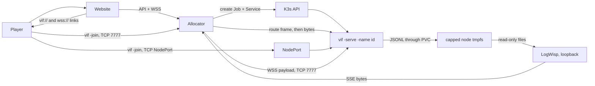

# The session fleet: design and work list

vif dedicated servers run one session per container on K3s. A website asks
for a game, one container appears, and it ends itself when nobody is in it.

This is what the design is, what it cost when it was measured, and what is left.
The procedure for installing it is
[Deploying the session fleet](kube-docker-deploy.md); the objects are in
[`deploy/`](../deploy/README.md); the scenarios that verify the process by hand are
in [`script/`](../script/README.md).

## 1. What is deployed

| Property | Value |
|---|---|
| Session unit | One `vif -serve` process, one pod, one Job, one Service. |
| Concurrency ceiling | 10, enforced by namespace `ResourceQuota`; the allocator also refuses before attempting an eleventh. |
| First-guest window | 90 s. A session nobody reaches exits 0 and is removed. |
| Empty grace | 90 s after the last guest leaves; also the window a dropped player has to reclaim their slot. |
| Drain | 20 s on `SIGTERM`, inside a 30 s termination grace period. A second signal exits at once. |
| Trigger | `tool/vif-allocator`, a hardened node service, is the website-facing control-plane boundary. A caller selects roster size, the session's own bots, log level and scenario from what it advertises in `limits`; everything else in the workload is the deployment's. `deploy/k3s/session.sh` drives it from a shell and can also render the template directly. No session pod runs between requests. |
| Image | `scratch` plus the static `vif_headless` binary (about 14 MiB), non-root, read-only root filesystem, no shell. Its one scenario is the embedded `main` fallback; the rest come off a node volume, so what else the fleet serves changes without a rebuild. |
| Scenario | Chosen per session from the allocator's advertised list, served from a read-only node directory (`/var/db/vif/wad`) mounted `scenario/` and `image/` only. The corpus and keymap are the image's embedded ones, player domain that is never compared with a guest's; a guest is served the session's scenario at the join, so it needs none of the node's files. |
| Transport | Raw framed TCP, for every participant. A WebSocket route carries the same bytes for a browser, or for a terminal whose network blocks 7777: the allocator terminates it with the repository's standard-library `pkg/websocket` and splices it to the pod (§9). Unauthenticated (§4). |
| Reached by | Its name, on three routes (§9): `vif://<site>:7777/<session>` through the allocator's front door, `vif://<site>:<nodeport>/<session>` straight to the session's forwarded NodePort, and `wss://<site>/vif/ws/<session>` through the site's edge and the allocator to the pod. |
| Logs and metrics | Each Job writes `<session-id>.jsonl` through a Bound local PVC onto a 256 MiB node tmpfs. One standalone LogWisp node service, built from upstream LogWisp `main`, has a read-only view and a loopback-only listener; the allocator reverse-proxies its SSE bytes at `/vif/api/logs` without parsing a record. |
| Public API | Exactly `/vif/api/sessions`, `/vif/api/logs` and `/vif/ws/<session>`, over TLS through the site's edge. `/healthz`, `/readyz` and every node port but the game's stay unreachable from outside. |



## 2. Runtime contract

| Property | Required behaviour |
|---|---|
| Session unit | One process owns one match timeline. The world is in memory; no replacement pod inherits it. |
| Authority | The dedicated host's Shared world is canonical; guests predict and accept corrections. |
| Capacity | `-players` is a ceiling on guests. At capacity the health body reports `ready=false`; the process stays healthy. |
| Allocated lifetime | `-first-join`, `-empty` and `-drain` are enforced by `internal/lifecycle` over roster observations, and published on `/health`. The session's own bots count as occupancy, so a session only they occupy runs until a drain, which sends them away at once, or the Job's one-hour `activeDeadlineSeconds`. |
| Join identity | The coordinator refuses a peer whose protocol, simulation fingerprint, capture schema, journal schema, tick interval, seed, RNG session or scenario digest differs from the offer it made. The corpus is not among them: glyphs are player domain, so each participant reads its own and a peer with different text still joins. |
| Session name | Optional. `-name` makes one address able to serve several sessions: the dialer sends it before the handshake, so a front door can route on it, and the session refuses a name that is not its own. A routing key, not a credential. Every fleet pod answers to its session ID, on every route (§9). |
| Crossing ordering | Ordinary crossings are judged by the capture's per-source sequence fence, not by their apply tick, so a link that misses the playout lead costs freshness rather than the player's action (§5). |
| Shutdown | `SIGTERM` drains: readiness false, dials refused with `ErrSessionEnding`, exit when the roster empties or `-drain` elapses. |
| Health | One `/health` path. Its code is liveness; the body carries `ready`, `phase`, `expires_in`, roster, map and tick. |
| Storage | Match state is never persisted. A 256 MiB node tmpfs backs one Retain local PV/PVC for ephemeral public game logs, and an 8 MiB node directory backs a second, read-only one for scenarios. A session Job mounts those two claims and nothing else. Replacing the scenario tree is an atomic rename: a running match keeps the inode its pod mounted, and the next pod gets the new one. |

Kubernetes restart and replication do not create game-level high availability.
Authority succession helps already-connected participants after a host disappears;
it does not move an in-memory session into an unrelated pod.

## 3. Work list

### Open

| ID | Priority | Item | Done when |
|---|---|---|---|
| G | next | **Hand off a deployment a stranger can install.** | Both rehearsals below reach a first session with no undocumented step, and every resource value in `deploy/k3s/30-session.yaml` cites a number from H3. |
| G1 | next | **Rehearse from bare Arch Linux and from bare Ubuntu.** Record package and service differences, and fix every command that assumes the production node. | A second node reaches [§13 of the procedure](kube-docker-deploy.md#13-first-session) without a step its operator had to invent. |
| H3 | next | **Measure a full roster.** Nine sessions driven by headless joiners for the fleet-level readings — CPU, memory, tmpfs, log rate, rotations — plus one real four-player session over real links, through a tower and a storm and on `wad/scenario/td`, for the hour the Job's deadline allows, which tick slips and correction magnitude need. | Requests and limits in `30-session.yaml`, and the quota totals, come from the four-player measurement rather than from single-guest history and estimates. |
| H5 | later | **Spatial grid on ceiling-sized maps.** The grid is sized to the map, so only a ceiling-sized one such as `td` (500×250) reserves about 30.5 MiB per world, and a guest's staging world a second. | Deferred until density matters; on `td` the grid is a minority of what a session was measured to cost. |

### Partly done

Each of these has landed in part; what remains is a [TODO](todo.md) item.

| ID | Done | Remaining |
|---|---|---|
| W1 | **Commission the browser path.** A hidden tab draws nothing and repaints once on return ([multi-platform §5](multi-platform.md#a-hidden-tab)). | [Let a browser tab leave and come back](todo.md#let-a-browser-tab-leave-and-come-back) |
| H1 | **Harden the open port.** The game port is unauthenticated by decision and reachable from the Internet; everything a stranger can do on it is bounded as §4 lists. | [Fuzz the join handshake](todo.md#fuzz-the-join-handshake) |
| H16 | **Automate image delivery.** Nightly CI publishes the headless image to GHCR under moving and commit-addressed tags; the node builds and imports its own with `deploy/guest/update-vif-image.sh`. | [Promote verified images to the node](todo.md#promote-verified-images-to-the-node) |
| H4 | **Renderer-neutral builds.** `vif_headless`, which the image runs, leaves out the renderer and audio packages. | [Extract the renderer-neutral Android host model](todo.md#extract-the-renderer-neutral-android-host-model) |

The deployment keeps a session's own bots closed (`VIF_ALLOCATOR_BOTS_MAX=0`) until
[Open fleet sessions to bots](todo.md#open-fleet-sessions-to-bots) holds, and its
per-address budgets loose until
[Tighten the per-address budgets](todo.md#tighten-the-per-address-budgets).

### Dropped, with the reason

| Was | Reason |
|---|---|
| F11 `SIGHUP` reload | No reload contract is planned. `SIGHUP` terminates like any other signal, which is the documented behaviour. |
| F12 match-complete exit | There is no gameplay terminal state and none is planned. A session ends on emptiness. If one ever exists it attaches to `lifecycle.Controller.Expire` and nothing else changes. |
| H9 per-session LogWisp | The ten-session fan-in uses one standalone node service. The sidecar template, renderer branch and ConfigMap are removed; so are the pod-log follower, the allocator JSON splicer and the allocator-owned LogWisp. None of them is a fallback. |

## 4. Security posture

The game port is **open and unauthenticated**. Anyone who can reach it can join a
session and influence its Shared world, and so can anyone who can open the browser
route. Browser admission authentication is open work
([todo](todo.md#add-browser-admission-authentication)); without it, what is not
accepted is a stranger being able to do anything *worse* than play.

What bounds a stranger:

- at most `NetworkAdmitBurst` (6) admissions per address in each
  `NetworkAdmitWindow` (1 minute), tracked for at most `NetworkAdmitTracked` (1024)
  addresses, past which a new one is refused, so the defence cannot become the
  exhaustion. It is keyed on the player's own address: the pod applies it on the
  NodePort route, which preserves that address, and the allocator before its lookup
  on both proxied routes as one budget per address (`-client-joins`), the front
  door's from the dialler and the browser route's from `-client-address-header`. At
  the pod, proxied players share the node's address and so a budget per session;
- at most `MaxHandshakes` (8) handshakes in flight, each on its own goroutine with a
  `ConnectTimeout` (5 s) and a `ReadTimeout` (30 s);
- a 16-bit frame length, bounded receive queues, and a bounded repair size, so no
  peer can make the host reserve memory by asking;
- `admissibleFromSource`, which refuses roster-creating crossings from anyone but
  the coordinator;
- the join identity check, which refuses a peer that is not running this session
  before it is given a roster slot;
- the start gate, which waits on whoever is still on the link for one world install.
  A participant that goes silent is dropped at that bound and one that drops is
  excused rather than fatal, so neither holding a fresh session open nor ending
  somebody's match is reachable from that window, and a confirmation is keyed to the
  link it arrived on so no peer passes the gate on another's behalf;
- the session name, which every fleet pod sets: a stranger that cannot produce it
  never reaches Assign. It is a routing key rather than a credential — it is in
  every player's link and travels in clear — so what it bounds is a session being
  walked into, not one whose link leaked;
- the network policy: the game port reachable, the probe port only from the node and
  the `monitoring` namespace, everything else denied, no egress;
- the allocator's published surface: exactly the create/list, log-stream and
  session-socket routes and the front door, bounded by the ten-session quota, the
  90-second first-join expiry, `-client-creates` sessions per address in that
  window, the advertised `limits` on what a caller may select, and the edge's rate
  limits on the browser route; without `-client-address-header` the API and the
  browser route charge no per-address budget. Its probe endpoints and every other
  path stay behind the node's own filter
  ([Deployment §6](kube-docker-deploy.md#6-the-nodes-own-filter));
- on both proxied routes: a 16-hex identifier looked up in Kubernetes state rather
  than supplied, a refusal for a session that is not live and ready, and
  `-route-max` connections per session over the two together, each released when
  its splice ends: a write stalled ten seconds ends a direction, and the other then
  has ten seconds. The browser route adds one `Origin` and the edge's rate limits,
  refused before the upgrade. The front door, the allocator's one Internet-facing
  socket, places at most 32 connections at once, reads one name-sized frame from
  each within five seconds, and refuses before it dials a pod (§9);
- `-authority host`, which is the fleet's default and what keeps that one port the
  only one. A migrate session gives every participant a listening port and publishes
  the addresses inside the session; a fleet session is its address, so it has no
  reason to want the other shape.

What remains unbounded is fuzz coverage for a malformed, oversized, replayed or
half-open handshake ([Fuzz the join handshake](todo.md#fuzz-the-join-handshake)). The firewall requirements in
[Deployment §2](kube-docker-deploy.md#2-the-public-edge) are what
stand in front of the rest: the forwarded surface is the ten-port NodePort range and
the front door's 7777, and the probe, log-stream and cluster API ports never leave
the node.

## 5. Late-crossing ordering

A guest whose link misses its playout lead produces a crossing for T+3 that the
authority has not received when it reads its world at T+9: the capture cannot
contain it, though its apply tick is six ticks past. Judged by tick, the guest would
take the correction to hold the action and drop it, and the player would see their
cursor move, jump back a fifth of a second later, then move again once the next
capture carried it — the ordinary case for every action a correction straddles on an
Internet link. So `CaptureHeader.Crossings` carries one `{source, seq}` fence per
participant, the authority included, naming the sequence through which that world
contains that participant's ordinary crossings, and every ordinary frame is judged
by its source's fence rather than its apply tick wherever the question is asked: the
replay suffix, the scheduled queue, and frames arriving after the install
([Multiplayer §3.2](multi-player.md#32-the-capture-boundary)).

**Trade-offs, for review after live testing:**

| Decision | Alternative | Why |
|---|---|---|
| Remote entries are the **highest applied** sequence, not a contiguous prefix. | A contiguous prefix, exact in every topology. | Within one link a source's frames arrive in order, so the two are the same number in every topology the CLI builds. Where they differ — a frame overtaking a lower one across a relay — the maximum costs one cadence of a frame looking contained when it is not. A contiguous prefix would instead stall on a frame the receiver refused for a full queue and will never see, making that producer replay a growing suffix at every correction for the rest of the session. Bounded and self-healing beats exact and unbounded. |
| The **local** entry stays a contiguous prefix. | The same maximum. | Local dispatch can complete out of order, so a capture racing an input that was encoded but not yet dispatched must not claim it. |
| A source the header does not name is **claimed for nothing**. | Fall back to the tick. | The fallback is the misjudgement the fence exists to prevent. Keeping an artifact costs a duplicate the next correction repairs; discarding one costs the player their action. |
| The replay suffix is **cleared on reset**. | Leave it, as before. | A reset restarts the sequence counter, so a record retained across one carries a number a post-reset fence would compare against and get wrong in both directions. The old tick boundary pruned these by age; a sequence boundary has no such accident to rely on. |
| One vector in a **capture-schema bump**, not a compatible addition. | Keep the authority's own fence beside the vector. | Two fences answering one question is how they drift apart. Mixed builds are refused at the join by the capture-schema field in the identity check, so a bump costs nothing a mixed fleet was allowed to do anyway. |

**What the fence does not change.** Each participant stamps its crossings with the
lead its own link asks for, and the authority commits one that arrives late at its
own next tick ([Multiplayer §3.5](multi-player.md#35-command-frames-the-commit-and-pacing)).
A link that misses its lead still produces late frames, which the producer and the
authority apply at different ticks and the next correction reconciles; the fence
makes them harmless rather than rare, since the producer keeps its own action until
a capture contains it. `TestALateGuestActionIsNotUndoneByTheCorrectionThatMissedIt` in
`internal/app` shapes the host's receive side with twice the playout lead and fails
if the cursor moves back.

## 6. Resources

What the manifest asks for:

| Resource | Value | Rationale |
|---|---:|---|
| memory request / limit | 96 / 192 MiB | Single-guest measurement plus headroom for a staging world after an authority change. |
| `GOMEMLIMIT` | 160 MiB | An earlier collection target than the limit, so the runtime collects instead of the kernel killing. |
| CPU request / limit | 100m / 500m | One guest was about 0.05 core in early measurement; the ceiling is wide until a storm is measured. |
| per bot | +32 MiB memory request, limit and `GOMEMLIMIT`; +64m CPU request | A seat at 120×40 measured about 28 MB resident and 60 ms of CPU a second (`vif_headless`, a sandbox, not the node). `-bots-max` stops at 6, where the limit meets the `LimitRange`'s 384 MiB. |
| termination grace | 30 s | Above the 20 s drain, so the process decides when the match ends. |

What one session actually cost, measured on the node with one guest on `wad`
defaults:

| Reading | One session |
|---|---|
| CPU | 144m |
| Memory | 59 MiB against a 96 MiB request and a 192 MiB limit |
| tmpfs | 12 MiB of 256 MiB |
| Log rate | 89 KiB in 30 s, about 3 KiB/s |

Ten of these is roughly 30 KiB/s into the 256 MiB tmpfs, which the 8 MB rotation and
the cleanup timer carry. Do not scale the CPU and memory figures from here; H3
measures a four-player world, which is the shape the manifest's values are for. The
quota totals in `10-quota.yaml` are ten times the game container without bots; the
config-check init container counts only against its own peak.

Historical baseline worth keeping: server in lobby 12.0 MB RSS; embedded game with
one guest 61.75 MB peak; server after a guest left 40.1 MB; headless joiner with a
staging world 95.5 MB peak; two staggered guests 63.5 MB plateau; spatial grid about
30.5 MiB per world, which the grid reserves only on a ceiling-sized map. Repeated
resets plateaued rather than growing, so the RSS lag was runtime scavenging, not a
per-match leak.

## 7. Verification

Automated, in the repository:

```sh
go test ./...        # includes lifecycle, identity refusal, probe and fingerprint
make verify          # plus vet and the build-tag matrix
```

By hand, on a dev machine — see [`script/README.md`](../script/README.md):

```sh
./script/test.sh all          # includes fleet, deploy, lifetime, drain, bot, identity
./script/test.sh serve-fleet  # the flag set the containers run
./script/test.sh probe        # /health and /metrics
./script/test.sh load 2 3 60  # hosts with their own bots and a bot joiner: cost, slips, evictions
```

Against a cluster, [§13 of the procedure](kube-docker-deploy.md#13-first-session) is
the standing check: it proves the allocator's transaction, off-box joins over the
front door, the direct port and the browser route, the front door's and browser
route's refusals, the enforced network policy, the self-tagged file, deletion and
the empty steady state in one pass. Run it after every change to a live workload,
allocator binary, Role, mount or logging service, and after
[its reboot gate](kube-docker-deploy.md#14-the-reboot-gate).

What a cluster has not yet been asked:

| Check | Expected |
|---|---|
| Full roster until the Job's one-hour deadline (H3) | No OOM, liveness restart, sustained tick slips, or growing correction magnitude, and the deadline ends each session. |
| `tc netem` latency, loss, reordering | Recovers at the next bounded correction or keyframe. |
| Pod delete / node failure | Connected-client behaviour is recorded; no replacement is advertised as the same match. |
| A full tmpfs | Bounded log loss without ending a game. |

## 8. Decisions

- **Allocated session, not a long-lived one.** A website creates the container, so
  the container ends itself. The long-lived shape remains available and is what the
  lifetime flags select when omitted.
- **`-empty` owns a bounded vacancy.** It preserves the parked world until expiry;
  the one-minute fresh-world reset is only for an unbounded hand-started server.
- **Ninety seconds, twice.** The first-guest window and the empty grace are the same
  number and different bounds; the second doubles as the reconnect window.
- **Ten sessions, enforced by quota as well as by the allocator.** A ceiling only the
  allocator believes is one an allocator bug removes.
- **A Job per session.** The process is meant to exit; a Deployment would restart it
  into a session nobody is in.
- **One address for every session, and a NodePort per session beside it.** The
  front door places a join by its name, so every link has one shape and a stale one
  is refused. The ten-port pool stays each session's direct route and the fleet's
  concurrency bound; the page advertises only the front door and the browser route,
  so a deployment need not expose the direct one.
- **The front door is the allocator's, and reads one frame.** Placing a join needs
  the lookup the browser route already makes; past the route frame it copies bytes.
- **Admission is the allocator's.** Per-player budgets and rate limits for every
  proxied route live where the player's address is still known, never at the pod.
- **A thin allocator, not a second scheduler.** It exposes only the fixed session
  transaction on `/vif/api/`; K3s still schedules, admits, limits, terminates and
  garbage-collects every workload.
- **No public delete endpoint.** The API is anonymous behind the site, so one player
  must not be able to end another's match.
- **Docker builds; K3s runs.** Docker and its system containerd stay disabled except
  during an on-demand build. The image is imported into K3s's embedded containerd.
- **One health path.** The code answers "should this process still be running";
  everything else is in the body, where the allocator reads it.
- **The vif JSON line is the log contract.** The workload writes it to the
  node-local PVC, and LogWisp and the allocator carry those same bytes without
  parsing or reshaping them.
- **The public stream is session output only.** K3s, kernel, host journal and the
  `admit` sub that names a player's address remain operator-only.
- **The host is the authority over identity.** A joiner reports; the coordinator
  decides.
- **No authentication, and hardening first.** See §4.
- **WebSocket on the standard library, terminated in the allocator.** `pkg/websocket`
  is one minimal RFC 6455 byte stream for `vif`'s native client and the allocator,
  which splices the browser route to the pod as the front door does (§9).
- **Drain waits for the roster with a deadline.** No participant migration: there is
  nowhere to migrate a match that lives in one process's memory.
- **Dedicated lobby:** quorum is one, `-players` is capacity.
- **Map bounds:** a scenario that sets up its own map (td) keeps it; otherwise an
  explicit `-size` wins, and without one the first guest sets the shared map.
- **Correction:** Shared capture is authoritative; Player-domain state is excluded
  and only explicit persistent local FSM lifecycle is re-derived.

## 9. The session routes

A session is reached by its name on three routes, and its pod answers to that name
on all of them, so no route can seat a player in a match their link did not name.

| Route | Link | Path | Refuses a bad dial |
|---|---|---|---|
| Front door | `vif://<site>:7777/<id>` | host forward, the allocator on the node, the pod's 7777 | the allocator, before any dial: a first frame that is not a route, an identifier that is not 16 hex, a dialler past its budget (§4), a session unknown, unready or full, one at `-route-max` |
| Direct | `vif://<site>:<nodeport>/<id>` | host forward, the session's NodePort, the pod's 7777 | the pod itself, on the name, its roster and its per-address budget |
| Browser | `wss://<site>/vif/ws/<id>` | the site's edge, the allocator, the pod's 7777 | the allocator, before the upgrade (below) |

**The front door.** `vif-allocator` listens on `-route-listen` beside its API,
placing at most 32 connections at once and closing any past them. It reads exactly
one `MsgSessionRoute` frame, under a five-second deadline and the 64-byte name
bound; resolves the pod with the lookup the browser route uses; dials `podIP:7777`,
re-encodes the name to it and splices the two sockets with half-close, Go setting
`TCP_NODELAY` on both. A direction ends when its peer closes or a write stalls ten
seconds, and the other then has ten seconds. A stream that does not open with a
route frame is closed unanswered; every other refusal is a `MsgJoinReply` whose
reason `vif -join` prints. The cost is the browser route's: native play through it
depends on the allocator process, and the pod sees each such player at the node's
address, so its `admit` record names the node and the per-address budget is the
allocator's (§4).

**Where the browser route's layers stop.** Nginx terminates TLS and forwards the
`Upgrade`; it never looks at a frame. `vif-allocator` checks method, identifier
syntax, that the request is an upgrade, `Origin` (403), the player's join budget
(429), the session's liveness and readiness and the shared ceiling, then the
handshake (426 for another version, 400 for a bad key), then dials `podIP:7777`
(502 if that fails); each is a status before any 101. It answers the 101 and splices
the socket's payload to the pod with the front door's `splice`, `TCP_NODELAY` on
every socket, and never dials an upstream a caller named. The page wraps its own
`WebSocket` as a `net.Conn`, and `vif -join wss://…` dials with `pkg/websocket` and
sends the URL's origin; both send the route's last path segment as the name inside
the stream, so the pod checks it and the protocol, bounds and handshake are a
native client's.

**What it costs.** The pod sees browsers at the node's address, as it sees
front-door players, so its budget is one per session for every proxied player and
the allocator keys the per-player one in its place (§4). The allocator unmasks
and frames the bytes. Measured on loopback against a pod pushing every 50 ms and a
client pinging every 20 ms, an echo took 78 µs through the allocator's end and 72 µs
through the front door, and nginx with TLS added about 0.3 ms; in the field a native
`wss://` join matches the front door. The nginx block is in
[`deploy/website/vif.nginx.example`](../deploy/website/vif.nginx.example), and
[Multi-platform §5](multi-platform.md#5-browser-networking) holds the decision record.

## 10. Acceptance and rollback boundary

The deployment is complete when all of these hold, and the open items in §3 are what
stands between here and there:

- ten concurrent files have distinct names and matching self-tags;
- the browser route refuses another origin, an unknown session, a session that is
  not ready and the connection past `-route-max`, each before the upgrade, and the
  front door refuses the same before any dial; both refuse a player past its join
  budget, and the API one past its creation budget;
- session pods remain Restricted, tokenless, and free of direct `hostPath`;
- allocator RBAC cannot read `pods/log`;
- tmpfs is hard-capped, K3s fails closed without it, and reboot clears it;
- a full tmpfs causes bounded log loss without ending a game;
- standalone LogWisp holds no Kubernetes credential and binds only loopback;
- stopping LogWisp does not stop allocation, state, or gameplay;
- SSE preserves source bytes and stays bounded under slow and reconnecting clients;
- public logs exclude host, K3s, credential, and exact client-address data;
- every resource value in `30-session.yaml` cites a full-roster measurement; and
- [§13 of the procedure](kube-docker-deploy.md#13-first-session) passes after reboot.

These constraints hold for every change until then:

- keep the `vif` namespace at Pod Security `restricted`;
- session pods mount only the `vif-fleet-logs` claim and the read-only
  `vif-fleet-wad` claim — never a direct `hostPath`;
- the game writes complete JSONL records, and no component tails Kubernetes pod
  logs, splices allocator JSON, or inserts a field after serialization;
- LogWisp stays one independent node service with no Kubernetes credential, never an
  allocator child or a per-session container, and the allocator may proxy its bytes
  but must not parse, normalize, buffer, or own the stream processor;
- stop allocation and prove the fleet empty before changing a live workload,
  allocator binary, Role, mount, or logging service;
- build LogWisp from upstream `main`, never a pull-request head, and judge its
  journal only by the invocation running the installed binary;
- announce restarts, simultaneous clients, and deadline-sensitive joins first;
- put placeholders in repository commands; never commit a real machine address;
- remove rendered files, probe pods and verification JSONL after each change, and
  preserve the mounted tmpfs and the Bound PV/PVC;
- keep the previous allocator binary and configuration until the next live
  [§13](kube-docker-deploy.md#13-first-session) passes.

Rollback restores the preceding allocator or LogWisp from its updater's `.previous`
set; the session image, the scenario tree, the node filter and the fleet objects come
back by running `./deploy/update.sh` for that component at the earlier revision,
which rebuilds the session image the image update removed. It may also disable the
site's routes or stop LogWisp. It never lowers Pod Security, mounts a direct
`hostPath`, deletes a Bound PV/PVC in use, or unmounts the tmpfs while K3s is
running. The per-component commands are in
[`deploy/guest/README.md`](../deploy/guest/README.md).
