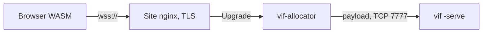

# Build Profiles and Platform Boundaries

vif has two independent kinds of variation:

- a **runtime mode** chooses how one process runs: interactive play, replay,
  authored script, caller-driven headless simulation, or dedicated server;
- a **build profile** chooses which host capabilities exist in the binary at all.

Keeping those choices separate matters. `ModeServer` avoids initializing a
presentation, renderer, or audio service at runtime, while the `vif_headless` build
also removes their constructors and implementations from the dependency graph.
The same simulation can therefore run in a full client and a dedicated server
without presentation becoming part of multiplayer identity.

This document records the current profile contract, what each supported platform
can actually do, how a browser joins a session, the extension seam for
downloadable content, and how the desktop window, the browser page and Android
host the game.

## 1. Current build profiles

| Profile | Tags or target | Presentation | Audio | Raw socket sessions | Logging | Intended use |
|---|---|---|---|---|---|---|
| Full native | `make release` | Terminal renderer; on Linux and FreeBSD the desktop window too, which `-g` opens | Included | Yes | Included | Linux/FreeBSD client or manually run host |
| Audio-free native | `vif_noaudio` | Terminal renderer | Omitted | Yes | Included unless `novlog` | Platforms or packages that do not ship audio |
| Dedicated server | `make headless` / `vif_headless` | Omitted | Omitted | Yes | Included unless `novlog` | `-serve`, headless scripts, containers |
| Browser | `make wasm` / `GOOS=js GOARCH=wasm` | Page: a WebGL canvas drawn from cell frames (`pkg/browser`) | Page: an AudioWorklet fed from the Worker | No | Stub | Solo play, or a session joined over its `wss://` route |
| Desktop window | `make gui` / `vif_gui`: the full native binary opening the window by default; `make cli` / `vif_nogui` leaves the window out | Window: Xlib, EGL, GLES 2 loaded at run time | Included | Yes | Included | A desktop entry, or a machine with no X libraries to load or none purego builds for (Termux); cgo stays off either way |
| Android | `make android` (`android/`, its own module) | `SurfaceView`, a Canvas cell drawer | `AudioTrack` | Yes | Included | A phone or tablet, the game in-process through `gomobile bind` |
| Windows cross-build | `make windows` | Terminal renderer | Omitted | Yes | Stub | Experimental `windows/amd64` zip, with the known issues in §4 |

`novlog` is orthogonal to the other profiles. `vif_headless` implies no audio;
`vif_noaudio` removes audio while retaining terminal presentation. The browser
build keeps the audio implementation: the mixer streams to the page as a host's
speakers (§8), so `vif_noaudio` on a wasm build is a choice, not a requirement.

The useful commands are:

```bash
make release                 # bin/vif
make nolog                   # bin/vif without the logger
make headless                # bin/vif-headless
make gui                     # bin/vif-gui, the window by default
make cli                     # bin/vif-cli, no window
make android                 # bin/vif-debug.apk, from android/
make wasm                    # web/vif.wasm
make windows                 # bin/vif.exe

go build -tags=vif_noaudio ./cmd/vif
go build -tags='vif_headless novlog' ./cmd/vif
```

The dedicated binary deliberately refuses presenting modes. Its normal entry is
`vif-headless -serve <address>`; an unpresented `-script`, a `-headless` bot run
and `-replay -headless` verification are also valid. This turns
an accidental attempt to run interactive play from a server artifact into an
early configuration error rather than a nil terminal failure.

## 2. Composition boundary

The build split follows capabilities rather than operating-system names:

| Capability | Build-specific seam | What stays common |
|---|---|---|
| Presentation | `internal/app/presentation_*`, generated `manifest/render_gen.go`, the host's `Presentation` or the terminal service | World, systems, semantic input, scheduler |
| Audio | `internal/app/audio*`, `engine/resource_audio*`, audio service/systems, generated audio builder | Event payload identifiers in `pkg/audio/model` |
| Socket network | `internal/app/network_*` | Network protocol and simulation-facing `engine.NetworkPort` |
| Logging | existing `internal/vlog` build variants | Call sites and status collection |
| Resources | `engine.FileProvider` and `ContentProvider` | Parsed config/content models |

`App` embeds a build-specific presentation state. The presenting variant owns the
run's `Presentation`, the host's or else the terminal (§8), and the render
orchestrator; the headless variant is empty. Renderer construction is generated
into its own `!vif_headless` file, so the dedicated build does not compile
`internal/render` or `internal/render/renderer` merely to leave their values
unused.

Audio follows the same shape. Mixer, synthesis, backend, service, configuration,
and full audio systems compile only when audio is available. Protocol and event
payloads use `pkg/audio/model`, a small package containing stable identifiers but
no mixer, backend, filesystem, or synthesis dependency. The audio-free generated
builder installs tiny event sinks under the same `audio` and `music` system names.
They consume local audio events and publish the unavailable status without linking
the engine, preserving event telemetry and runtime system controls.

The authoritative manifest still declares the two local audio systems. They have
no simulation writes, and the manifest fingerprint deliberately ignores the
local build capability just as it ignores renderers. A full terminal guest and a
headless host therefore retain the same simulation identity. A future optional
system that changes shared or player simulation state must **not** use this local
capability mechanism; it must remain in every session participant or become part
of the negotiated simulation identity.

### What headless still carries

The dedicated build removes renderer and audio packages and keeps the terminal
module's value types, which semantic input bindings, color configuration,
wall/image cells, crash recovery, some simulation resources and `internal/pattern`
use. They are the renderer-neutral vocabulary every host speaks (§8), so the build
carries them by decision. Build constraints guard adapters and constructors, not
gameplay code by platform.

## 3. Reference artifact measurements

Measured with Go 1.27.2 and the release workflow's flags: `CGO_ENABLED=0`,
`-trimpath`, `-ldflags='-s -w'`, `linux/amd64` for the native profiles. They are
not release budgets; toolchain and source changes move them.

| Artifact | Bytes | MiB | Comparison |
|---|---:|---:|---:|
| Full native | 17,219,847 | 16.42 | baseline for native profiles |
| `vif_noaudio` native | 16,810,247 | 16.03 | 2.38% smaller than full |
| `vif_headless` native | 15,704,224 | 14.98 | 8.80% smaller than full |
| Browser (`js/wasm`) | 29,683,569 | 28.31 | — |

Size is the visible result, not the primary invariant. The stronger checks are
that this command prints no renderer or audio-engine package:

```bash
go list -deps -tags=vif_headless ./cmd/vif \
  | grep -E 'internal/render|render/renderer|/pkg/audio$'
```

It should produce no output. The container is one static binary in
`scratch`; its exact layer size should be measured for each release.

## 4. Platform matrix

| Target | Current support | Important constraints |
|---|---|---|
| Linux | Developed and tested | Full audio backend discovery, Unix terminal/crash handling, TCP sessions, dedicated image |
| FreeBSD | Tested native target | Unix behavior and optional OSS `/dev/dsp` |
| Windows amd64 | Experimental; plays in Alacritty, with the issues below | `CGO_ENABLED=0`; `novlog vif_noaudio` by choice, since audio and logging both compile for Windows; published as an experimental zip, not a development focus |
| Android | Debug-signed APK in every nightly and release ([android/README.md](../android/README.md)) | `android/`, its own module: `gomobile bind` around `app.Run`, a `SurfaceView` Canvas drawer and `AudioTrack` (§8); the wad as the system root |
| `js/wasm` | Solo play and session join; a tab that leaves is still being commissioned ([TODO](todo.md#let-a-browser-tab-leave-and-come-back)) | The page draws the cell grid on a WebGL canvas, plays the mixer's PCM and keeps `[play]` in its storage (`pkg/browser`); no filesystem discovery, process execution, logging sink, or raw sockets, each `unavailable in a browser` where a command asks. A session is joined over a browser WebSocket (§5), never a socket |
| Other 64-bit native Go targets | No support claim | May compile through generic files, but are not in the verification matrix |
| 32-bit targets | Not supported | `internal/core/arch32.go` stops the build on `386`, `arm`, `mips` and `mipsle`; the code assumes a 64-bit `int`. A fork that needs one can likely drop that file and build the terminal client with `vif_nogui`, since `pkg/window` lays out Xlib for 64-bit only and purego has no FreeBSD 32-bit port; that work is left to the fork |

Played on Windows in Alacritty, the zip runs, with three known issues:

- **The mouse does nothing.** The terminal module's Windows backend reads the
  console as VT input, so a click reaches the game only if the console host passes
  the terminal's SGR mouse reports through; that is the first thing to check.
- **No audio.** The build leaves the engine out. The engine compiles for Windows,
  and ffplay, one of its pipe players, has a Windows build, so audio there is
  untried rather than impossible.
- **Status bar cells flicker on redraw.** The terminal module writes a frame
  without synchronized output (DEC mode 2026), and the Windows console host
  repaints what a program writes on its own schedule; neither is confirmed as the
  cause.

The simulation uses `float64` and live sessions include concurrent scheduling.
Different targets are not promised bit-exact lockstep even when their manifest
fingerprints agree. The fingerprint rejects known simulation-shape differences;
authoritative correction remains the live convergence mechanism.

## 5. Browser networking

### What a browser joins with

The game protocol is a framed byte stream, and a browser has exactly one
bidirectional byte stream: a WebSocket. It has no arbitrary socket, and `js/wasm`'s
`net` package is a fake networking surface rather than a way around that. So the
browser build dials the session's WebSocket route and wraps the browser's
`WebSocket` object, opened in the program's Worker, as a `net.Conn` — reads block
on arriving binary messages, writes send one encoded frame each, and deadlines and
closure behave as the transport already expects. `network.dial` is the only seam; everything above it,
including `SocketPort`, the handshake, the fences and the snapshot assembly, is the
code a native client runs.

That is why message boundaries need not be frame boundaries. `Decode` reads with
`io.ReadFull` from a stream, so a receiver reassembles whatever chunking the path
produced, exactly as it does from TCP. The inbound queue is bounded at
`wsQueueMessages`: a browser offers a receiver no backpressure, so the link is
closed rather than left growing the tab's heap. A native build dials the same
route with `pkg/websocket`, whose `Conn` has the same shape: a byte stream across
messages, one frame per write, deadlines passed to the socket.

The browser is refused `-host` and `-serve` before initialization, because it can
bind nothing, and a `-join` or `:join` naming a `host:port`, because it can dial no
socket. A browser guest never advertises a port, even in a migrate session.

### What the browser adds to a link

The Go program runs in a Worker (`web/worker.js`), so the page's drawing never holds
it, but it runs on one thread with no preemption: Go returns to the browser only
when every goroutine is idle, and a socket message is a browser event. An arriving
epoch or echo therefore waits for the tick, frame or correction install in progress,
and a busy world adds latency a native client does not pay. A link's writer flushes
at once rather than lingering for a burst, because a browser timer is clamped to
4 ms or coarser. Measured against a local host on 2026-09-29, round trip as the
host reads it:

| Guest | `main` at 120x40 | `td` at 500x250 |
|---|---|---|
| native terminal | 5 ms | 5 ms |
| browser, headless Chromium, 1080p | 3–4 ms | 80–500 ms, the Worker at 100% of a core |

### A hidden tab

While the page is hidden the Go program draws nothing (`pageHidden`); its tick, its
socket and its probe answers carry on in the Worker for as long as the browser runs
it, so the other players see an idle participant. On return the page is handed the
whole screen once. Drawing on would hold frames behind the page's throttled timers;
the host hands the page one at a time, so even then one waits, never a backlog to
replay.

A browser that freezes the tab instead, as Chrome may under its energy or memory
saving and mobile browsers readily do, stops the Worker, so nothing reads the
socket. The session drops the participant after `NetworkLinkDeadAfter` (5 s) of
silence, as it drops any silent peer, and on return the page shows "Host connection
lost; continuing locally from the last authoritative state"; reloading the same
link rejoins while the session lives.

### Where WebSocket is spoken

In `pkg/websocket`: one minimal RFC 6455 implementation on the standard library,
shared by `vif`'s native client and `vif-allocator`, which terminates the browser
route and splices raw TCP to the pod's game port as its front door does. The pod
keeps its framed TCP listener, so ordered delivery, frame bounds, queue bounds,
closure and backpressure are unchanged. It speaks the version-13 upgrade, binary
data, ping, pong and close; text, extensions and subprotocols are refused, masking
is enforced by role, and `TCP_NODELAY` is set on every socket it owns.

| Option | Decision |
|---|---|
| **Chosen — hand-written, terminated in `vif-allocator`.** | The objection was new parsing surface on the public route; the answer is a small reader whose memory is bounded whatever a length claims, fuzzed at the frame reader and both handshake parsers. The allocator already carries every proxied player's bytes; for a browser it also unmasks and frames them, which costs microseconds (fleet §9). |
| A bridge process in the session pod. | An image, a container and a hop per session, and a socket whose latency this repository does not control: one without `TCP_NODELAY` holds each frame toward the player until the last is acknowledged, tens of milliseconds a frame. |
| A WebSocket listener in `vif -serve`, behind the allocator's proxy. | Keeps the allocator's hop and moves the `Origin` check into every pod. The listener exists for one binary on a LAN or in a test (below); the fleet does not use it. |
| A third-party package. | `net/http` has no WebSocket handler, `golang.org/x/net/websocket` is deprecated, and a maintained package is a network-facing dependency on the path every player takes. |
| The API server's `pods/portforward`. | A shell-equivalent grant, and it needs the same client. |
| An ingress controller. | None translates WebSocket to a raw TCP backend. |
| WebTransport. | Its advantages do not yet justify an HTTP/3 server and ingress. |
| A WebRTC data channel. | ICE, signalling and TURN solve a peer-to-peer problem an authoritative host does not have. |

`vif -host ws://:7777` or `-serve ws://:7777` serves a session over WebSocket from
one binary, one protocol per listener. The upgrade feeds the TCP accept loop, so
the handshake budget and per-address admission apply unchanged. It is plain `ws`
on any path, and checks no `Origin`: it grants nothing ambient a foreign page could
borrow. `-join ws://host:7777/<name>` joins it from a terminal or a page.

`network.AdmissionLimiter` is per address, and the pod sees browsers at the node's
address, as it sees front-door players, so per-player admission is the
allocator's: one budget per address over both routes, keyed on the front door's
socket address and on the address the edge writes into `-client-address-header`
([fleet §4](kubernetes-fleet.md#4-security-posture)).

### The public route



`wss://<site>/vif/ws/<session>`. The session identifier is a routing key, not a
secret. The site's nginx terminates TLS and forwards `Upgrade` without interpreting
a frame. The allocator checks the method, the identifier's syntax, that the request
is an upgrade and the `Origin` before it answers the upgrade. The address's join
budget, the session's liveness and readiness in reconciled Kubernetes state and its
own per-session ceiling follow in the stream, as the front door's do, so a page reads
why it was refused; it never accepts an upstream a caller named.

For a page served over HTTPS the endpoint must be `wss://`: browsers block
`ws://` as active mixed content. The route is same-origin with the page, so a
`connect-src 'self'` policy permits it. Ordinary CORS headers are not a substitute
for the `Origin` check. Browser admission credentials, short-lived and
session-scoped, are [open work](todo.md#add-browser-admission-authentication).

Native clients use raw TCP, through the allocator's front door or the session's
own NodePort ([fleet §9](kubernetes-fleet.md#9-the-session-routes)), or this
route where a network blocks those; a native client's `Origin` is the URL's own.
The allocator owns routing and admission as well as allocation; keep those duties
behind explicit interfaces so the process can be renamed or split without moving
Kubernetes lifecycle code into the game.

## 6. Browser launch arguments

Go's browser support accepts an argument vector through `Go.argv` in
`wasm_exec.js`. `web/terminal.js` builds it from two page-controlled sources and
`web/worker.js` hands it to the program:

1. `window.VIF_ARGS`, set before the terminal script loads;
2. repeated `arg` query parameters.

`web/` is the launcher, and it is copied to a deployment as it stands: the same
page, the same scripts and stylesheet, the same `vif.wasm` and `wasm_exec.js` the
Makefile writes, from one Go. A deployment that
edits any of them has forked the launcher, and the fork is only visible the next
time one side changes.

A deployment that publishes the files under other names, as content-hashed ones
for long caching, names them on the `terminal.js` script element instead of
editing a script: `data-wasm` for `vif.wasm`, `data-worker` for `worker.js`,
`data-exec` for `wasm_exec.js` and `data-audio` for `audio-worklet.js`. Each one
unnamed is the file beside the page.

```html
<script src="/vif/wasm/terminal.4f1c….js" data-wasm="/vif/vif.9a2e….wasm"
        data-worker="/vif/wasm/worker.07bd….js" data-exec="/js/wasm_exec.0c94….js"
        data-audio="/vif/wasm/audio-worklet.5b3a….js"></script>
```

```html
<script src="vif-config.js"></script>
<script src="terminal.js"></script>
```

```javascript
// vif-config.js
window.VIF_ARGS = ['-d', '-seed=42'];
```

```text
https://<site>/vif/wasm/?arg=-d&arg=-seed%3D42
```

The launcher accepts at most 64 arguments of at most 1,024 characters each.
Arguments are configuration, not a content transport. Query values appear in
browser history, logs, and sometimes referrers, so secrets and substantial payloads
do not belong there. A path supplied through `-s`, `-f`, or another file flag also
does not make that file exist in the browser filesystem.

The page passes `-join=wss://<site>/vif/ws/<session>` through this bridge; typing
`:join <that link>` in a running solo game does the same without a reload. A
`ws://` or `wss://` target is dialled whole, and its last path segment is the name
sent first, as a `vif://` link's is. An `http(s)://` site creates a session, and the
page joins the WebSocket route the site answers with; a session's `vif://` link
joins by the route its site lists, and a bare host:port is refused here (see the
address grammar in [Services](services-and-networking.md)).

A browser has no terminal to print an exit error to, so the launcher keeps the
tail of stderr and, once the program exits, shows its last line (or the crash
that ended it) in place of the terminal and the start screen, centred in what the
browser's bars leave, with a Reload button. A refused join's reason says whether a
retry helps; a socket that does not open says the game may have ended or the link is
too slow, after `NetworkJoinConnectTimeout` (15 s) where it never answers. The page then terminates the Worker and posts it nothing
more, so a later resize or visibility change cannot replace that reason.

## 7. External maps and assets

A browser has no config root: solo, it plays the embedded scenario, content and
keymap, and CLI arguments alone cannot give it the editable `wad/` tree a native
build resolves. What a native run writes back to `vif.toml`'s `[play]` the page
keeps in the site's storage (`localStorage`, handed to the Worker at the start,
since a Worker has none), so each visit starts as the last was left; a private
window, or a site whose storage is blocked, keeps them to the run.

A guest already receives custom maps. When the scenario it resolves does not have
the session's digest, the coordinator serves it during the join, between the offer
and the reply: the canonical `resource.Scenario` container (at most 64 files, 256 KiB a
file, 1 MiB in all), deflated, verified against the digest and held in memory for
the run ([Services §7.2](services-and-networking.md#72-join-identity-and-who-decides-it)).
A browser guest takes it the same way. Content never travels on the
tick/correction channel, where it would couple simulation latency, frame bounds and
content size.

What remains is a client with no config root and no peer, such as a page before it
has joined anything ([todo](todo.md#fetch-a-content-addressed-bundle-over-http)).
It should read the same container through an HTTP-backed resource provider rather
than make systems fetch URLs:

1. fetch the container by its digest over HTTPS;
2. hold it to the bounds and the digest check a transferred scenario meets;
3. cache by digest where the platform permits it;
4. expose it through the provider boundary, as `resource.Options.Provided`
   exposes a transferred scenario;
5. construct a new `App` with it.

Constructing a new `App`, as a scenario change or a `:join` already does in the
same process, is safer than mutating a running world's configuration: the FSM,
corpus identity, map bounds, system toggles, and session fingerprint are
established during initialization. A native HTTP provider can share the policy, so
a fetched and a transferred scenario have one identity model on every platform.

The format and its limits are decided. The provider still needs decisions about
publisher trust, allowed origins, cache lifetime, and whether executable-like FSM
actions from an untrusted source are acceptable. Hashing proves identity and
integrity; it does not establish trust.

## 8. Adding another renderer or Android host

A presenting run takes its screen from `app.Presentation`: a service the hub
runs, the `render.Surface` frames are flushed to, its size, how long it has held
a frame, the events it reports in the terminal's vocabulary (`terminal.Event`,
which a host posts for the keys and pointer cells it maps), and the pointer mode.
One the player can leave without quitting also reports that on `Away`, and a solo
run pauses until they return, drawn undimmed: the pause is not theirs. The terminal is one (`terminalHost`); it is the
default when `Config.Host` names none. A host also supplies its speakers as
`Host.Audio`, a writer the mixer streams PCM to in place of a backend found by
name. Adding a graphical host is therefore composition, not a simulation fork:

1. implement `Presentation` over the window or view, drawing the cell grid with
   the embedded font atlas (`asset.DefaultFont`, `pkg/glyph`): `glyph.Raster`
   is the software drawer, a `Surface` any host can start from;
2. build a `Config` with that `Host` and call `app.Run`; a library binding wraps
   that call;
3. keep graphical assets and renderer construction out of the common manifest
   builder, and leave components, systems, events, scheduler and the manifest
   fingerprint common.

The desktop window is one such host: `cmd/vif/gui.go`, in every Linux and FreeBSD
build but `vif_nogui`, sets `Host.Presentation` to a `pkg/window` window when `-g`
asks for it, as a `vif_gui` build or `vif.toml`'s `[presentation] window` does by
default and `-cli` refuses; it opens maximized or full screen on `-maximized` or
`-fullscreen` (`_NET_WM_STATE` set before the map); the window draws each frame with
`glyph.Raster` and uploads it as one GLES 2 texture, and posts keys and the
pointer as the events a terminal reports, each key's release too once a run asks
(`hostkey.Report`, which the page and Android share): XKB's detectable autorepeat
tells a held key's repeats from releases, a server without it reports presses
alone, and focus leaving ends every hold; `-scale n` draws the texture `n` times
its size with nearest filtering, for a HiDPI screen. Its libraries
(`libX11.so.6`, `libEGL.so.1`, `libGLESv2.so.2`) are opened with purego, so
the binary builds with `CGO_ENABLED=0`; on FreeBSD purego needs its `fakecgo` built
as std, which the Makefile's release targets pass (`GUI_GCFLAGS`). It runs on
Wayland through XWayland. purego's `fakecgo` links the binary to the system libc,
so a Linux client binary needs glibc and runs neither on musl nor under Termux;
`vif_nogui` and `vif_headless` binaries stay static.

The browser is another: `cmd/vif/browser.go` under `js/wasm` sets
`Host.Presentation` to a `pkg/browser` host. The Go program runs in a Worker, so the
page's drawing never holds it; the host embeds `glyph.Frames` and hands the page one
frame at a time, the cells changed since the one it holds, the next once the page
reports the last drawn, so a page that stops drawing holds a frame rather than a
queue and shows as `Blocked`. The page (`web/terminal.js`) draws the grid with one
WebGL quad whose fragment shader finds its cell in two data textures and mixes the
cell's colors by a glyph mask, rasterized from a monospace font at the cell's device
size, so glyphs are crisp at any zoom; the mask is drawn again only when that size
changes; a pinch, or Ctrl and the wheel, zooms the cell live within the range
`browser.Open` hands the page, Android's, and the page reports the cell once it
holds still, for the run to keep as Android's. Without WebGL (a Chromium build on a
blocklisted GPU) it paints each changed cell on a 2D canvas from the same mask,
slower on a large grid, and says so once. It reports keys, a soft keyboard's text
and pastes, the pointer at its cell (a touch is the left button marked as a
finger's, as on Android) and its size as the terminal events the host posts; a hardware key names its `KeyboardEvent.code`, so its `keyup` ends the
hold it began, the key strip's and the soft keyboard's keys tap, and blur or a
hidden tab ends every hold, a pointer's press and a finger's too, whose ends would
reach another tab or window. A button pressed while another is held, which a
browser reports as a move, presses as one alone does. A hidden tab draws nothing and is handed the whole screen on return; the
run is not paused ([§5](#a-hidden-tab)). Its speakers are `Host.Audio`
(`browser.Speaker`): the Worker posts each mixer buffer that sounds, and the page
opens an `AudioContext` at the first and plays them through an AudioWorklet
(`web/audio-worklet.js`) that holds two buffers ahead and goes silent when the
Worker falls behind, as a tick longer than a mixer period makes it; rendering a
50 ms buffer with music and effects playing costs the Worker's thread about 1.3 ms.
A muted game posts nothing; the touch strip's speaker button sends Ctrl-S, as a
keyboard would, to cycle the channels.

Android follows that path in `android/` ([its README](../android/README.md)), a
module of its own bound by `gomobile bind`. `game.Start` builds a `Config` whose
`Host` is the view and an `AudioTrack` at 44.1 kHz 16-bit stereo, and calls
`app.Run`. The app opens on a start screen (`StartScreen`) over the view: the logo,
"Tap to start" under it and a `?` that opens the touch controls. The run starts
behind it with its player away (`game.Start`'s `away`): its game waits at its first
tick, drawn undimmed and silent, so the tap lifts the screen off a game already
built and painted; its keys reach it only from then. A screen turned before the
tap starts that game over at the new size, as one opened at it would be, since
nobody has seen it; once played, a resize crops it as on a terminal.
The view's grid is the cells its pixels hold at a cell 12 dp tall
(16x32 pixels on a 420 dpi phone, never under the atlas's 12x24; aspect 0.5),
which a pinch zooms when its fingers lift: from `parameter.CellLeast` to
`CellMost` (4 to 40 dp, the page's range too) in `CellStep` steps, never under the
atlas, and the run keeps it in `vif.toml`'s `[presentation] cell` as it keeps
`[play]` (`paths.SaveCell`), so the next run opens at it. A
Java render thread takes the newest frame at each vsync as the cells changed
since the one it holds (`glyph.Frames`, the hand-off every host drawing in another
runtime shares), which `CellDrawer.OnCanvas` paints from the atlas as one texture
(`glyph.Texture`, `game.Atlas`) at the atlas's size, as an instrumented test checks
against `glyph.Raster` pixel for pixel, and posts it on a hardware canvas stretched
over the whole view, filtered, so no margin is left; a tap maps to its cell in
proportion. `FromRaster`, Go's raster as pixels, is the fallback. The APK's `wad/` is copied to the app's files directory as the
system root (`VIF_SYSTEM_ROOTS`); the user root, logs and journals live beside it
through the XDG variables. `onPause` reaches the run as `Away`, `onResume` hands
the drawer the whole grid. A tap is a left press and release on its cell and a
finger moving while down a left drag, both marked as a finger's (`Event.Touch`), posted once per cell as a terminal reports
motion, so the cursor follows it and a held one repeats fire; keys and the system
keyboard's text are terminal key events, Back is Escape. A hardware key's
`onKeyUp` ends the hold its `onKeyDown` began and `getRepeatCount` marks its
repeats; the system keyboard's text, its delete and Back tap; the window losing
focus ends every hold. Two fingers tapped together twice raise or drop the system
keyboard, read from the window's insets rather than a flag of the app's; the
keyboard covers the view instead of resizing it, so a `crop_on_resize` map keeps
its cells; the run hears of the keyboard (`Covered`, which the status bar reads as
`StatusCovered`) and keeps its input to the left half of the bar's bottom row,
which the view draws again above the keyboard at twice its size from the same
picture. A second Back within a second and a half sends the app to the
background. A tap held on the status bar opens the configuration menu, the hold
every host shares (`MenuHoldDuration`), and taps drive its rows; with mouse input
off a press on the bar's rows still reaches the run, and the open menu takes the
pointer. The page does each of these on a touch screen, timed alike: the double
tap (or the key strip's button), a keyboard measured from `visualViewport`, the
bottom row drawn again above it, and the hold. Every page opens on the same start
screen in the same words, the key strip listed where Android lists Back; a
desktop's asks for a click or a key, and its `?` lists the mouse and the first keys.
The Worker holds the compiled program until that press, made at any point of the
download or compile, which opens the sound too; a key starts it as it comes up,
unseen by the game, and Escape, Tab, the F keys and chords start nothing. A lobby's
`-join` link waits for it too.

Measured on a Pixel 7 emulator (Android 16, x86_64, 1080x2400, a 90x91 grid):
the game hands over a frame every vsync and about 20 a second change cells, its
20 Hz tick; taking, painting and posting one costs 3.5–4.2 ms mean and under 7 ms
at p95 on the host GPU, 6–9 ms on the software one. The raster fallback costs
36–57 ms a changed frame on the software GPU, a picture's worth of pixels across
JNI each time: a fallback, not a 60 fps path. On a Pixel 8 Pro (Tensor G3,
Android 17, 1008x2244 at 120 Hz, 15x30-pixel cells stretched over the view) the
Canvas drawer paints every frame the game changes, 20–35 a second at 1x and 60 at
4x, at 8–16 ms mean, 19–27 ms at p95 and at most 45 ms for take, paint and post,
with no stutter to see; so the GLES drawer stays unwritten.

Decisions taken for the host model, in force: the terminal module's value types
(`Cell`, `Attr`, `ColorMode`, `Key`, `Event`) are the renderer-neutral
vocabulary, so the 14 KB of it a headless binary links is accepted; the cell grid
is copied to a `Surface`, never serialized to ANSI and parsed back (a pipe into an
emulator widget was measured at 80x the cell copy per frame;
`terminal.NewWithBackend` keeps that seam for tooling); the font is a bitmap atlas
generated once, not a TrueType rasterized at load; Android draws on a Canvas
behind a drawer interface, and a GLES drawer is written only if a device misses
60 fps; the configuration menu is the `tui` one on every host, summoned by a held
press and driven by taps, and a menu Android draws itself is a later item
([todo](todo.md#give-the-configuration-menu-a-touch-target-on-android)); the
cell aspect the presentation reports is one parameter of the simulation
([Rendering §2.2](rendering.md#22-the-cell-aspect)). Host adapters plug through
`Host`; simulation modules plug through the manifest and the generator
([Behavior machines](machine-design.md) §8), never through a second registry.

Build tags should remain orthogonal capabilities. Avoid an accumulating
`linux`/`windows`/`android` switch in gameplay code: use a platform tag only where
the host API forces it, and a capability tag where multiple platforms can share
the same omission or adapter.

## 9. Verification and release concerns

`make verify` compiles the full (also with cgo off), `novlog`, audio-free,
dedicated, `vif_nogui`, browser and Windows variants, tests the audio-free and
dedicated profiles, the `android` module and `pkg/window`, and runs the §3
dependency check in addition to the normal test and vet gates. A release should
also run:

```bash
go generate ./internal/manifest
go build ./...
go test ./...
go vet ./...
./script/test.sh all
node --check web/terminal.js web/worker.js web/audio-worklet.js
```

Compilation is not runtime certification. What the browser route still has to
show is a tab that leaves, hidden or suspended, and a session whose last guest was
a browser ([TODO](todo.md#let-a-browser-tab-leave-and-come-back)). Linux and FreeBSD release
checks should include a real terminal; audio-capable artifacts also need at least
one real or `null`/WAV backend smoke test. Windows is played by hand, not
certified on the release path; its known issues are in §4.

Two policy decisions stay separate from transport, and both are open in todo:
[browser admission](todo.md#add-browser-admission-authentication), with whether the
allocator stays its credential boundary, and the publisher trust, allowed origins
and cache policy of [a fetched container](todo.md#fetch-a-content-addressed-bundle-over-http)
(§7).
