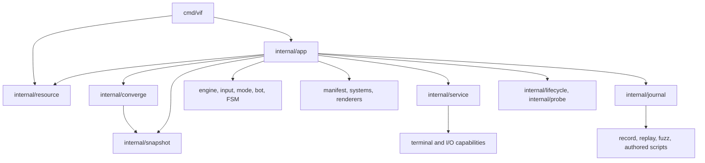
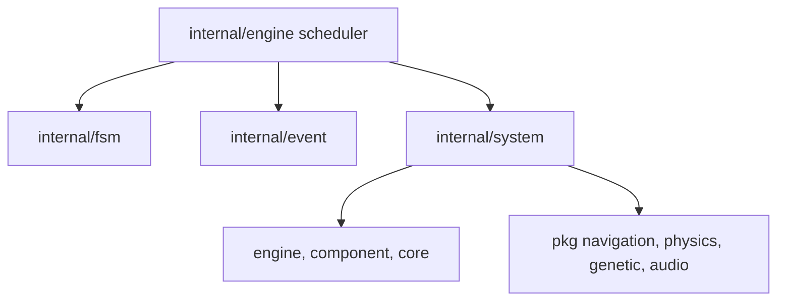
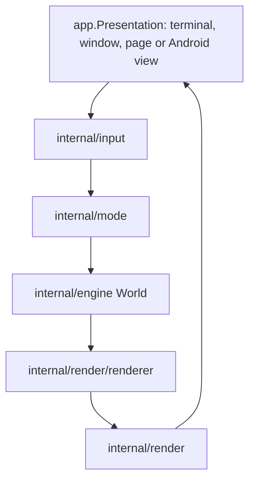
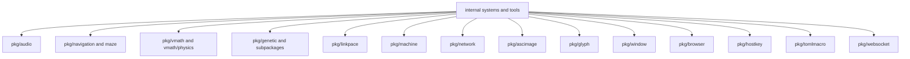

# Package Map

This document is the medium-level map between the high-level containers in
[Architecture overview](architecture.md) and individual implementation files.
It focuses on production packages first, then reusable libraries and tools.

## 1. Application package topology

`internal/app` is the composition root. Other packages should not construct an
entire game runtime or depend back upward on it.

## 2. Simulation package topology

The system package is intentionally broad: each file is a gameplay system, and
the generated manifest supplies construction order. A system's file serves only
its own system: no other system calls its functions or reads its fields, the
timer slot's `armTimer` and `timerRunning` aside. Shared mechanics move downward
into focused packages, or into a file that declares no system and takes the world
it works on: `blast.go`, `interaction.go`, `speakers.go`, `sweep.go`, `targeting.go`
and `telemetry.go`, the list `helperFiles` in `internal/system/domain_test.go`
pins. Systems otherwise communicate through ECS data and events: a species that
must refuse hits sets a ward status combat reads, rather than calling combat.

## 3. Presentation and interaction topology

Input parsing is engine-independent; mode routing is engine-aware. Rendering
reverses that direction: renderers read engine state and write only to the
render abstraction, while the orchestrator owns the presentation's surface.

## 4. Production package responsibilities

| Package | Responsibility and boundary |
|---|---|
| `cmd/vif` | Flags and the one help table that also renders `doc/vif.6` and the shell completions in `deploy/package/`; `vif.toml` defaults; logging/journal/runtime-capture setup; play/serve/replay/script/bot/check/schema selection; the session request a `-join` site answers; process exit policy. |
| `internal/content` | Immutable corpus model; root-directory load; plain-text sanitization and authored TOML blocks; corpus cursor. Internal because it depends on game `core.CodeBlock`. |
| `internal/app` | Negotiate startup sessions, compose play/headless/replay/script/server Apps, seat bots and relay their links, drive frame/input/playback/script loops and replay checkpoints, capture and install the shared world, open a journal where a run stands, verify anchor/config identity, and run a dedicated host's lifetime and probe. A presenting run presents through the host's `Presentation` and speakers (`app.Host`), the terminal when the host supplies none. It owns the world and the lock over it; the authority protocol that reads and writes that world lives in `internal/converge` and reaches it only through the `converge.Instance` seam this package implements: the correction glue, `corrector`, over the world and the capture encoder, and the run's place in its session, `membership`, beside it. The journal and its replay are `scribe`'s. Each of the three reads the run through one interface, and `App` is what is left: construct the world, wire the services, run the loop. |
| `internal/converge` | The authority protocol: which generation of the session this instance is part of and who is authoring it, the succession that moves authorship when the author goes, the adaptive per-link correction cadence a host publishes, the selective manifest/page exchange that makes a converged link cost hashes, the install a guest commits between two ticks, slow-participant eviction, the answers a relay serves the participants behind it, and the listening port and succession chain a survivor dials down. It holds no world: `converge.Instance` is the whole of what it asks the run for, and every method on it takes the world lock itself except `CaptureSharedLocked` and `IndexSharedLocked`, which `TickClosed` calls from inside a tick — which is also what lets its own criteria drive it against a stub world instead of a composition root. |
| `internal/asset` | Every embedded shipped file — fallback scenario, tutorial corpus, default keymap and `vif.toml`, shipped bot graphs, built-in sound and music banks, the source-archive version stamp — plus the splash bitmap font and the cell font atlas the window, page and Android view draw with. The only package with an `embed` directive. |
| `internal/component` | Pure ECS component data, enums/masks and per-kind tables; logic over them lives in the owning system (exceptions in [ECS](ecs-and-events.md#4-component-catalog)). Position is declared here but stored specially by `engine`. |
| `internal/core` | Small shared value types, entity ID and replication domain, modes, code blocks, the deterministic dependency resolver `service` orders its lifecycle with and `engine` checks the system graph with, crash and stderr-capture support. |
| `internal/engine` | World, typed stores, positions/spatial grid, resources, game context/state, pausable/manual clocks, time control, scheduler, locking, world copies, the shared-world state and paged delta a capture is built from, the shared-death prediction ledger, and the roster/control re-derivation an install performs over the cursor store. |
| `internal/event` | Event catalog/payload registry, replication classes and the wire predicate, producer origins, replay record/anchor schema, the MPSC queue and its wire-sink hooks, crossing frame encoding, handler router, pooled/batched payload support. |
| `internal/fsm` | Generic hierarchical, parallel-region machine; TOML graph loader with macro expansion; transitions, delayed actions, variables, per-region trigger masks, system policy, capture import/export, and optional transition/region observation hooks. |
| `internal/fsm/std` | Reusable HFSM actions/guards and the `Host` capability set. It does not import the game engine. |
| `internal/gen-manifest` | The `go generate` program behind `internal/manifest`: reads `definition.go`, the event catalog and the input enums, and writes every `*_gen.go` file (§6). |
| `internal/help` | Projects the live key bindings into the help overlay's topics. A leaf over `internal/input`. |
| `internal/input` | Terminal-event parser, semantic intents, the keys a scenario captures, keymap override decoding/merging; the default document comes from `internal/asset`. It does not import the ECS. |
| `internal/bot` | Bot graphs: parse and validate a bot document, the vocabulary of actions and guards over the bot's own world, and the driver that feeds a graph the events its instance dispatched during the last step, releases its intents through the router at the graph's rate and keeps its score. Engine-aware like `mode`; it imports neither `app` nor `converge`, and writes the world only through intents. |
| `internal/journal` | Runtime-agnostic deterministic-run machinery: recording lifecycle, in-memory capture, rotated JSONL loading, replay ordering/payload decoding, seeded fuzz input, and versioned authored tick scripts. Drivers depend on narrow target interfaces and never import `internal/app`. |
| `internal/lifecycle` | The allocated session's lifetime policy: a pure state machine over an injected clock turning roster observations into a phase (unstarted, waiting, occupied, vacant, draining, expired), a deadline, and whether a dial may still be admitted. It opens nothing, reads no roster, and terminates nothing — the run supplies the observations and acts on the phase. |
| `internal/manifest` | Authoritative component/system/renderer lists, the simulation fingerprint two participants must share, capability-split generated builders, the declared system dependency graph, game binding for the generic FSM, and the JSON schema `-schema` prints for authoring tools. |
| `internal/mode` | Mode ownership, intent execution, motions/operators/search, mouse handling, macros, command mode and the configuration menu, undo/history. |
| `internal/network` | The session layer over `pkg/network`: the join and peer-link handshakes with their previews, offers, rosters, claims and refusals, the relayed join a guest serves, the kinds a session exchanges and the table a link reads them by, the authority term, succession rule and chain, the build identity, the per-address admission budget, and the configuration a session fills from `parameter`: the link's defaults, timing and kinds, the mesh it tests on and the router request a site `-join` makes. |
| `internal/parameter` | Gameplay tunables, timing, priorities, effect/audio tuning, the shipped sound and music banks' parse, and navigation/genetics settings. |
| `internal/parameter/visual` | Renderer-facing characters, masks, palettes, gradients, shapes, and post-process settings. |
| `internal/paths` | Platform config-root and user-state discovery, categorized resource names, and the `vif.toml` settings, the one file it reads. |
| `internal/resource` | Resolve the scenario, keymap, corpus, audio overrides and bot graphs against the config-root precedence rule; read a scenario whole into the digested canonical form a session serves a joiner; and validate what those paths resolve to, every bot graph in the roots and embedded included, for `-check`. |
| `internal/pattern` | Convert a dual-mode `.vifimg` asset into wall spawn cells. One file, one path, no drawing. |
| `internal/prof` | Profiler: per-module wall time on the tick, event and render paths, process CPU/memory/GC/I/O sampling, and pprof CPU, heap and mutex profiles and execution-trace captures. Publishes into the status registry; three atomic loads per timed call while off. |
| `internal/probe` | The supervised run's HTTP endpoint: `/health` and `/metrics`. Standard library and `internal/status` only, and stateless — a snapshot function supplies the run's answer and a status registry supplies the metrics, so the run decides what its words mean and this decides only how to say them. |
| `internal/profile` | Per-kind tables indexed by kind: the combat attack matrix and species contact damage, collision, homing and mass profiles, and species drop tiers. |
| `internal/render` | Render context, coordinate transforms, compositor buffer, blend modes, finalizers, text-console palette detection and the quantizer that maps a 256-color frame to its sixteen colors, renderer interface/orchestrator. |
| `internal/render/renderer` | Concrete visual projections of components/resources, UI, post-process passes, and flow/graph debug overlay. |
| `internal/service` | Dependency-ordered lifecycle hub and mode-selected adapters for categorized files, terminal, content, audio, and network transport. |
| `internal/snapshot` | Shared-capture wire model: the capture and its header, the compressed JSON envelope, the correction manifest with its pages and section hashes, and the selective shard set — none of which reads a world. Also the comparison surface: the key filters, the line format and diff, the per-store digest, the assembled shared and whole-instance line sets, and the capture/correction telemetry cells. The surface readers take the caller's world lock and never acquire one. |
| `internal/status` | Registered atomic metrics closed by `Freeze`, per-slot player metrics and the bare key that mirrors this instance's own slot, sorted/grouped snapshots, duration formatting, and the tick-sampled flight recorder. |
| `internal/system` | Gameplay mechanics and event handlers. Systems are constructed from the manifest and run in priority order. |
| `internal/vlog` | Build-tagged logger facade: levels, scopes, correlation stamps, correlated sets, standalone files, crash flush, and the ungated journal files, one per journal; no-op on WASM/`novlog`. |

## 5. Reusable `pkg` libraries

| Package | Public purpose | Important coupling |
|---|---|---|
| `pkg/ascimage` | Convert images to terminal cells and read/write dual-mode `.vifimg` assets. | External terminal/color types only. The interactive viewer lives in `cmd/ascimage` because it needs the in-repo render buffer. |
| `pkg/glyph` | Parse the bitmap font atlas and draw a frame of terminal cells into RGBA, changed cells only: the reference drawer of a graphical host. The protocol a drawer in another runtime paints from: the atlas as one texture (`Texture`), frames as the cells changed since the one it holds (`Frames`), and the probe that checks such a drawer against the raster. | External terminal, color and TOML modules and `pkg/vmath` only; the atlas comes from the caller (`internal/asset`). |
| `pkg/window` | A desktop window that draws a cell grid: Xlib, EGL and GLES 2 loaded at run time with purego, keys and pointer posted as terminal events. Built on Linux and FreeBSD; `cmd/vif` links it unless `vif_nogui` or `vif_headless`, and `vif_gui` opens it by default. | `pkg/glyph` draws the frame; external terminal module and purego. |
| `pkg/browser` | A web page as the screen and speakers on `js/wasm`: frames handed to the page one at a time as the cells changed since the one it holds, the mixer's PCM posted to the page (`Speaker`), keys, text, the pointer and resizes taken back as terminal events. | `pkg/glyph` encodes the frames; external terminal module and `syscall/js`. The page is `web/`. |
| `pkg/hostkey` | The key report of a host that reads its platform's own key events: presses until a run asks for releases, then each key's press, repeats and release paired by the host's code for the physical key, taps for keys with no release, every hold ended when focus leaves. The window, the page and Android share it. | External terminal module only (its `KeyHolds` pairs the releases). |
| `pkg/audio` | Synthesis, sound registry/cache, PCM mixer, patterns, harmony, voices, sequencer, backend detection, WAV sink. | Game policy *and the sound bank* are injected; the package ships no specs and imports nothing under `internal/`. |
| `pkg/audio/model` | Audio identifiers and arrangement values shared by events/configuration. | No mixer, backend, filesystem, or synthesis dependency; remains in audio-free profiles. |
| `pkg/genetic` | Generic generational and caller-driven streaming genetic engines, deterministic PCG streams, exact continuation checkpoints, and operators. | Core package uses the standard library only; its default seed restates `vmath.Golden64` rather than importing it. |
| `pkg/genetic/fitness` | Convert lifetime metric bundles to scalar fitness. | Depends on tracking types. |
| `pkg/genetic/tracking` | Pooled lifetime metric collectors for simple and composite subjects. | No game-specific component dependency. |
| `pkg/genetic/registry` | Up to 256 species/populations, sampling, probes, tracking, stats, optional persistence. | Composes core genetic, fitness, tracking, and persistence. |
| `pkg/genetic/persistence` | Atomic file saves and TOML/JSON codecs for population DTOs. | TOML codec imports the external TOML module. |
| `pkg/network` | Framed messages over TCP or WebSocket (the browser's own socket on `js/wasm`), deflated per link once a handshake opens the stream; the accept and dial transport with its handshake budget and the hooks a session's handshakes plug into; the port's tick-drained inbound queue, bundled sends and the link probe it answers itself; an in-process mesh with shaped links; chunked bodies; crossing fences; session addresses and TLS. | Standard library, `pkg/linkpace` and `pkg/websocket`. It knows no kinds and no game: `Kinds` is the session layer's table over the kind byte, and the handshakes, the timing and the kinds come from its caller's `Config`. |
| `pkg/linkpace` | Per-peer link estimation (round trip, jitter, delivery rate, saturation) and the bounded controller that turns it into a correction cadence and keyframe interval inside a convergence floor. | Standard library only, deliberately: the package cannot see a world, an event or a component, which is what makes "network timing may not enter the simulation" (D-24) structural rather than remembered. |
| `pkg/machine` | Per-entity state machines: an `Instance` a component carries (a state, its elapsed time, its entry's duration), an immutable `Graph` built and validated once from typed hooks and stepped in fixed phases, and `Queue`, values each behind a relative timer. | Standard library only: hooks reach the world through the context the host passes, and the host writes the state's flags to its components ([Behavior machines §6](machine-design.md#6-runtime-pkgmachine-stdlib-only)). |
| `pkg/tomlmacro` | Expand macros in parsed TOML documents: typed parameters, substitution, array splicing, zipped `each`, bounded nesting and output. | Standard library only: it works on the parser's generic trees, so the FSM loader and bot graphs share one expander. |
| `pkg/maze` | Recursive-backtracker maze generation, rooms, braiding, and solution data. | Standard library only, with its own `Point` and a default seed restating `vmath.Golden64`; surfaced through wall/maze events. |
| `pkg/navigation` | Flow fields, recompute caches, flow steering, composite passability, multi-route graphs. | Owns its route-graph tuning; wall access is callback-based. |
| `pkg/vmath/physics` | `float64` kinetic state, integration, bounce, homing/arrival, collisions, orbital and 3D operations. | Owns `physics.Kinetic`; depends only on the standard library and `pkg/vmath`. |
| `pkg/vmath` | `float64` scalar/vector math, LUTs, shapes, arcs, grid traversal, cell topology, seeded randomness, and the shared math constants. | Standard-library-only foundation; integer `Point`/`Area` values are grid indices, not fixed-point numbers. |
| `pkg/websocket` | RFC 6455 as a byte stream: the version-13 upgrade as client and server, binary frames, ping, pong and close. | Standard library only. `pkg/network` dials and serves sessions with it and `tool/vif-router` terminates the browser route with it. |

No package under `pkg` imports anything under `internal`; `make arch-check`
enforces it. That is what lets a leaf take game data — the sound bank, wall
callbacks, fitness policy — from its caller instead of reaching for it. The
numeric stack is one-way: `pkg/vmath` imports only the standard library and
`pkg/vmath/physics` imports `pkg/vmath`. `pkg/audio`, the core `pkg/genetic`
package, `pkg/linkpace`, `pkg/machine`, `pkg/network` and the numeric stack have
the clearest game-independent boundaries.

## 6. Generated assembly

`internal/manifest/definition.go` is the human-edited declaration for three
registries:

- component field/type pairs and the entity domain each may attach to;
- system registry keys, constructors, domain profile, required and optional
  dependencies, snapshot obligation, and optional local build capability;
- renderer registry keys, constructors, and layer priorities.

`go generate ./internal/manifest/...` (`make generate`) invokes
`internal/gen-manifest` and updates the core, audio and audio-free system
builders, the terminal renderer builder, typed component stores/removal masks and
the component domain table, the shared-world capture, install, delta and store
rows, the event reflection registry, and input enum strings.
Stable tie-breaking comes from manifest order when two systems or renderers share
a priority. Audio is the current local-only implementation capability; audio-free
builds select null event sinks without changing the simulation fingerprint.

Important exceptions:

- `MetaSystem` takes a `GameContext`, so `internal/app` registers it once the
  context exists. Its profile is declared in `manifest.ContextSystems` for the
  same validation and fingerprint, and the generated builders do not construct it.
- `NetworkSystem` is a manifest-registered dual-domain system. It is inert while
  the world holds no network resource and becomes the tick-owned wire bridge once
  a session attaches one.
- runtime system control matches each system's `Name()`;
  `TestActiveSystemsMatchRuntimeNames` keeps it equal to the manifest key.

## 7. Dependency direction rules

The practical dependency rules are:

1. `cmd/vif` translates flags into `app.Config` and the option types inside it (`converge.SlowPolicy`, `lifecycle.Policy`, `resource.Options`), and calls the `app` entry points and the few operations beside them (`manifest.Schema`, `resource.Check`, `network.RequestSession` for a `-join` site); nothing imports a `cmd` package.
2. `app` may compose all runtime layers; domain packages should not import it.
3. `converge` sits between `app` and `snapshot`/`network`: it decides what a session publishes and installs, and asks the run for the world through `converge.Instance` rather than importing `app`. It exports the protocol's own operations and reports and nothing else: a criterion that has to fabricate protocol state belongs in that package, where it can reach the state directly, rather than behind an exported knob.
4. `snapshot` and `resource` sit below both: the first owns the capture wire model and the comparison surface, the second the config-root precedence rule. Neither imports `app`, and neither acquires the world lock — the surface readers walk a world the caller has already locked, and the wire model reads none at all.
5. `journal` owns deterministic input-stream mechanics and may depend on event and input values, while App-specific construction, presentation, and session startup stay above it.
6. `engine` owns data/lifecycle infrastructure but should not import concrete
   gameplay systems or renderers.
7. `input` produces pure intents and must remain free of engine dependencies.
8. `mode`, `bot`, systems, and renderers may depend on engine data, but communicate
   laterally through resources/events rather than concrete peer references.
9. Generic FSM core/std share the event catalog but not the engine: `std.Host` is
   the capability seam and the manifest bridge is the adapter.
10. Blocking I/O stays behind services, render flush, audio backends, tools, or
   diagnostics—not inside a simulation update.
11. Reusable algorithms accept callbacks/data structures instead of reaching
   into global world state where practical.

## 8. External module boundary

| External module | Used by | What remains in vif |
|---|---|---|
| `lixenwraith/terminal` | app, service, input, mode (`tui` forms), render and renderers, ascimage, cmds and tools; core's crash reset and a few attribute and color-mode types in component, engine, pattern and system | Game-specific input semantics, compositor, renderers, and layout. |
| `lixenwraith/toml` | content, FSM and std, bot graphs, keymaps, commands, journal scripts, `vif.toml` settings, resource checks, event payload text, audio specs, genetic persistence, soundlab, the router | Schemas, validation policy, semantic models, and application resolution. |
| `lixenwraith/color` | components, engine, events, render and renderers, visual parameters, pattern, systems, ascimage, cmds and tools | Layering, masks, game palettes, effects, and render scheduling. |
| `lixenwraith/log` | `internal/vlog` only in normal builds | Scopes, game correlation fields, crash/runtime capture integration, status snapshots. |
| `ebitengine/purego` | `pkg/window` only | The window's Xlib, EGL and GLES 2 bindings, frame upload and event mapping. |

The pinned revisions are in `go.mod`; this document intentionally avoids
duplicating version strings that would become stale.

## 9. Commands, tools, and sandboxes

| Area | Contents |
|---|---|
| `android/` | The Android host, a module of its own: `game`, the Go library `gomobile bind` wraps around `app.Run` (the view as a `Presentation`, the speakers), and the Java app that presents it ([android/README.md](../android/README.md)). |
| `cmd/ascimage` | Supported image converter/viewer command. |
| `cmd/soundlab` | Supported audio document editor, REPL/TUI, sequencer audition environment, and script runner. |
| `script/*` | `test.sh`, the end-to-end checks no Go test makes ([script/README.md](../script/README.md)), and the sparring pair: authored `vif -script` schedules that play a fixed host or guest against a person. |
| `tool/blend-tester` | Inspect blend behavior and palette/effect combinations. |
| `tool/font-atlas` | Render the embedded font atlas from a monospace TrueType; Python, so the rasterizer stays out of the module. |
| `tool/font-editor` | Edit the bitmap splash font. |
| `tool/hierarchy-map` | Terminal UI that selects Go source subsets as LLM context, indexed by `@lixen:` annotations, local imports and symbol-level coupling. |
| `tool/http-server` | Minimal static server used by `make serve` for the WASM bundle. |
| `tool/vif-router` | Website-to-K3s session router; a host service, not part of the game binary. |
| `tool/vif-log` | Terminal viewer for the JSONL session log and replay journal, separately or merged; its packages are internal to the tool. |
| `wad/` | The external payload, laid out as it installs into a `vif/` configuration root: alternate scenarios, a plain-text corpus and a wall image ([filesystem layout](filesystem-layout.md)). |
| `web/` | The page and worker the WASM build runs in: a WebGL canvas drawn from the host's cell frames, a hidden text field for keys, the key strip for touch screens. |
| `deploy/` | The session image, K3s objects, node units, updaters and runbook, the LogWisp pipeline, the site's log-viewer page, and the packaging files in `deploy/package/` ([deploy/README.md](../deploy/README.md)). |
| `sandbox/*` | Isolated prototypes, visual/interaction experiments, and the random and render benchmarks; not part of application assembly. |
