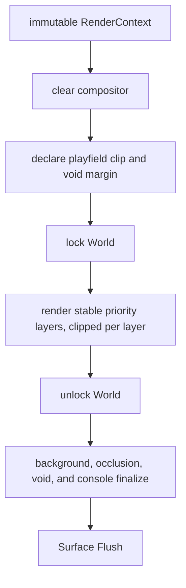
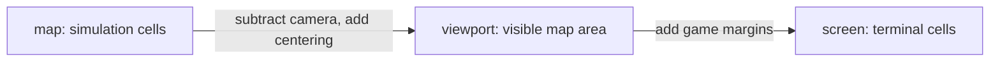

# Rendering Architecture

vif renders a layered simulation into a terminal-cell compositor. The
renderer reads the ECS; it never owns gameplay state. The external terminal and
color modules provide host I/O and color primitives, while this repository owns
camera transforms, layer ordering, masks, visual policy, and every game-specific
renderer.

## 1. Frame pipeline

The app draws a frame every third of a tick, 60 per second, so each tick shows for
three frames. `RenderOrchestrator` owns one reusable `RenderBuffer`, clears it,
acquires the world lock, invokes visible renderers in ascending priority, and
releases the lock. Finalization and the flush to the surface
happen outside the world lock, and the terminal writes on a goroutine of its own:
`Flush` never waits, holding only the newest frame while a write is out. A terminal
that stops reading (a hidden tab, a multiplexer client that went away) therefore
cannot block game ticks, event delivery, or input routing. Once it has held a write
for `TerminalBlockedAfter` (100 ms) the frame loop stops drawing, logs `terminal
stopped taking output; drawing paused`, and resumes with a matching record when the
write returns; the tick handshake runs throughout.

The frame leaves through `render.Surface`: color mode, `Flush` of the cell grid and
`Sync`. The terminal, the desktop window, the browser page and the Android view
satisfy it, and it is all a host has to provide to draw the same cells
([Multi-platform §8](multi-platform.md#8-adding-another-renderer-or-android-host)).

Before the lock the orchestrator derives the frame's playfield rectangle and
declares the void around it; each simulation layer then draws clipped to the
playfield and each screen-space layer to the whole buffer. See section 2.1.
`RenderStatus` draws the status bar alone over a void screen, for a world not yet
the one to show: a joiner's, until the start gate installs its session's.

Renderers are registered during application assembly. Insertion sort preserves
priority order, and registration index is the stable tie-breaker. A renderer
that implements `VisibilityToggle` can be registered permanently and skipped
without rebuilding the pipeline, as the cursors, overlay, and pinned state are.

## 2. Render context and coordinates

`RenderContext` is passed by value and snapshots the frame data needed by all
renderers:

| Group | Fields |
|---|---|
| Timing | pause-aware game time, frame delta, paused flag |
| Player | local-cursor map coordinates and validity |
| Layout | game-area screen offsets |
| View | viewport width/height and camera top-left |
| Map | logical map width/height and centering offsets |
| Host | complete terminal screen width/height |

There are three coordinate spaces:

- Map coordinates are authoritative for positions, walls, collisions, and
  cursor motion.
- Viewport coordinates crop a map larger than the terminal or center a smaller
  map.
- Screen coordinates include UI/game margins and address the render buffer.

`MapToViewport`, `ViewportToScreen`, `MapToScreen`, `IsInViewport`, and
`VisibleMapBounds` centralize conversion. New renderers should use these helpers
instead of duplicating camera arithmetic. `MapToViewport` and `MapToScreen`
report a coordinate visible only when it is both a map cell and inside the
viewport, so an out-of-map coordinate that projects into a centered map's margin
answers false. `MapToViewport` still returns the projection (`MapToScreen`
returns zero), so a renderer anchoring a shape on an off-map centre projects it
there and lets the clip trim the result, as the explosion field does. Area
renderers should still intersect their iteration bounds with `VisibleMapBounds`
to avoid the wasted work; the quasar zap ellipse does, and walks only the row's
band of cells its test admits rather than the box, since its radius spans the map.

### 2.1 The playfield clip

A map smaller than the viewport is centered inside it, and the margin that
leaves belongs to no cell any entity, effect, or field can occupy. It appears
whenever the render area outgrows the simulation: a `crop_on_resize = false`
scenario such as `wad/scenario/td`, a multi-participant session whose bounds were
latched by the first person to join, or a tmux pane zoomed after the map was fixed.

Four rectangles describe it, all derived from `RenderContext`:

| Helper | Space | Meaning |
|---|---|---|
| `PlayfieldViewportRect` | viewport | the map's extent inside the viewport |
| `PlayfieldRect` | screen | the cells a simulation coordinate can reach |
| `GameAreaRect` | screen | the whole viewport; the part outside the playfield is the margin |
| `FrameRect` | screen | the game area with its row and column gutters; the part outside the playfield is the void |

Confinement is enforced in two independent places, because the two failure
modes are different:

- **Coordinate layer.** `MapToScreen` and friends reject off-map coordinates, so
  every renderer that projects map cells is bounded by construction. This covers
  shapes drawn per-cell from a possibly off-map anchor: splash bitmaps, health
  bars, tracer trails, marker areas.
- **Compositor layer.** `RenderBuffer.SetClip` bounds every write path, and the
  orchestrator sets it per layer from `RenderPriority.ClipsToPlayfield`. This
  covers renderers that never convert a map coordinate at all because they
  iterate the viewport directly — ping lines, materialize beams, the explosion
  accumulation buffer — and it holds for effects nobody has written yet.

`ClipsToPlayfield` is the single classification of layers into simulation and
screen space. Post-processing, the heat bar, indicators, status bar, and debug
layers address the whole screen and stay unclipped; the two cursors mark map
cells and clip. `TestEveryLayerDeclaresItsClip` fails when a priority is added
without a declared side.

Where a renderer's own geometry depends on the bound rather than merely being
trimmed by it, it reads `PlayfieldViewportRect` directly: ping spans the map
rather than the viewport, materialize beams run from the map edge so their
length and intensity gradient stay correct, and the indicator gutters number
only reachable rows and columns, leaving the rest of the frame to the void.

When the map fills the game area — every `crop_on_resize` run, and every
camera-cropped map — the playfield equals the game area and the clip is a no-op.

The centering offset itself has one definition, `ConfigResource.MapOffset`, with
`ConfigResource.ViewportToMap` as its inverse. Mouse routing uses the inverse, so
the cell under the pointer is the cell the renderer drew there.

Replay separates simulation geometry from presentation geometry. The journal
anchor fixes the former; each frame's context is re-laid for the viewer's
terminal, with its own viewport, centring and camera derived from the recorded
camera plus the viewer's `h/j/k/l` scroll, clamped to the map. The recorded camera
and viewport are never written.

### 2.2 The cell aspect

A terminal cell is about twice as tall as it is wide, and every vertical extent
the game authors (radii, orbit heights, navigation costs) is written at that
reference. `vmath.Aspect` (width over height, `RefAspect` 0.5) is the one
definition: `Y` scales an authored vertical extent, `YInt` a cell count,
`Circular` and `FromCircular` convert a vertical distance to and from horizontal
units. The presentation reports its aspect with its grid
(`Presentation.CellAspect`), `ConfigResource.CellAspect` holds it beside the
color mode and `RenderContext.CellAspect` carries it to the renderers;
`navigation.CostsFor` builds a field's costs from it (10, 20 and 22 at the
reference, 10, 10 and 14 for a square cell), `visual.ShieldConfigFor` and each
inverse-radius pair are computed where they are used, and ascimage takes it as
`-aspect`. Footprint radii (the quasar's and the snake head's collision, the
quasar shield) are cells whatever the aspect. It is simulation identity: the
anchor carries it (`JournalAnchor.CellAspect`) and a guest adopts the host's as
it adopts the map bounds (D-14), since two participants at different aspects
would steer differently. Projection stays `PointAt` (floor): a graphical surface
shows the same cell snapping a terminal does.

## 3. Compositor data model

The buffer allocates parallel arrays sized to `width * height`:

| Array/state | Purpose |
|---|---|
| terminal cells | Rune, foreground, background, attributes. |
| `touched` | Whether a background channel has been explicitly drawn. |
| masks | Semantic layer bits accumulated for post-processing. |
| current write mask | Mask applied by subsequent drawing calls. |
| clip rectangle | Writable area; set per layer by the orchestrator, reopened by `Clear`. |
| background overlay | Deferred color/intensity for otherwise untouched cells. |
| void region | Frame and playfield rectangles plus the color the void is filled with. |
| finalizer function | Selected once from color mode and occlusion configuration. |

Resize reuses capacity when possible and synchronizes the terminal. Clear
zeroes cells and metadata, reopens the clip to the whole buffer, and keeps
allocations. Out-of-bounds draw calls are safe no-ops, and so are draws outside
the clip: `inBounds` tests the clip, which `SetClip` keeps intersected with the
buffer so the check stays a single range test. `CellAt` deliberately reads
through buffer bounds rather than the clip, so a test can read back the cells a
layer was prevented from reaching. `MutateDim` and `MutateGrayscale` iterate the
clip, so a clipped layer cannot post-process outside it either.

### Drawing operations

`Set` optionally writes a rune and composites foreground/background channels.
Focused helpers preserve the other channel:

| Operation | Semantics |
|---|---|
| `SetFgOnly` | Replace rune/foreground/foreground attributes and retain background. |
| `SetBgOnly` | Replace only background and mark it touched. |
| `SetBgScreen` | Screen-blend a background over the cell's, or over a caller base if none was drawn yet. |
| `SetBgAlphaOwned` | Alpha-blend a background, blank the glyph, and let the current mask replace the cell's tags: a translucent panel. |
| `SetWithBg` | Opaque cell replacement; the current mask replaces the cell's earlier tags. |
| `SetBg256` | Store a palette index in the background channel and set the palette attribute. |

`BackgroundAt` supplies a caller-selected canvas color for an untouched staging
cell, allowing a renderer to compose several layers locally and commit once.

Terminal attributes identify whether RGB channel bytes represent truecolor or
an xterm-256 palette index. Any effect that mutates colors must preserve those
attributes and avoid treating an index as an RGB component.

## 4. Blend modes

Blend mode is encoded as an operation plus foreground/background flags.

| Operation | Typical visual use |
|---|---|
| Replace | Opaque glyphs, UI, and hard field cells. |
| Alpha | Fades and translucent overlays. |
| Add | Energy glows, explosions, storm/pylon fields. |
| Max | Retain the brightest participant when fields overlap. |
| Soft light | Subtle shield glow. |
| Screen | Light-emitting fields, lightning, pulses. |
| Overlay | Ember ring/color shaping. |

Predefined modes include both-channel variants plus foreground-only screen,
replace, and add, and background-only max and alpha. A renderer should choose
the narrowest channel set it needs so later layers can preserve existing content.

The actual color math comes from `lixenwraith/color`; the selection and
composition policy lives in `internal/render` and the concrete renderers.

## 5. Semantic masks and post-processing

Renderers call `SetWriteMask` before drawing. Current mask categories are:

| Mask | Content |
|---|---|
| `MaskPing` | Cursor crosshair/grid guidance. |
| `MaskGlyph` | Normal typeable text. |
| `MaskField` | Shield/ember and related fields. |
| `MaskTransient` | Projectiles, particles, materialization, lines, sigils. |
| `MaskComposite` | Species, structures, gold, composite members. |
| `MaskUI` | Meters, status, cursor, overlays, debug UI. |
| `MaskHealthBar` | Dedicated high bit used by health bars. |
| `MaskWall` | Wall cells, so pause dim reaches them whatever drew before. |

Masks allow late renderers to transform selected prior layers without knowing
which concrete renderer produced them:

- grayout desaturates glyphs while excluding guidance, fields, transients,
  composites, health bars, walls, and UI;
- dim scales every category except UI while the game is paused; on a text
  console, where a halved color is mostly black, it grays them instead;
- the truecolor finalizer dims selected occupied backgrounds under glyphs;
- strobe supplies a deferred background overlay for otherwise untouched cells;
  a console shows it in one step, in its nearest background, while the envelope
  is past half its peak.

An RGB write, blend or mutation over a 256-color index first resolves the index
to its color, so no arithmetic ever runs on an index.

## 6. Finalization and color modes

The buffer chooses one of two finalizers at construction:

| Mode | Finalization |
|---|---|
| Truecolor with occlusion enabled | Fill untouched backgrounds, then dim touched backgrounds under runes whose masks match the occlusion set. |
| 256-color or occlusion disabled | Fill untouched backgrounds only. |

Both use the normal background unless a renderer set a deferred background
overlay, in which case its precomputed color/intensity fills untouched cells.

A third pass then repaints the void region: the part of the frame outside the
playfield (the centering margin, and the gutter cells beside it) is filled with
`visual.RgbVoid` so it reads as out of play rather than as empty map. Only
untouched cells are repainted, so a UI or debug layer that legitimately reaches
into the margin keeps the colors it composed, and the pass walks the four margin
bands rather than the whole area. Setting `RgbVoid` to `RgbBackground` makes the
void indistinguishable from the map.

Every cell also leaves finalization with a glyph, a space where none was drawn.
After a resize the terminal module records its screen as zero cells over a
screen cleared to the terminal's own background, so a glyphless black cell (the
void, the heat bar's unlit track) would match that record and never be sent.

In 256-color mode the game draws for a text console, and a last pass settles
every cell on one of the console's sixteen colors. The palette is the Linux
console's live one (`/sys/module/vt/parameters/default_*`, which `setvtrgb`
writes), FreeBSD vt's default, or VGA; it is in `Config.ConsolePalette` for
renderers that pick colors from it. An entry (0-15) passes through, an xterm
index keeps its hue family by the rules FreeBSD's teken documents, and RGB takes
the nearest entry in CIELAB, except that the theme background is the console's
black. Stone art sends every color but a moss or crystal glyph's as the gray of
its luma (`pattern.Art256`), since those rules put a muted brown in the red
family. Text that would vanish into its background, or UI text under a 2.5
contrast ratio, takes the nearest entry that shows. Styles are resolved rather
than sent, because the Linux console recolors dim, italic and underlined text
and FreeBSD brightens bold.

An emulator gets 256-color mode too, when nothing announces truecolor (ssh drops
`COLORTERM`). It draws entries 0-15 in its theme, which can make a pair the console
reads, such as bright white on blue, unreadable, but it shows xterm's cube exactly.
`Config.TextConsole` tells the two apart (the terminal reports a console as 16
colors), and a renderer that wants the cube keeps its cells out of the last pass
with `RenderBuffer.SetExact`, which lasts the frame: the start screen's button.

Finalization is immediately followed by the surface's full-buffer `Flush`.

The CLI can force 256-color (`-color 256`) or truecolor (`-color true`);
`-color auto`, the default, lets the terminal capability select the mode, and a
text console, which the terminal reports as 16 colors and draws in SGR 30-37 and
90-97, takes 256-color. Visual parameter files provide truecolor and
palette-specific values. Renderer logic should not assume every color channel
contains RGB.

## 7. Layer inventory

The manifest is the authoritative renderer list. The conceptual order below is
also the visual stacking order; exact integer priorities are in
`internal/render/priority.go`.

| Layer group | Renderers |
|---|---|
| Background/guidance | `ping` |
| Environment/guidance | `wall`, `chargeline` |
| Base entities | `sigil`, `glyph`, `gold` |
| Particles | `flash`, `fadeout`, `explosion`, `spirit`: what a species left, under the species that leaves it |
| Species/structures | `pylon`, `tower`, `storm`, `kraken`, `eye`, `snake`, `drain`, `quasar`, `swarm`, `behavior` (every data species), then `healthbar` over them |
| Tracer/materialize | `tracer`, `materialize`, `teleportline` |
| Fields/projectiles | `shield`, `ember`, `orb`, `lightning`, `missile`, `pulse`, `ray`, `bullet` |
| Overlay effects | `landing`, `button`, `splash`, `marker` |
| Post-process | `grayout`, `strobe`, `dim` |
| UI | `heat`, `indicator`, `statusbar`, `peer_cursor`, `cursor`, `start_screen` |
| Debug and telemetry | `flowfield`, `pinned_state`, `overlay` |

Some rendered concepts do not have a same-named component or system. For
example, charge/teleport lines and the landing marker are projections of species
state, ember is a heat phase, and status/overlay renderers read resources/adapters. Conversely,
a game component needs no renderer if another renderer deliberately projects
it (nuggets use their visual/sigil representation rather than a registered
`nugget` renderer).

The tracer renderer is intentionally background-only: every sampled trail
cell writes no rune/foreground, so typeable text remains readable as a tracer
crosses it. `BlendMaxBg` bounds overlapping auto-fire at the brighter input
instead of accumulating color, and the visible ring-buffer prefix contracts as
a blocked tracer drains to its stop point.

The landing marker is one cell, the centre of the footprint a charge or a beam
lands on, cycling white, red and pink every `visual.LandingBlinkStep` from the
lock until the landing. The charge and teleport lines run between the footprints'
centres, so both end on it: a charge pulse's head arrives on the pulse's last tick,
since `Machine.Elapsed` moves a tick at a time. It draws over the player's fields,
so a shield's rim never hides it. Truecolor lights its background alone, so a glyph under it still reads;
256-color draws a foreground block, since eight backgrounds cannot show its bright
entries.

The kraken renderer shades a pose once. A tick moves the Kraken and the frames
until the next show the same pose, so it keeps the shaded cells while the pose,
position and visible bounds match, and draws them again as they are. It takes the
tentacle samples the Kraken system built that tick from `KrakenShape` and samples
the shape itself only when something moved the Kraken after its system ran. Each
disc stamps its box with squared distances, and only a cell within
`vmath.RoundingMargin` of a disc or rim edge takes the square root the definition
compares, so the cells are exactly those of the per-cell distance test.

A cell can hold several glyphs while drift carries layers past one another. The
glyph renderer draws typeable text in its cell, only the cell's top glyph, the one
typing acts on (`Position.TopGlyphIs` settles a cell holding one entity by its
length and ranks a stacked one). Scenery is drawn where its layer stands at the
frame's moment. A tick steps a layer whole cells, so the renderer carries each
layer on from its cells by the part-cell and velocity the environment leaves in
`Drift` each tick, over the time since the tick (`TimeResource.PaceTime`, the
pacing clock's instant it ran at) and a tick at most: a fast layer moves every
frame and lands where the next tick puts it, and a frame before the tick draws it
in its cells. The layers draw far to near and typeable text last, each over the
ones behind it, so the nearest glyph shows where several are drawn in one cell,
and lines of two depths interleave where they cross. Scenery standing in rock or a
wall that blocks spawns is not drawn: rock and walls draw first and a glyph prints
over them foreground-only, so the text passes behind them. In truecolor each
scenery layer mixes its type's bright color into the background by
`visual.SceneryDepthMix`, so far text fades as haze, while typeable text keeps its
level's color. In 256-color mode a glyph hue has two console entries, one for dark
and one shared by normal and bright, so only the dark layer stands apart there.

### Local and peer cursors

Two renderers rather than one loop, and they answer different questions. The local
cursor answers "where am I, and what am I about to act on", so it takes the colour
of whatever it is standing on and follows the local input mode. A peer answers
"where is that player", so it keeps one colour per roster slot whatever it stands
on — drawing them the same way would make the two indistinguishable exactly when it
matters, which is when they overlap. `PriorityPeerCursor` sits directly under
`PriorityCursor` so an overlap resolves in favour of the one the player is steering.

`peer_cursor` keeps a participant visible even when it projects no shield or
ember. The local cursor and the inverted marker read the cell underneath
through one `cellContent`, which picks the cell's top glyph as typing does, so
what they show is what a keystroke would hit.

Peer shield and ember fields keep their owner's color and geometry. In truecolor
they compose at `visual.PeerFieldBlend` (30%) of local intensity over the
existing or theme background; in 256-color they are drawn undimmed, since the
console would show a dimmed rim as black. Ember walks the fixed roster instead
of every shield, keeps one heat cache per slot, and commits its layers in one
background write. Its per-cell work is lookups: the angle of every cell offset
it can visit is tabled once per painter, each radial step of the glow is composed
over the theme background when heat or blend changes, so only a cell something
else painted blends live, and a ring skips the cells its Gaussian cannot light.
The box is clipped to the visible map before any per-frame table is built. Both
field renderers compose peers first and the local cursor last, without sorting
or changing store/slot order. The distinction remains render-only; no
transported state changes.

## 8. Renderer responsibilities

Concrete renderers should:

1. read the component/resource stores they own while the orchestrator holds the
   world lock;
2. cull by visible map bounds before expensive work, and derive any geometry
   that depends on the map's extent from `PlayfieldViewportRect` rather than the
   viewport dimensions;
3. convert map coordinates through `RenderContext`;
4. select a semantic write mask and explicit blend/channel behavior;
5. derive animation from game time/delta without mutating simulation data;
6. keep reusable scratch buffers/caches on the renderer instance;
7. leave surface flushing and buffer lifetime to the orchestrator.

Rendering must not publish gameplay events or alter components. If a visual
requires durable simulation state, a system should compute/store that state and
the renderer should project it.

## 9. UI and debug projections

The heat bar, indicators, status bar, and cursor are late layers marked as UI
so normal dimming does not make control information unreadable. A heat level
lights `width*level/100` cells over a black track, and the ten segments and
their notches derive from the same division, so a level of 10k ends exactly on
the k-th notch at any width. The status bar
is two rows (`StatusRows`) on every host. The upper one holds the status items in
a fixed priority: session badge, time control, FSM phase, energy, damage
multiplier, boost, grid state, and the metrics, dropped first when space is tight.
Those that fit span the row edge to edge, each in a slot at least its width and
the slots as equal as those widths allow, so an item's edges move when the items
shown change, not when a value grows a digit. The bottom row holds the audio
letter, the mode label, a fixed key cell (`StatusKeyWidth`) with a pending key
sequence or the last one completed, then typed input or the message shown; no
item narrows it, and the keys never share their cells or their time with a
message. A message longer than its room rises onto the items' row while it shows,
as vim's rises over the window, broken after a space or a slash where the rest
then fits the bottom row, so a log path reads whole on a portrait phone. While a
keyboard covers a touch host (`StatusCovered`), the row keeps its input and
messages to the left half the host repeats above the keyboard. A
message is a notice or an alert (`parameter.StatusKinds`): the newest replaces the
one shown, except that a notice does not displace an alert younger than its
minimum, and each leaves after its kind's wall time. Its
colors come from one palette per color mode: the theme's in truecolor, and on a
text console fixed entries, each apart from the items beside it and with the text
that reads best on it. The audio state is a letter: X muted, S sfx, M music,
O both; it is absent without an audio engine.

The start screen (`StartScreenRenderer`) is the terminal's and the desktop
window's: while `RenderContext.StartScreen` holds it covers every row above the
status bar, the logo at the centre two fifths of the shorter side and the prompt
under it on a button, the site's colors in truecolor and console entries in 256
colors. An emulator's button keeps the site's blue and white through xterm's cube;
a console's fonts lack the half blocks that round it, so there it is the label in
bright white framed in bright blue double lines, which fonts without them draw single. The status bar keeps its line under it and leaves its items' row clear;
`RenderStatus` draws it too, for a join waiting for its press.

The relative row and column gutters number only the rows and columns the
playfield covers and mark the rest with the void color, so the chrome agrees
with the margin it borders rather than numbering cells no motion can reach.

The overlay renderer adapts help/about/telemetry content into buffer cells. The
about window draws the lixen mark from its shape (`logoCells`): in truecolor as
quadrant glyphs fitted to anti-aliased samples (`ascimage.FitQuadrant`), on a
console as whole blocks in the entry each cell mostly shows. Flow
debug can show a target group's flow field or route graph and is controlled via
`:flow [group]` and `:graph [group]`. Debug layers are part of the normal
pipeline but are visibility-gated.

## 10. Patterns and image-derived assets

`internal/pattern` bridges terminal image assets into the game: it converts a
dual-mode `.vifimg` into wall cells, which `WallSystem` spawns as one composite
wall. Pattern results become simulation spawn data; they are not drawn by
bypassing the ECS/render pipeline.

The `cmd/ascimage` tool performs image conversion and viewing. The external
terminal/color modules own general terminal and RGB primitives; vif
retains only game-specific asset interpretation and layering.

## 11. Adding a renderer

1. Implement `render.SystemRenderer` under `internal/render/renderer` and keep
   its world dependency read-only.
2. Add an explicit priority or reuse a deliberate shared priority, and declare
   the new priority's side in `RenderPriority.ClipsToPlayfield`.
3. Register the constructor in `internal/manifest/definition.go`.
4. Run manifest generation.
5. Select/test truecolor and 256-color paths, including foreground/background
   palette attributes. A 256 path names console entries (`visual.Con*`), draws
   what the console cannot blend as solid cells past
   `visual.Effect256Threshold`, and keeps to glyphs every console font has
   (`TestConsoleGlyphsAreInEveryConsoleFont`).
6. Verify behavior under camera cropping, centered small maps, terminal resize,
   pause, grayout/dim/strobe, and overlapping fields.
7. Check that the surface flush remains outside the world lock and that no
   renderer retains store pointers across frames.

## 12. Source map

| Concern | Primary source |
|---|---|
| Orchestration and the frame sink (`Surface`) | `internal/render/orchestrator.go`, `interface.go` |
| Context/transforms | `internal/render/context.go` |
| Replay presentation and pan | `internal/app/play.go` |
| Buffer/finalization | `internal/render/buffer.go` |
| Text-console palette and quantizer | `internal/render/console.go` |
| Color mode selection | `internal/app/presentation_terminal.go` |
| Blending | `internal/render/blender.go`, `color.go` |
| Layer priorities and clip classification | `internal/render/priority.go` |
| Rectangles and clipping geometry | `internal/render/rect.go`, `context.go` |
| Visual constants/masks | `internal/parameter/visual/*.go` |
| Concrete projections | `internal/render/renderer/*.go` |
| Registry | `internal/manifest/definition.go` |
| Image conversion/patterns | `pkg/ascimage`, `internal/pattern`, `cmd/ascimage` |
