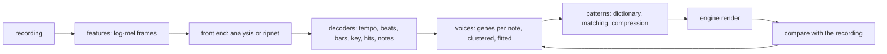

# Rip design

Decision record and working design for the rip: the engine's estimate of a
recording in its own vocabulary, voices, patterns, a key and a tempo, that a
player can edit and the sequencer can play. [Audio §11](audio.md#11-ripping-a-recording)
describes what runs today; this document is where it is going and why.

## 1. Purpose

A recording comes in; what comes out is what soundlab could have authored: the
tonal voices the notes were played with, the drum hits and the notes as patterns
on the sixteenth grid, the key, the chord each bar leans on, and the tempo. The
engine is the ground truth of its own vocabulary, so a rip is good when the engine
playing its output sounds like the recording, and that is the loop everything
below closes.

## 2. Stages

1. **Features.** `MelFrames` makes the log-mel frames a model hears: the rip's own
   grid, 22.05 kHz, 93 ms windows every 11.6 ms, eighty bands from 30 Hz up, the
   recording's peak at one. The built-in analysis works from the same spectrogram,
   split into a harmonic and a percussive part by medians. Features are computed
   in Go on both sides of training, so the model sees in soundlab exactly what it
   saw in the trainer.
2. **Front end** (`RipFrontEnd`). It hears a recording into `RipFrames`: the
   strength of any onset, of each drum's, each pitch's salience, each register's
   chroma, and, from a model, the wave and voice genes the note under each frame
   is played with. Two front ends fill it: `analysis`, the package's signal
   processing, and `ripnet`, a transformer over the mel frames whose heads are
   those fields. The seam is the frames, so the decoders never know which heard.
3. **Decoders.** Classical, shared, cheap and explainable: tempo by
   autocorrelation under a prior, beats by dynamic programming, the bar line by
   the kick, the snare on two and four, the key's root in the bass and the
   chroma's change, the key and chords by chroma, hits by peak picking, notes by a
   Viterbi path through the salience, cut and quantized to the grid with the
   notes' median lag against the beats taken out, the recording's tuning read
   first so the pitch table sits where its notes do, a pickup bar opened before
   the first full bar when sound leads into it, the bass
   register's salience from a window four times the rip's and the rip's own
   together (the long one's semitones at 110 Hz, the short one's onsets), the
   melody register twice, the second path with the first's notes and their partials
   cancelled and its notes kept above a share of the first's strength, so two
   voices in one register are heard where one path heard the louder, the two
   lines kept from crossing by pitch order, so a held dyad is not a trill
   between them. `RipParams` holds their thresholds as data a search tunes
   (`tune`).
4. **Voices.** Each note carries the genes the front end heard it played with
   (`VoiceDef.Genes`, thirty-two parameters in [0, 1] on perceptual scales, and a
   wave class); a register's notes average into one voice. A register the front
   end heard no voice for, every register under the built-in analysis, gets one
   fitted by analysis-by-synthesis (soundlab's `rip`, and `fit` again with more
   generations): the rip's transcript (`Rip.Notes`) gives the register's longest
   and loudest notes, the engine renders a candidate voice at each note's pitch,
   loudness and length at the recording's tuning (`RenderNoteAt`), the render's
   mel frames are compared with the recording's around the note (`MelDistance`), and a search over the
   thirty-two genes and the wave, seeded with every registered voice and run
   under an adaptive step with its evaluations cached, closes the distance. The
   recording around a note holds the other voices too, so the fit is to the mix
   there; a trained front end narrows that. The melody register's second line
   gets a voice of its own (`Rip.UnderVoice`), fitted to its notes alone, so a
   violin under a pluck is not played through the pluck's voice. Next, notes
   cluster by their genes into as many voices as a line has. The model
   proposes; the engine disposes.
5. **Patterns and the dictionary.** Notes and hits fall into bars. `rip` writes
   windows of up to four bars as patterns, the estimate heard first; `compress`
   writes the dictionary: per part (beat, melody, bass) the bars that stand for
   the others, each a pattern of one bar (`<name>_<part>_a`, `_b`, ...), and the
   song, which bar plays which at the recording's tempo, key and tuning
   (`SongDef`, a `[[song]]` in the pattern document). Matching assigns each bar to a member: today by `BarDistance`, the
   steps two bars do not share over the steps either has, a hit by drum and step
   and a note by step and pitch, an accidental keeping a note off the key; next by reconstruction, the rip of the
   member's render against the bar's.
6. **Compression.** Bars within a threshold of one another, a few per cent of
   their steps, merge into one member. The mechanical pass runs first
   (`Cluster`: each bar its own group, the two nearest groups merged by their
   mean distance while it holds within the threshold, the medoid standing for
   each), then a search over the assignment refines it: a genome of each bar's
   representative under `CategoricalPerturbator`, scored by the representatives
   in use, heavily by any bar farther from its own than the threshold and
   lightly by the mean distance, seeded with the mechanical answer and taken only
   when better. On the sample recording the search rarely beats the greedy pass
   under this distance; it earns its place when the distance is reconstruction,
   which is why it is there.
7. **The loop.** The song is rendered (`RenderTimeline`) and ripped back on its
   own grid (`Ripper.Grid`: the tempo and the downbeat pinned, the decoders of
   both skipped), since the tempo decoder hears a clean render of
   sixteenth-dense patterns a metrical level away as readily as the recording
   (the sample's 86 bpm came back as 115) and the bar-line decoder a beat late
   when the render's downbeat carries no kick; that rip is compared with the
   recording's (`CompareRips`), and the score `compress` prints is how much of
   the rip survives as the song, drums, melody and bass apart: a grade of the
   fitted voices and the dictionary, with those decoders graded by `tune`.
   `refine` then moves the voices and the steps in turn, judged not by that
   rip-back, which cannot see the rip's own mistakes (a note misheard in the
   recording is misheard the same way in the render), but by `Fidelity`: the
   render and the recording heard through one front end (`Ripper.Sound`), their
   pitch salience, log-mel bands and onset strength compared bar by bar on each
   one's own beats. The voices are searched by the genetic engine; the steps
   are swept, each tried a semitone and an octave either way and silent, the
   best move kept when it gains, since a move touches one note's frames in a
   thousand and a search over every step's genes at once saw nothing of it in
   its budget; a round is one search and one sweep, until a round gains
   nothing. Next, the model hearing the render too, so
   its voice estimate of the render against its estimate of the recording is a
   second, cheaper distance for the voice search.

The output is a sound document of voices, a pattern document of patterns and the
song, which bar plays which at what tempo and in what key. The song is the form
the engine lacked, the conductor placing patterns by tier, not by bar; soundlab
plays one through the live sequencer (`song <name> play`), each bar's patterns
scheduled to land on its bar line while the one before plays, and renders one
offline (`song <name> <file.wav>`).

## 3. Learning

- **Corpus.** The engine renders it (`corpus`): loops of the registered rhythm,
  melody and bass patterns across tempos and keys, each with its WAV, its mel
  frames and its events in frames, with the wave and genes of the voice each note
  was played with. Labels cost nothing and are exact. What it lacks, in order of
  need: a mix, a room and a codec between the render and the frames (impulse
  convolution, noise, equalisation, a low-pass), voices beyond the shipped five
  (random genes), chance steps as optional targets, and real recordings with
  hand-checked notes held out for validation, so neither a model nor a tuned set
  learns the synthesizer.
- **Augmentation.** `corpus ... aug` puts a room and a mix behind each loop, a
  gain, a one-pole low-pass, a Schroeder reverb and a noise floor drawn per
  loop, redraws each tonal track's voice near the registered one, a third of
  the time on another wave, labelled as played, drives a third of the loops
  into a soft clip, the saturation a mix is thickened with, which piles
  harmonics on every note and sum and difference tones between notes, and
  renders the loop off A440 by up to a quarter tone either way (`SetTuning`),
  since recordings are and the sample is forty cents flat; `gen` draws beats, melodies
  and bass lines from the key for three loops in five per part, since the bank
  alone repeats its few melodies and a model trained on it learns them, not
  pitch. Both draw from streams of their own, so a loop's bank patterns and key
  are the same with and without them.
- **Model.** `ripnet.Spec`: eighty bands in, width 128, four heads, four layers,
  feed-forward 512, a window of 64 frames either side, about 800 thousand
  weights; heads for the onset, the three drums, the sixty-nine pitches, voicing,
  the five waves and the thirty-two genes. Attention carries ALiBi biases, a
  slope per head on the frame distance, so the model has no positions to learn
  and generalises past the training window. `tool/rip-train` is its PyTorch
  twin and writes the weight file `pkg/transformer` loads; the instructions are
  its README.
- **Inference** is pure Go, float32, no CGO, the same on every host. A
  three-minute song costs about a GFLOP per layer at the default width: seconds
  on a desktop core, under a minute on a phone, and the width and depth are the
  file's to choose. The analysis stays the default front end: soundlab hears
  with the model when the first root holds `audio/ripnet.bin`.

## 4. Layout

- `pkg/audio`: the rip, its parameters, the decoders, the built-in analysis,
  the features, the truth (`ExpectedRip`, `ExpectedEvents`) and the score
  (`CompareRips`), the offline renders (`RenderMusic`, `RenderTimeline`,
  `RenderNote`), the distances (`MelDistance`, `BarDistance`), the mechanical
  clustering (`Cluster`) and the song (`SongDef`). Imports only `toml`. The
  searches stay out of it, so it stands alone.
- `pkg/audio/ripnet`: the learned front end, `Spec` and `Hear`. Imports `audio`
  and `transformer`, and goes with `audio` to its module.
- `pkg/transformer`: inference over frames and the weight file. Standard
  library only, its own module when the time comes.
- `pkg/genetic`: the searches, over `RipParams`, over voice genes and over
  bar-to-pattern assignments, with seeds, a schedule, a checkpoint, a cache and
  a categorical operator for them. Standard library only.
- `internal/soundlab`: the verbs that drive it all (`rip`, `fit`, `compress`,
  `song`, `render`, `corpus`, `tune`), the documents the results land in, and
  the files overlay (`^O`) that loads, rips and saves them.
- `tool/rip-train`: the trainer, Python, outside the module.

## 5. Budgets and determinism

The analysis runs about forty-five times real time on one desktop core, the model
adds seconds per minute of audio at the default width, and memory is a few floats
per frame per pitch: tens of megabytes for a song. Every render and draw is
seeded, the searches run on fixed streams, and the model is float32 arithmetic in
a fixed order, so a rip of one recording with one weight file and one parameter
set is the same rip on every host.

## 6. What `pkg/genetic` gave the searches

The voice fit and the dictionary matching asked for what the parameter search
did not, and the generational engine now has it:

- assignment genomes: a `[]int` of each bar's representative under
  `CategoricalPerturbator`, which moves an element to another of its categories,
  and `UniformCombiner` over ints; a move, a swap, a split and a merge are all
  reachable by it, and the size term in the score does the merging, so the
  dedicated operators waited and were not missed;
- the fitness with a size term and a constraint is a scalarization in soundlab's
  `compress`, not a `fitness` bundle: three terms, one line, and a search that
  changes its distance changes that line;
- an adaptive step: `SetSchedule` with `AdaptiveStrength`, the one-fifth rule,
  so the voice fit widens its step while it improves and narrows while it stalls;
- evaluation caching: `Memoize` wraps an evaluator with a cache by genome key,
  safe under parallel scoring, so a render is paid once per candidate;
- a checkpoint for the batch engine: `Checkpoint` and `Restore` carry the pool,
  the history, the knobs in force and the random stream's position, and a
  restored run ends where an unbroken one ends;
- seeding from several candidates: `SetSeeds` opens the first generation with
  them, every registered voice for the fit, the mechanical grouping for the
  matching.

What it does not have and may yet need: a covariance step (CMA-ES) if the voice
fit stalls on correlated genes once its distance is the model's, and a
reconstruction-scored matching that renders per candidate, where `Memoize`
and the checkpoint earn their keep.

## 7. Plan

1. Done: the analysis and the decoders; parameters as data and their search; the
   offline render, the truth and the score; the transformer, `ripnet`, the corpus
   and the trainer; the genetic additions; the voice fit by analysis-by-synthesis;
   the dictionary, matching and compression; the song document, rendered offline
   and conducted live; the song's score against the rip; the augmented corpus, a
   first training run and `bench`; the refinement loop (`refine`), voices and
   steps refined in turn; the seventh pass, where the sample was misheard
   upstream of everything: the recording's tuning read first, a pickup bar,
   the notes' lag, accidentals on steps, and `refine` judged by `Fidelity`
   with the steps' pitches among its moves.
2. Next: the model's pitch, where four runs have left it behind the analysis
   while its drums pulled ahead: a detuned corpus (the loops rendered at
   random offsets from A440, as recordings are) so the front end learns what
   the analysis now measures, and more loops and steps, the held-out loss
   still falling at 20000; the step sweep's cost, five renders a step, once
   songs grow past a few bars; the matching scored by reconstruction;
   several voices in a register, clustered by their genes; the false drums
   gated by a harmonic check or by the model.
3. Then: real recordings in the corpus, tuned parameters and weights shipped as
   data, and the rip on Android under the mobile budget.

## 8. Measured on the sample recording

`lixenwraith/scratch`'s `one_more_bite_intro.wav` through the built-in analysis,
the voice fit, the dictionary and the song, nine seconds on four cores:

- The rip: 86 bpm, A# harmonic minor, three full bars from 2.52 s, 25 notes a
  register, and 19 kicks, 36 snares and 2 hats in a clip with no drums, the
  bass's and the plucks' attacks ([todo](todo.md#tune-the-rip)).
- The fit: six notes a register, twelve generations of twenty-four seeded with
  the shipped five; the melody's voice modal at mel distance 0.107 against the
  best seed's 0.127, the bass's modal at 0.102 against 0.142.
- The dictionary: three bars into eight one-bar patterns, the same under a
  threshold of 5 and of 25 per cent; three bars have nothing to compress, and
  the assignment search never beat the greedy grouping under `BarDistance`.
- The score, the rip of a render on its own grid against the recording's rip:
  the windows through the shipped voices melody 0.64, bass 0.89; through the
  fitted voices 0.75 and 0.58; the song with its drums 0.60, 0.39, drums 0.56;
  without them 0.78 and 0.58. The fitted melody voice rips back better than the
  shipped lead, the fitted bass worse than the shipped bass, fitted as it was to
  the mix around the low notes; the false drums, played, mask the bass.
- Before the grid was pinned every render ripped back at 115 bpm, a dotted
  eighth for the beat, and a beat late: two decoder faults the score of the
  compression must not carry, and two faults a real recording still pays for.
- The third pass, `rip ... nodrums` so the false drums stay out: the song rips
  back at 0.66 (melody 0.90, bass 0.79, drums 0 for the kicks the bass's
  attacks still read as). `refine` over two rounds, each register's voice
  searched by that score with the fitted voice and the shipped ones as seeds,
  then the steps: 0.66 to 0.87 in the first round, all of it from the voices
  (melody 0.66 to 0.80, bass to 0.87), 0.88 in the second, the steps' search
  adding nothing either time. Four minutes on four cores. A voice that rips back
  well is one the analysis hears the same notes from and no drums in, which is
  not the same as the one nearest the recording's spectrum; the ear decides
  between `bite_fit.wav` (the mel fit) and `bite_refined.wav` (the score fit).
- The first training run: 120 augmented loops of four bars from the shipped
  bank, `ripnet.Spec` at 818 thousand weights, 3000 steps of batch 8 in twenty
  minutes on four CPU cores, the loss from 4.8 to 0.44 and the pitch head's
  still falling. `bench 12 4` on fresh loops, total then tempo, bars, drums,
  melody, bass: the analysis on clean loops 0.49 (0.75, 0.79, 0.51, 0.18,
  0.50), the model 0.48 (0.83, 0.85, 0.63, 0.06, 0.27); on augmented loops the
  analysis 0.45 (0.75, 0.75, 0.54, 0.11, 0.31), the model 0.47 (0.83, 0.88,
  0.67, 0.05, 0.16). The model already hears onsets and drums better than the
  analysis and holds up under the room and the mix where the analysis drops;
  its pitches are far behind, which is the head with the most classes and the
  least training. The shipped bank's few melodies cap what a corpus can teach:
  more patterns and more steps before the model is trusted with a melody.
- The bass read from a window four times longer: the loop test's melody rises
  from 0.92 to 0.95 and its bass holds at 1, the sample's bass notes last two
  to four steps where they flipped every step between A#2 and A2, and the
  pinned grid stops reading a bass note a step early once the long window's
  reading is held to the short window's timing (the geometric mean of the two;
  the long one alone read onsets early) and the grid takes the two-frame lead
  the centred windows give every event. A sustained pad under the loop's melody
  still moves the key estimate, G and B outvoting E, and the rip's own key then
  snaps the F to E: the pad test's melody number says that, not the paths.
  With the partials of the bass's near-equal neighbour cancelled as well, the
  A3 and A#3 the sample's melody carried at the bass's octave on its first
  steps are gone: 30 melody notes where the fourth pass had 36, the six that
  went the bass's.
- The fourth pass, the melody register tracked twice: the sample's melody has 36
  notes where one path had 25, nine steps carrying two; the song rips back at
  0.76 through the mel-fitted voices and 0.86 after two rounds of `refine`,
  the second line costing the melody's own self-consistency (0.67 against
  0.90), since two notes on a step through one voice do not rip back as two.
  On a render with a sustained pad under the test loop's melody the second pass
  finds eight of the pad's sixteen notes where one path found none, the first
  of each bar and seldom the second, which the first path's note on the same
  pitch a fifth below the bass's partial has already spent. None of the
  sample's 36 notes is longer than three steps where the violin holds six to
  twelve: the path flips between the semitone bins a vibrato crosses, the next
  decoder item ([todo](todo.md#tune-the-rip)).
- The second training run, 300 loops with generated parts and the room and
  mix, 12000 steps of batch 8 in an hour and a half on four CPU cores, the
  training loss down to 0.31 and the pitch head's to 0.15: worse on fresh
  loops than the first run and than the analysis. `bench 12 4`, whose loops
  now carry generated parts: the analysis 0.47 on clean loops (tempo 0.75,
  bars 0.75, drums 0.52, melody 0.17, bass 0.39) and 0.46 augmented; the
  model 0.40 (0.67, 0.71, 0.50, 0.11, 0.18) and 0.38 (0.58, 0.73, 0.53, 0.07,
  0.13). Each loop was seen about three hundred times: the model learned the
  corpus, not the music. The trainer now holds loops out, scores them as it
  goes and exports the step whose decoder heads scored best on them; the
  number that matters is the held-out loss, not the training loss, and `bench`
  after it. A 6000-step run with thirty loops held out showed the held-out
  loss near 3.6 against a training loss near 1.0 by step 2000, the wave head
  learning each loop's voice by heart and the pitch head's held-out loss not
  moving from 0.73: with hundreds of loops of random voices and rooms there is
  too little to generalise from, so the next run takes thousands of loops,
  each seen a few times.
- The third run, 3000 loops with generated parts and the room and mix, sixty
  held out, 6000 steps of batch 8 in forty minutes on four CPU cores, each
  loop seen sixteen times: the held-out decoders' loss falls the whole way,
  1.79 at step 1000 to 1.48 at 6000, the pitch head's 0.61 to 0.51, and the
  last step is the one exported. `bench 12 4`: the analysis 0.47 on clean
  loops (tempo 0.75, bars 0.75, drums 0.52, melody 0.17, bass 0.39), the model
  0.44 (0.67, 0.75, 0.59, 0.11, 0.25); augmented, the analysis 0.46 (0.83,
  0.81, 0.50, 0.16, 0.27), the model 0.45 (0.75, 0.77, 0.65, 0.11, 0.08). The
  model is within three hundredths of the analysis overall, ahead on drums,
  behind on pitch, and still improving when the run ended: more loops and more
  steps are the next lever, not another head. The sample through it: 115 bpm,
  F major, five bars from 0.79 s, 38 melody and 15 bass notes; the song rips
  back at 0.36 and 0.57 after two rounds of `refine`, against the analysis
  path's 0.59 and 0.88. The analysis path stays the sample's better transcript.
- The sixth pass, the second melody line with steps, a track and a voice of
  its own: the sample's melody has 25 notes in its first line and 5 in the
  second, the bass 14; the mel fit gives the lines a square, a modal voice and
  a modal bass, the song rips back at 0.54 through them and 0.88 after two
  rounds of `refine`, each of the three voices searched in turn. The line's
  own voice is what a violin under a pluck needed; what the first line still
  mixes is two instruments taking turns as the louder.
- The sample through that model (`bite_model_*` on the scratch branch): 115 bpm
  where the analysis heard 86, F major where it heard A# harmonic minor (its
  fifth), four bars from 1.66 s, 19 melody and 21 bass notes; the song rips
  back at 0.45 through the mel-fitted voices and 0.63 after two rounds of
  `refine`, against the analysis path's 0.66 and 0.88. The model's transcript
  is the weaker one today, as `bench` said it would be; the loop lifts either.

- The fourth run, 20000 loops with generated parts, the room and the mix,
  frames and labels only (`nowav`), 200 held out, 20000 steps of batch 8 in
  two hours and three quarters on four CPU cores shared with the day's other
  work, each loop seen eight times: the held-out decoders' loss falls from
  1.74 at step 1000 to 1.04 at 20000 (the pitch head's 0.60 to 0.40) and is
  still the best at the last step, so the run was not long. `bench 12 4`
  through the seventh pass's analysis: the analysis 0.49 on clean loops
  (tempo 0.75, bars 0.85, drums 0.50, melody 0.20, bass 0.40), the model
  0.45 (0.58, 0.81, 0.54, 0.17, 0.34); augmented, the analysis 0.48 (0.83,
  0.88, 0.50, 0.17, 0.28), the model 0.51 (0.83, 0.88, 0.73, 0.11, 0.20).
  The model passes the analysis for the first time, on the loops with a room
  and a mix, on the strength of its drums; it loses the clean loops on tempo
  and both on pitch, and the analysis itself gained two hundredths from the
  seventh pass. The sample through it (`bite_model_*` on the scratch branch):
  115 bpm, F major, six bars with a pickup bar from 1.94 s before the
  recording, 21 melody notes with 27 under and 24 bass notes; the song sounds
  0.57 like the recording before `refine` and 0.67 after two rounds (pitch
  0.80, timbre 0.51, onset 0.71), ripping back at 0.66 and 0.71, against the
  analysis path's 0.75 and 0.81 by fidelity and 0.87 and 0.89 by rip-back. The
  weights stay out of the tree: a front end that wins on drums and loses on
  pitch, and hears a clip forty cents flat at A440, is not yet the rip's
  better ear.
- The seventh pass, the sample heard on its own tuning: the transcript's note
  list (soundlab's `notes`) showed A#2 taking turns with A2 in sixteenths, G2
  with G#2 at the chord change, C5 with C#5 in the lead, ten melody notes
  before the first bar line dropped, and harmonic minor for a scale only the
  wobble's leakage voted for. A histogram of the spectral peaks' offsets from
  the nearest semitone put the recording 41 cents flat of A440, three quarters
  of the weight at one offset: every pitch sat between two salience rows, and
  no decoder downstream could have repaired that. With the tuning read first,
  a pickup bar from 0.45 s before the recording and the notes' lag taken out,
  the rip is A# minor at 86 bpm, four bars, 88 notes, 42 steps in the melody's
  first line, 27 in the second and 9 in the bass; the bass is a held A#2, C#3
  and G#2 line where it was 25 wobbling fragments, the lead holds notes for
  three and four steps, and 3 notes sit off the key where 10 did, kept as
  accidentals. The song sounds 0.75 like the recording before `refine` (pitch
  0.81, timbre 0.69, onset 0.73) and rips back at 0.87 without a kit on either
  side; two rounds judged by fidelity lift it to 0.81 (0.83, 0.74, 0.86) and
  the rip-back to 0.89 (melody 0.70, bass 0.80), all of it from the voices:
  the step search, 312 genes over six generations of twelve, kept no move in
  either round, so the moves or the budget are the next question there. The
  rip-back is no longer what `refine` maximizes and still passes the sixth
  pass's 0.88, which a voice could game with attacks the analysis heard the
  same notes from; the judge and the self-grade agree on this clip.

## 9. Decisions

- **The decoders stay classical.** Tempo, beats and note cutting are solved
  problems with cheap, inspectable solutions; a model earns its place at the
  perceptual front end, where hand-made features fail on real instruments.
- **Features are computed in Go for training too.** A second implementation of
  the mel frames would have to match bit for bit; the corpus carries the frames
  Go made instead.
- **Relative positions by ALiBi, windows by a band.** No learned positions, no
  limit from the training length, attention cost linear in the recording.
- **Voices as genes.** One vector serves the model's regression head, the
  search's genome and the document, on the scales the ear hears.
- **The engine labels its own corpus.** Exact labels for free, with the
  synthesizer's domain as the cost to pay down with augmentation and held-out
  recordings.
- **The model is optional.** The analysis ships and works everywhere; a weight
  file in the root upgrades the hearing without a build.
- **Pure Go inference.** No CGO, no runtime to ship, the same path on the
  desktop, the browser and the phone.
- **The searches live in soundlab.** `pkg/audio` holds the primitives, a render,
  a distance, a mechanical grouping, and `pkg/genetic` the engine; soundlab
  joins them, so `audio` goes to its own module without `genetic`.
- **The song is a document.** `[[song]]` beside the patterns, names not ids, a
  tempo and a key of its own, so a ripped song is edited, saved and played like
  anything else authored, and the conductor's tiers stay the game's.
- **The score is the rip of the render.** A song is as good as the rip it rips
  back to; the same `CompareRips` grades a parameter set, a model and a
  compression, so their numbers compare.
- **The judge is the recording itself.** The rip-back is blind to the rip's
  own errors, so a search on it polishes a wrong transcript; `refine` judges a
  render by `Fidelity`, its frames against the recording's through one front
  end, so a wrong note costs what the ear hears, and the rip-back stays the
  number that compares across passes.
- **Accidentals, not a chromatic scale.** A step keeps its degree in the key
  and carries the semitones left as `acc`, so the harmony, the chord following
  and the editor's rows keep their meaning while a transcript loses no note.
- **The front end reads the tuning.** A440 is an assumption a recording need
  not share: forty cents off put every pitch of the sample between two salience
  rows, and no decoder downstream could have repaired the wobble that made.
  And the engine renders at it: a song played at A440 beside a recording forty
  cents flat sounds sharpened, a stretched string, before any note is judged.
- **Voices do not cross.** The louder of two concurrent notes changes hands
  from frame to frame, so the first and second paths swap a held dyad between
  them; assigned by pitch order, the upper line stays the upper, which is how
  the ear parts them.
