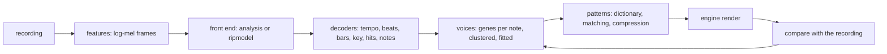

# Rip design

Decision record and working design for the rip: the engine's estimate of a
recording in its own vocabulary, voices, patterns, a key and a tempo, that a
player can edit and the sequencer can play. [Audio library
§9](../pkg/audio/doc/audio.md#9-ripping-a-recording) describes what runs today;
this document is where it is going and why.

## 1. Purpose

A recording comes in; what comes out is what soundlab could have authored: the
tonal voices the notes were played with, the drum hits and the notes as patterns
on the sixteenth grid, the key, the chord each bar leans on, and the tempo. The
engine is the ground truth of its own vocabulary, so a rip is good when the engine
playing its output sounds like the recording, and that is the loop everything
below closes.

## 2. Stages

1. **Features.** `MelFrames` makes the log-mel frames a model hears: the rip's own
   grid, 22.05 kHz, 93 ms windows every 11.6 ms, 229 bands from 30 Hz up, under a
   semitone apart from A3, the
   recording's peak at one. The model reads each band on a true logarithm, in dB
   over a floor 80 dB down less the frame's mean, and the mean as one more input:
   a frame's loudness apart from a level-free shape, the cepstrum's amplitude
   normalization, so a phrase 20 dB softer reaches it as clearly (`log1p(100 ×
   energy)`, the frames' stored form, kept 0.3% of a loud note's contrast for
   notes 18 dB down, the log 59%). The built-in analysis works from the same
   spectrogram, split into a harmonic and a percussive part by medians. Features
   are computed in Go on both sides of training, so the model sees in soundlab
   exactly what it saw in the trainer.
2. **Front end** (`RipFrontEnd`). It hears a recording into `RipFrames`: the
   strength of any onset, of each drum's, each pitch's salience, each register's
   chroma, and, from a model, the wave and voice genes the note under each frame
   is played with and how surely each pitch is struck there. Two front ends fill it: `analysis`, the package's signal
   processing, and `ripmodel`, a transformer over the mel frames whose heads are
   those fields. The seam is the frames, so the decoders never know which heard.
3. **Decoders.** Classical, shared, cheap and explainable: tempo by
   autocorrelation under a prior, beats by dynamic programming, the bar line by
   the kick, the snare on two and four, the key's root in the bass and the
   chroma's change, the key and chords by chroma, hits by peak picking, notes by a
   Viterbi path through the salience, cut and quantized to the grid with the
   notes' median lag against the beats taken out, the recording's tuning read
   first so the pitch table sits where its notes do, a pickup bar opened before
   the first full bar when sound leads into it, the bass
   register's salience from a window four times the rip's and the rip's own
   together (the long one's semitones at 110 Hz, the short one's onsets), the
   melody register as two lines at once, a hidden path over pairs of pitches
   where each line pays its own costs of moving and of starting or ending, no
   pair a unison, a semitone or a harmonic interval apart, and the first line
   paying `cross` a frame to be the quieter, so it is the line the ear follows
   and the second the one under it, through a crossing or a rest shorter than
   changing places would cost; the second line's notes are kept above a share
   of the register's strength. The decoder follows the louder line, and the
   lead is often the softer, so the notes are parted again into two lines by
   what a line keeps, its pitch from note to note, the length of its notes,
   their strength and no two at once, and the lead is the line a rule names,
   the busier by default (`Ripper.Lead`). From a front end that hears
   each pitch struck, the melody register's notes are read from the strikes
   instead: a note starts where its pitch's strike peaks over `strike`, as hard
   as the model heard it struck, and lasts while its salience holds, until the
   model hears it let go over `release` or until it is struck again over
   `strike_again`, any number at once, so the notes a pedal leaves ringing do
   not hide the next one struck, which a path through the salience, preferring
   what sounds strongest, stays on; the lines are parted from them as before.
   A pitch let go rings on as far as this goes: while its salience holds only
   the higher bar starts it again. A new note's attack sets off strikes on the
   pitches still ringing, weaker
   ones across the register and as sure as its own a semitone or a tone away,
   so a ringing pitch is renewed only over the higher bar and by the surest
   strike within a tone. A strike starts no note when its pitch
   never sounds strongly (`strike_hold` of the reference within the shortest
   note), when a stronger strike in the register within two frames sits an
   octave, a twelfth or two octaves under it (a partial of that note), or when
   it follows the pitch's last within `strike_gap`. The bass is decoded up to A3, over
   the melody's lowest rows, which count for three quarters against the bass
   rows' own reference; a reached note the bass line does not continue, its
   nearest other bass note more than an octave away, is not the bass's, and a
   note both registers hear goes to the line it continues, the one whose
   nearest other note is nearer in pitch, the bass when they tie. `RipParams`
   holds their thresholds as data a search tunes (`tune`).
4. **Voices.** Each note carries the genes the front end heard it played with
   (`VoiceDef.Genes`, thirty-two parameters in [0, 1] on perceptual scales, and a
   wave class); a register's notes average into one voice. A register the front
   end heard no voice for, every register under the built-in analysis, gets one
   fitted by analysis-by-synthesis (soundlab's `rip`, and `fit` again with more
   generations): the rip's transcript (`Rip.Notes`) gives the register's longest
   and loudest notes, the engine renders a candidate voice at each note's pitch,
   loudness and length at the recording's tuning (`RenderNoteAt`), the render's
   mel frames are compared with the recording's around the note (`MelDistance`), and a search over the
   thirty-two genes and the wave, seeded with every registered voice and run
   under an adaptive step with its evaluations cached, closes the distance. The
   recording around a note holds the other voices too, so the fit is to the mix
   there; a trained front end narrows that. The melody register's second line
   gets a voice of its own (`Rip.UnderVoice`), fitted to its notes alone, so a
   violin under a pluck is not played through the pluck's voice. Next, notes
   cluster by their genes into as many voices as a line has. The model
   proposes; the engine disposes.
5. **Patterns and the dictionary.** Notes and hits fall into bars. `rip` writes
   windows of up to four bars as patterns, the estimate heard first; `compress`
   writes the dictionary: per part (beat, melody, bass) the bars that stand for
   the others, each a pattern of one bar (`<name>_<part>_a`, `_b`, ...), and the
   song, which bar plays which at the recording's tempo, key and tuning
   (`SongDef`, a `[[song]]` in the pattern document). Matching assigns each bar to a member: today by `BarDistance`, the
   steps two bars do not share over the steps either has, a hit by drum and step
   and a note by step and pitch, an accidental keeping a note off the key; next by reconstruction, the rip of the
   member's render against the bar's.
6. **Compression.** Bars within a threshold of one another, a few per cent of
   their steps, merge into one member. The mechanical pass runs first
   (`Cluster`: each bar its own group, the two nearest groups merged by their
   mean distance while it holds within the threshold, the medoid standing for
   each), then a search over the assignment refines it: a genome of each bar's
   representative under `CategoricalPerturbator`, scored by the representatives
   in use, heavily by any bar farther from its own than the threshold and
   lightly by the mean distance, seeded with the mechanical answer and taken only
   when better. On the sample recording the search rarely beats the greedy pass
   under this distance; it earns its place when the distance is reconstruction,
   which is why it is there.
7. **The loop.** The song is rendered (`RenderTimeline`) and ripped back on its
   own grid (`Ripper.Grid`: the tempo and the downbeat pinned, the decoders of
   both skipped), since the tempo decoder hears a clean render of
   sixteenth-dense patterns a metrical level away as readily as the recording
   (the sample's 86 bpm came back as 115) and the bar-line decoder a beat late
   when the render's downbeat carries no kick; that rip is compared with the
   recording's (`CompareRips`), and the score `compress` prints is how much of
   the rip survives as the song, drums, melody and bass apart: a grade of the
   fitted voices and the dictionary, with those decoders graded by `tune`.
   `refine` then moves the voices and the steps in turn, judged not by that
   rip-back, which cannot see the rip's own mistakes (a note misheard in the
   recording is misheard the same way in the render), but by `Fidelity`: the
   render and the recording heard through one front end (`Ripper.Sound`), their
   pitch salience, log-mel bands and onset strength compared bar by bar on each
   one's own beats. The voices are searched by the genetic engine; the steps
   are swept, each tried a semitone and an octave either way, the recording's
   strongest pitch at its step, a step earlier and later, longer and shorter,
   and silent, judged on the bars that play its pattern, the best move kept
   when it gains, since a move touches one note's frames in a thousand and a
   search over every step's genes at once saw nothing of it in its budget;
   then a step a line leaves empty tries that strongest pitch, the one way in
   for a note the rip missed; a round is one search and one sweep, until a
   round gains nothing. Next, the model hearing the render too, so
   its voice estimate of the render against its estimate of the recording is a
   second, cheaper distance for the voice search.

The output is a sound document of voices, a pattern document of patterns and the
song, which bar plays which at what tempo and in what key. The song is the form
the engine lacked, the conductor placing patterns by tier, not by bar; soundlab
plays one through the live sequencer (`song <name> play`), each bar's patterns
scheduled to land on its bar line while the one before plays, and renders one
offline (`song <name> <file.wav>`).

## 3. Learning

- **Corpus.** The engine renders it (`corpus`): loops of the registered rhythm,
  melody and bass patterns across tempos and keys, each with its WAV, its mel
  frames and its events in frames, with the wave and genes of the voice each note
  was played with. Labels cost nothing and are exact. What it lacks, in order of
  need: a mix, a room and a codec between the render and the frames (impulse
  convolution, noise, equalisation, a low-pass), voices beyond the shipped five
  (random genes), chance steps as optional targets, and real recordings with
  hand-checked notes held out for validation, so neither a model nor a tuned set
  learns the synthesizer. The generative lead is left out: the sequencer writes
  its notes bar by bar as it plays, so no label read off the pattern holds them.
- **Augmentation.** `corpus ... aug` puts a room and a mix behind each loop,
  drawn per loop: a gain and a swell of up to 6 dB, for half the loops a
  one-pole low-pass at 4 to 11 kHz, two equaliser bands within 6 dB from 80 Hz
  to 8 kHz, for a third a soft clip (drive 1.5 to 3.5), the saturation a mix is
  thickened with, which piles harmonics on every note and sum and difference
  tones between notes, for half a compressor, a booth's Schroeder reverb or for
  a third a hall's, and for half a noise floor 40 to 65 dB down, a loop past
  full scale turned down rather than clipped. It redraws each tonal track's
  voice near the registered one, a third of the time on another wave, in a
  third of the loops with every release but the bass's three to ten times as
  long, a pedal's ringing, all labelled as played, and renders the loop off
  A440 by up to a quarter tone either way (`SetTuning`), since recordings are
  and the sample is forty cents flat; `gen` draws beats, melodies
  and bass lines from the key for three loops in five per part, since the bank
  alone repeats its few melodies and a model trained on it learns them, not
  pitch, and for three loops in five an accompaniment in the free slot, a
  broken chord in eighths or sixteenths changing pitch from note to note under
  a melody that is a slow line of longer notes in half the loops: the texture
  of the sample recording, a lead over an arpeggio, which the rip has to part.
  A third of the generated melodies and accompaniments play half their length
  6 to 18 dB softer, as a phrase played softly, and `codec` sends a third of
  the loops through Opus, MP3 or AAC and back. Some voices are driven hard, as a
  guitar through an amp. A generated loop leaves out its drums three times
  in ten and its bass once in seven, so a line is heard bare too. Both draw
  from streams of their own, so a loop's bank patterns and key are the same
  with and without them.
- **Harness.** `tool/rip-train/pipeline.sh` runs the corpus, the training, the
  bench and the install with every knob an environment variable, the corpus in
  `PARTS` exports at once, each keeping the loops already on disk, and a focus
  script run before the corpus turns a run toward a kind of music (`focus/`:
  vocals as lines, plucked instruments); a training round spreads a run over
  several machines, shards from one start averaged into the next (`shard`,
  `merge`); `tool/rip-train/README.md` is the guide. A voice carries a vibrato and a vowel's formants for the vocal focus,
  neither a gene, kept by the augmentation when it draws voices near a
  registered one.
- **Model.** `ripmodel.Spec`: 230 inputs (229 bands and the level), width 256, eight heads of 32,
  four layers, feed-forward 1024, a window of 64 frames either side, 3.2
  million weights (12.8 MB), four times the first five runs' width 128 and four
  heads; heads for the onset, the three drums, the sixty-nine pitches, voicing,
  the five waves, the thirty-two genes, and the sixty-nine pitches struck, let
  go, and how hard each was struck. Attention carries ALiBi biases, a
  slope per head on the frame distance, so the model has no positions to learn
  and generalises past the training window. A file may put convolutions over
  frames and bands before the input layer, each pooled over the bands
  (`transformer.Conv`), and split the layers into towers over the shared input
  layer, each computing a run of the heads (`transformer.Tower`), so the drums
  need not share the pitch's layers. `tool/rip-train` is its PyTorch
  twin and writes the weight file `lixenwraith/transformer` loads
  ([format](https://github.com/lixenwraith/transformer/blob/main/doc/format.md));
  the instructions are its README.
- **Inference** is pure Go, float32, no CGO, the same on every host to float32
  rounding. A three-minute song is 15500 frames, 26 GFLOP a layer at the
  default width: 70 seconds on one core of a 2017 laptop's i7-7700HQ, against
  20 at width 128, and the width and depth are the file's to choose. The analysis stays the
  default front end: soundlab hears with the model when the first root holds
  `audio/ripmodel.bin`.

## 4. Layout

- `lixenwraith/audio`: the rip, its parameters, the decoders, the built-in
  analysis, the features, the truth (`ExpectedRip`, `ExpectedEvents`) and the
  score (`CompareRips`), the offline renders (`RenderMusic`, `RenderTimeline`,
  `RenderNote`), the distances (`MelDistance`, `BarDistance`), the mechanical
  clustering (`Cluster`) and the song (`SongDef`). Imports only `toml`. The
  searches stay out of it, so it stands alone, a module of its own.
- `lixenwraith/audio/ripmodel`: the learned front end, `Spec` and `Hear`.
  Imports `audio` and `transformer`.
- `lixenwraith/transformer`: inference over frames and the weight file, a
  module of its own. Standard library only.
- `lixenwraith/genetic`: the searches, over `RipParams`, over voice genes and
  over bar-to-pattern assignments, with seeds, a schedule, a checkpoint, a
  cache and a categorical operator for them. Standard library only.
- `internal/soundlab`: the verbs that drive it all (`rip`, `fit`, `compress`,
  `song`, `render`, `corpus`, `tune`), the documents the results land in, and
  the files overlay (`^O`) that loads, rips and saves them.
- `tool/rip-train`: the trainer, Python, outside the module.

## 5. Budgets and determinism

The analysis runs about forty-five times real time on one desktop core, the model
adds seconds per minute of audio at the default width, and memory is a few floats
per frame per pitch: tens of megabytes for a song. Every render and draw is
seeded, the searches run on fixed streams, and the model is float32 arithmetic in
a fixed order, so a rip of one recording with one weight file and one parameter
set is the same rip on every host.

## 6. What `lixenwraith/genetic` gave the searches

The voice fit and the dictionary matching asked for what the parameter search
did not, and the generational engine now has it:

- assignment genomes: a `[]int` of each bar's representative under
  `CategoricalPerturbator`, which moves an element to another of its categories,
  and `UniformCombiner` over ints; a move, a swap, a split and a merge are all
  reachable by it, and the size term in the score does the merging, so the
  dedicated operators waited and were not missed;
- the fitness with a size term and a constraint is a scalarization in soundlab's
  `compress`, not a `fitness` bundle: three terms, one line, and a search that
  changes its distance changes that line;
- an adaptive step: `SetSchedule` with `AdaptiveStrength`, the one-fifth rule,
  so the voice fit widens its step while it improves and narrows while it stalls;
- evaluation caching: `Memoize` wraps an evaluator with a cache by genome key,
  safe under parallel scoring, so a render is paid once per candidate;
- a checkpoint for the batch engine: `Checkpoint` and `Restore` carry the pool,
  the history, the knobs in force and the random stream's position, and a
  restored run ends where an unbroken one ends;
- seeding from several candidates: `SetSeeds` opens the first generation with
  them, every registered voice for the fit, the mechanical grouping for the
  matching.

What it does not have and may yet need: a covariance step (CMA-ES) if the voice
fit stalls on correlated genes once its distance is the model's, and a
reconstruction-scored matching that renders per candidate, where `Memoize`
and the checkpoint earn their keep.

## 7. Plan

1. Done, through thirteen passes on the sample: the analysis and the decoders;
   parameters as data and their search; the offline render, the truth and the
   score; the transformer, `ripmodel`, the corpus, the trainer and training in
   rounds across machines; the voice fit by analysis-by-synthesis; the
   dictionary, matching and compression; the song document, rendered offline,
   a line at a time, and conducted live; the augmented, detuned, saturated
   corpus with generated parts and the sample's texture, a lead over an
   arpeggio; `bench`, loop by loop; the refinement loop judged by `Fidelity`
   with the voices held to the fit; the recording's tuning, a pickup bar, the
   notes' lag, accidentals; the two melody lines decoded together and parted
   by their character under a lead rule; the bass decoded to A3; a note's
   brightness; the truths: transcripts corrected by hand, rhythms tapped
   out, MIDI files, and two rips of one piece as witnesses; and the model at
   four times the size, its sixth run passing the engine's loops and losing
   the recordings.
2. Next: the lead's eight missing and seven cut notes on the origin, chased
   with the rhythm truth and a transcript corrected by hand, note by note; a
   default lead rule, or the brightness as one more thing a line keeps, once
   enough recordings with truths say which; the pedal, a third line or the
   chord a line rings under, which two lines cannot hold; the decoder's and
   the parting's constants tuned against truths rather than rendered loops
   (`tune` taking `truth` files as its score); real recordings with their
   notes in the corpus, since the sixth run's held-out line was flat while
   the recordings' truths favoured the analysis, and the model's next run on
   them, measured by `bench` and by the truths and shipped only when it beats
   the analysis on both.
3. Then: tuned parameters and weights shipped as data, and the rip on Android
   under the mobile budget.

## 8. Measured on the sample recording

`lixenwraith/scratch`'s `one_more_bite_intro.wav` through the built-in analysis,
the voice fit, the dictionary and the song, nine seconds on four cores:

- The rip: 86 bpm, A# harmonic minor, three full bars from 2.52 s, 25 notes a
  register, and 19 kicks, 36 snares and 2 hats in a clip with no drums, the
  bass's and the plucks' attacks ([todo](todo.md#tune-the-rip)).
- The fit: six notes a register, twelve generations of twenty-four seeded with
  the shipped five; the melody's voice modal at mel distance 0.107 against the
  best seed's 0.127, the bass's modal at 0.102 against 0.142.
- The dictionary: three bars into eight one-bar patterns, the same under a
  threshold of 5 and of 25 per cent; three bars have nothing to compress, and
  the assignment search never beat the greedy grouping under `BarDistance`.
- The score, the rip of a render on its own grid against the recording's rip:
  the windows through the shipped voices melody 0.64, bass 0.89; through the
  fitted voices 0.75 and 0.58; the song with its drums 0.60, 0.39, drums 0.56;
  without them 0.78 and 0.58. The fitted melody voice rips back better than the
  shipped lead, the fitted bass worse than the shipped bass, fitted as it was to
  the mix around the low notes; the false drums, played, mask the bass.
- Before the grid was pinned every render ripped back at 115 bpm, a dotted
  eighth for the beat, and a beat late: two decoder faults the score of the
  compression must not carry, and two faults a real recording still pays for.
- The third pass, `rip ... nodrums` so the false drums stay out: the song rips
  back at 0.66 (melody 0.90, bass 0.79, drums 0 for the kicks the bass's
  attacks still read as). `refine` over two rounds, each register's voice
  searched by that score with the fitted voice and the shipped ones as seeds,
  then the steps: 0.66 to 0.87 in the first round, all of it from the voices
  (melody 0.66 to 0.80, bass to 0.87), 0.88 in the second, the steps' search
  adding nothing either time. Four minutes on four cores. A voice that rips back
  well is one the analysis hears the same notes from and no drums in, which is
  not the same as the one nearest the recording's spectrum; the ear decides
  between `bite_fit.wav` (the mel fit) and `bite_refined.wav` (the score fit).
- The first training run: 120 augmented loops of four bars from the shipped
  bank, `ripmodel.Spec` at 818 thousand weights, 3000 steps of batch 8 in twenty
  minutes on four CPU cores, the loss from 4.8 to 0.44 and the pitch head's
  still falling. `bench 12 4` on fresh loops, total then tempo, bars, drums,
  melody, bass: the analysis on clean loops 0.49 (0.75, 0.79, 0.51, 0.18,
  0.50), the model 0.48 (0.83, 0.85, 0.63, 0.06, 0.27); on augmented loops the
  analysis 0.45 (0.75, 0.75, 0.54, 0.11, 0.31), the model 0.47 (0.83, 0.88,
  0.67, 0.05, 0.16). The model already hears onsets and drums better than the
  analysis and holds up under the room and the mix where the analysis drops;
  its pitches are far behind, which is the head with the most classes and the
  least training. The shipped bank's few melodies cap what a corpus can teach:
  more patterns and more steps before the model is trusted with a melody.
- The bass read from a window four times longer: the loop test's melody rises
  from 0.92 to 0.95 and its bass holds at 1, the sample's bass notes last two
  to four steps where they flipped every step between A#2 and A2, and the
  pinned grid stops reading a bass note a step early once the long window's
  reading is held to the short window's timing (the geometric mean of the two;
  the long one alone read onsets early) and the grid takes the two-frame lead
  the centred windows give every event. A sustained pad under the loop's melody
  still moves the key estimate, G and B outvoting E, and the rip's own key then
  snaps the F to E: the pad test's melody number says that, not the paths.
  With the partials of the bass's near-equal neighbour cancelled as well, the
  A3 and A#3 the sample's melody carried at the bass's octave on its first
  steps are gone: 30 melody notes where the fourth pass had 36, the six that
  went the bass's.
- The fourth pass, the melody register tracked twice: the sample's melody has 36
  notes where one path had 25, nine steps carrying two; the song rips back at
  0.76 through the mel-fitted voices and 0.86 after two rounds of `refine`,
  the second line costing the melody's own self-consistency (0.67 against
  0.90), since two notes on a step through one voice do not rip back as two.
  On a render with a sustained pad under the test loop's melody the second pass
  finds eight of the pad's sixteen notes where one path found none, the first
  of each bar and seldom the second, which the first path's note on the same
  pitch a fifth below the bass's partial has already spent. None of the
  sample's 36 notes is longer than three steps where the violin holds six to
  twelve: the path flips between the semitone bins a vibrato crosses, the next
  decoder item ([todo](todo.md#tune-the-rip)).
- The second training run, 300 loops with generated parts and the room and
  mix, 12000 steps of batch 8 in an hour and a half on four CPU cores, the
  training loss down to 0.31 and the pitch head's to 0.15: worse on fresh
  loops than the first run and than the analysis. `bench 12 4`, whose loops
  now carry generated parts: the analysis 0.47 on clean loops (tempo 0.75,
  bars 0.75, drums 0.52, melody 0.17, bass 0.39) and 0.46 augmented; the
  model 0.40 (0.67, 0.71, 0.50, 0.11, 0.18) and 0.38 (0.58, 0.73, 0.53, 0.07,
  0.13). Each loop was seen about three hundred times: the model learned the
  corpus, not the music. The trainer now holds loops out, scores them as it
  goes and exports the step whose decoder heads scored best on them; the
  number that matters is the held-out loss, not the training loss, and `bench`
  after it. A 6000-step run with thirty loops held out showed the held-out
  loss near 3.6 against a training loss near 1.0 by step 2000, the wave head
  learning each loop's voice by heart and the pitch head's held-out loss not
  moving from 0.73: with hundreds of loops of random voices and rooms there is
  too little to generalise from, so the next run takes thousands of loops,
  each seen a few times.
- The third run, 3000 loops with generated parts and the room and mix, sixty
  held out, 6000 steps of batch 8 in forty minutes on four CPU cores, each
  loop seen sixteen times: the held-out decoders' loss falls the whole way,
  1.79 at step 1000 to 1.48 at 6000, the pitch head's 0.61 to 0.51, and the
  last step is the one exported. `bench 12 4`: the analysis 0.47 on clean
  loops (tempo 0.75, bars 0.75, drums 0.52, melody 0.17, bass 0.39), the model
  0.44 (0.67, 0.75, 0.59, 0.11, 0.25); augmented, the analysis 0.46 (0.83,
  0.81, 0.50, 0.16, 0.27), the model 0.45 (0.75, 0.77, 0.65, 0.11, 0.08). The
  model is within three hundredths of the analysis overall, ahead on drums,
  behind on pitch, and still improving when the run ended: more loops and more
  steps are the next lever, not another head. The sample through it: 115 bpm,
  F major, five bars from 0.79 s, 38 melody and 15 bass notes; the song rips
  back at 0.36 and 0.57 after two rounds of `refine`, against the analysis
  path's 0.59 and 0.88. The analysis path stays the sample's better transcript.
- The sixth pass, the second melody line with steps, a track and a voice of
  its own: the sample's melody has 25 notes in its first line and 5 in the
  second, the bass 14; the mel fit gives the lines a square, a modal voice and
  a modal bass, the song rips back at 0.54 through them and 0.88 after two
  rounds of `refine`, each of the three voices searched in turn. The line's
  own voice is what a violin under a pluck needed; what the first line still
  mixes is two instruments taking turns as the louder.
- The sample through that model (`bite_model_*` on the scratch branch): 115 bpm
  where the analysis heard 86, F major where it heard A# harmonic minor (its
  fifth), four bars from 1.66 s, 19 melody and 21 bass notes; the song rips
  back at 0.45 through the mel-fitted voices and 0.63 after two rounds of
  `refine`, against the analysis path's 0.66 and 0.88. The model's transcript
  is the weaker one today, as `bench` said it would be; the loop lifts either.

- The fourth run, 20000 loops with generated parts, the room and the mix,
  frames and labels only (`nowav`), 200 held out, 20000 steps of batch 8 in
  two hours and three quarters on four CPU cores shared with the day's other
  work, each loop seen eight times: the held-out decoders' loss falls from
  1.74 at step 1000 to 1.04 at 20000 (the pitch head's 0.60 to 0.40) and is
  still the best at the last step, so the run was not long. `bench 12 4`
  through the seventh pass's analysis: the analysis 0.49 on clean loops
  (tempo 0.75, bars 0.85, drums 0.50, melody 0.20, bass 0.40), the model
  0.45 (0.58, 0.81, 0.54, 0.17, 0.34); augmented, the analysis 0.48 (0.83,
  0.88, 0.50, 0.17, 0.28), the model 0.51 (0.83, 0.88, 0.73, 0.11, 0.20).
  The model passes the analysis for the first time, on the loops with a room
  and a mix, on the strength of its drums; it loses the clean loops on tempo
  and both on pitch, and the analysis itself gained two hundredths from the
  seventh pass. The sample through it (`bite_model_*` on the scratch branch):
  115 bpm, F major, six bars with a pickup bar from 1.94 s before the
  recording, 21 melody notes with 27 under and 24 bass notes; the song sounds
  0.57 like the recording before `refine` and 0.67 after two rounds (pitch
  0.80, timbre 0.51, onset 0.71), ripping back at 0.66 and 0.71, against the
  analysis path's 0.75 and 0.81 by fidelity and 0.87 and 0.89 by rip-back. The
  weights stay out of the tree: a front end that wins on drums and loses on
  pitch, and hears a clip forty cents flat at A440, is not yet the rip's
  better ear.
- The seventh pass, the sample heard on its own tuning: the transcript's note
  list (soundlab's `notes`) showed A#2 taking turns with A2 in sixteenths, G2
  with G#2 at the chord change, C5 with C#5 in the lead, ten melody notes
  before the first bar line dropped, and harmonic minor for a scale only the
  wobble's leakage voted for. A histogram of the spectral peaks' offsets from
  the nearest semitone put the recording 41 cents flat of A440, three quarters
  of the weight at one offset: every pitch sat between two salience rows, and
  no decoder downstream could have repaired that. With the tuning read first,
  a pickup bar from 0.45 s before the recording and the notes' lag taken out,
  the rip is A# minor at 86 bpm, four bars, 88 notes, 42 steps in the melody's
  first line, 27 in the second and 9 in the bass; the bass is a held A#2, C#3
  and G#2 line where it was 25 wobbling fragments, the lead holds notes for
  three and four steps, and 3 notes sit off the key where 10 did, kept as
  accidentals. The song sounds 0.75 like the recording before `refine` (pitch
  0.81, timbre 0.69, onset 0.73) and rips back at 0.87 without a kit on either
  side; two rounds judged by fidelity lift it to 0.81 (0.83, 0.74, 0.86) and
  the rip-back to 0.89 (melody 0.70, bass 0.80), all of it from the voices:
  the step search, 312 genes over six generations of twelve, kept no move in
  either round, so the moves or the budget are the next question there. The
  rip-back is no longer what `refine` maximizes and still passes the sixth
  pass's 0.88, which a voice could game with attacks the analysis heard the
  same notes from; the judge and the self-grade agree on this clip.

- The ninth pass, the song at the recording's tuning and the lines uncrossed:
  the user heard the refined tonals as slightly sharp, a stretched string,
  which was the render at A440 against the clip's 41 cents flat; and a second
  recording of the piece, `one_more_bite_intro_origin.wav`, in tune (+2 cents),
  three semitones lower, a second longer and ripped on another metrical level
  (148 bpm, G minor, eight bars), agrees with the first's transcript on 41 of
  49 melody notes, 27 of 29 under notes and all 10 bass notes after
  transposition and a fitted time map, while both listings show the two lines
  swapping a held dyad. With the song rendered at the recording's tuning and
  concurrent notes assigned to the lines by pitch order, the intro sounds 0.76
  like the recording before `refine` (pitch 0.82, timbre 0.75 where it was
  0.69, onset 0.72) and rips back at 0.90 (melody 0.74 where it was 0.63); the
  origin 0.71 (0.71, 0.70, 0.71) and 0.86. Saturation, which the augmentation
  now puts on a third of the loops, costs the analysis on the bench: 0.475 to
  0.429 on augmented loops, the melody 0.17 to 0.08. `compress`, the harmonic
  spectrum raised to a power before the salience, at 0.6 gains a hundredth on
  clean loops (0.499 against 0.487), loses one on augmented (0.420 against
  0.429) and loses on both recordings (0.74 against 0.76, 0.67 against 0.71);
  at 0.45 the bench loses more (0.481, 0.410) while the intro gains in pitch
  (0.86, ripping back at 0.94) and the origin loses (0.68, 0.79). No setting
  wins on all four, so the default stays at one and the knob is the search's;
  what saturation breaks is not the fundamental's weight alone. The sweep
  judged on a step's own bars, with the rhythm and length moves: two rounds
  take the intro from 0.76 to 0.85 (pitch 0.85, timbre 0.84, onset 0.85),
  55 and 37 steps moved, the voices 0.04 of it; the origin from 0.71 to 0.81
  (0.82, 0.79, 0.83), 70 and 46 steps. The rip-back holds at 0.89 and 0.86
  while its bass falls (0.80 to 0.67 on the intro): a move the recording's
  frames like is not always one the rip reads back the same, and fidelity is
  the judge. The user's ear: the origin's refined render is the first whose
  melody is recognisably the piece's, with wrong notes here and there and
  some misses and extras, where none of the earlier renders would have been
  identified as it; the origin is the primary sample from here, and the
  intro, shifted and stretched from it, a degraded second witness.

- The tenth pass, the recording's own pitch among the sweep's moves: the
  origin recording, judged by the user as the first render whose melody is
  the piece's, with wrong notes here and there and some misses and extras.
  Four rounds of the sweep as it was converge after three at 0.81, so more
  rounds were not the lever. With the recording's strongest pitch over a step
  tried on a step's note and inserted where a line leaves a step empty, the
  first sweep moves 70 steps and adds 77 for 0.84 (from 0.75 after the
  voices), the second round reaches 0.87 (pitch 0.91, timbre 0.87, onset
  0.84), ripping back at 0.89: a note the rip missed had no other way in. The
  same recipe with one melody line, the second pass off, reaches 0.84 (0.89,
  0.83, 0.80), so the numbers keep the second line and the ear decides. The
  intro is left at the ninth pass's 0.85; the origin is the sample now.

- The eleventh pass, the two lines decoded together and the voices held to
  the fit: the first line was the loudest pitch of each frame and the second
  what a pass over the rest found, so the lead and a counter line a few notes
  away traded places wherever one was momentarily louder, which the user
  heard as a lead render that was the lead in places and the other line in
  others; and `refine` had drifted every voice toward a driven saw, which the
  user heard as renders turning electronic where the fit's had sounded like
  the recording. A stream assignment over the notes already cut, by pitch, a
  masked harmonic profile and level, made the two recordings' transcripts
  agree less (the intro's first-line notes with a match in the origin 32 of 36
  against 41 of 49, the origin's 24 of 44 against 33 of 55), so the change
  went into the decoder: a hidden path over pairs of pitches, each line its
  own costs, no pair a unison, a semitone or a harmonic interval apart, the
  first line paying `cross` (0.003 a frame; 0 and 0.01 agree within a note or
  two) to be the quieter. On a synthetic pair, a louder lead in quarter notes
  under and then over a counter line in eighths on the same voice, 31 of 32
  lead notes land in the first line and none of the counter's, 63 of 64
  counter notes in the second. The bench is unchanged (analysis 0.485 clean
  and 0.425 augmented against 0.487 and 0.429). The origin's transcript has
  77 notes where it had 104 and the intro's 65 where it had 88, the fragments
  of a line hopping between two gone, and the two agree at the same rate on
  fewer notes (the origin's first line 23 of 38 against 33 of 55, its second
  17 of 22 against 23 of 32). The fit picks modal voices for every line of
  both; `refine` keeps them within a tenth of their floors (the origin's
  0.115, 0.118 and 0.103 against 0.112, 0.117 and 0.100), and the origin
  sounds 0.86 (pitch 0.89, timbre 0.86, onsets 0.81) after two rounds from
  0.69 before, where the tenth pass's drifted voices reached 0.87; the intro
  0.84 (0.85, 0.84, 0.84) from 0.66, the ninth's 0.85. Each line renders
  alone now (`song <name> <file> <voice>`), so the user can say which line
  the lead is and where it changes hands, which the numbers cannot.

- The twelfth pass, the lines parted by their character: the user heard the
  eleventh's lead render start right and then mix the lines where a loud held
  F4 of the counter line took the lead's place, the lead being the softer
  line in this piece, short notes at a steady cadence under held ones. The
  two decoded lines' notes are parted again by what a line keeps, pitch from
  note to note, length, strength against the register's reference and no two
  at once, the lead named by a rule: on a synthetic pair, a softer lead in
  eighths under a louder counter line in half notes that crosses it, 61 of 64
  lead notes land in the melody line and none of the counter's; the first
  parting, with the strength raw, followed loudness alone. On the origin the
  busier line, the default, is the counter (33 notes against the lead's 27),
  so the recipes name `lead soft`, and the lead reads G4 A4 A4 D5 D#5 D#5 A#4
  D#5 D5 A5 D5 G4 A4 ..., the user's first three notes among them; a default
  that holds for more music is open. The intro's bass, the origin's D#3 and
  D3 three semitones up, had surfaced as F#3 and F3 in its melody register
  with no bass under them, so the bass decoder reaches A3 over the melody's
  rows, a reached row counting for three quarters, a reached note the bass
  line does not continue dropped, and a note both registers hear going to the
  line it continues; the intro's bass line reads as the origin's (15 of 17
  notes heard by both, 10 of 10 before but with the F#3s missing), at a cost
  of a hundredth on the clean bench (0.477 against 0.485; the parting itself
  costs nothing). The origin sounds 0.86 after two rounds (pitch 0.90, timbre
  0.85, onsets 0.82) from 0.71 before, the intro 0.84 (0.86, 0.84, 0.82) from
  0.73, both with modal voices within their floors. `agree`, the two
  transcripts line by line under the transposition that matches most: 14 of
  the lead's notes and 14 of the counter's heard by both (of 25 and 27, 25 and
  33), 39 of the melody register's as one line, so about seven notes in ten
  are parted the same way in the two recordings; the earlier script's per-line
  numbers had matched across lines. `truth` is ready for the melody written
  out, the number the renders still lack.

- The thirteenth pass, the rhythm from the user's ear: the lead plays
  quarter, quarter, half, quarter, eighth, half three times and then seven
  quarters, twenty-five notes on a plucked string; the second line is a piano
  arpeggio in eighths throughout, fifty-eight notes of changing pitch under
  pedal, which the user could not write down by pitch; the bass is free. That
  rhythm, as `unit eighth` and `(1-2-3---4-56---)x3 a-a-a-a-a-a-a`, placed on
  the time map that matches most (0.999 of the rip's), is the first truth the
  rip has had: the origin's lead, named by `lead long` (the default, the
  busier line, is the arpeggio here; soft and long part the same), has 17 of
  the 25 given notes within half an eighth, 8 missed and 10 extra, 7 of the
  given cut in two or more, the half notes among them; the second line has 30
  of 58 eighths, 11 rip notes spanning two or more, the pedal's ringing notes
  merged, which two lines cannot hold. The intro: 12 of 25 and 24 of 58. A
  rule that cut a note where its salience rose again by a third after falling
  off its peak, for a repeated note, heard 32 of 32 repeated piano strikes in
  a test and on the recording cut 11 of the lead's 25 notes and the bass's
  held notes, whose strings beat: withdrawn the same hour, the rhythm having
  shown it in one run. The songs: the origin 0.86 after two rounds (pitch
  0.90, timbre 0.85, onsets 0.82), the intro 0.84 (0.87, 0.84, 0.80), with
  modal voices within their floors. The corpus draws the piece's texture for
  the next run, a broken chord in the free slot under a melody of longer
  notes; its loops bench at 0.476 clean and 0.457 augmented for the analysis,
  a new baseline.

- The sixth training run, the first at four times the size (width 256, eight
  heads of 32, 3.2 million weights), on 40000 loops of the accompaniment
  corpus without the generative lead (rendered in 95 minutes in four parts on
  the laptop's four cores), 400 held out, 40000 steps of batch 8 in two hours
  on its GTX 1060, each loop seen eight times: the held-out decoders' loss
  falls from 1.82 at step 1000 to 0.99 at 37000 (the pitch head's 0.66 to
  0.46) and is flat from step 33000. `bench 12 4`, its loops drawn without the
  generative lead: the analysis 0.470 on clean loops (tempo 0.75, bars 0.88,
  drums 0.51, melody 0.13, bass 0.38), the model 0.510 (0.75, 0.85, 0.71,
  0.08, 0.38); augmented, the analysis 0.458 (0.83, 0.90, 0.51, 0.06, 0.33),
  the model 0.460 (0.75, 0.81, 0.63, 0.07, 0.27): the first run to pass the
  analysis on both lines, on its drums, still behind on melody. The truths
  reverse it: through the model the origin's melody register hears 34 of the
  83 notes the user tapped where the analysis hears 50 (the lead 10 of 25
  against 17), at 99 bpm where the user's eighth gives the analysis's 148;
  the intro 34 against 37, at 115 bpm against 86. Two studio recordings
  scored against MIDI files of their pieces: the whole of Für Elise, 1051
  notes, has 266 of the 869 above E3 heard through the model against 444
  through the analysis; Billie Jean's first forty seconds, its drum channel
  scored hit by hit (`MatchHits`), have 38 of 39 kicks heard with 47 false
  against 37 with 135, 37 of 39 snares with 18 false against 25, 149 of 155
  hats against 146, and the bass riff 96 of 138 notes against 94. A truth of
  that riff written from memory had its first note an octave low, the
  synthesizer's doubling, and favoured the analysis 110 to 84: a truth is a
  score, not a recollection. The weights are installed on the development
  machine to be judged by ear and stay out of the tree; the model hears drums
  better and melodies worse, a synthesizer's domain more steps will not
  leave, which real recordings with their notes in the corpus are for.

- The seventh round changed one thing a run on the sixth's recipe, each run
  40000 loops (400 held out) over 40000 steps on the same GPU. 7a heard 229
  bands in place of eighty: held-out decoders 0.92 against 0.99, the bench
  under the sixth (0.452 clean, 0.451 augmented), and on the recordings Für
  Elise's register 363 of 869 against 266 (the analysis 444) and Billie
  Jean's riff 127 of 138 against 96. 7b trained the same model on a corpus
  nearer a real mix (a swell, two equaliser bands, a compressor, halls, a
  pedal's releases, a noise floor in half the loops, generated loops without
  their drums or bass at times): level with the sixth on its loops (0.508,
  0.458), and on the recordings the best model then, Für Elise's register 425
  and its melody line 240 of 611 against the analysis's 205, Billie Jean's
  riff 127 with 67 extra and its kicks 47 false against the analysis's 135,
  the intro's register 42 against 37, the origin's 32 against 50. 7c put
  three convolutions before the input layer: held-out 0.86 against 7b's
  1.13, the bench past the analysis on 7b's rougher loops (0.436 against
  0.418 clean, 0.448 against 0.400 augmented), the recordings level with
  7b but Billie Jean's snare 39 false against 5. 7d split the layers into
  towers over 7c's convolutions, onset and drums on two layers and the rest
  on four: held-out 0.86, no better on the bench or the recordings.
- The eighth round followed Für Elise's soft notes. Counted by the
  recording's level (`truth`), 7b heard 67% of the register's loudest notes
  and 11% of those 18 dB or more down, the analysis 76% and none. Of 7b's
  misses its own pitch output cleared the decoder's floor for 100 of 104
  loud ones and 122 of 135 at 6 to 12 dB down, which the two-line path
  dropped where a pedal leaves earlier notes ringing as strongly as the new
  one; below 18 dB the model itself faded, its input (log1p of a hundred
  times the energy) keeping 0.3% of a loud note's contrast there, a true
  logarithm 59%. The model gained a strike head for each pitch, the melody
  register's notes read from its strikes any number at once, and an input of
  each band in dB against the frame's own level, the level an input of its
  own. 8b, on 7c's convolutions and 7b's corpus: the bench 0.501 clean, its
  melody 0.16 the first past the analysis's 0.13, and 0.409 augmented. At a
  strike threshold of 0.5 it heard 739 of Für Elise's 869 register notes and
  73% of those 18 dB down, with five times too many notes (the register's F1
  0.26). Swept on Für Elise, the origin and the intro, the F1 is best at 0.9
  on the three together (0.585, 0.546 and 0.630), the default since, past
  7b's 0.554, 0.520 and 0.627 on each and under the analysis's 0.633 and
  0.699 on the first two; there the notes 18 dB down are 19% heard against
  7b's 11%, and at 0.95 only 5%. A head trained with a
  positive weight w scores a posterior p as wp/(wp + 1 - p), so the strike
  head's half-sure is 0.95, and a soft note struck scores as a false strike
  does. Three filters on the strikes (the pitch must sound at 0.9 of the
  reference within the shortest note, a stronger strike's octave, twelfth or
  double octave is its partial, and a strike within 0.12 s of the pitch's
  last is none) took the mean F1 over the three to 0.616 at a threshold of
  0.85 (0.600, 0.632, 0.617), against 0.587 at 0.9 without them and the
  analysis's 0.629. Scored by note onsets instead of order, the F1 agrees
  with truth's (0.590 against 0.585 for 8b at 0.9), so the extra notes are
  extra, not chords out of order. On the bench they cost the model 0.007
  clean and 0.004 augmented (its melody 0.15 to 0.13 and 0.11 to 0.09),
  spread over the filters: none alone accounts for it. Listening to that
  Für Elise found two of its mistakes in the decoder: the partial filter
  dropped an A4 struck with the bass A2 two octaves under, and a new note's
  attack set off strikes of 0.85 to 0.96 on the pitches still ringing under
  the pedal, where a real strike again read 0.97 or more. With partials
  compared only inside the melody register and a ringing pitch restarted only
  over 0.95 (`strike_again`), the threshold came down to 0.8: pooled over the
  three recordings, F1 0.674 against round nine's 0.604 (precision 0.749
  against 0.548, recall 0.613 against 0.672) and the analysis's 0.633, the
  model past it for the first time; Für Elise alone 0.680. The bench stays
  0.491 clean, its augmented melody falling from 0.09 to 0.06; a bar of 0.90
  keeps the bench whole (0.498, 0.403) at 0.646 pooled. Listening to that
  clip found a ringing B4 renewed by the attack of a C5 a semitone up (0.98
  against 0.99) and of an A4 a tone down (0.95 against 0.99), each a false B4
  on a downbeat; with a renewing strike also the surest within a tone, pooled
  F1 0.678 (precision 0.765, recall 0.610) and the bench unchanged.
- The tenth round (10a) gave the model release and velocity heads, on a corpus
  of the string and modal voices that fade as they ring, with soft phrases 20
  to 30 dB down. Over 8b on the same bench loops: 0.509 clean (melody 0.22
  against 0.16) and 0.473 augmented (0.16 against 0.12), against 0.502 and
  0.479. On the recordings it read 0.530 pooled at 8b's thresholds, because the
  release head ended notes under the pedal and their echoes then restarted them
  on the lower bar. With a released pitch restarted only over `strike_again` and
  thresholds of its own (0.8, 0.94, `release` 0.9): 0.650 (precision 0.80, recall
  0.55), under 8b's 0.678. Its strike peaks alone against the score reach F1 0.51
  against 8b's 0.53. Better synthesis moved the engine's loops, not the
  recordings, and a lone line 30 dB under the rest is labelled but inaudible,
  which may have blurred the strike head. Through a codec, a clip's rip differs
  from its rip uncoded: F1 between the two 0.93 at Opus 96 kbps and 0.82 at 32 on
  lossless piano notes, 0.85 and 0.71 on Billie Jean, though the input moves only
  about 1 dB; the recordings are themselves Opus at 133 to 141 kbps.

## 9. Decisions

- **The decoders stay classical.** Tempo, beats and note cutting are solved
  problems with cheap, inspectable solutions; a model earns its place at the
  perceptual front end, where hand-made features fail on real instruments.
- **Features are computed in Go for training too.** A second implementation of
  the mel frames would have to match bit for bit; the corpus carries the frames
  Go made instead.
- **Relative positions by ALiBi, windows by a band.** No learned positions, no
  limit from the training length, attention cost linear in the recording.
- **Voices as genes.** One vector serves the model's regression head, the
  search's genome and the document, on the scales the ear hears.
- **The engine labels its own corpus.** Exact labels for free, with the
  synthesizer's domain as the cost to pay down with augmentation and held-out
  recordings.
- **The model is optional.** The analysis ships and works everywhere; a weight
  file in the root upgrades the hearing without a build.
- **Pure Go inference.** No CGO, no runtime to ship, the same path on the
  desktop, the browser and the phone.
- **The searches live in soundlab.** `lixenwraith/audio` holds the primitives,
  a render, a distance, a mechanical grouping, and `lixenwraith/genetic` the
  engine; soundlab joins them, so `audio` is a module of its own without
  `genetic`.
- **The song is a document.** `[[song]]` beside the patterns, names not ids, a
  tempo and a key of its own, so a ripped song is edited, saved and played like
  anything else authored, and the conductor's tiers stay the game's.
- **The score is the rip of the render.** A song is as good as the rip it rips
  back to; the same `CompareRips` grades a parameter set, a model and a
  compression, so their numbers compare.
- **The judge is the recording itself.** The rip-back is blind to the rip's
  own errors, so a search on it polishes a wrong transcript; `refine` judges a
  render by `Fidelity`, its frames against the recording's through one front
  end, so a wrong note costs what the ear hears, and the rip-back stays the
  number that compares across passes.
- **Accidentals, not a chromatic scale.** A step keeps its degree in the key
  and carries the semitones left as `acc`, so the harmony, the chord following
  and the editor's rows keep their meaning while a transcript loses no note.
- **The front end reads the tuning.** A440 is an assumption a recording need
  not share: forty cents off put every pitch of the sample between two salience
  rows, and no decoder downstream could have repaired the wobble that made.
  And the engine renders at it: a song played at A440 beside a recording forty
  cents flat sounds sharpened, a stretched string, before any note is judged.
- **Two lines are one decoder, not the louder and the rest.** The louder
  pitch of each frame is not a line: a lead and a counter line a few notes
  apart trade places wherever one is momentarily louder, and a second pass
  over what the first left finds fragments; the ninth pass assigned concurrent
  notes by pitch order, which only holds while the lead stays the upper.
  Decoded together, each line keeps its own continuity, and which is the lead
  is a cost, not a rule: the first line pays a little each frame to be the
  quieter, so it follows the louder line through a crossing and gives it up
  only over a rest or an inversion that lasts. A stream assignment after the
  fact, by pitch, timbre and level over the notes both passes had cut, was
  tried first and made the two recordings of the piece agree less: the notes
  were already cut wrong.
- **The lead is a line's character, named by a rule.** Decoded together, the
  two lines are continuous, but the decoder's first line is the louder, and
  on the origin recording the lead the user hears is the softer: a steady
  line of short notes under a counter line of held notes. So the notes are
  parted again by what each line keeps, pitch, length, strength and no two at
  once, which the decoder's loudness tie-break cannot see, and which line is
  the melody is a rule the listener can set, the busier by default, since no
  one cue holds for all music: loudness failed here, pitch order failed in
  the ninth pass. A note's strength is weighed against the register's
  reference, not raw: raw, it outweighed every other cue by a hundred times
  and the first parting followed loudness alone.
- **Ground truth is a transcript corrected by hand; two rips are two
  witnesses.** The numbers so far grade the mix, not the melody; what the
  user hears as the lead has no number. `truth` scores a rip against notes
  given in the `notes` verb's own text, which a listener corrects by hand, by
  the longest common subsequence of each line's pitches in time order under
  the transposition that matches most, so a tempo that drifts or a phrase
  played freer, a live take against a studio one, does not break the match;
  `agree` holds two rips of one piece to each other the same way where no
  score is to hand, by line and with the melody register as one, since the
  two may part its lines differently.
- **A rhythm tapped out is a truth.** The user could write the piece's
  structure down by ear, the lead's note lengths and that the second line
  runs in eighths, but not the pitches of a fast line under others. A truth
  without pitches, `unit eighth` and `(1-2-3---4-56---)x3 a-a-a-a-a-a-a`,
  is matched by when its notes start, and it answers the questions the
  renders left open: which line is the lead, how many of its notes the rip
  cuts or merges, and how far the lead rule's default is from the ear. It is
  the number to chase while the pitches stay the ear's.
- **A refined voice stays near the fit.** The song's score is of the whole
  mix, and a bright voice fills a mix better than the voice that sounds like
  the line, so `refine` drifted every voice toward a driven saw while the
  number rose: the renders sounded electronic where the fit's had sounded like
  the recording. Each voice now has a tonal floor, its distance from the
  recording's notes as the fit measures it, and the search hears no candidate
  past the floor by more than a tenth; the score picks among voices that sound
  like the notes. The sweep's proposals keep within a fifth of their track's
  nearest note for the same reason: a pitch the mix is strongest at is not
  thereby the line's.
