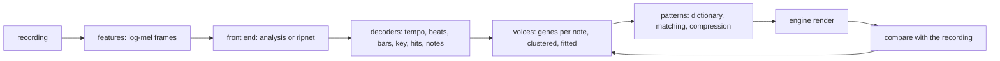

# Rip design

Decision record and working design for the rip: the engine's estimate of a
recording in its own vocabulary, voices, patterns, a key and a tempo, that a
player can edit and the sequencer can play. [Audio §11](audio.md#11-ripping-a-recording)
describes what runs today; this document is where it is going and why.

## 1. Purpose

A recording comes in; what comes out is what soundlab could have authored: the
tonal voices the notes were played with, the drum hits and the notes as patterns
on the sixteenth grid, the key, the chord each bar leans on, and the tempo. The
engine is the ground truth of its own vocabulary, so a rip is good when the engine
playing its output sounds like the recording, and that is the loop everything
below closes.

## 2. Stages

1. **Features.** `MelFrames` makes the log-mel frames a model hears: the rip's own
   grid, 22.05 kHz, 93 ms windows every 11.6 ms, eighty bands from 30 Hz up, the
   recording's peak at one. The built-in analysis works from the same spectrogram,
   split into a harmonic and a percussive part by medians. Features are computed
   in Go on both sides of training, so the model sees in soundlab exactly what it
   saw in the trainer.
2. **Front end** (`RipFrontEnd`). It hears a recording into `RipFrames`: the
   strength of any onset, of each drum's, each pitch's salience, each register's
   chroma, and, from a model, the wave and voice genes the note under each frame
   is played with. Two front ends fill it: `analysis`, the package's signal
   processing, and `ripnet`, a transformer over the mel frames whose heads are
   those fields. The seam is the frames, so the decoders never know which heard.
3. **Decoders.** Classical, shared, cheap and explainable: tempo by
   autocorrelation under a prior, beats by dynamic programming, the bar line by
   the kick, the snare on two and four, the key's root in the bass and the
   chroma's change, the key and chords by chroma, hits by peak picking, notes by a
   Viterbi path through the salience, cut and quantized to the grid. `RipParams`
   holds their thresholds as data a search tunes (`tune`).
4. **Voices.** Each note carries the genes the front end heard it played with
   (`VoiceDef.Genes`, thirty-two parameters in [0, 1] on perceptual scales, and a
   wave class). Today a register's notes average into one voice; next, notes
   cluster by their genes into as many voices as the recording has, and each
   voice is fitted by analysis-by-synthesis: the engine renders the voice at the
   note's pitch and loudness, the render's mel frames are compared with the
   note's, and a search over the genes closes the distance. The model proposes;
   the engine disposes.
5. **Patterns and the dictionary.** Notes and hits fall into bars; bars of up to
   four form patterns. The dictionary is the set of patterns the song is made
   of, and matching assigns each bar of the recording to a member. Its score is
   reconstruction (the rip of the arrangement's render against the rip of the
   recording, `CompareRips`) less a cost per dictionary member, which is what
   makes a repeated bar one pattern rather than many.
6. **Compression.** Two patterns within a threshold of each other, a few per cent
   of their steps and pitches, merge into one, their bars reassigned. A
   mechanical pass, agglomerative merging under the threshold, is the first
   implementation; the dictionary-size term of the matching search applies the
   same pressure, so whether a separate search does better is a measurement to
   make, not a decision to take now.
7. **The loop.** The arrangement is rendered (`RenderMusic`), compared with the
   recording, and voices and patterns are refined in turn until the score stops
   improving. The model hears the render too, so its voice estimate of the
   render against its estimate of the recording is a second, cheaper distance
   for the voice search. Convergence is measured, and a step that does not
   improve the score is undone.

The output is a sound document of voices, a music document of patterns, the key,
the tempo and a timeline, which bar plays which patterns. The timeline is a form
the engine has not: the conductor places patterns by tier, not by bar. It is the
one new document the rip needs and is designed with the dictionary.

## 3. Learning

- **Corpus.** The engine renders it (`corpus`): loops of the registered rhythm,
  melody and bass patterns across tempos and keys, each with its WAV, its mel
  frames and its events in frames, with the wave and genes of the voice each note
  was played with. Labels cost nothing and are exact. What it lacks, in order of
  need: a mix, a room and a codec between the render and the frames (impulse
  convolution, noise, equalisation, a low-pass), voices beyond the shipped five
  (random genes), chance steps as optional targets, and real recordings with
  hand-checked notes held out for validation, so neither a model nor a tuned set
  learns the synthesizer.
- **Model.** `ripnet.Spec`: eighty bands in, width 128, four heads, four layers,
  feed-forward 512, a window of 64 frames either side, about 800 thousand
  weights; heads for the onset, the three drums, the sixty-nine pitches, voicing,
  the five waves and the thirty-two genes. Attention carries ALiBi biases, a
  slope per head on the frame distance, so the model has no positions to learn
  and generalises past the training window. `tool/rip-train` is its PyTorch
  twin and writes the weight file `pkg/transformer` loads; the instructions are
  its README.
- **Inference** is pure Go, float32, no CGO, the same on every host. A
  three-minute song costs about a GFLOP per layer at the default width: seconds
  on a desktop core, under a minute on a phone, and the width and depth are the
  file's to choose. The analysis stays the default front end: soundlab hears
  with the model when the first root holds `audio/ripnet.bin`.

## 4. Layout

- `pkg/audio`: the rip, its parameters, the decoders, the built-in analysis,
  the features, the truth (`ExpectedRip`, `ExpectedEvents`) and the score
  (`CompareRips`), the offline render (`RenderMusic`). Imports only `toml`.
- `pkg/audio/ripnet`: the learned front end, `Spec` and `Hear`. Imports `audio`
  and `transformer`, and goes with `audio` to its module.
- `pkg/transformer`: inference over frames and the weight file. Standard
  library only, its own module when the time comes.
- `pkg/genetic`: the searches, over `RipParams` today, over voice genes and
  bar-to-pattern assignments next. Standard library only.
- `internal/soundlab`: the verbs that drive it all (`rip`, `render`, `corpus`,
  `tune`) and the documents the results land in.
- `tool/rip-train`: the trainer, Python, outside the module.

## 5. Budgets and determinism

The analysis runs about forty-five times real time on one desktop core, the model
adds seconds per minute of audio at the default width, and memory is a few floats
per frame per pitch: tens of megabytes for a song. Every render and draw is
seeded, the searches run on fixed streams, and the model is float32 arithmetic in
a fixed order, so a rip of one recording with one weight file and one parameter
set is the same rip on every host.

## 6. What `pkg/genetic` needs next

The voice fit and the dictionary matching ask for what the parameter search did
not:

- genomes that are assignments and sets, bars to patterns, with operators that
  move a bar, swap two, split a member or merge two; today's operators are for
  real vectors and bit patterns;
- a fitness with a size term and a constraint, or a scalarization that takes
  them, over `fitness`'s metric bundles;
- an adaptive step for the continuous searches (a sigma that follows success, as
  CMA-ES does), since thirty-two voice genes under a fixed sigma converge slowly;
- evaluation caching by genome, since a render is the expensive step and a
  generation repeats candidates;
- a long run's checkpoint and resume for the batch engine, which the streaming
  engine has and the batch engine lacks;
- seeding a pool from several given candidates, not one, so a model's proposals
  all enter the search.

## 7. Plan

1. Done: the analysis and the decoders; parameters as data and their search; the
   offline render, the truth and the score; the transformer, `ripnet`, the corpus
   and the trainer.
2. Next: train on a corpus with a room and a mix, and measure the model front end
   against the analysis on rendered and on real material; the `pkg/genetic`
   additions above; the voice fit by analysis-by-synthesis; the dictionary,
   matching and compression; the timeline document.
3. Then: real recordings in the corpus, the refinement loop's convergence
   measured, tuned parameters and weights shipped as data, and the rip on
   Android under the mobile budget.

## 8. Decisions

- **The decoders stay classical.** Tempo, beats and note cutting are solved
  problems with cheap, inspectable solutions; a model earns its place at the
  perceptual front end, where hand-made features fail on real instruments.
- **Features are computed in Go for training too.** A second implementation of
  the mel frames would have to match bit for bit; the corpus carries the frames
  Go made instead.
- **Relative positions by ALiBi, windows by a band.** No learned positions, no
  limit from the training length, attention cost linear in the recording.
- **Voices as genes.** One vector serves the model's regression head, the
  search's genome and the document, on the scales the ear hears.
- **The engine labels its own corpus.** Exact labels for free, with the
  synthesizer's domain as the cost to pay down with augmentation and held-out
  recordings.
- **The model is optional.** The analysis ships and works everywhere; a weight
  file in the root upgrades the hearing without a build.
- **Pure Go inference.** No CGO, no runtime to ship, the same path on the
  desktop, the browser and the phone.
