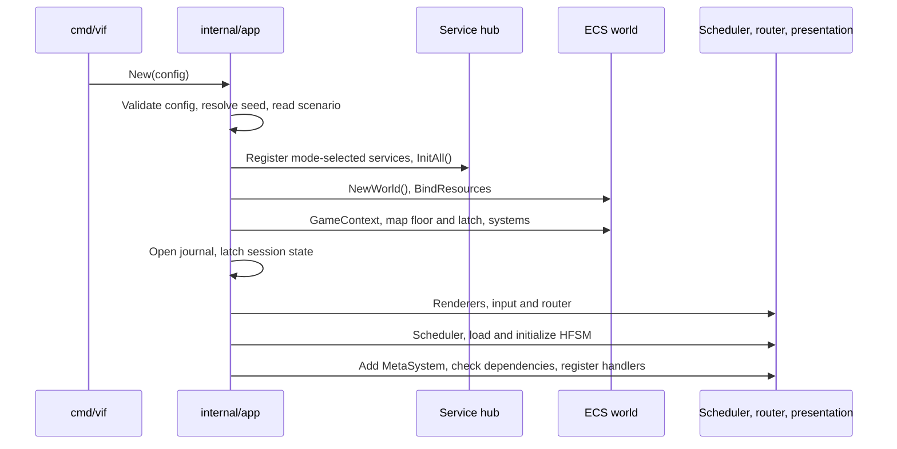
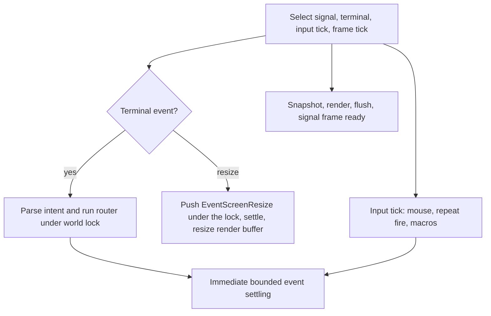
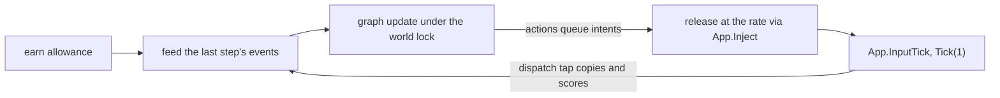
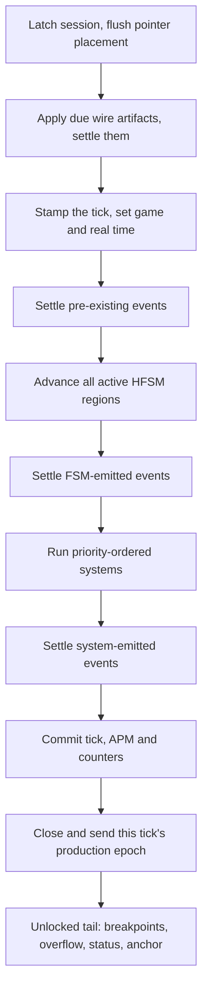

# Runtime, Scheduling, and Concurrency

This document describes the application runtime shapes and the
synchronization contract that makes the ECS safe. For the data structures
operated on by the runtime, see [ECS and events](ecs-and-events.md).

## 1. Process modes

`app.Mode` chooses which services, clock, and goroutines an `App` owns:

| Mode | Presents | Driven | Geometry/input owner | Audio | Execution |
|---|---:|---:|---|---:|---|
| `ModePlay` | Yes | No | terminal / terminal | If built | `PausableClock`; scheduler and event goroutines |
| `ModeHeadless` | No | Yes | caller / caller | No | `ManualClock`; a harness, `journal.ScriptDriver`, `bot.Driver`, or `journal.ReplayDriver` verifying a journal invokes ticks and injections; a script or bot in a session attaches network I/O |
| `ModeReplay` | Yes | Yes | journal / playback controls | If built | `ManualClock`; `journal.ReplayDriver` invokes ticks and injections |
| `ModeScript` | Yes | Yes | script, or terminal for a watched bot / playback controls | If built | `ManualClock`; `journal.ScriptDriver` or `bot.Driver` invokes ticks and injections; the presented form of a `ModeHeadless` script or bot, network I/O included |
| `ModeServer` | No | No | config / none | No | `PausableClock`; scheduler and event goroutines, as `ModePlay`, with no terminal and no local cursor |

The six predicates in `internal/app/config.go` are the policy boundary:
`Presents`, `Driven`, `Serves`, `OwnsGeometry`, `OwnsInput`, and `Audio`. Assembly
checks them rather than scattering mode comparisons through the runtime. A config
whose mode does not own geometry defaults to terminal-equivalent geometry 80x24
when dimensions are not supplied, and rejects I/O settings the selected mode cannot
honor. It also rejects a simulation speed setting — a driven mode's clock is
advanced only by `Tick`, and a dedicated host runs at the session's rate — with one
exception: an authored script or bot reads `-speed` as its wall pace, which is a
property of the run rather than of the clock. See §1.1.

Those predicates describe a full native build. Compile-time capabilities refine
them: `vif_headless` makes presenting modes unavailable and omits renderers;
`vif_noaudio` and `wasm` make `Audio` false and replace full audio systems with
event-only sinks. Runtime mode
and build profile remain separate so the same `ModeServer` behavior can run from
a full development binary or the smaller deployment artifact. See
[Build profiles and platform boundaries](multi-platform.md).

`-serve <address>` constructs `ModeServer`. `cmd/vif` normally constructs `ModePlay`; `-r`/`-replay <file>` constructs a replay
from the journal anchor, and `-script <file>` constructs a caller-driven
`ModeHeadless` run from an authored tick schedule, or `ModeScript` with `-watch`.
`-bot [N[:graph]|graph]` adds bots beside the human, including with `-host`
and `-join`; `-bots` accepts the same grammar. `-watch` uses the first bot's view
with no human, and `-headless` runs it without a terminal. Each additional bot is
its own instance in the same process (§4, Bot seats). See [Bots](bots.md).

| Tool path | Entry | Terminal initialized? | Result |
|---|---|---:|---|
| Validate | `resource.Check` | No | Resolve `vif.toml`, the scenario (loaded into a throwaway HFSM and checked against this build's systems), keymap, audio overrides, corpus and every bot graph; print what each resolved to. |
| Export schema | `manifest.Schema` | No | Emit schema version 1 JSON for events, fields, actions, guards, operators, and config fields. |
| Verify replay | `app.VerifyJournal` | No | `-r <file> -headless`: replay a journal flat out and fail at the first world digest it does not reproduce; a `jseq` gap fails before it plays. |
| Run script | `app.RunScript` | Only with `-watch` | Execute a bounded versioned TOML schedule; optional `-host`/`-join` uses the session's start gate. |
| Run bot | `app.RunBot` | With `-watch` | Explicit `-watch` or `-headless` drives the first bot; remaining bots are seats. A headless bot defaults to 120x40 and paces as a script does (§1.1); a watched one defaults to the terminal's size and real time. Ordinary `-bot` uses `app.Run` with a human. |

### 1.0 The four session flags

Four ways to be in a session, which differ in less than the flag names suggest:

| Flag | Binds a port | Local cursor | Terminal | Startup lobby | Default `-authority` |
|---|---:|---:|---:|---|---|
| `-host <addr>` | yes | yes | yes | none — plays from its first tick, opens once its clock runs; a script or bot waits in one (§1.2) | `migrate` |
| `-serve <addr>` | yes | no | no | its first guest: nobody plays until one arrives | `host` |
| `:host <addr> [host\|migrate]` | yes | yes | yes | none — the session opens at the tick it is running | the word given, else the run's |
| `-join <addr>` | in a migrate session, one of its own; with `-relay <addr>`, one that admits people who cannot reach the host | yes | yes | waits for the host's start gate | adopted from the offer |

The guest's port is what makes migration mean anything. The coordinator completes
the declared address from the connection it arrived on and publishes it,
unconfirmed, in the succession chain; every participant but a seated bot keeps a
link open to the current successor, so the instance that has to author already has
one at a handoff. `-listen <addr>` names the port and the default is the host's
own, either falling back to an OS-assigned one when it is taken; `-no-advertise` —
or a bind that fails, or an `-authority host` session — leaves the participant a
leaf that plays normally and, in a migrate session, is elected only when the chain
names no survivor. `-relay <addr>` makes a joined participant a door for people
who cannot reach the host: they `-join` that address, take independent slots, and
play through it; a person admitted that way is a leaf unless it passes `-listen`,
and keeps its slot when its relay leaves. See [Multiplayer](multi-player.md) §5.

Everything else about the session is one implementation. `-players` is a ceiling
on every host and unset means the whole roster; the mid-run gate is
installed on all of them and armed once the clock is running; a reconnect takes the
same path as a first join; the correction cadence, the barrier, the roster
crossings and the succession do not know which flag opened the session. The first
three columns are one question — *is a person sitting at this process* — asked
three times: `-headless` requires bots to drive its local cursor, and `-serve`, with
no local cursor, is the deployment shape.

`:host` is an operator command rather than a flag, and its session opens at
whatever tick the run has reached. `-probe`, `-first-join`, `-empty` and `-drain`
are refused outside `-serve`, because each of them answers to a supervisor and an
interactive run has a person instead.

### 1.1 Script pacing and presentation

A script is a deterministic list of inputs at named simulation positions. Two
things about how one is *run* are policy rather than content:

| `-speed` | Effect on a script |
|---|---|
| unset | Real time in a session, unpaced when solo. A solo script that opens a session with `:host` starts pacing at that tick and re-anchors its clock there. |
| `1`, `2`, `1/2`, … | One tick occupies the game interval divided by the rate: `2` is twice real time, `1/2` is half. |
| `max` | No wall pacing at all. Refused with `-host`, `-join` or seated bots: a participant that outruns its peers is not simulating the session it is in. |

Every participant of one session must use the same rate. The runtime cannot see a
peer's pace, so it enforces only the `max` case: a participant running faster than
the rest reaches ticks they have not, and every correction rebases it back to the
authority's tick — which is a working session, but not one whose scripted actions
land where they were authored. A dedicated host runs real time; an interactive
host runs its own rate, which an interactive guest adopts from the offer and nobody
changes while a peer is linked. A script sharing a session with either must match it.

`-watch` presents the run on this terminal instead of running it headlessly. The
simulation is unchanged — the same manual clock, the same script geometry, the
same driver — so a presented run and a headless one of the same script produce
the same world. Only pan and quit are offered while a presented script is in a
session; pause, step and rate are instance-local and half a session cannot be
paused.

### 1.2 The dedicated host

`-serve <address>` runs a host with no terminal, no renderer, no audio and no
cursor of its own. What is left is what a session cannot do without: the Shared
world, the authority, the correction cadence and the roster, on the real clock and
the scheduler goroutine, because a session's simulation has to advance whether or
not anybody is watching it here.

Holding no cursor is a roster property rather than an absence. The coordinator
keeps its participant identity and roster entry; its slot is
`parameter.NoPlayerSlot`, so every "is this my cursor" test answers no without a
special case. The FSM's boot cursor is not suppressed — it is created as it always
is, and the roster hands it to the first guest, which is what keeps shared creation
order identical to an ordinary host's.

A server's `-players` ceiling counts *guests*, because the server is not one of
them; any other host's counts one fewer, because it holds a cursor itself. A lobby
exists only where no person plays at the process, and the process seats its own
bots before it, so they count as guests: a server starts on its first guest; a
scripted or bot-driven `-host` on its first guest or, with `-players`, on the whole
party it names; an interactive host has none and plays from its own first tick.
Every later guest arrives through the mid-run gate. An interactive `-host` is
`:host` given at startup.

`-size WxH` gives a server the terminal-equivalent geometry it has no terminal to
derive, which is what every joiner adopts as the D-14 map latch.

Without it the server takes that geometry from its **first guest**. Otherwise a run
with no `-size` would fall back to `app.DefaultWidth` x `DefaultHeight` (80x24), a
79x21 map — and because the joiner adopts the host's latch, every participant would
then play on it however large its own terminal is. The joiner's acceptance therefore
carries its own geometry (`network.JoinerReport`), and `App.adoptLobbyGeometry` applies the
first one before the roster closes, so the bounds it produces are the ones the
offer names and the tick-zero capture contains.

First rather than smallest, and the difference is the mid-run gate: guests arrive
throughout the run, so sizing from the smallest would mean shrinking the map under
participants already playing on it, which D-14 forbids for the same reason a
terminal may not crop a shared map. An explicit `-size` still wins, and a scenario
that fixes its own bounds (`crop_on_resize = false`, as `wad/scenario/td` does) is left
alone: those bounds are the scenario's statement rather than a stand-in for a
terminal nobody has.

`-probe <address>` binds the health and metrics endpoint for the run — one `/health`
path whose code is liveness and whose body carries everything else, plus `/metrics`.
See [Services and networking](services-and-networking.md) §12. It binds before the
lobby, because a run waiting for its first guest is a run a supervisor is watching
start.

#### The allocated session

`-first-join`, `-empty` and `-drain` bound a session that was created on somebody's
behalf rather than started by hand. They are refused outside `-serve`, because a
flag that ends a process must not silently do nothing.

| Flag | Meaning | Zero |
|---|---|---|
| `-first-join <d>` | End the run if no guest has connected within `d` of the listener binding. | Wait forever. |
| `-empty <d>` | End the run `d` after the last guest leaves. Also the window in which a guest that dropped reclaims the slot its departure released. | Stay open. |
| `-drain <d>` | On a termination signal, stop admitting and wait up to `d` for the roster to empty before exiting anyway. A second signal exits at once. | Exit at once. |

The policy itself is `internal/lifecycle`: a pure state machine over an injected
clock, with the phases `waiting`, `occupied`, `vacant`, `draining` and `expired`.
`Serve` starts it after the probe binds and before the lobby, folds the roster into
it once a second, and exits when it expires — logging one `session ended` line that
names the reason. The lobby wait carries the same deadline, because a pod nobody
dialled is exactly the case the first-guest window exists for and exactly the case
the start gate would otherwise wait in forever.

A signal reads the roster at the instant it arrives rather than the loop's last
reading, which can be a second old: a drain that read a stale empty roster would end
a session somebody had only just joined.

`draining` and `expired` refuse a dial with `ErrSessionEnding`, and `/health` keeps
answering 200 with `ready=false` plus the phase and the time remaining — a drain is
not a fault. The refusal is deliberately distinguishable from `ErrSessionStarting`:
that one means retry, this one means the session is leaving.

The start gate waits only on guests still linked. One that leaves before confirming
it installed the world is dropped from the wait, and one still unconfirmed after
`parameter.NetworkJoinReadyTimeout` is disconnected with a Warn. The session runs
on either way, and one left empty parks (below).

Why the process holds this rather than the orchestrator: the roster is the only
thing that knows whether anybody is in the session, and it is inside the process. A
`Job` with an `activeDeadlineSeconds` can end a session on a wall clock; nothing
outside can end one on emptiness. See
[Deploying the session fleet](kube-docker-deploy.md).

```bash
./bin/vif -serve :7777 -probe :7778 -log-stdout -lv info \
    -players 4 -size 120x40 -first-join 90s -empty 90s -drain 20s
```

```bash
./bin/vif -serve :7777 -players 2 -size 120x40 -l -lv info
./bin/vif -join server.example:7777          # each person, elsewhere
```

The scheduler applies render backpressure at real time and slower, so the server
releases the same frame handshake on the same interval and draws nothing. Every
30 s it logs a `session summary` record if the summary changed, so a parked session
writes one line until somebody arrives. A signal halts the server's own bot seats
before the drain.

#### An empty session parks

A run whose roster empties stops its clock, and stops it at once. An empty session
has nothing to simulate for, and simulating it anyway is not free: with no cursor
on the map the gold cycle cannot place a sequence, so it fails, retries a tenth of
a second later, and fails again for as long as the process runs. It is also what
makes "a guest that dropped reclaims the slot its departure released" mean
something — the world it comes back to is the world it left rather than one that
aged without it.

On an unbounded host, a world nobody reclaimed inside
`parameter.SessionVacantReset` is replaced once and stays parked over the fresh
world. The reset briefly releases the clock, so the park is asserted on every
vacant reading. Its boot cursor belongs to nobody on a dedicated host, so the park
drops it before a mid-run join needs that slot.

A dial is what releases the park, on the accept goroutine and before the mid-run
gate reads its capture: that gate waits for a tick a stopped clock never reaches,
so a dial served by one would time out instead of being admitted. `/health` says
`clock=paused` beside `phase=vacant` throughout, and stays live — a park is not a
stall.

`-empty` outranks the fresh-world reset. A bounded session still parks immediately,
but keeps that exact world throughout the grace so a reconnect returns to the same
match; expiry then ends the process. Only `-empty=0` permits an in-process reset.

A server outlives its guests. Its mid-run gate is installed at construction and
armed once the scheduler is running, so a participant that dropped can dial back
into the slot its departure released and receive the world at whatever tick the
session has reached. `-players` bounds how many cursors the session holds, not how
many dials it will ever accept.

It also outlives its own authority, and that is why `-serve` defaults to
`-authority host`. A dedicated host *is* the session: its address is what the
allocator handed out and what every guest holds, so if the process goes, the answer
is an orchestrator putting another one at that address and the guests dialling back
— not a guest declaring itself the host. This is policy, not a limit:
a migrate session's guests declare ports and its successor is the first surviving
member of the published chain ([Multiplayer](multi-player.md) §5.1, §5.3), and
`-serve` still pins authorship because the address it was allocated at is the
session's identity.

The arming happens after `scheduler.Start` rather than before it, because the gate
waits for a capture one playout lead ahead of the current tick and a clock that has
not started never reaches it. Between the lobby reading its roster and that arming
there is a window neither gate can serve, so a dial landing in it is refused with
`ErrSessionStarting` — a refusal the dialer retries, rather than an identity and a
silent wait for a start gate no longer being sent.

A scripted participant schedules its actions on the ticks it issues, so it may
enter through the mid-run gate like anyone else ([Development](development.md)).

Together these make a scripted participant: one side of a session plays a fixed
sequence at real time while a person plays the other freely, which is how a
scripted demonstration is shown and how a reproduction is held constant while the
other participant is fuzzed by hand. `script/sparring-host.toml` and
`script/sparring-guest.toml` are the two directions.

## 2. Composition sequence



`-join` adds a pre-composition step: `newSessionApp` dials, receives the host's
offer and `JournalAnchor`, adopts its seed, configuration identity and map latch,
takes the scenario's bytes from the coordinator when no root here holds them, and
only then calls `New`. A dedicated host or a scripted or bot-driven `-host`
composes first, so its acceptor can capture the live tick-zero world, then waits in
its lobby and completes the start/ready gate before it ticks. Every run that waits
on that gate has its clock frozen during construction, before the HFSM creates
deadlines, and released only after it, so tick zero does not inherit how long the
lobby waited. An interactive `-host` binds its port before the terminal starts but
composes solo and opens the session once its clock runs, as `:host` does.

The detailed construction order is significant:

1. Normalize and validate the config, resolve the seed (a drawn one is logged)
   and apply any embedder-provided log scope.
2. Read the scenario, so one that does not resolve fails before the terminal is
   taken and before the journal anchor names it.
3. Initialize the generated event registry. FSM trigger resolution and `:emit`
   depend on it.
4. Register services by mode and build: terminal for presenting modes; network
   for native `ModePlay` in every role and for any mode given `-host` or `-join`
   (a wasm build: a join only); audio when the mode has it; files and content
   always. A replay copy borrows its lender's terminal and opens no audio.
   `InitAll` then initializes them in deterministic topological order.
5. Create the world and its RNG, let services contribute typed resources, and
   mark the run session-shared when a network endpoint exists.
6. Resolve geometry from the terminal or config and create `GameContext` (with
   `ManualClock` for a driven mode), which initializes the status registry,
   map/camera config, clock, event queue, game state, transient state, empty
   player roster, and target resource.
7. Apply the scenario's `[map]` floor and the D-14 map latch, before any system or
   the boot script reads the map's size.
8. Size status snapshots and the flight recorder, publish corpus telemetry, and
   build the authority protocol (`converge.New`).
9. Apply the initial `-speed` rate, and freeze the clock of a run that waits on a
   start gate.
10. Construct systems from the generated manifest. `World.AddSystem` sorts them
    by priority and preserves manifest order for equal priorities.
11. Open the journal when requested, then latch the session state the run starts
    in.
12. For a presenting mode, construct and priority-sort renderers.
13. Create the input parser, merge the keymap and build the mode router for
    semantic injection in every mode; bind terminal mouse control only when the
    terminal owns simulation input.
14. Create frame synchronization channels and the scheduler, then load the
    scenario into the HFSM, initialize its regions, enqueue their entry actions
    (including the shipped cursor spawn request), and apply global/region system
    toggles.
15. Add `MetaSystem`, which needs the completed `GameContext` and ticks at
    `PriorityUI`; check the declared system dependencies with
    `World.CheckSystemDependencies` (an unknown name or a cycle is a startup
    error; it orders nothing, since `AddSystem`'s priority sort fixes tick order);
    register every system that implements `event.Handler`.

If any step fails, `App.New` calls `Close` on the partially built application.
Services therefore must make `Stop` idempotent and able to release resources
acquired by `Init` even when `Start` was never reached.

## 3. Runtime clocks and cadence

Play mode has separate cadences rather than treating a rendered frame as the
only clock.

| Path | Default interval | Owner | Purpose |
|---|---:|---|---|
| Render frame | 16.7 ms (a third of a tick) | main goroutine | Snapshot frame state, render, flush, and release the next simulation tick. |
| Input tick | 16 ms | main goroutine | Reconcile terminal mouse mode, open the command line after a breakpoint hit, repeat held/automatic fire, and advance macros. |
| Simulation tick | 50 ms | scheduler goroutine | Advance pause-aware game time, FSM, systems, APM, and telemetry. |
| Event attempt | 4 ms | event goroutine | Settle queued events between simulation ticks, including while paused. |
| Audio buffer | 50 ms | audio mixer goroutine | Drain audio commands, synthesize/mix the next PCM buffer, and write it. |

The simulation is fixed-step but frame-gated. The main loop primes one
`frameReady` token. After a simulation update signals `updateDone`, the next
render completes and then returns another token. The scheduler also has a
bounded timeout while waiting, so a missed render token does not block forever.
This limits the simulation to one outstanding update and prevents rendering a
world that is being advanced concurrently.

Driven modes (headless, replay, script) replace `PausableClock` with
`ManualClock`. They do not call `Scheduler.Start`, so there is no scheduler loop,
event loop, or frame gate racing the world lock. `App.Tick(n)` applies corrections
that have arrived, then for each of `n` ticks services a pending reset, steps the
manual clock by exactly the fixed interval and executes one tick body on the
caller's goroutine; `App.Settle` drains an injected event group without advancing
time. `Tick` deliberately executes even when operator pause state is true,
because the caller is the clock authority.

For a solo driven App, the resulting run is a pure function of seed, resolved
config, and injected event groups. A networked script or bot additionally
consumes the peer's ordered stream; its driver paces ticks at the run's rate
(§1.1), trimmed by the guest pace the last tick read, so one process cannot race
thousands of ticks ahead of the other.

A process may hold several Apps: a holder and its bot seats, a replay's copies, an
install's staging world. What a holder and its seats share and what they do not;
none of it enters a simulation snapshot:

| State | Scope | With seats |
|---|---|---|
| `status.active` flight recorder hook | the last registry to enable a recorder | seats enable none and take no status snapshots |
| `vlog` sink and scopes | one per process; each App logs through its own handle | a seat's records carry its own run, tick and `instance` `seat N` |
| `vlog` journal | one per process | only the front App journals; seats write none |
| `engine.divergentReads` | one warning latch per config key | harmless across Apps |
| `internal/prof` captures | the process | a profile covers the holder and its seats |
| signals, terminal, audio, probe | the front App only | seats are headless and stop when their holder halts them |
| corpus, scenario, keymap, graph parse | per App | per seat |

## 4. Play, playback, and authored-script loops

### Interactive play



Terminal key and mouse events flow through the input machine. A complete intent
is handled under `World.RunSafe`; if it pushed anything, the scheduler settles at
once so the next frame sees its effects. A pointer placement moves the view at
once but its cursor move waits for the next tick: `World.PushPointerMove` keeps
only the newest cell, and `FlushPointerMove` pushes it before each tick and before
any other journaled push, so placements keep their order and a sweep crosses one
cell a tick. A resize pushes `EventScreenResize` under the world lock like any
input, settles it, then resizes the render buffer to the dimensions the handler
wrote.

The input ticker is independent of rendering so held-button fire and macro
playback have stable cadence even when frames fluctuate. Macro intents re-enter
the same locked `handleIntent` path as physical input.

For a render frame, the application:

1. increments the frame counter;
2. under the world lock, refreshes an open config menu and copies continuous game
   and real time, local-cursor position, map, viewport, and camera data into a
   value `RenderContext` (a hidden wasm page skips this step and the next);
3. invokes the orchestrator, which separately locks the world while concrete
   renderers read components, then flushes terminal cells outside the lock;
4. while paused, stops there: the pause overlay renders but no tick is released;
5. otherwise, when the previous simulation update is complete, sends a
   non-blocking `frameReady` token.

### Replay playback

`app.PlayJournal` (`-r`/`-replay <file>`) loads journal records, rebuilds config
and geometry from the first anchor, verifies the config/corpus fingerprint, and
drives a `ModeReplay` App with `journal.ReplayDriver`. The reader accepts several
files and sorts/deduplicates them by `jseq`; the CLI passes one path. A set whose
first anchor says `StartRun != 0` or `StartTick != 0` is refused: records alone
cannot rebuild a world that began elsewhere. The record format is
[Logging and diagnostics](logging-and-diagnostics.md) §9.

The playback keys are fixed; any other key is parsed by the keymap in NORMAL,
which keeps only quit, the audio toggle, `:` and the config menu.

| Control | Playback action |
|---|---|
| `SPACE` | Pause/resume; at the end, play again from the start. |
| `.` | Pause and advance one tick. |
| `,` | Pause and step back one tick. |
| `+` / `-` | Move the viewer rate up/down the rational scale ladder. |
| `h j k l` / `0` | Scroll a map larger than the view by four cells; re-centre. |
| Ctrl+S | Cycle the viewer's mute, which starts as `-mute` says; no journal records it. |
| `:r tick <n>` | Go to the first step at or past tick `n` of the run shown, the status bar's `GT`. |
| `:r time <[[h:]m:]s>` | Go to that game time at 1x: seconds alone, `m:s` or `h:m:s`. |
| `:r restart` | Play again from the recording's start; also Simulation → Restart replay. |
| `:` | Command line: `replay`, `config`, `help`, `about`, `telemetry`, `hud`, `debug`, `content`, `flow`, `graph`, `log`, `q`. |
| `q` | Quit. |

The status bar adds `diverged by tick <n>` once the replay fails to reproduce a
world digest the run wrote (logging and diagnostics §9), and a `journal`
`replay diverged` Warn record names it. `-r <file> -headless` runs the same check
flat out, with no terminal.

In a replay `:r` is `:replay`; elsewhere it remains `:region`, which a replay
refuses. A game reset starts a run whose ticks count from zero, so `tick` and
`time` address the run shown; the status bar reports run, tick and its 1x time.

Pacing converts the recorded tick interval and speed to wall time, then applies
the viewer's rate. A presented step is one recorded tick: a guest's written world
and the groups that landed on it take none of the run's time, so they share the
tick after them rather than holding the view a tick of their own. The presented
copy steps on its own goroutine in batches of at most three quarters of a frame
that alternate with frames: the loop reads no key and draws nothing while one runs,
so an install or a checkpoint delays a frame instead of stalling the loop, and owed
time a run too slow for its rate cannot play is not banked. The simulation
keeps its recorded geometry; the frame is laid out for the viewer's terminal, and a
resize re-lays it. A map the view holds is
centred in void as the game centres it; a larger one is shown from the recorded
view's centre, and scroll stops at the map's edges. The command line holds
playback, as the game's does, and borrows the recorded mode without announcing a
change to the world or pausing its clock (`GameContext.Viewer`), so closing it
leaves the run as recorded; a command that would change the recording is refused.

A world cannot be rewound, so going back presents another copy of the run: a
`ModeReplay` App on the viewer's terminal, built off the frame loop, muted and
without a flight recorder until it is presented. One fresh copy waits idle, and
one job at a time builds it or moves it into place on its own goroutine.

After each step the presented copy plays, the player keeps the whole state of the
run (`app.checkpoint`) and its world digest: the last `parameter.ReplayRing` (8)
steps in a ring, and every `parameter.ReplayCheckpointSteps` (100) on a ladder that
drops every other and doubles its spacing past `parameter.ReplayCheckpoints` (32).
A checkpoint holds every store and occupied grid cell's entities in their own order
and both domains' allocators (`engine.WorldCopy`), RNG streams, FSM position,
scheduler and queue with its pending events, every registry cell, each system's FSM
toggle and its private state (`engine.StateCopier`, or `SharedStateSaver` for a
carrier without one), the corpus cursor, the latched session (`engine.SessionState`,
from the journal) and the driver's place. One costs about 1 ms at 146×34, and 10 ms
and 6.3 MB on td's 500×250 map with 16 players, where a restore takes about 35 ms
with the copy's construction. A checkpoint the ring lets go, unless the ladder keeps
it or a move restores from it, lends its storage to the next, which then allocates
1.7 MB there.

Every move goes to the first step at or past a tick of the run shown: `,` to the
step before, one a frame, as `.` steps on; `:r` to the tick asked; a restart to the
start. The presented copy plays there unpaced for most of each frame when it stands
before it and no checkpoint is more than a ring nearer, so the view keeps drawing;
otherwise the idle copy restores the nearest checkpoint, or starts fresh, replays
there and keeps the last ring of steps before it, and is presented the next frame.
So `,` within the ring restores without replaying, and a tick past the furthest step
reached plays on from the latest checkpoint.

A step that fails, such as a written world failing its integrity check once the
replay has left its run, ends the stream there: the viewer pauses on it with the
error on the bar for the rest of the replay, `,` and seeks still work, and nothing
plays past it. Quitting then exits with that error.

A restored copy must reproduce its checkpoint's digest (positions, kinetics,
combat, entity counts), and every copy stepping through ticks the run has passed
must stand and diverge where the run did. One that does not is never presented:
every checkpoint is dropped and none is taken again (a `journal` `replay checkpoint
left the run` Warn), and the move replays from the start. The bar's `diverged by
tick` is the run's, which the first copy past it found, not one copy's. A copy that
takes over brings the HUD pins, the speakers, whose engine plays on while the gates
the copy replayed decide what sounds, and the process's flight recorder, whose
window starts again, and draws into the same cells rather than repainting.

A replay logs as play does, so `:log on` and `:log off` bound a window around an
issue found by seeking. Each copy writes through its own log handle, muted until it
is presented, so records carry the presented copy's `run` and `tick` and a copy
replaying off the frame loop writes only its failures. Each jump of the presented tick (`,`,
a seek, a restart) is a `journal` `replay moved` Info record with `tick`,
`from_tick`, `delta` and their runs, stamped after the jump; a seek ahead
is recorded as it starts, and the ticks it plays log as they pass. Ticks played
again after going back log again, after the record that explains them.

### Authored headless scripts

`app.RunScript` loads a versioned TOML file through `internal/journal`, applies
its optional terminal-equivalent geometry, and builds a driven App. Actions are
addressed by `(run, tick)` and execute before the next tick at that position. With
`-host` or `-join` the authority ends runs, so an action names no run and its tick
counts the ticks the script has issued (§1.2).
Same-position actions retain file order and each settles independently, matching
separate live input groups. Four deliberately small action forms exist:

- a canonical semantic input action from `input.ActionNames`, with optional
  count and target character;
- a string of semantic text-character intents;
- a complete ex-command round trip;
- a registered event plus journal-compatible TOML payload and, when needed, an
  explicit replication domain.

The script's `ticks` is a hard bound, so a process terminates without terminal
input and reports an action whose `(run, tick)` was never reached. With neither
`-host` nor `-join`, ticks run flat out unless `-speed` sets a pace (§1.1). A
joining script takes the same anchor, roster and start/ready gate as an
interactive guest; a hosting one waits in a lobby first, as a dedicated host does
(§1.2); either then wall-paces the caller-driven ticks. The two processes may use
different files; this is how one schedule targets the host's local participant
and another targets the guest's.
Unknown top-level/action fields are rejected rather than ignored; action fields
that apply only to intents or events are rejected on the other forms.

### Bot seats

`app.RunBot` and each seat drive a `bot.Driver`, the authored-script loop with a
graph in place of a schedule. One `Step`:



- Allowance is earned before the update, `actions_per_second` a second capped at
  one second's worth, so a world-reading action acts only when all it queues lands
  before the tick. The queue holds 256; a full one drops and counts.
- Under the world lock the machine handles, in dispatch order, the events its
  instance dispatched during the previous step that some state triggers on, then
  updates by one tick. Guards and actions read the world and never write it.
- After the lock, `App.Inject` releases what the allowance covers, `App.InputTick`
  advances auto-fire and held buttons, and the instance ticks. Its dispatch tap,
  live only while the driver plays, copies each event a trigger names and checks
  every one against the score table. `Step` returns false once an intent quits.
- Draws come from `vmath.NewSeededRand(seed, "bot.<participant>")`. Graph state is
  in no capture, journal or fingerprint.

A seat (`internal/app/seat.go`) is that driver on another headless instance in the
holder's process, on its own goroutine and paced against the authority like any
guest. `seatConfigLocked` routes its join: a still-guest relays it on its own link,
a run in no session first hosts on loopback, an authority is dialled on loopback,
and a successor opens an admission listener of its own. A play-mode holder's seats
stand still while it is paused; a driven holder's step on. A headless bot or seat
ends once its instance forks, and a seat also once its holder does.

## 5. Simulation tick steps



`Scheduler.processTick` holds the world lock for steps 1–11:

1. latch the session state and, if a pointer placement is pending (§4), push it
   and settle it as an `"input"` group; read the guest pace trim;
2. apply the wire artifacts whose fixed playout deadline has arrived and settle
   them in their own `"wire"` group — before the tick stamp advances, so both
   copies of a crossing land at the same absolute tick
   ([domain model](domain-design.md#41-receive-lead) §4.1). A run that is
   session-shared settles this group every tick, whether or not a peer is linked;
   a solo run has none;
3. open the next journal tick stamp, then set `GameTime` to `SimTime(tick)` —
   derived from the tick, never from the pacing clock, so every participant reads
   the same instant — with wall `RealTime` and fixed `DeltaTime`;
4. update elapsed-time status;
5. consume/dispatch events accumulated before the tick until the queue is empty
   or the settling cap is reached;
6. advance the FSM by the fixed interval, then publish foreground telemetry and
   one metric set per declared region;
7. settle events emitted by state transitions and actions;
8. run all systems sequentially against that settled state;
9. settle the events the systems emitted, as a tick phase like steps 5 and 7, so
   an outcome a system applies through a queued event belongs to this tick for
   every reader after it;
10. commit the tick count and APM, and snapshot entity, queue and event counters;
11. raise the session layer's own journaled records, which settle between ticks,
    then close this tick's production epoch and hand it to the transport, so a
    peer receives one tick's artifacts as one tick's worth, and write the journal
    digest when it is due.

A reset dispatched by step 2, 5, 7 or 9 — a crossed `:new`, or the scenario's
own — ends the tick there, as one between ticks does: the rest of the body, the
epoch flush and the tail are skipped on every participant alike, and the
scheduler resets the FSM before the new run's tick 1.

Step 10 is inside the critical section deliberately: `Position` has no internal
lock, so counting entities after unlocking would race removals on the
event-loop and main goroutines.

After the lock is released, the scheduler uses only atomic or internally
synchronized paths, in this order: expire a run-until request, report queue
overflow, tick the status registry (recorder sample, grouped status snapshot,
pending recorder flush), fire standing stat breakpoints that rose (§9), emit the
journal anchor when due, and close the profiler window when one is due.

That tail is not a barrier. Because the lock is already released, the event
loop, input path and render goroutine can commit between the locked body and the
sample, so a status snapshot or recorder window is stamped with tick *n* but
reads "at or after tick *n*" for anything not written inside the locked body.
See [Logging and diagnostics](logging-and-diagnostics.md) §6.

`Scheduler.Prepare`, reached from `Start` or from driven construction,
calls `Registry.Freeze` immediately after `World.Seal`. Both close a
registration surface before any tick reads it:
`Seal` freezes the system list, `Freeze` freezes the metric set and lays out
the recorder ring.

Systems may emit events during `Update`; step 9 settles them before the guest's
tick-close capture, the epoch flush and the journal digest read the world. What
a capture still does not carry is a queued event: one pushed after that settle
(the session layer's records, an install's re-derivations, a breakpoint's
pause) or one a settle stopped at its pass cap left behind.

Each non-empty explicit settle group (input, wire, the between-tick event loop
and an injected `Settle`) advances the journal `boundary` counter; a tick's own
pre, post and close phases and a reset's settles are not groups. This preserves
distinctions between separately injected groups whose system events would be
ordered differently if merged. See
[Logging and diagnostics](logging-and-diagnostics.md) for the complete journal
stamp lattice.

## 6. Event-loop concurrency

The queue accepts multiple producers, but `Consume` is a single-consumer
operation. The world lock is therefore both an ECS lock and the consumer token.
No path may consume the event queue without holding it.

The event goroutine exists only where `Scheduler.Start` runs: `ModePlay` and
`ModeServer`. Driven Apps use `Tick` and `Settle` on the caller goroutine and
therefore do not need the `TryLock` backoff path.

On each event-loop interval:

- an empty approximate queue length avoids lock contention;
- `World.TryLock` handles short idle windows cheaply;
- a miss increments backoff telemetry;
- after a configured number of misses, the event loop takes a blocking lock to
  guarantee progress after a long tick or render pass;
- one whole settle runs, then the lock is released. A single pass would split a
  cascade across wakeups and interleave it with the next records by wall time.

Each dispatched event goes to a harness tap (a bot's dispatch tap) while its
payload is still the producer's, then to the HFSM (unless a reset holds it out),
then to registered handlers in registration order. The FSM's answer — whether any
active region consumed the event — is recorded in the pass summary, so a
system-handler count of zero is unambiguous. A handler may enqueue another event;
a settle repeats consume passes up to `EventLoopIterations` (16), and one that
stops there with events still queued counts `event.settle_exhausted`.
The queue capacity is 2,048. Producers that overrun it evict the oldest
unread events and increment a monotonic dropped counter; this represents real
state loss and is logged when observed.

## 7. Lock and ownership matrix

| State | Synchronization owner | Allowed access |
|---|---|---|
| Entity IDs, component stores, component masks, positions, spatial grid, map/camera mutation | `World.updateMutex` | Tick, event dispatch, input/router, reset, and renderers while holding the same lock. |
| Event queue writes | Lock-free MPSC producer protocol | Any producer; payload lifetime rules still apply. |
| Event queue consume | World lock as single-consumer token | Scheduler tick, event loop, immediate dispatch, or reset only. |
| System list | Single-threaded construction, then `World.Seal` | Read-only after `Scheduler.Prepare` seals it. |
| Pause, rate, step budget, run-until request, standing breakpoints | `TimeControl` atomics; breakpoints as a `BreakSet` replaced whole | `MetaSystem` and commands set them, and the session paths pause and release a lobby or a parked run; the scheduler takes steps and trips requests and breakpoints; input and render read them without the world lock. |
| Render buffer | Render orchestrator | Main/render path only; cleared and reused per frame. |
| Context flags/counters | Atomics | Cross-goroutine reads for macros, mouse, auto-fire, frame/status strings. |
| APM history | `GameState.mu` plus atomic published totals | Scheduler admits gestures at dispatch and rolls history. |
| Target groups | `TargetResource` RW lock | Navigation writes; species/genetic code reads snapshots. |
| Status metric values | Per-value atomics; set closed by `Registry.Freeze` | Systems cache pointers during construction; snapshots and the recorder load atomically off the world lock. |
| Audio sequencer, voices, active effects | Mixer-goroutine confinement | Other goroutines send bounded commands or read atomic mirrors. |
| Service registry/lifecycle | `service.Hub.mu` | Composition/start/stop paths only. |
| Network inbound buffer | Bounded channel | Transport callbacks push without blocking; active `NetworkSystem` sessions drain at the tick poll boundary. |

### Non-reentrant router rule

`App.handleIntent` acquires the world lock before calling
`mode.Router.Handle`. Nothing reachable from the router may call
`World.RunSafe`, `World.Lock`, or another lock wrapper for the same mutex. The
router can directly access stores because its caller already provides the
critical section.

### Operator commands hold the lock

`App.handleIntent` runs command mode under the world lock, so a command that
performs I/O stalls the tick, the event loop and rendering for its duration.
`:log on` opens the session file. `:t save` only captures its records under the
lock; a second logger drains them to disk on its own goroutine, bounded by a 3 s
drain timeout, so it is available in a live session too.
Both are deliberate operator costs and neither is reachable from gameplay
input. `:log off` and `:log rec flush` are explicitly not in this class — the
first detaches the sink and drains on another goroutine, the second only sets a
flag the tick goroutine reads.

### Pointer and slice lifetime rules

Sparse-set `GetPtr` pointers and dense entity slices are live views. Structural
store changes can invalidate pointers or reorder swap-removed entries. They must
not escape the world-locked operation that obtained them unless a component's
API explicitly guarantees otherwise. Similarly, pooled event payloads and
scratch slices must not be retained by asynchronous logging or later work;
logging call sites pass primitive values or copies.

## 8. Pause semantics

Pause freezes simulation ticks through `PausableClock` and the scheduler's
pause gate. It does not freeze the whole process:

- terminal input and signals still arrive;
- the event loop still dispatches queued events;
- the pause/overlay frame still renders using wall-clock time;
- mouse reporting state can still be reconciled;
- gameplay pointer input, auto-fire, and macros are withheld while input is
  suspended;
- `AudioSystem` propagates pause to the mixer, which fades the audio path.

`MetaSystem` is the single owner that keeps pause flag, clock, and pause-change
events aligned. It refuses a request to enter pause while a transport has a live
peer: stopping one participant would also stop its barrier production and apply
loop while every peer continued. Command and overlay modes still open, but do not
pause a live network session. The exception is an authority whose every linked
participant is a seat it holds (`SessionState.SeatsOnly`): its seats stand still
with it, and a late joiner's admission unpauses it.

In a driven App, pause remains observable/operator state but never revokes the
caller's authority: `App.Tick` uses the stepped tick path and still advances.

## 9. Time control

`TimeScale` is an exact rational `Num/Den`, not a float. Operator-visible rates
are the fixed ladder `1/8`, `1/4`, `1/2`, `1`, `2`, `4`, `8`; `+` and `-` step
along it and clamp at the ends. `PausableClock` re-anchors game time on a rate
change, so there is no time jump or catch-up burst. Above 1x the scheduler
skips render backpressure so the world can outrun the display.

`-speed <rate>` sets the initial play-mode rate; an interactive guest takes its
host's instead (§1.1). Runtime commands are:

| Command | Effect |
|---|---|
| `:speed` | Report the current rate. |
| `:speed <rate>` | Select one ladder rate. |
| `:speed +`, `-`, `reset` | Step faster/slower or restore 1x. |
| `:step [n]` | Pause and grant one or `n` complete ticks, capped at 10,000. |
| `:step [rate] fsm [region] [pause]` | Run until the next matching region transition. |
| `:step [rate] ev <Event> [pause]` | Run until the named event is dispatched. |
| `:step off` | Disarm and restore 1x. |

A run-until request stores the pre-request rate in `BreakState.Restore`, switches
to the optional run rate, and trips exactly once. The `pause` suffix pauses at
the match; without it, the previous rate is restored and execution continues.
FSM and event modes are probed at the transition and dispatch sites rather than
by polling telemetry. `Expiry` self-disarms a request after 20,000 game ticks
so a misspelled assumption cannot run forever; a hit or expiry triggers a
`break` flight-recorder flush. Reset cancels tick allowances and run-until
requests because their region/event context was destroyed, while the ordinary
rate remains operator-owned.

Standing breakpoints (`:d break`, [Input and modes](input-and-modes.md)) trip on
every match until cleared: an event's dispatch, a region's entry, any region
entering a state, or a status cell's comparison turning true. The dispatch and
transition sites probe them as they do run-until requests; stat breakpoints are
read once per completed tick in the unlocked tail (§5). A hit fires the same
`break` flush, pauses the run, and the next input tick opens the command line
unless it or an overlay is already up, so leaving it resumes. A live session only
reports a hit and refuses setting one.

These controls are operator pacing under `ModePlay`. Replay records and
reinjects their events, but its manual clock advances only under
`ReplayDriver`; viewer `+`/`-` controls presentation pacing instead.
Speed changes, tick stepping and run-until controls are refused in a live network
session for the same per-instance-clock reason as pause.

## 10. Reset and operator state

`:n <scenario>` is not a reset. The regions a scenario declares are what register
the FSM metric set, and `Scheduler.Prepare` freezes that set for the life of a
run, so another scenario needs another run: `Run` owns a loop that builds one App
per run, and the command validates the name and latches which one comes next;
naming the scenario already loaded resets in place instead. The same loop replaces
the run for a `:join`, a `:journal start`, a session restart and a removal by the
host; the scenario change, the restart and the journal seat the run's bots again.
Everything operator-owned restarts with it. See
[HFSM and configuration](fsm-and-configuration.md) §2.

In a session every participant does this together. Only the coordinator may ask;
it broadcasts `MsgSessionRestart` before its transport goes and rebuilds solo,
reopening its address once its clock runs. Each guest latches the same restart,
rebuilds on its own command line and redials, arriving through the mid-run gate a
reconnect uses — so the roster, the world install and the scenario
transfer are the paths that already existed. Nothing is carried in the notice: the
offer a guest is given when it redials names what is being played.

A `:new` command emits `EventGameResetRequest` and requests scheduler reset
without reconstructing the process. In a live session only the coordinator may
request it; the request crosses and every participant applies it at one barrier
tick. A reset the scenario's own FSM emits, such as the shipped monitor's on a
defeat, is re-derived on every instance instead.
`MetaSystem` snapshots the roster's slot/control/peer/holder assignments, pauses
time and audio, clears entities, `GameState` and kill tallies, advances the
journal run while rebasing its tick to zero, returns a map this instance owns to
its viewport size (no smaller than the scenario's `[map]` floor) while a session's
latched bounds carry across, resets camera, crop-on-resize, mode, captured keys
and status text, and cancels pending step controls. The reset FSM's first cursor
spawn carries the configured heat/energy template and expands the saved roster
in deterministic slot order. The scheduler serializes these phases with the
world lock:

1. drain and discard stale queued events;
2. reset deadlines and elapsed-time anchors;
3. settle an unpause with the HFSM held out, so entry actions below sound;
4. reset all initially configured HFSM regions, variables, and delayed actions;
5. reapply global and active-region system toggles, then settle the entry-action
   and toggle events;
6. advance the RNG session and emit a fresh journal anchor.

Simulation state is rebuilt; operator state describes how that simulation is
being driven or observed and survives plain `:new`. Its explicit contract is:

- free-mouse and auto-fire preferences;
- the current time scale;
- telemetry HUD visibility and pinned overlay cards;
- standing breakpoints.

Both `:new` and `:new!` clear the issuing instance's recorded and playing macros,
and on every instance close overlays, return to Normal mode, and clear
command/search/status text; a reset the scenario raises, as the default
scenario's defeat does, clears no instance's macros. `:new!` additionally purges
the initiating instance's operator contract: free mouse and auto-fire become
off, speed returns to 1x, and the telemetry HUD/pins and breakpoints are cleared.
A peer receiving the crossed reset retains its own operator state, macros
included. Logging target, level, scope, snapshot period, and recorder depth are
process diagnostics and are never part of this purge.

Other session-observer fields have explicit behavior rather than belonging to
that purge list: the render frame remains monotonic, reset ends paused state,
and the terminal-wide `MouseDisabled` flag survives both reset
forms. The full `session` snapshot record reports these values even though
replay comparison omits the record.

The genetic registry object outlives a reset but its contents do not: the reset
drops in-flight evaluations and deregisters every species the run declared, and
the FSM's region entries register them afresh, so evolution starts over with each
game.

### Replay comparison boundary

`App.Snapshot` includes the full observer surface. Replay verification uses
`App.SnapshotSimulation`, which drops the `session` context record and the
replay-excluded keys in `internal/snapshot/surface.go`:

| Surface | Excluded keys |
|---|---|
| Operator time control | `engine.paused`, `engine.speed`, `engine.speed_pct`, `engine.step`, `engine.breakpoint` |
| Presentation | `engine.fps`, `context.frame` |
| Live contention | `event.backoffs` |
| Recorder bookkeeping | `rec.depth`, `rec.flushes`, `rec.records`, `rec.skipped` |
| Snapshot bookkeeping | `stat.late`, `stat.groups`, `stat.metrics` |
| Capture and correction | the whole `snapshot.` prefix |
| Profiler and process | the whole `prof.` and `proc.` prefixes |

`engine.fps` counts frames per wall second, which no replay reproduces; the other
entries describe pacing, contention, or telemetry rather than world behavior. The
deny-list uses exact keys because the same metric groups also contain simulation
counters that must still compare, except for three whole groups. A replay installs
no capture and applies no correction, so every `snapshot.` key describes the
session the run was part of rather than the simulation it reproduces; `prof.` and
`proc.` measure this process.

## 11. Shutdown and failure handling

Normal shutdown is triggered by quit intent, terminal close/error, or an OS
signal. `App.Close` halts its bot seats and waits for them to leave, then stops
the scheduler before stopping services so no tick can use an I/O resource after it
is released. The hub stops every initialized service in reverse dependency order.

`cmd/vif` configures diagnostics before any terminal enters its alternate screen,
so startup failures and runtime reports remain recoverable. It exits 1 on any
returned error, and 73 (`EX_CANTCREAT`) when logging was requested and cannot
start: a run that cannot write the log it was asked for ends before it plays
rather than playing unlogged.

Crash handling is designed around terminal restoration:

- scheduler and logger goroutines are launched through `core.Go`, which routes
  panics to the central crash handler;
- the terminal polling goroutine has its own emergency reset because it owns a
  particularly sensitive raw-mode boundary;
- the optional logger receives a crash record and bounded flush opportunity;
- race/fatal/panic text written to stderr can be redirected and drained into
  structured diagnostics on supported native builds;
- terminal finalization is unconditional if terminal initialization succeeded,
  even when service startup did not.

The audio engine bounds its wait for a blocked backend writer so shutdown does
not indefinitely leave the terminal in raw mode.

## 12. Source map

| Concern | Primary source |
|---|---|
| Entry selection, diagnostics setup, exit policy | `cmd/vif/main.go` |
| Runtime modes and composition | `internal/app/config.go`, `app.go`, `headless.go` |
| Build capability adapters | `internal/app/presentation_*`, `audio*`, `network_*` |
| Interactive, playback, and script loops | `internal/app/loop.go`, `play.go`, `script.go` |
| Session gates, mid-run hosting and restarts, dedicated host, probe, bot seats | `internal/app/session.go`, `host.go`, `serve.go`, `probe.go`, `seat.go` |
| Allocated-session lifetime policy | `internal/lifecycle` |
| Replay copies and checkpoints | `internal/app/clone.go` |
| Recording, replay, fuzz, and authored script drivers | `internal/journal` |
| Replay identity and comparison boundary | `internal/app/replay.go`, `surface.go`, `internal/snapshot/surface.go` |
| Tick and event scheduling | `internal/engine/scheduler.go` |
| World locking and system execution | `internal/engine/world.go`, `sync_*.go` |
| Play/manual clocks, simulation time and time control | `internal/engine/pausable_clock.go`, `manual_clock.go`, `sim_clock.go`, `time_control.go` |
| Game context, reset flags, and snapshots | `internal/engine/game_context.go`, `game_state.go`, `snapshot.go` |
| Event queue and routing | `internal/event/queue.go`, `router.go` |
| Pause/reset owner | `internal/system/meta.go` |
| Service teardown | `internal/service/hub.go`, `adapter_terminal.go`, `adapter_audio.go` |
